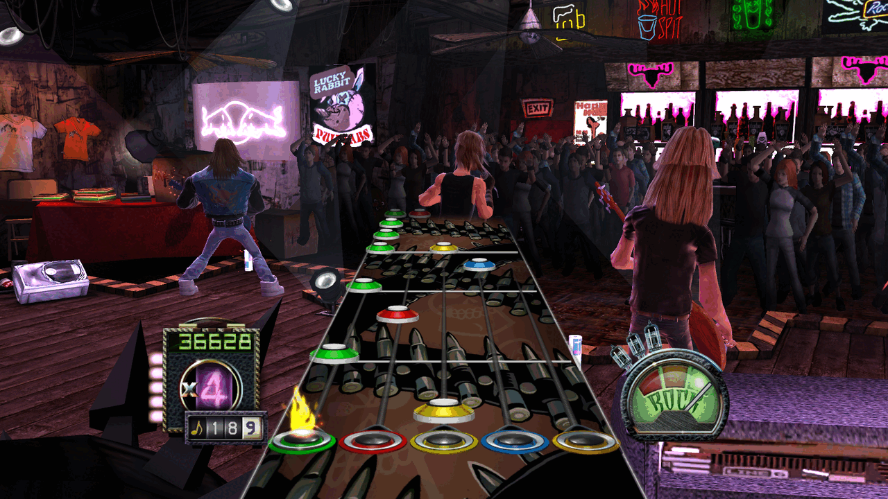
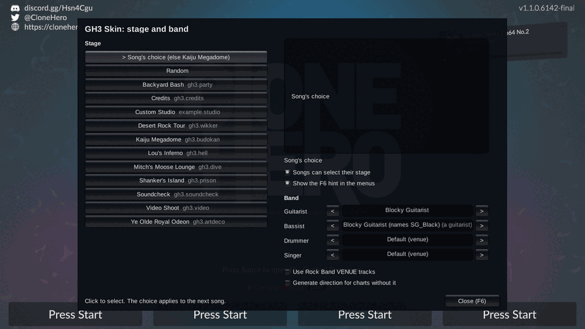
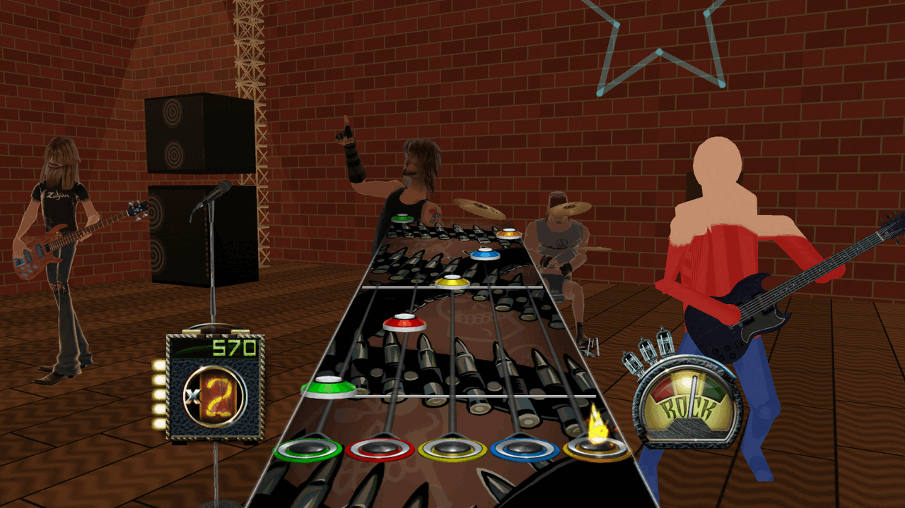

# GH3 gameplay skin for Clone Hero

This mod makes Clone Hero look and play like Guitar Hero III. It replaces the highway, the gems, the sustains, the hit effects, and the HUD with the GH3 art and animation. Behind the highway, it shows the GH3 venues with the band, the crowd, the cameras, the lights, and the effects. Songs from GH3 get their original direction, and other charts get direction from their GH or Rock Band venue tracks or from their sections. Players add stages and characters as single files, and creators make them in Blender.



| The F6 picker | A stage and a character made with the Blender add-on |
| --- | --- |
|  |  |

Status: release readiness. Nothing is published yet ([STATUS.md](docs/STATUS.md)).

## For players

[PLAYER-GUIDE.md](docs/PLAYER-GUIDE.md) tells you how to install the mod, select the stage and the band, and add stages and characters.

- You need Clone Hero **v1.1.0.6142-final** (64-bit) for Linux or Windows, and the release zip of the mod for your system. The install script installs MelonLoader 0.7.3 ([install steps](docs/PLAYER-GUIDE.md#1-install-the-mod)).
- macOS is not supported ([STATUS.md](docs/STATUS.md#platforms)).
- In the menus, push **F6** to select the stage and the band.
- Put stages (`.chstage`) in `Custom/Stages`, characters (`.chchar`) in `Custom/Characters`, and instruments (`.chinst`) in `Custom/Instruments` ([PLAYER-GUIDE.md section 6](docs/PLAYER-GUIDE.md#6-add-stages-characters-and-instruments)).
- Limits: one five-fret guitar player; landscape screens only ([STATUS.md](docs/STATUS.md#known-differences-from-gh3)).

## For creators

- [CREATOR-GUIDE.md](docs/CREATOR-GUIDE.md): make a stage and a character with the CH Stage Tools add-on for Blender, edit a GH3 venue, and add direction to charts.
- [examples/](examples/): an example stage and character (`.blend` and package, CC0-1.0).
- References: [BLENDER-ADDON.md](docs/BLENDER-ADDON.md) (the add-on), [PACKAGE-FORMAT.md](docs/PACKAGE-FORMAT.md) (the package files), [CUSTOM-CONTENT.md](docs/CUSTOM-CONTENT.md) (song direction and the stage-pack source format).

## For developers

Build and install from the repository. This needs your GH3 PC files and the tools of [PIPELINE.md](docs/PIPELINE.md):

```bash
MISE_QUIET=1 scripts/regenerate.sh --clean
MISE_QUIET=1 GH3_CLONE_HERO_DIR=<game folder> bash install.sh
MISE_QUIET=1 GH3_CLONE_HERO_DIR=<game folder> bash run-gh3-skin.sh
```

Run all tests with `MISE_QUIET=1 scripts/test.sh`. `scripts/build-release.sh` makes the release zips ([VERIFICATION.md](docs/VERIFICATION.md#release-build)).

| Document | Contents |
| --- | --- |
| [ARCHITECTURE.md](docs/ARCHITECTURE.md) | Runtime modules, pipeline, asset formats, data flow |
| [PIPELINE.md](docs/PIPELINE.md) | Make the assets and packages from the GH3 files |
| [VERIFICATION.md](docs/VERIFICATION.md) | Tests, screenshots, recordings, Windows tests, the release build, runtime variables |
| [PACKAGE-FORMAT.md](docs/PACKAGE-FORMAT.md) | Package format v1, the converter, and the C# importer |
| [BLENDER-ADDON.md](docs/BLENDER-ADDON.md) | The add-on: panels, code, round-trip results |
| [CUSTOM-CONTENT.md](docs/CUSTOM-CONTENT.md) | Song direction, Rock Band `VENUE` mapping, stage-pack source format |
| [PARITY-NOTES.md](docs/PARITY-NOTES.md) | GH3 facts: addresses, constants, scripts, formulas |
| [STATUS.md](docs/STATUS.md) | Platforms, current status, known differences from GH3, stability |
| [PACKAGING-PLAN.md](docs/PACKAGING-PLAN.md) | Record of the package plan, the decisions, and the spike results; what remains before a release |
| [ORCHESTRATOR-HANDOFF.md](docs/ORCHESTRATOR-HANDOFF.md) | How the work on this project is organized (agents, machine limits, environment) |

## License and credits

The code, tools, and documentation are MIT ([LICENSE](LICENSE)). The Blender add-on is GPL-3.0-or-later. The GH3 content and the BetterGH3 and FastGH3 art are not covered by these licenses.


The tap gems come from BetterGH3, and the cyan Star Power phrase gems and the highway rails come from FastGH3. [CREDITS.md](CREDITS.md) lists all third-party work and tools.

This is a non-commercial fan project. It is not affiliated with Activision, Neversoft, RedOctane, Harmonix, or the Clone Hero developers. The GH3 content comes from the owner's copy of the game. The repository has the prepared HUD and gem textures (`assets/`), but not the GH3 game files; the pipeline makes the venues, the band, and the other stage content from the GH3 files. The release zips contain these GH3-derived packages ([PACKAGING-PLAN.md](docs/PACKAGING-PLAN.md) decision 1).
