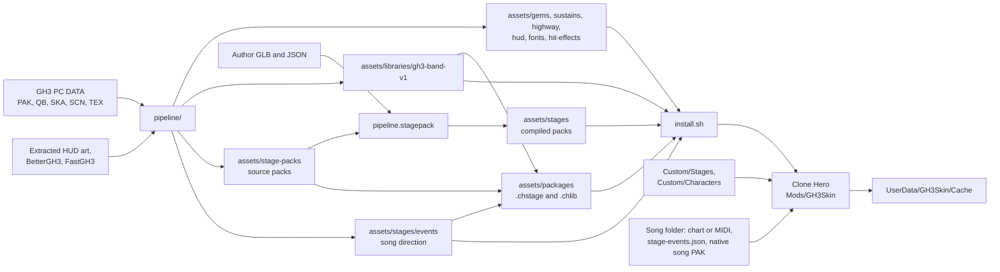
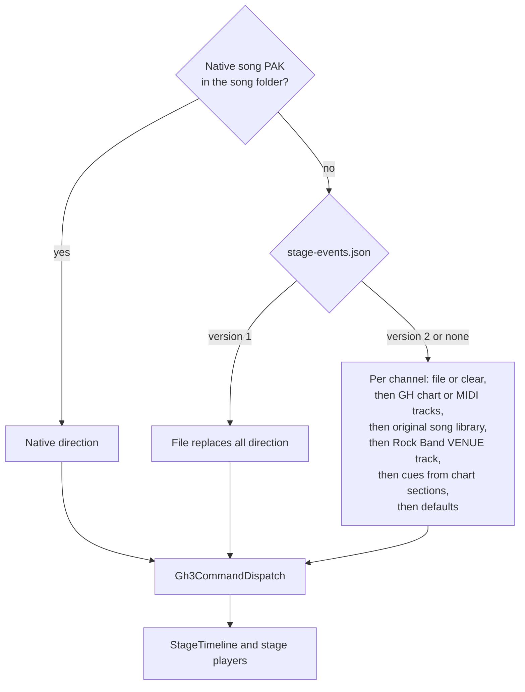

# Architecture

The project has two parts:

- **The mod** (`src/`, C#, MelonLoader on Il2Cpp Clone Hero). It replaces the gameplay art, draws the GH3 HUD, and renders a 3D GH3 stage with the band, crowd, lights, and effects behind the highway.
- **The pipeline** (`pipeline/`, Python). It converts the owner's GH3 PC files into textures, a shared band library, and stage packs. See [PIPELINE.md](PIPELINE.md).

## Runtime modules

`SkinMod` (`src/Gh3Skin.cs`) is the MelonLoader entry point. It checks the game version and platform (`GameCompatibility`), binds the obfuscated Clone Hero members (`CloneHeroBindings`), reads the test options (`SkinOptions`), loads textures once (`SkinAssets`), and creates the per-scene parts when the gameplay scene loads. A scene change or a backward jump of the song clock resets them. In the other scenes (the menus) it runs the stage and band picker (`PickerOverlay`).

| Folder | Contents |
| --- | --- |
| `src/` | `SkinMod`, `SkinAssets`, `SkinAssetPaths`, `SkinOptions`, `GameCompatibility`, `CloneHeroBindings`, `PreviewCapture` (timed screenshots), `FrameProfile` (`GH3_SKIN_PROFILE`), `BindingTrace` (`GH3_SKIN_TRACE`) |
| `src/Gameplay/` | `GameplayScene` (cached game objects), `GameplayStateReader` (score, streak, rock, and Star Power from the engine), `GameplaySpriteRenderer` (highway, gems, sustains, stock-effect hiding; split into `.Highway`, `.Gems`, `.Sustains` parts), `HighwayView` (GH3 camera and highway geometry), `BeatlineVisual`, `GemKind`, `GemAnimation`, `SustainBend` and `SustainVariant` (whammy bend, star whammy), `HitEffects` (GH3 2D hit particles) |
| `src/Hud/` | `GameplayHud` builds the HUD tree. Components: `HighwayHud`, `ReadyBannerHud`, `RockMeterHud` (`RockGaugeHud`, `StarPowerBulbsHud`), `ScorePanelHud` (`AmpHud`, `LampColumnHud`, `ComboHud`, `ComboDigitHud`), `MessageHud`, `HitEffectsHud`, `YouRockHud`. Pure state and animation classes (`HudState`, `RockMeterState`, `ComboReelAnimation`, `StarPowerBulbAnimation`, `StarPowerHighwayAnimation`, `IntroHudAnimation`, `YouRockAnimation`, `ReadyAnimationTrigger`, `HudTuning`, `HudViewport`) have no Unity calls; the logic tests use them |
| `src/Native/` | GH3 data and script engine: `Gh3Pak`, `Gh3Qb`, `Gh3QbText` (typed QB values), `Gh3Checksum`, `Gh3Song` (native song PAK), `Gh3ScriptCode` and `Gh3ScriptRuntime` (QB bytecode interpreter), `Gh3CommandDispatch`, `Gh3PcCommands`, `Gh3ComponentWait`, `Gh3Random` (GH3's RNG), `Gh3ScriptEvent` |
| `src/Packages/` | Package format v1 at runtime ([PACKAGE-FORMAT.md section 20](PACKAGE-FORMAT.md#20-c-importer)): `PackageManager` (scan, checks, cache keys, one import at a time on a background thread, song venue packages, cache clean-up), `PackageManifest`, `PackageSource` (zip or folder, SHA-256 checks), `GlbDocument`, `StageCompiler` and `StageGeometry` (port of `pipeline/stagepack`), `LibraryImporter`, `CharacterImporter` and `CharacterModel` (`.chchar` to a band model folder with GLB bind poses), `TextureCodec`, `Png`, `BlockCompression` (BC1/BC3), `PackageJson`, `PlayerChoices` (`UserData/GH3Skin/choices.json`), `StageSelection` and `NativeVenues` (stage of a song: player choice, song suggestion, GH3 career venue), and `PackageRuntime` (Unity glue: content folders, GPU formats, log lines, the saved choices). Only `PackageRuntime` uses Unity |
| `src/Menu/` | `PickerOverlay`: the stage and band picker, an IMGUI window that F6 opens in the menus ([PLAYER-GUIDE.md](PLAYER-GUIDE.md)). `PickerTest`: picker steps without a mouse for captures (`GH3_SKIN_PICKER_TEST`) |
| `src/Stage/` | `GameplayStage` (stage choice for each song, stage source: package cache or older install; band characters; stage camera, scene resources, per-frame update order), `StagePack` (compiled pack loader), `Shaders/` (GLSL sources for the bundles) |
| `src/Stage/Rendering/` | `StageAssets` (meshes, materials, translated GH3 templates, fallback surface model), `StageShader` (loads a bundle shader and stops the stage with an error when the graphics API has no program), `StageGh3Material` (template table and GH3 render state), `StageMaterialState`, `StageRenderControlState`, `StageTextureAnimation`, `StageUvWibble`, `StageTransparency`, `StageTriangleOrder`, `StageHighwayMask` |
| `src/Stage/Direction/` | Song direction: `StageTimeline` (cue evaluation on the song clock), `StageCue`, `StageChartReader` (chart and MIDI tracks), `StageRockBandVenue` (Rock Band `VENUE` track to GH3 cues) and `StageGeneratedDirection` (cues from chart sections), `StageNativeSong`, `StageSongDirection` (version 2 channels), `StageGh3Events`, `StageShowFlow` (intro and win sequences), `StageCameraPath` (GH3 camera cuts), `StageNoteHits` |
| `src/Stage/Band/` | `StageBand` (the library members or character packages on the role rigs), `StagePerformance`, `BandAnimation`, `StageGuitarArms` (DegenerateBlend tracks, Havok-style IK), `StageDrummer`, `StageHair`, `StageHandFire`, `StageLipSync` (singer mouth from the chart's vocals when the song has no GH3 facial clips) |
| `src/Stage/Crowd/` | `StageCrowd` (one impostor render texture per row), `StageCrowdState`, `StageCrowdPerformance` |
| `src/Stage/Lighting/` | `StageLighting`, `StageLightShowState`, `StageLightScene`, `StageLightSpatial`, `StageLightNative`, `StageLightTransition`, `StageLightingRenderer` (light-data texture), `StageBeamMotion`, `StageHousingRotation`, `StageFixtures` |
| `src/Stage/Particles/` | GH3 particle system: definitions, emission, motion, wind, LOD, visibility, render list and order, techniques, geometry, and batches (`StageParticles`) |
| `src/Stage/Effects/` | `StageEffects` (pyro, sparks, smoke, fireworks), Tesla, screen color, outlines, movies |
| `src/Stage/Scripts/` | `StageScripts`, `StageScriptState` (QB runtime bindings), `StageScriptBank`, `StageObjectState`, `StageActors`, `StageActorState`, `StageScriptActorState` |
| `src/Stage/Audio/` | `StageAudio`, `StageAudioState`, `StageAudioBackend` (Clone Hero's BASS library from `Application.dataPath/Plugins`, also `Plugins/x86_64` on Windows), `StageSoundBank` |
| `src/Spike/` | Packaging probes, off by default (`GH3_SKIN_SPIKE=textures`, `skinned`, `brotli`); see [docs/spike/](spike/) and [PACKAGE-FORMAT.md](PACKAGE-FORMAT.md#18-in-game-check-of-brotli) |

### Update order

`SkinMod.OnLateUpdate` reads the game state once. Then it updates the sprite renderer, the stage, the HUD, the hit effects, and the preview capture, in this order. `GameplayStage.Update` samples the timeline at `GameManager.songTime`, then the camera, band, crowd, lights, scripts, effects, particles, movies, screen effects, outlines, hand fire, and transparency sorting. All stage state uses the song clock. Thus pause holds the state and a seek rebuilds it.

### Il2Cpp constraints

Clone Hero is an Il2Cpp build. Many Unity methods are stripped or slow through the interop layer. Keep these rules:

- In per-frame loops, do not use Unity struct constructors or operators (`new Vector3(...)`, `+`, `*`). Use field initializers (`new Vector4 { x = ... }`) and `System.Numerics`. Particle batches compute in `System.Numerics` and upload once per frame.
- Do not use the public ranged `Mesh` overloads (`SetVertices(array, start, length)`, `SetIndices(...)`, `SetVertexBufferData`). They fail with "Method unstripping failed". Use `Mesh.SetArrayForChannelImpl`, `SetIndicesImpl`, and `InternalSetBoneWeights`.
- Also stripped: `Mesh.SetTriangles`, the `Color` indexer, `Vector4.Magnitude`, `BoneWeight1`, and Unity's `AudioSource`. Use `mesh.triangles`, named color fields, and the BASS backend.
- Use `AssetBundle.mainAsset` and `CommandBuffer.Internal_DrawMesh(..., null)`.
- `Shader.isSupported` is true also when Unity replaces a shader with its error shader (no program for the graphics API). `StageShader` checks the pass name `GH3` instead (`Material.GetPassName`). `Shader.FindPassTagValue` is stripped.
- Keep loaded shaders and textures with `HideFlags.DontUnloadUnusedAsset`. Stage cleanup runs in `OnApplicationQuit` and `OnDeinitializeMelon`.
- Background threads run only managed code without Unity or Il2Cpp objects: the package import thread and the clip prefetch (`Parallel.ForEach`). They hand results to the main thread through files, thread-safe collections, and a log queue that `PackageRuntime.Update` writes on the main thread. The main thread waits for the clip prefetch in the stage load, so no other mod code runs on it at the same time. A warm start starts no import thread.
- IMGUI: `GUI.DrawTexture` is stripped ("Method unstripping failed"). The picker draws images as `GUIStyle.normal.background` of a `GUI.Box`. `GUI.Box`, `Label`, `Button`, `Toggle`, `BeginScrollView`, `GUIStyle`, and `Event.current` work. The picker turns itself off after the first IMGUI exception.
- Linux: MelonLoader's hook library (Dobby) maps its hook pages with `MAP_FIXED` over memory in use, which crashed the game at random places (CoreCLR type loader, JIT, hook jumps). `HookPageGuard` runs first in `OnEarlyInitializeMelon` and moves these pages to the relocation table of `GameAssembly.so`. Keep it the first statement there. See [STATUS.md](STATUS.md#stability).

### Clone Hero bindings

The mod reads obfuscated members of Clone Hero `v1.1.0.6142-final` for Linux and Windows. One `Gh3Skin.dll` works on both:

- `GameCompatibility` rejects other versions and other platforms (`Application.platform` must be `LinuxPlayer` or `WindowsPlayer`).
- MelonLoader generates the interop assemblies for each game install. The mod compiles against the interop assemblies of one install (`install.sh` uses the target game). The interop type names and field names are the same on both platforms. Method names are not: Il2CppInterop names methods by position and caller count, and these are different in each build.
- Thus the source does not call obfuscated methods by interop name. `CloneHeroBindings` finds them at start by their obfuscated metadata name (`il2cpp_method_get_name` on each `NativeMethodInfoPtr_*`) and makes delegates. It also checks the metadata name of each obfuscated field that the mod reads. If a check fails, the mod logs the member and stays off.
- Add each new obfuscated member to `CloneHeroBindings` with its metadata name. Get the name with `tools/InteropMap`.

The member map and the evidence are in [PARITY-NOTES.md](PARITY-NOTES.md#clone-hero-bindings).

## Stage and band selection

`GameplayStage` decides once for each song (`StageSelection`) and logs `GH3 stage choice: <id> (<reason>)`. For each band role with a character in `choices.json`, `StageBand` loads the character's cache folder through `StageAssets` (the same renderer setup as the library members) on the role's rig: the character joints map to the rig bones by name (`CharacterModel.Map`), and the GLB inverse bind matrices are the mesh bind poses. The role's clips, hair, IK, and hand fire stay. When the character mesh has no instrument, `StageBand` also loads the instrument parts of the role's library band model (`BandAttachments`, the split rule of `pipeline/package/character.py`) on the same bones. A character that fails to load gives the venue default. The same decision sets the direction switches from `choices.json` (`StageChartReader.UseVenueTrack`, `UseGeneratedDirection`; the environment variables win) before the chart loads.

## Song direction sources

Native, converted, and authored commands share `Gh3CommandDispatch`. The Rock Band `VENUE` track becomes GH3 camera notes, lightshow moods, colors, blends, and lightshow notes 58 and 60, so it plays through the same players; the mapping is in [CUSTOM-CONTENT.md](CUSTOM-CONTENT.md#rock-band-venue-track). Authored GH3 script calls in charts use the text `gh3 ` followed by the JSON of `Gh3ScriptEvent.Encode`. The original song library matches the song by title and artist. The playable chart's tempo map always controls timing. The chart reader also makes `sing` cues (one per sung syllable, from `PART VOCALS` or `.chart` lyrics, channel `sing/singer`); `StageLipSync` uses them only when the singer has no `face` cue. See [CUSTOM-CONTENT.md](CUSTOM-CONTENT.md) for the formats.

## Asset formats

| File | Format |
| --- | --- |
| `assets/gems/`, `sustains/`, `highway/`, `hud/`, `hit-effects/` (`.png`, `.dds`) | Gem, sustain, highway, HUD, and hit-effect textures, one folder for each type ([assets/README.md](../assets/README.md)). The amp and multiplier `.dds` files in `hud/score/` are DXT5 blocks captured from GH3; `SkinAssets` uploads them without conversion. `SkinAssetPaths` has the folder of each file; `Mods/GH3Skin/assets/` has the same layout |
| `assets/fonts/*-font.json` + `.png` | GH3 font atlas and glyph table (`num_a9`, `num_a7`, `text_a6`, `text_a10_large`, `text_a1`) |
| `assets/hud/counter-tuning.json` | Measured streak-counter animation and placement values (`HudTuning`) |
| `*.chstage`, `*.chlib`, `*.chchar` | Packages ([PACKAGE-FORMAT.md](PACKAGE-FORMAT.md)). The mod converts them to `UserData/GH3Skin/Cache/<sha256>-i<importer>/` with the runtime files below; `textures/*.tex` (BC1, BC3, or RGBA32 with mips), `*.q48.br` clips, and `audio/*.pcm` replace the PNG, `.bin.gz`, and `.pcm.gz` files of the older install |
| `meshes.bin` | `GH3STG04` (static, 144-byte vertex: 60-byte stage vertex with lightmap, layer, and mask UVs, then GH3 UV sets 0–3, texcoord 4–5, binormal 0, position 1, binormal 1) or `GH3BND02` (skinned, 128-byte vertex: 56-byte vertex with four bone indices and weights, then UV sets 0–3, texcoord 4–5, binormal 0, tangent 0). Header: magic, mesh count; then per mesh: material ID, vertex count, index count, vertices, 32-bit indices |
| `stage.json` | Materials (texture, blend, cutoff, shading, lightmap, layer, mask, UV wibble, and the GH3 record `gh3`: template, constant banks, samplers, addressing, flags, blend, alpha reference, draw order), light groups, visibility groups, object pivots |
| `pack.json` | Compiled stage pack: ID, name, library, band placements, waypoints, effects, crowd, and SHA-256 of all source and compiled files |
| `cameras.json`, `lighting.json`, `scripts.json`, `actors.json`, `fixtures/` | Camera bank, light snapshots, typed script bank, skinned actors, light housings |
| `library.json`, `catalog.json` | Library file hashes; per-role bones, groups, layers, and clips |
| `direction/<role>/*.bin.gz` | Sampled animation clips at 30 fps |
| `movies/*.gh3video` | `GH3VID01` frame bank: width, height, frame count, rate, offsets, PNG frames |
| `render/*.bundle` | Unity AssetBundles with one shader each (stage, particle, Tesla, outline, screen color). Each shader has an OpenGL Core program and a Direct3D 11 program; Unity selects the program for the active graphics API. The passes have the name `GH3`. `install.sh` also copies them to `Mods/GH3Skin/render/`, which the mod uses first (packages carry no shaders) |
| `render/stage-templates.json` | Index and engine-register use of each translated GH3 template in `stage.bundle`. Install it with the bundle |

### Stage materials

Each GH3 material keeps its original template checksum, constant banks, samplers, and render state. `pipeline/gh3/shader.py` translates the D3D9 `vs_3_0` and `ps_3_0` bytecode of every used template from `MaterialLibrary.bin.xen` to GLSL. `pipeline.render.shaders` inserts one function per template into `Stage.glsl` and builds `stage.bundle`. At runtime `StageAssets` selects the template with `_Gh3Template.x` and applies GH3's material bind (`StageGh3RenderState`). A material without a translated template uses the stage surface model in `Stage.glsl` (unlit, ambient, or lit with lightmap, layer, and mask). Custom packs without GH3 records use this model.

### Shader programs for each graphics API

There is no Unity editor and no HLSL source. `pipeline.render.shaders` copies `Hidden/BlitCopy` from the installed Clone Hero and replaces its programs:

- **OpenGL Core** (Linux, Windows with `-force-glcore`): the GLSL text from `src/Stage/Shaders/` and a parameter blob, in the Linux `Hidden/BlitCopy` format.
- **Direct3D 11** (the Windows default): `pipeline/render/d3d11.py` translates the same GLSL. glslang makes SPIR-V, SPIRV-Cross makes HLSL, and Microsoft FXC makes shader model 4.0 DXBC. The program header comes from the Windows `Hidden/BlitCopy`. The parameter blob (constant buffers, variable offsets, texture and sampler slots) comes from the DXBC reflection. Unity's built-in matrices go to Unity's own constant buffers (`UnityPerDraw`, `UnityPerFrame`, `UnityPerCamera`) with Unity's sizes and offsets. The vertex inputs get Unity's bind channels (vertex 0, normal 1, tangent 2, color 3, texture coordinate *n* to channel 4 + *n*).

The GLSL sources have `#ifdef GH3_D3D11` blocks only where Direct3D 11 needs other code: the stage shader puts the surface values into the template output registers (shader model 4.0 has 16 vertex outputs), and the particle soft edge uses the Direct3D depth range (0 to 1, reversed Z) and `_ProjectionParams.x` for the flipped projection of render textures. The OpenGL program text is the same as before, except for these inactive blocks.

## Tests and tools

| Path | Contents |
| --- | --- |
| `tests/*.cs`, `tests/SkinLogic.Tests.csproj` | C# logic tests. They link the Unity-free source files. Optional variables (`GH3_PACK_ASSETS`, `GH3_NATIVE_DATA`, `GH3_*_ORACLE`, ...) add checks against real assets and native reference data |
| `tests/test_*.py` | Python pipeline tests |
| `schemas/*.schema.json` | JSON Schemas (draft 2020-12) of package format v1: manifest, venue sidecars, `character.json`, GLB extras. See [PACKAGE-FORMAT.md](PACKAGE-FORMAT.md) |
| `scripts/test.sh` | Runs both suites and shell syntax checks |
| `tools/Gh3SongTool/` | C# command-line tool: event export, song audit, chart export, QB dumps, one-field camera edit |
| `tools/audit-materials.py` | Template or fallback for each used material (`--stages` and `--library` also take package cache folders) |
| `tools/PackageImport/` | Runs the mod's package importer outside the game (`dotnet run --project tools/PackageImport -c Release -- PACKAGES CACHE [--rgba]`) |
| `tools/capture-manifest.py`, `tools/compare-captures.py`, `tools/compare-sheet.py`, `tools/summarize-profile.py` | Capture metadata, side-by-side comparison, contact sheets, profile summary |
| `tools/disassemble-ps.py` | Prints a GH3 pixel shader |
| `tools/gh3-reference/` | Start, drive, and stop the original GH3 under Wine for reference captures |
| `tools/MoonscraperAudit/` | Moonscraper preservation probe |
| `tools/rtmidi-stub.c` | Stub `libRtMidi.so` for Linux test games without an ALSA sequencer seat |
| `tools/InteropMap/` | Maps the interop names that the mod uses to obfuscated metadata names, field offsets, and method RVAs, for one or more game installs |
| `tools/native-offsets.py` | Compares a Linux and a Windows native method by the object offsets that they read |
