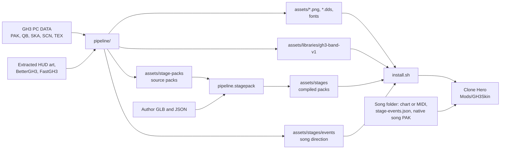
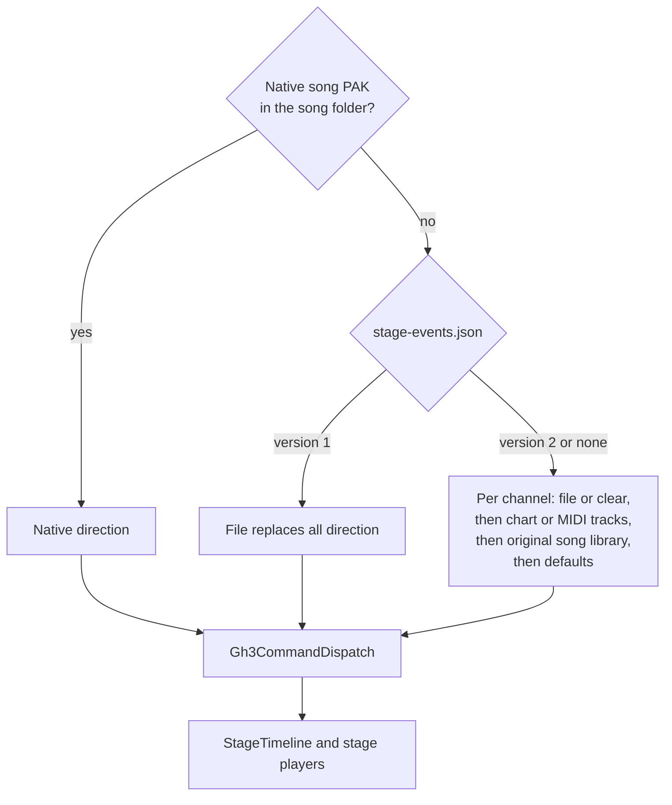

# Architecture

The project has two parts:

- **The mod** (`src/`, C#, MelonLoader on Il2Cpp Clone Hero). It replaces the gameplay art, draws the GH3 HUD, and renders a 3D GH3 stage with the band, crowd, lights, and effects behind the highway.
- **The pipeline** (`pipeline/`, Python). It converts the owner's GH3 PC files into textures, a shared band library, and stage packs. See [PIPELINE.md](PIPELINE.md).

## Runtime modules

`SkinMod` (`src/Gh3Skin.cs`) is the MelonLoader entry point. It checks the game version (`GameCompatibility`), reads the test options (`SkinOptions`), loads textures once (`SkinAssets`), and creates the per-scene parts when the gameplay scene loads. A scene change or a backward jump of the song clock resets them.

| Folder | Contents |
| --- | --- |
| `src/` | `SkinMod`, `SkinAssets`, `SkinOptions`, `GameCompatibility`, `PreviewCapture` (timed screenshots), `FrameProfile` (`GH3_SKIN_PROFILE`) |
| `src/Gameplay/` | `GameplayScene` (cached game objects), `GameplayStateReader` (score, streak, rock, and Star Power from the engine), `GameplaySpriteRenderer` (highway, gems, sustains, stock-effect hiding; split into `.Highway`, `.Gems`, `.Sustains` parts), `HighwayView` (GH3 camera and highway geometry), `BeatlineVisual`, `GemKind`, `GemAnimation`, `SustainBend` and `SustainVariant` (whammy bend, star whammy), `HitEffects` (GH3 2D hit particles) |
| `src/Hud/` | `GameplayHud` builds the HUD tree. Components: `HighwayHud`, `ReadyBannerHud`, `RockMeterHud` (`RockGaugeHud`, `StarPowerBulbsHud`), `ScorePanelHud` (`AmpHud`, `LampColumnHud`, `ComboHud`, `ComboDigitHud`), `MessageHud`, `HitEffectsHud`, `YouRockHud`. Pure state and animation classes (`HudState`, `RockMeterState`, `ComboReelAnimation`, `StarPowerBulbAnimation`, `StarPowerHighwayAnimation`, `IntroHudAnimation`, `YouRockAnimation`, `ReadyAnimationTrigger`, `HudTuning`, `HudViewport`) have no Unity calls; the logic tests use them |
| `src/Native/` | GH3 data and script engine: `Gh3Pak`, `Gh3Qb`, `Gh3QbText` (typed QB values), `Gh3Checksum`, `Gh3Song` (native song PAK), `Gh3ScriptCode` and `Gh3ScriptRuntime` (QB bytecode interpreter), `Gh3CommandDispatch`, `Gh3PcCommands`, `Gh3ComponentWait`, `Gh3Random` (GH3's RNG), `Gh3ScriptEvent` |
| `src/Stage/` | `GameplayStage` (stage camera, scene resources, per-frame update order), `StagePack` (compiled pack loader), `Shaders/` (GLSL sources for the bundles) |
| `src/Stage/Rendering/` | `StageAssets` (meshes, materials, translated GH3 templates, fallback surface model), `StageGh3Material` (template table and GH3 render state), `StageMaterialState`, `StageRenderControlState`, `StageTextureAnimation`, `StageUvWibble`, `StageTransparency`, `StageTriangleOrder`, `StageHighwayMask` |
| `src/Stage/Direction/` | Song direction: `StageTimeline` (cue evaluation on the song clock), `StageCue`, `StageChartReader` (chart and MIDI tracks), `StageNativeSong`, `StageSongDirection` (version 2 channels), `StageGh3Events`, `StageShowFlow` (intro and win sequences), `StageCameraPath` (GH3 camera cuts), `StageNoteHits` |
| `src/Stage/Band/` | `StageBand`, `StagePerformance`, `BandAnimation`, `StageGuitarArms` (DegenerateBlend tracks, Havok-style IK), `StageDrummer`, `StageHair`, `StageHandFire` |
| `src/Stage/Crowd/` | `StageCrowd` (one impostor render texture per row), `StageCrowdState`, `StageCrowdPerformance` |
| `src/Stage/Lighting/` | `StageLighting`, `StageLightShowState`, `StageLightScene`, `StageLightSpatial`, `StageLightNative`, `StageLightTransition`, `StageLightingRenderer` (light-data texture), `StageBeamMotion`, `StageHousingRotation`, `StageFixtures` |
| `src/Stage/Particles/` | GH3 particle system: definitions, emission, motion, wind, LOD, visibility, render list and order, techniques, geometry, and batches (`StageParticles`) |
| `src/Stage/Effects/` | `StageEffects` (pyro, sparks, smoke, fireworks), Tesla, screen color, outlines, movies |
| `src/Stage/Scripts/` | `StageScripts`, `StageScriptState` (QB runtime bindings), `StageScriptBank`, `StageObjectState`, `StageActors`, `StageActorState`, `StageScriptActorState` |
| `src/Stage/Audio/` | `StageAudio`, `StageAudioState`, `StageAudioBackend` (Clone Hero's BASS library), `StageSoundBank` |
| `src/Spike/` | Packaging probes, off by default (`GH3_SKIN_SPIKE=textures`, `skinned`, `brotli`); see [docs/spike/](spike/) and [PACKAGE-FORMAT.md](PACKAGE-FORMAT.md#18-in-game-check-of-brotli) |

### Update order

`SkinMod.OnLateUpdate` reads the game state once. Then it updates the sprite renderer, the stage, the HUD, the hit effects, and the preview capture, in this order. `GameplayStage.Update` samples the timeline at `GameManager.songTime`, then the camera, band, crowd, lights, scripts, effects, particles, movies, screen effects, outlines, hand fire, and transparency sorting. All stage state uses the song clock. Thus pause holds the state and a seek rebuilds it.

### Il2Cpp constraints

Clone Hero is an Il2Cpp build. Many Unity methods are stripped or slow through the interop layer. Keep these rules:

- In per-frame loops, do not use Unity struct constructors or operators (`new Vector3(...)`, `+`, `*`). Use field initializers (`new Vector4 { x = ... }`) and `System.Numerics`. Particle batches compute in `System.Numerics` and upload once per frame.
- Do not use the public ranged `Mesh` overloads (`SetVertices(array, start, length)`, `SetIndices(...)`, `SetVertexBufferData`). They fail with "Method unstripping failed". Use `Mesh.SetArrayForChannelImpl`, `SetIndicesImpl`, and `InternalSetBoneWeights`.
- Also stripped: `Mesh.SetTriangles`, the `Color` indexer, `Vector4.Magnitude`, `BoneWeight1`, and Unity's `AudioSource`. Use `mesh.triangles`, named color fields, and the BASS backend.
- Use `AssetBundle.mainAsset` and `CommandBuffer.Internal_DrawMesh(..., null)`.
- Keep loaded shaders and textures with `HideFlags.DontUnloadUnusedAsset`. Stage cleanup runs in `OnApplicationQuit` and `OnDeinitializeMelon`.

### Clone Hero bindings

The mod reads obfuscated fields of Linux Clone Hero `v1.1.0.6142-final` only. `GameCompatibility` rejects other versions before it reads them. The field map is in [PARITY-NOTES.md](PARITY-NOTES.md#clone-hero-bindings).

## Song direction sources

Native, converted, and authored commands share `Gh3CommandDispatch`. Authored GH3 script calls in charts use the text `gh3 ` followed by the JSON of `Gh3ScriptEvent.Encode`. The original song library matches the song by title and artist. The playable chart's tempo map always controls timing. See [CUSTOM-CONTENT.md](CUSTOM-CONTENT.md) for the formats.

## Asset formats

| File | Format |
| --- | --- |
| `assets/*.png`, `*.dds` | HUD, gem, sustain, highway, and hit-effect textures. The amp and multiplier `.dds` files are DXT5 blocks captured from GH3; `SkinAssets` uploads them without conversion |
| `assets/*-font.json` + `.png` | GH3 font atlas and glyph table (`num_a9`, `num_a7`, `text_a6`, `text_a10_large`, `text_a1`) |
| `assets/counter-tuning.json` | Measured streak-counter animation and placement values (`HudTuning`) |
| `meshes.bin` | `GH3STG04` (static, 144-byte vertex: 60-byte stage vertex with lightmap, layer, and mask UVs, then GH3 UV sets 0–3, texcoord 4–5, binormal 0, position 1, binormal 1) or `GH3BND02` (skinned, 128-byte vertex: 56-byte vertex with four bone indices and weights, then UV sets 0–3, texcoord 4–5, binormal 0, tangent 0). Header: magic, mesh count; then per mesh: material ID, vertex count, index count, vertices, 32-bit indices |
| `stage.json` | Materials (texture, blend, cutoff, shading, lightmap, layer, mask, UV wibble, and the GH3 record `gh3`: template, constant banks, samplers, addressing, flags, blend, alpha reference, draw order), light groups, visibility groups, object pivots |
| `pack.json` | Compiled stage pack: ID, name, library, band placements, waypoints, effects, crowd, and SHA-256 of all source and compiled files |
| `cameras.json`, `lighting.json`, `scripts.json`, `actors.json`, `fixtures/` | Camera bank, light snapshots, typed script bank, skinned actors, light housings |
| `library.json`, `catalog.json` | Library file hashes; per-role bones, groups, layers, and clips |
| `direction/<role>/*.bin.gz` | Sampled animation clips at 30 fps |
| `movies/*.gh3video` | `GH3VID01` frame bank: width, height, frame count, rate, offsets, PNG frames |
| `render/*.bundle` | Unity AssetBundles with one OpenGL shader each (stage, particle, Tesla, outline, screen color) |
| `render/stage-templates.json` | Index and engine-register use of each translated GH3 template in `stage.bundle`. Install it with the bundle |

### Stage materials

Each GH3 material keeps its original template checksum, constant banks, samplers, and render state. `pipeline/gh3/shader.py` translates the D3D9 `vs_3_0` and `ps_3_0` bytecode of every used template from `MaterialLibrary.bin.xen` to GLSL. `pipeline.render.shaders` inserts one function per template into `Stage.glsl` and builds `stage.bundle`. At runtime `StageAssets` selects the template with `_Gh3Template.x` and applies GH3's material bind (`StageGh3RenderState`). A material without a translated template uses the stage surface model in `Stage.glsl` (unlit, ambient, or lit with lightmap, layer, and mask). Custom packs without GH3 records use this model.

## Tests and tools

| Path | Contents |
| --- | --- |
| `tests/*.cs`, `tests/SkinLogic.Tests.csproj` | C# logic tests. They link the Unity-free source files. Optional variables (`GH3_PACK_ASSETS`, `GH3_NATIVE_DATA`, `GH3_*_ORACLE`, ...) add checks against real assets and native reference data |
| `tests/test_*.py` | Python pipeline tests |
| `schemas/*.schema.json` | JSON Schemas (draft 2020-12) of package format v1: manifest, venue sidecars, `character.json`, GLB extras. See [PACKAGE-FORMAT.md](PACKAGE-FORMAT.md) |
| `scripts/test.sh` | Runs both suites and shell syntax checks |
| `tools/Gh3SongTool/` | C# command-line tool: event export, song audit, chart export, QB dumps, one-field camera edit |
| `tools/audit-materials.py` | Template or fallback for each used material |
| `tools/capture-manifest.py`, `tools/compare-captures.py`, `tools/compare-sheet.py`, `tools/summarize-profile.py` | Capture metadata, side-by-side comparison, contact sheets, profile summary |
| `tools/disassemble-ps.py` | Prints a GH3 pixel shader |
| `tools/gh3-reference/` | Start, drive, and stop the original GH3 under Wine for reference captures |
| `tools/MoonscraperAudit/` | Moonscraper preservation probe |
| `tools/rtmidi-stub.c` | Stub `libRtMidi.so` for test games without an ALSA sequencer seat |
