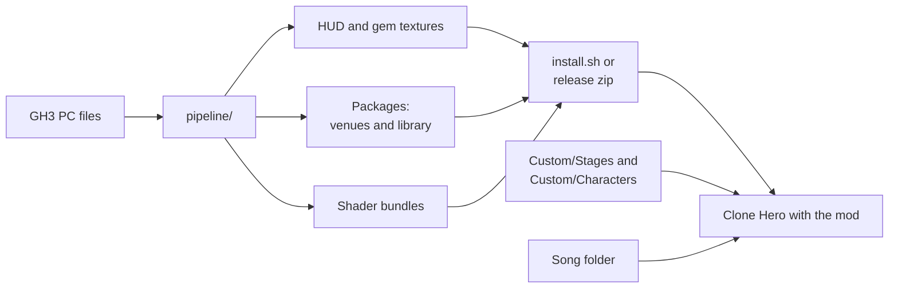
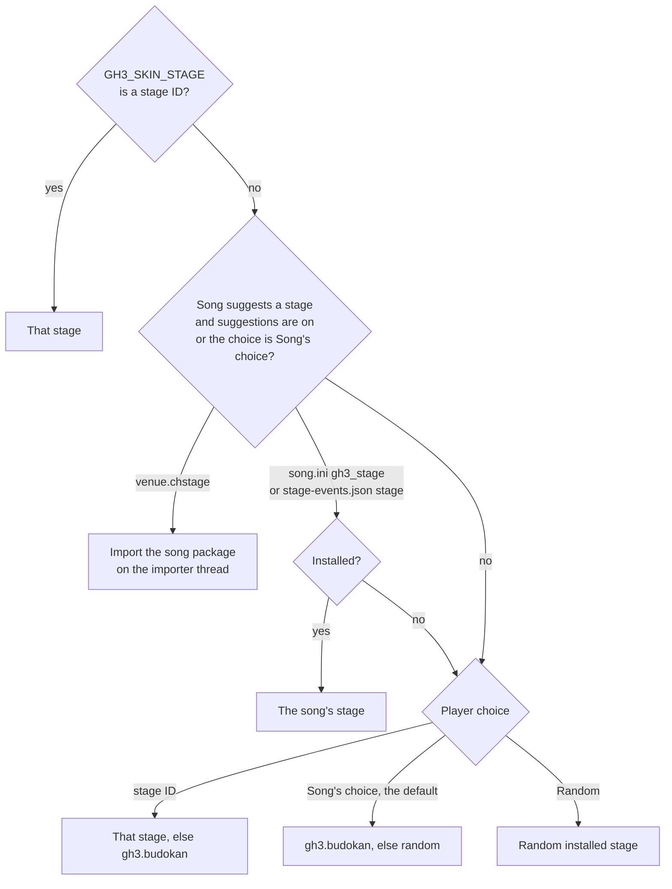
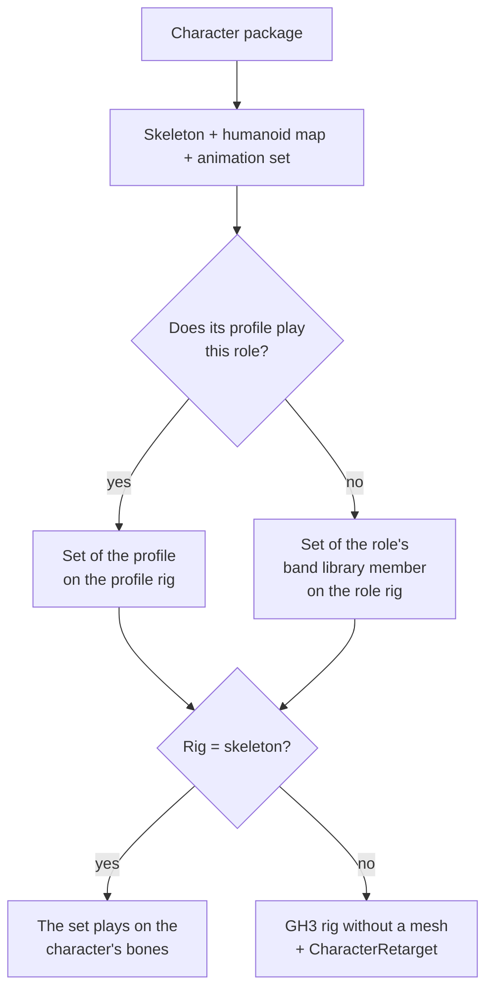
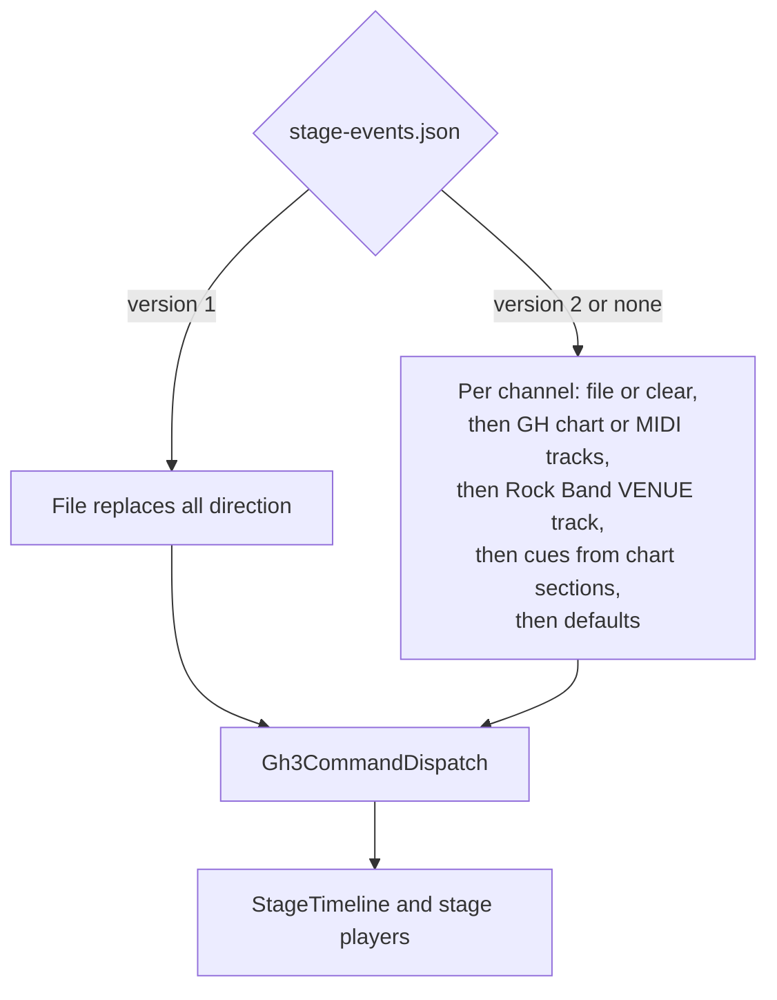

# Architecture

The project has two parts:

- **The mod** (`src/`, C#, MelonLoader on Il2Cpp Clone Hero). It replaces the gameplay art, draws the GH3 HUD, and renders a 3D GH3 stage with the band, crowd, lights, and effects behind the highway.
- **The pipeline** (`pipeline/`, Python). It converts the owner's GH3 PC files into textures, a shared band library, and stage packs. See [PIPELINE.md](PIPELINE.md).

Inside the pipeline, the venues go through editable source packs (`assets/stage-packs`) and compiled packs (`assets/stages`), and the band library through `assets/libraries`, before the converter writes the packages (`assets/packages`). See [PIPELINE.md](PIPELINE.md). The mod imports each package one time into `UserData/GH3Skin/Cache` and loads the stage from there ([PACKAGE-FORMAT.md section 20](PACKAGE-FORMAT.md#20-c-importer)).

## Runtime modules

`SkinMod` (`src/Gh3Skin.cs`) is the MelonLoader entry point. It checks the game version and platform (`GameCompatibility`), binds the obfuscated Clone Hero members (`CloneHeroBindings`), reads the test options (`SkinOptions`), loads the skin textures once (`SkinAssets`: worker threads decode the images, and the main thread uploads them a few milliseconds in each menu frame; the gameplay scene waits for the rest), and creates the per-scene parts when the gameplay scene loads. A scene change or a backward jump of the song clock resets them. In the other scenes (the menus) it runs the stage and band picker (`PickerOverlay`).

| Folder | Contents |
| --- | --- |
| `src/` | `SkinMod`, `SkinAssets`, `SkinAssetPaths`, `SkinOptions`, `SkinEnvironment` (every environment variable that the mod reads), `GameCompatibility`, `CloneHeroBindings`, `HookPageGuard` (Linux hook pages, see below), `PreviewCapture` (timed screenshots), `FrameProfile` (`GH3_SKIN_PROFILE`), `LoadTiming` (`GH3_SKIN_TIMING`, load phases), `BindingTrace` (`GH3_SKIN_TRACE`) |
| `src/Gameplay/` | `GameplayScene` (cached game objects), `GameplayStateReader` (score, streak, rock, and Star Power from the engine), `GameplaySpriteRenderer` (highway, gems, sustains, stock-effect hiding; split into `.Highway`, `.Gems`, `.Sustains` parts), `HighwayView` (GH3 camera and highway geometry), `BeatlineVisual`, `GemKind`, `GemAnimation`, `SustainBend` and `SustainVariant` (whammy bend, star whammy), `HitEffects` (GH3 2D hit particles). `GameplaySpriteRenderer` is split into partial files by part |
| `src/Hud/` | `GameplayHud` builds the HUD tree. Components: `HighwayHud`, `ReadyBannerHud`, `RockMeterHud` (`RockGaugeHud`, `StarPowerBulbsHud`), `ScorePanelHud` (`AmpHud`, `LampColumnHud`, `ComboHud`, `ComboDigitHud`), `MessageHud`, `HitEffectsHud`, `YouRockHud`. Pure state and animation classes (`HudState`, `RockMeterState`, `ComboReelAnimation`, `StarPowerBulbAnimation`, `StarPowerHighwayAnimation`, `IntroHudAnimation`, `YouRockAnimation`, `ReadyAnimationTrigger`, `HudTuning`, `HudViewport`, and the canvas sizes `HudCanvas`) have no Unity calls; the logic tests use them |
| `src/Gh3/` | GH3 data formats and the script engine for the package data (the mod does not read GH3 files), and the random generators, without Unity: `Gh3Qb`, `Gh3QbText` (typed QB values), `Gh3QbConstants` (QB value types, file layout, script opcodes), `Gh3Checksum`, `Gh3Keys` (named GH3 checksums), `Gh3ScriptCode` and `Gh3ScriptRuntime` (QB bytecode interpreter: the scheduler, `.Builtins` for the engine commands, `.Cursor` for statements and expressions), `Gh3CommandDispatch`, `Gh3PcCommands`, `Gh3ComponentWait`, `Gh3Random` (GH3's RNG), `XorShift32` and `PcgHash` (the mod's own repeatable random values), `Gh3ScriptEvent` |
| `src/Packages/` | Package format v1 at runtime ([PACKAGE-FORMAT.md section 20](PACKAGE-FORMAT.md#20-c-importer)): `PackageManager` (scan, checks, cache keys, one import at a time on a background thread, song venue packages, cache clean-up), `PackageManifest`, `PackageSource` (zip or folder, SHA-256 checks), `GlbDocument`, `StageCompiler` (partial files `.Direction`, `.Materials`, `.Actors`) and `StageGeometry` with `SkinnedVertex` (port of `pipeline/stagepack`), `LibraryImporter` (band library and character library), `CharacterImporter` and `CharacterModel` (`.chchar` to a band model folder with GLB bind poses), `CharacterSkeleton` and `HumanoidRoles` (a character's own skeleton, its humanoid map, and its face shapes; `HumanoidRoles` also has the humanoid and face bone names of the GH3 rigs), `CharacterLibrary` (the rig profiles of a character library), `LibraryRigs` and `RigData` (the rig data of the libraries: fixed profiles, rig points, IK chains, constraints; [PACKAGE-FORMAT.md section 10.2](PACKAGE-FORMAT.md#102-rig-data)), `TextureCodec` (GH3TEX02 package textures, copied into the cache), `Png`, `BlockCompression` (BC1/BC3 decoder for a GPU without these formats), `PackageJson`, `PlayerChoices` (`UserData/GH3Skin/choices.json`), `StageSelection` (stage and band suggestions of a song from its folder, and the stage choice), and `PackageRuntime` (Unity glue: content folders, GPU formats, log lines, the saved choices). Only `PackageRuntime` uses Unity |
| `src/Menu/` | `PickerOverlay`: the stage and band picker, an IMGUI window that F6 opens in the menus ([PLAYER-GUIDE.md](PLAYER-GUIDE.md)). `PickerTest`: picker steps without a mouse for captures (`GH3_SKIN_PICKER_TEST`) |
| `src/Stage/` | `GameplayStage` (stage camera, scene resources, per-frame update order; `.Sources`: stage choice for each song, the package cache folders, band characters and instruments; `.Debug`: debug views), `StagePack` (compiled pack loader, with the stage's `SmallVenue` flag and GH3 `Zone`), the shared constants `StageLimits` (validation limits), `StageTolerance` (vector tolerances), and `Gh3GameConstants` (GH3 health and tempo defaults, Unity render queues), `Shaders/` (GLSL sources for the bundles) |
| `src/Stage/Rendering/` | `StageAssets` (meshes, textures, skinning; `.Materials`: translated GH3 templates, fallback surface model, toon and hair layers), `StageDefinition` (`stage.json`), `StageParticleBatch` (the quad batches of particles, hand fire, and fallback effects), `StageShader` (loads a bundle shader and stops the stage with an error when the graphics API has no program), `StageGh3Material` (template table and GH3 render state), `StageToon` (toon settings and the hair-layer draw order of character materials), `StageMaterialState`, `StageRenderControlState`, `StageTextureAnimation`, `StageUvWibble`, `StageTransparency`, `StageTriangleOrder`, `StageHighwayMask` |
| `src/Stage/Direction/` | Song direction: `StageTimeline` (cue evaluation on the song clock), `StageCue`, `StageChartReader` (chart and MIDI tracks), `StageRockBandVenue` (Rock Band `VENUE` track to GH3 cues) and `StageGeneratedDirection` (cues from chart sections), `StageSongDirection` (version 2 channels), `StageShowFlow` (intro and win sequences), `StageCameraPath` (GH3 camera cuts), `StageNoteHits`; `Gh3NoteConstants` (GH3 camera, lightshow, drum, crowd, and fret notes, Rock Band VENUE notes) and `MidiConstants` (MIDI and chart values) |
| `src/Stage/Band/` | `StageBand` (the band members, with `.Characters` for the character model of each character package: the set on its rig, or the retarget to the character's skeleton), `CharacterMotion` (an animation set and the GH3 rig that it plays on: a band library member, or a character library profile with its clip offsets, hair, and IK), `StagePerformance` (the performance bank and `PerformancePlayer`), `PerformanceClip` (GH3CLP01 and q48 clips, the clip cache), `BandAnimation`, `StageGuitarArms` (DegenerateBlend tracks, Havok-style IK), `StageDrummer`, `StageHair` (the solver, `.Collision`, and `HairDefinition`), `StageHandFire`, `StageLipSync` (singer face from the chart's vocals when the song has no GH3 facial clips: `.Track`: notes, phonemes, and viseme keys; `.Life`: brows, squint, eyes, head nods; `.Shapes`: the measured GH3 face poses), `LyricPhonemes` (lyrics to phonemes with the CMU Pronouncing Dictionary resource `src/Resources/cmudict.br` and spelling rules; no Unity), `VocalEnvelope` (vocal stem loudness on a worker thread, cached; no Unity), `CharacterRetarget` (the GH3 pose on a character's skeleton, the GH3 face bones by name, and the gear that fits the body: instrument, microphone stand, drum kit; no Unity), `StageRetarget` and `CharacterFace` (the GH3 rig without a mesh, the anchors, the GH3 twist constraints of a GH3 rig, and the face blend shapes) |
| `src/Stage/Crowd/` | `StageCrowd` (one impostor render texture per row), `StageCrowdState`, `StageCrowdPerformance` |
| `src/Stage/Lighting/` | `StageLighting`, `StageLightShowState`, `StageLightScene`, `StageLightSpatial`, `StageLightNative`, `StageLightTransition`, `StageLightingRenderer` (light-data texture), `StageBeamMotion`, `StageHousingRotation`, `StageFixtures` |
| `src/Stage/Particles/` | GH3 particle system: definitions, emission, motion, wind, LOD, visibility, render list and order, techniques, geometry, and batches (`StageParticles`); `StageParticleConstants` (shared GH3 particle values) |
| `src/Stage/Effects/` | `StageEffects` (pyro, sparks, smoke, fireworks), Tesla, screen color, outlines, movies |
| `src/Stage/Scripts/` | `StageScripts`, `StageScriptState` (QB runtime bindings), `StageScriptBank`, `StageObjectState`, `StageActors`, `StageActorState`, `StageScriptActorState` |
| `src/Stage/Audio/` | `StageAudio`, `StageAudioState`, `StageAudioBackend` (Clone Hero's BASS library from `Application.dataPath/Plugins`, also `Plugins/x86_64` on Windows; also decodes the vocal stem of the lip sync with a decoding channel, which BASS permits on a worker thread), `StageSoundBank` |

The C# conventions (files, names, constants and their GH3 source notes, comments) are in [CODE-STYLE.md](CODE-STYLE.md#c).

### Update order

`SkinMod.OnLateUpdate` reads the game state once. Then it updates the sprite renderer, the stage, the HUD, the hit effects, and the preview capture, in this order. `GameplayStage.Update` samples the timeline at `GameManager.songTime`, then the camera, band, crowd, lights, scripts, effects, particles, movies, screen effects, outlines, hand fire, and transparency sorting. All stage state uses the song clock. Thus pause holds the state and a seek rebuilds it.

### Il2Cpp constraints

Clone Hero is an Il2Cpp build. Many Unity methods are stripped or slow through the interop layer. Keep these rules:

- In per-frame loops, do not use Unity struct constructors or operators (`new Vector3(...)`, `+`, `*`). Use field initializers (`new Vector4 { x = ... }`) and `System.Numerics`. Particle batches compute in `System.Numerics` and upload once per frame.
- Do not use the public ranged `Mesh` overloads (`SetVertices(array, start, length)`, `SetIndices(...)`, `SetVertexBufferData`). They fail with "Method unstripping failed". Use `Mesh.SetArrayForChannelImpl`, `SetIndicesImpl`, and `InternalSetBoneWeights`.
- Also stripped: `Mesh.SetTriangles`, the `Color` indexer, `Vector4.Magnitude`, `BoneWeight1`, and Unity's `AudioSource`. Use `mesh.triangles`, named color fields, and the BASS backend.
- Use `AssetBundle.mainAsset` and `CommandBuffer.Internal_DrawMesh(..., null)`.
- `Shader.isSupported` is true also when Unity replaces a shader with its error shader (no program for the graphics API). `StageShader` checks the pass name `GH3` instead (`Material.GetPassName`). `Shader.FindPassTagValue` is stripped.
- Keep loaded shaders and textures with `HideFlags.DontUnloadUnusedAsset`. Stage cleanup runs in `OnApplicationQuit` and `OnDeinitializeMelon`.
- Background threads run only managed code without Unity or Il2Cpp calls: the package scan thread, the two package import workers, the skin image decode (`SkinAssets`), the stage read-ahead (`StageModelPrefetch`: model folders, actor clips, and script banks of the song's stage load), and the clip prefetch (`Parallel.ForEach`). They may fill arrays of Unity structs (`Vector3`, `Color32`) with field initializers, which call nothing in Il2Cpp; a Unity struct constructor or method calls Il2Cpp and is not allowed there. They hand results to the main thread through files, tasks, thread-safe collections, and a log queue that `PackageRuntime.Update` writes on the main thread. The main thread waits for the clip prefetch in the stage load, so no other mod code runs on it at the same time. A warm start starts no import worker.
- IMGUI: `GUI.DrawTexture` is stripped ("Method unstripping failed"). The picker draws images as `GUIStyle.normal.background` of a `GUI.Box`. `GUI.Box`, `Label`, `Button`, `Toggle`, `BeginScrollView`, `GUIStyle`, and `Event.current` work. The picker turns itself off after the first IMGUI exception.
- Linux: MelonLoader's hook library (Dobby) maps its hook pages with `MAP_FIXED` over memory in use, which crashed the game at random places (CoreCLR type loader, JIT, hook jumps). `HookPageGuard` runs first in `OnEarlyInitializeMelon` and moves these pages to the relocation table of `GameAssembly.so`. Keep it the first statement there. See [STATUS.md](STATUS.md#stability).

### Clone Hero bindings

The mod reads obfuscated members of Clone Hero `v1.1.0.6142-final` for Linux and Windows. One `Gh3Skin.dll` works on both:

- `GameCompatibility` rejects other versions and other platforms (`Application.platform` must be `LinuxPlayer` or `WindowsPlayer`).
- MelonLoader generates the interop assemblies for each game install. The mod compiles against the interop assemblies of one install (`install.sh` uses the target game). The interop type names and field names are the same on both platforms. Method names are not: Il2CppInterop names methods by position and caller count, and these are different in each build.
- Thus the source does not call obfuscated methods by interop name. `CloneHeroBindings` finds them at start by their obfuscated metadata name (`il2cpp_method_get_name` on each `NativeMethodInfoPtr_*`) and makes delegates. It also checks the metadata name of each obfuscated field that the mod reads. If a check fails, the mod logs the member and stays off.
- Add each new obfuscated member to `CloneHeroBindings` with its metadata name. Get the name with `tools/InteropMap`.

The member map and the evidence are in [PARITY-NOTES.md](PARITY-NOTES.md#clone-hero-bindings).

## Stage and band selection

`GameplayStage` decides once for each song (`StageSelection`) and logs `GH3 stage choice: <id> (<reason>)`. The song's suggestions come only from its folder (`venue.chstage`, `song.ini`, `stage-events.json` `stage` and `characters`), never from its title or artist (PACKAGING-PLAN decision 16). A role that the player leaves at the default gets the character of `stage-events.json` `characters` when suggestions are on (`GH3 band <role>: <id> (the song's stage-events.json)`). For each band role with a character, `StageBand` loads the character with one model (PACKAGING-PLAN decision 15, [PACKAGE-FORMAT.md section 9.7](PACKAGE-FORMAT.md#97-character-model-and-band-roles)):

- **Skeleton and humanoid map.** A character without `skeleton` has the rig of its profile (a fixed profile: the role rig of the band library; a character library profile: the profile rig) and its added bones; its humanoid map comes from the GH3 bone names (`HumanoidRoles.FromGh3`). A character with `skeleton` has its GLB joints and `skeleton.humanoid`.
- **Animation set.** `CharacterMotion`: the set of a character library profile (clips from the library's `clips/` with the rest-pose offsets), or the set of a band library member (the venue default and the fixed profiles). In the role of its profile (and as the bassist for a guitarist profile, as GH3 co-op does) the character plays its own set; in other roles, the set of the role's band library member.
- **Direct.** When the rig of the set is the character's skeleton, `StageBand` builds the bones from that rig, scales the performer by the profile scale, and `PerformancePlayer` writes the poses to them. Nothing else touches the poses, so a GH3 character in its own role has the poses of `main` before the change, bit for bit (`[trace] pose` hashes). The character joints map to the rig bones by name (`CharacterChainRig.ByName`), and the GLB inverse bind matrices are the mesh bind poses.
- **Rig data.** The band code finds the bones by their use, not by GH3 bone names: `CharacterMotion` carries the rig points, the IK chains, and the constraints of the rig of its set (`catalog.json` for a band library member, `characters.json` for a profile). `StageGuitarRig` runs the IK chains (the strength of an arm chain follows its `hand`) and the constraints; `CharacterRetarget` takes the instrument, microphone, mouth, stick, and seat bones from the rig points. The humanoid map and the face bones of a GH3 rig come from the GH3 bone names in `HumanoidRoles` (decision 15). `DataGuardTests` keeps GH3 stage IDs, zones, character names, and bone names out of the other files of `src/` (PACKAGING-PLAN decision 16).
- **Retarget.** Else `StageBand` makes two rigs: the GH3 rig of the set without a mesh, which `PerformancePlayer` drives and which holds the instrument, and the character's skeleton, which `CharacterRetarget` sets each frame from the GH3 pose (also in the hair sampler at 120 Hz). A GH3 rig as the skeleton also gets its profile scale (a scaled parent node), its face bones from the GH3 face bones with the same names, and the GH3 twist constraints (`StageGuitarRig`). The drum kit and the microphone stand on the GH3 rig scale to the body, and the drummer's sticks follow the character's hands.

The venue default plays the band library member directly. The stage's `smallVenue` flag (placements.json) selects the small-stage intro and win animations (`StageShowFlow`), and its `zone` (scripts.json) is the GH3 zone name of the venue scripts and sounds (`StageScriptState`, `StageAudioState`); the log line `GH3 stage loaded: <name> (zone <zone>, small|normal venue intro and win)` shows both. The band library is the required library with a catalog (`PackageManager.BandLibrary`), not a library with a known ID. A character's own chains (`character.json` `bones`, `colliders`, `chains`) add Unity bones after the rig bones (`CharacterExtras`, `CharacterChainRig`), and `StageHair` simulates them after the profile hair, with collision against the character's capsules. The character's own instrument plays in the role of its profile; else `StageBand` loads the instrument parts of the role's library band model (`BandAttachments`, the split rule of `pipeline/package/character.py`) on the rig of the set. Camera anchors and hand fire use frames on the character's bones (`StageRetarget`); `CharacterFace` sets the blend shapes. A character that fails to load gives the venue default. The player's instrument (`choices.json` `instruments`, `GH3_SKIN_INSTRUMENT_*`) replaces the character's own instrument and the library instrument of its role; it binds to the rest pose of the performer's rig. `HighwayChoice` then gives `HighwayScroll` the highway image of the player's role: the chosen instrument's, else the character's, else the default. The same decision sets the direction switches from `choices.json` (`StageChartReader.UseVenueTrack`, `UseGeneratedDirection`; the environment variables win) before the chart loads.

## Song direction sources

The mod does not read GH3 song PAKs (`<song>_song.pak.xen`), also not in a song folder. The GH3 direction of a GH3 song is a version 2 `stage-events.json` in the song folder: `pipeline.events` reads the direction of the 159 GH3 songs from the GH3 data with `tools/Gh3SongTool`, and `pipeline.song_direction` writes one file for each song folder of a GH3 chart pack, aligned to the pack's charts (the release has one zip for each pack; [CUSTOM-CONTENT.md](CUSTOM-CONTENT.md#gh3-direction-for-gh3-charts)). The band library keeps only the shared clips that the files name. Original, converted, and authored commands share `Gh3CommandDispatch`. The Rock Band `VENUE` track becomes GH3 camera notes, lightshow moods, colors, blends, and lightshow notes 58 and 60, so it plays through the same players; the mapping is in [CUSTOM-CONTENT.md](CUSTOM-CONTENT.md#rock-band-venue-track). Authored GH3 script calls in charts use the text `gh3 ` followed by the JSON of `Gh3ScriptEvent.Encode`. The playable chart's tempo map always controls timing; the `beat` cues of a direction file (GH3 fretbars) set the band's tempo (`StageTimeline.TempoAt`). The chart reader also makes `sing` cues (one per sung syllable, from `PART VOCALS` or `.chart` lyrics, channel `sing/singer`); `StageLipSync` uses them only when the singer has no `face` cue. See [CUSTOM-CONTENT.md](CUSTOM-CONTENT.md) for the formats.

## Asset formats

| File | Format |
| --- | --- |
| `assets/gems/`, `sustains/`, `highway/`, `hud/`, `hit-effects/` (`.png`, `.dds`) | Gem, sustain, highway, HUD, and hit-effect textures, one folder for each type ([assets/README.md](../assets/README.md)). The amp and multiplier `.dds` files in `hud/score/` are DXT5 blocks captured from GH3; `SkinAssets` uploads them without conversion. `SkinAssetPaths` has the folder of each file; `Mods/GH3Skin/assets/` has the same layout |
| `assets/fonts/*-font.json` + `.png` | GH3 font atlas and glyph table (`num_a9`, `num_a7`, `text_a6`, `text_a10_large`, `text_a1`) |
| `assets/hud/counter-tuning.json` | Measured streak-counter animation and placement values (`HudTuning`) |
| `*.chstage`, `*.chlib`, `*.chchar` | Packages ([PACKAGE-FORMAT.md](PACKAGE-FORMAT.md)). The mod converts them to `UserData/GH3Skin/Cache/<sha256>-i<importer>/` with the runtime files below; `textures/*.tex` (GH3TEX02: BC1, BC3, or RGBA32 with mips, pre-encoded in the package and copied), `*.q48.br` clips, and `audio/*.pcm` replace the PNG, `.bin.gz`, and `.pcm.gz` files of the compiled packs in `assets/stages` and `assets/libraries`. The mod reads only the cache; the compiled packs are pipeline outputs that the converter and the tests read |
| `meshes.bin` | `GH3STG04` (static, 144-byte vertex: 60-byte stage vertex with lightmap, layer, and mask UVs, then GH3 UV sets 0–3, texcoord 4–5, binormal 0, position 1, binormal 1) or `GH3BND02` (skinned, 128-byte vertex: 56-byte vertex with four bone indices and weights, then UV sets 0–3, texcoord 4–5, binormal 0, tangent 0). Header: magic, mesh count; then per mesh: material ID, vertex count, index count, vertices, 32-bit indices |
| `stage.json` | Materials (texture, blend, cutoff, shading, lightmap, layer, mask, UV wibble, and the GH3 record `gh3`: template, constant banks, samplers, addressing, flags, blend, alpha reference, draw order), light groups, visibility groups, object pivots |
| `pack.json` | Compiled stage pack: ID, name, library, band placements, waypoints, effects, crowd, and SHA-256 of all source and compiled files |
| `cameras.json`, `lighting.json`, `scripts.json`, `actors.json`, `fixtures/` | Camera bank, light snapshots, typed script bank, skinned actors, light housings |
| `library.json`, `catalog.json` | Library file hashes; per-role bones, groups, layers, and clips |
| `direction/<role>/*.bin.gz` | Sampled animation clips at 30 fps |
| `movies/*.gh3video` | `GH3VID01` frame bank: width, height, frame count, rate, offsets, PNG frames |
| `render/*.bundle` | Unity AssetBundles with one shader each (stage, particle, Tesla, outline, screen color). Each shader has an OpenGL Core program and a Direct3D 11 program; Unity selects the program for the active graphics API. The passes have the name `GH3`. `install.sh` copies them to `Mods/GH3Skin/render/`, where the mod reads them (packages carry no shaders) |
| `render/stage-templates.json` | Index and engine-register use of each translated GH3 template in `stage.bundle`. Install it with the bundle |

### Stage materials

Each GH3 material keeps its original template checksum, constant banks, samplers, and render state. `pipeline/gh3/shader.py` translates the D3D9 `vs_3_0` and `ps_3_0` bytecode of every used template from `MaterialLibrary.bin.xen` to GLSL. `pipeline.render.shaders` inserts one function per template into `Stage.glsl` and builds `stage.bundle`. At runtime `StageAssets` selects the template with `_Gh3Template.x` and applies GH3's material bind (`StageGh3RenderState`). A material without a translated template uses the stage surface model in `Stage.glsl` (unlit, ambient, or lit with lightmap, layer, and mask). Custom packs without GH3 records use this model.

Character and instrument materials can also use the toon modes of the surface model ([PACKAGE-FORMAT.md section 6.5.1](PACKAGE-FORMAT.md#651-toon-materials-and-hair-layers)): mode 3 is cel shading from the band light row of the light-data texture (key direction, key and ambient color), and mode 4 is the outline, a second material on the same renderer that draws the back faces pushed out along the normal. The hair layers set the stencil state (`_StencilRef`, `_StencilComp`, `_StencilPass`, and the masks are material properties of the stage shader; the default leaves the stencil buffer unchanged) and the render queue: features 2001, hair 2002 or later. The GH3 outlines (`StageOutlines`) use stencil bit 0; the hair layers use bits 1–3.

### Shader programs for each graphics API

There is no Unity editor and no HLSL source. `pipeline.render.shaders` copies `Hidden/BlitCopy` from the installed Clone Hero and replaces its programs:

- **OpenGL Core** (Linux, Windows with `-force-glcore`): the GLSL text from `src/Stage/Shaders/` and a parameter blob, in the Linux `Hidden/BlitCopy` format.
- **Direct3D 11** (the Windows default): `pipeline/render/d3d11.py` translates the same GLSL. glslang makes SPIR-V, SPIRV-Cross makes HLSL, and Microsoft FXC makes shader model 4.0 DXBC. The program header comes from the Windows `Hidden/BlitCopy`. The parameter blob (constant buffers, variable offsets, texture and sampler slots) comes from the DXBC reflection. Unity's built-in matrices go to Unity's own constant buffers (`UnityPerDraw`, `UnityPerFrame`, `UnityPerCamera`) with Unity's sizes and offsets. The vertex inputs get Unity's bind channels (vertex 0, normal 1, tangent 2, color 3, texture coordinate *n* to channel 4 + *n*).

The GLSL sources have `#ifdef GH3_D3D11` blocks only where Direct3D 11 needs other code: the stage shader puts the surface values into the template output registers (shader model 4.0 has 16 vertex outputs), and the particle soft edge uses the Direct3D depth range (0 to 1, reversed Z) and `_ProjectionParams.x` for the flipped projection of render textures. The OpenGL program text is the same as before, except for these inactive blocks.

## Tests and tools

| Path | Contents |
| --- | --- |
| `tests/*.cs`, `tests/SkinLogic.Tests.csproj` | C# logic tests. They link the Unity-free source files. `LiteralGuardTests` fails on a new unnamed number without a source note in `src/Stage`, `Hud`, `Gameplay`, and `Gh3` ([CODE-STYLE.md](CODE-STYLE.md#c-constants)). `DataGuardTests` fails on a GH3 stage ID, zone, character name, or bone name in a string of `src/` ([CODE-STYLE.md](CODE-STYLE.md#data-not-code)). Optional variables (`GH3_PACK_ASSETS`, `GH3_NATIVE_DATA`, `GH3_*_ORACLE`, ...) add checks against real assets and native reference data. C# code style: [CODE-STYLE.md](CODE-STYLE.md#c) |
| `tests/test_*.py` | Python tests: pipeline, package format, Blender add-on without Blender (`tests/addon.py` loads the add-on modules), examples, the Markdown links, anchors, and diagram size (`test_docs_links.py`), the full colour of the documentation images (`test_docs_images.py`), the unnamed numbers in the format code (`test_magic_numbers.py`), and the `pipeline` names that tools and research scripts import (`test_pipeline_imports.py`). Python code style: [CODE-STYLE.md](CODE-STYLE.md#python) |
| `schemas/*.schema.json` | JSON Schemas (draft 2020-12) of package format v1: manifest, venue sidecars, `character.json`, GLB extras. See [PACKAGE-FORMAT.md](PACKAGE-FORMAT.md) |
| `scripts/test.sh` | Runs both suites, `ruff check` and `ruff format --check` (`ruff.toml`), `mypy` on the package format code (`mypy.ini`), and shell syntax checks |
| `scripts/build-release.sh` | Builds the release zips (Linux, Windows) and the Blender add-on zip from a clean export of a commit ([VERIFICATION.md](VERIFICATION.md#release-build)) |
| `install.sh`, `install-linux.sh`, `install-windows.ps1` | Development install (builds the mod), and the release installers for Linux and Windows |
| `tools/Gh3SongTool/` | C# command-line tool of the pipeline: the GH3 song PAK reader (`Gh3Song`, `Gh3Pak`, `Gh3SongEvents`), event export, song audit, chart export, QB dumps. It links the QB and script code of `src/Gh3` |
| `tools/audit-materials.py` | Template or fallback for each used material (`--stages` and `--library` also take package cache folders) |
| `tools/check-character-trace.py` | Compares the `[trace] band` poses of a game log with the GH3 clips on the GH3 skeletons ([VERIFICATION.md](VERIFICATION.md#gh3-characters)) |
| `tools/PackageImport/` | Runs the mod's package importer outside the game (`dotnet run --project tools/PackageImport -c Release -- PACKAGES CACHE [--rgba] [--workers N]`) |
| `tools/capture-manifest.py`, `tools/compare-captures.py`, `tools/compare-sheet.py`, `tools/summarize-profile.py` | Capture metadata, side-by-side comparison, contact sheets, profile summary |
| `tools/doc-image.py` | Documentation images in full colour ([images/README.md](images/README.md)) |
| `scripts/measure-load.sh`, `tools/measure-load.py`, `tools/summarize-load.py` | Load times of the user flows with `GH3_SKIN_TIMING` ([VERIFICATION.md](VERIFICATION.md#load-times)) |
| `tools/disassemble-ps.py` | Prints a GH3 pixel shader |
| `tools/gh3-reference/` | Start, drive, and stop the original GH3 under Wine for reference captures |
| `tools/MoonscraperAudit/` | Moonscraper preservation probe |
| `tools/rtmidi-stub.c` | Stub `libRtMidi.so` for Linux test games without an ALSA sequencer seat |
| `tools/InteropMap/` | Maps the interop names that the mod uses to obfuscated metadata names, field offsets, and method RVAs, for one or more game installs |
| `tools/native-offsets.py` | Compares a Linux and a Windows native method by the object offsets that they read |
| `tools/windows/` | `run-win.sh` and the `env.sh` template: run Windows Clone Hero under Wine for tests |
| `tools/hook-slots.py`, `tools/hook-page-sampler.py` | Examine MelonLoader's Dobby hook pages in a core dump or a live run ([STATUS.md](STATUS.md#stability)) |
| `tools/lipsync-shapes.py` | Measures the singer viseme, brow, and squint poses of the GH3 facial clips and writes `StageLipSync.Shapes.cs` |
| `tools/lipsync-dictionary.py` | Builds the compact CMU Pronouncing Dictionary resource (`src/Resources/cmudict.br`) |
| `tools/ClipBench/` | Clip codec measurements of the spike |
| `tools/research/` | Tools of finished investigations, kept as evidence ([README](../tools/research/README.md), [docs/spike/](spike/)) |
