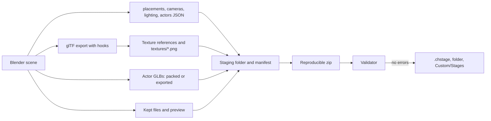

# Blender add-on: CH Stage Tools

Status: **venue tool set** (PACKAGING-PLAN step 5, parts 1 to 3). The add-on makes a venue from a template or opens a venue package, edits all venue data that [package format v1](PACKAGE-FORMAT.md) defines, validates it, and exports a `.chstage` package. Actors (animated scenery) are Blender armatures with their clips. The add-on has a script bank browser, a shot browser with GH3 proxy rigs for camera bone anchors, a live lighting preview with beams, and lists of visibility groups, light groups, and node flags. The ten GH3 venues open and export again without a loss (section 2.6).

## 1. For creators

### 1.1 Requirements

- Blender 4.2 LTS or later (Linux, Windows, or macOS). The add-on was tested with Blender 4.2.23 and 5.2.1.
- No internet connection and no other add-on are necessary.

### 1.2 Install

1. Get the file `chstage_tools-<version>.zip`. Do not extract it.
2. In Blender, open **Edit > Preferences > Get Extensions**.
3. Open the menu at the top right (the arrow), then click **Install from Disk**.
4. Select the zip file. Blender installs and enables the add-on.
5. Optional: open **Edit > Preferences > Add-ons > CH Stage Tools** and set **Custom/Stages folder** to the `Custom/Stages` folder of Clone Hero. Export can then copy the package into the game.

To remove the add-on, open **Edit > Preferences > Add-ons**, find **CH Stage Tools**, and click **Uninstall**.

### 1.3 Make a new stage

1. Click **File > New > New Stage from Template**, or open the 3D view sidebar (key **N**), click the tab **CH Stage**, and click **New**. The add-on makes a new scene with:
   - A floor, a back wall, two pillars, and one light fixture.
   - Four band placements with proxy bodies. A proxy body shows the size of a performer. It is not part of the package.
   - One waypoint (`guitarist_walk01`) and two emitters for each effect.
   - Two camera shots (`wide` and `guitar`).
   - Two stage lights (`Stage` and `Band`), the snapshots `fill` and `chorus`, and the moods `intro`, `blackout`, and `chorus`.
   - An empty script bank (`scripts.json`, a text block).
2. Change the scenery. Use usual Blender meshes and materials.
3. Set the package information: open **Stage Package > Package Information**. Set the ID, the name, the version, the authors, and the license.

### 1.4 Start from a package (for example a GH3 venue)

1. Click **File > Import > CH Stage Package (.chstage)**, or **Open** in the **CH Stage** tab.
2. Select a `.chstage` file. For a development folder, select its `manifest.json`.
3. The add-on makes a new scene with the name of the venue:
   - The scenery of `stage.glb` with its materials, lightmaps, and GH3 data.
   - The collection **Markers** (band placements, waypoints, effect emitters), the collection **Camera Shots** (one Blender camera for each shot point), and the collection **Lights**.
   - The collection **Actors**: one actor root (an empty) for each actor, with the actor model (armature and meshes) and its start clip (section 1.6).
   - The collection **GH3 Rig Proxies**: the GH3 band rigs at the band placements, when the GH3 library is available (section 1.8).
   - All settings in the panels: package information, crowd, camera notes, snapshots, moods, colors, and the script bank.
   - **Kept Package Files**: `scripts.json` (a text block) and the other files that the add-on does not make.
4. The scene camera is the first shot of the group `wide`. A GH3 venue opens in 1 to 19 seconds.

The `.blend` file holds all package data: the JSON files are text blocks, and the actor GLBs and other binary files are packed into the `.blend` file. Export does not need the source package after Open.

### 1.5 What you can set

| Where | Panel | Data |
| --- | --- | --- |
| 3D view sidebar, tab **CH Stage** | Stage Package | New, Open, add a marker, Validate, Export .chstage, issue list, last export |
| | Package Information | ID, version, name, description, license, permissions, authors, credits, required packages, preview (Render, Image, or None) |
| | Kept Package Files | The files that export writes again without a change (text or packed) |
| | Stage Object | Marker type: band placement (role), waypoint (name), effect emitter (pyro, sparks, fireworks, smoke), actor. For scenery: light group, visibility group and start state, light fixture, script object and its pivot (none, object origin, or custom values) |
| | Actor (actor or actor part selected) | Actor name, model file, model export, start clip, playback, clip rate, clips (show a clip, load all clips), light group, cue role, start visibility, created state, script object, startup script, animation events, scale, cue actions |
| | Actors | All actors of the scene; **Make Actor** |
| | Camera Shot (camera selected) | Shot name, type, control, tag, groups, anchor and look-at target, screen offset, write rotation, more points, orbit angle, angular speed, step time, step count, step direction, height ease, hand camera, key times, waypoints. A camera that is not a shot shows its point settings |
| | Camera Shots | Shot browser: filter by group and type, preview, later points; camera bone anchors and the GH3 rig proxies |
| | Stage Light (light selected) | Light ID, group, type, script object, override color, intensity, near, far, hotspot and field |
| | Lighting | Live lighting preview (a snapshot or a mood), beams; snapshots (light settings with specular, and beams), **Capture** and **Apply**, moods, color presets |
| | Script Bank | Objects, events, and values of `scripts.json`; jump to object; set a simple value |
| | Groups and Flags | Visibility groups, node flags, light groups (show, hide, select, show only), start state, color by light group |
| | Crowd and Camera Notes | Crowd roles and models, GH3 camera note selectors |
| Properties editor, tab **Material** | CH Stage Material | Shading (lit, ambient, unlit, not set), transparency (opaque, cutout, blend, additive), alpha cutoff, two-sided, color alpha (opaque GH3 materials), color scale, lightmap and its UV map, movie slot, sorted transparency, crowd atlas, crowd role, billboard, flipbook. "Kept GH3 data" lists the GH3 shader data that export keeps |

### 1.6 Actors (animated scenery)

An actor is a skinned model with clips, for example a stage diver, a dancer in a cage, or a turning sign. In Blender, an actor is an **actor root** (an empty with the marker **Actor**) with the actor model as its children: one armature and the skinned meshes. The clips are actions of the armature, one on each NLA track with the clip name.


- **Placement and scale.** Move, turn, and scale the actor root. Its world transform is the actor `transform` and its scale is the actor `scale` in `actors.json`.
- **Fields.** The **Actor** panel sets the `actors.json` fields: the start clip, playback (loop or hold), the light group, the cue role (for example `stage-diver/1`), the start visibility and the created state, the script object, the startup script, the animation-event table, and the cue actions (an action name and its clips, separated by commas).
- **Clips.** Open imports the clips that `actors.json` uses (the start clip and the action clips). The panel lists all clips of the model. Click a clip to show it (it becomes the active action and the scene frame range). Click **Load All Clips** to import the model again with all clips (changes to the Blender model of this actor are lost). The add-on preference **Open: import all actor clips** imports all clips at Open (a GH3 venue then needs more memory: up to 2.6 million keys for one Hell actor).
- **Clip rate.** The scene frame rate must be the clip rate (60 for the GH3 venue actors). Open sets it. Export of a Blender model uses the clip rate of the actor.
- **Model export.** **Automatic** writes the packed GLB of the opened package while the Blender model did not change. When you change the model (mesh, weights, bones, materials, or the loaded clips), export writes the Blender model. The panel shows which one export writes. **Packed GLB** and **Blender model** force one of them.
- **A Blender model** is exported with the safe glTF settings. Then the add-on applies the actor rules of the format: it removes the unit scale channels that Blender writes (PACKAGE-FORMAT 6.7) and reports other scale keys as errors, adds the clips that Blender did not import from the packed GLB, gives the images and materials their package names again (Blender adds `.001` when a name is in use), and embeds the images of GH3 texture references that Blender does not export.
- **A new actor.** Make a skinned model in Blender (an armature with child meshes and clips). Select the armature and click **Actors > Make Actor**. Set the actor name. Each clip must be an action on an NLA track (click **Push Down** in the action editor), or the active action. A clip starts at 0 s: export moves the first key of each clip to 0 s.

### 1.7 Script bank (scripts.json)

The script bank holds the GH3 scripts of a venue as typed values. The **Script Bank** panel is a browser, not a script editor:


- **Objects**: each entry of the node arrays (the GH3 objects of the venue) with its class, its type, and the Blender objects that have its script object name (scenery, fixtures, lights, actors). Click the arrow to select the Blender objects and show them in the 3D view.
- **Events**: the scripts that start: the bank startup scripts, the performance script, the trigger script of each node, the startup script of each stage object (`gh3ObjectScript`), and the script and animation events of each actor. A script shows its size; the add-on does not show or change GH3 script code.
- **Values**: the startup scripts, the performance script, and the definitions with a simple value.
- **Set a value**: the pencil button of a field changes a simple typed value (integer, number, text, vector, or checksum; a checksum takes a name or `0x` and 8 hex digits). The node name cannot change (it is the identity of the node). Script code, structures, and arrays cannot change.

The text block of `scripts.json` is also editable in the Blender text editor. Click the reload button of the panel after a change there. Names show as checksums; the panel shows the names that it knows (common GH3 field names, the bank names, and the Blender object names).


### 1.8 Camera tools

- **Shot browser**: the **Camera Shots** panel lists the shots of the scene. Filter them by group (menu) and by type. Click a shot to look through it in the 3D view (it becomes the scene camera). **Point 2**, **Point 3**, and so on look through the later points of a shot.
- **Camera bone anchors.** A camera with the anchor `head`, `hand_left`, `hand_right`, or `bone` moves with a performer bone in the game. When the GH3 library (`gh3-band-v1.chlib`) is available, Open loads the band rig of each band placement from it (`band/<role>/model.glb`), posed in the first frame of its first clip. Blender then shows each bone-anchored camera relative to that bone, and Validate gives no warning. The rig proxies are never exported.
- The add-on finds the library in the add-on preference **GH3 library (.chlib)**, or next to the opened package. **Load GH3 Rig Proxies** and **Remove Rig Proxies** load and remove the rigs later; the bone-anchored cameras keep their offset from the bone and move with it. Without the library, Blender shows the camera relative to the performer root, and Validate gives a warning for each bone anchor.


### 1.9 Lighting tools

- **Live lighting preview**: in the **Lighting** panel, turn on **Live lighting preview**. Select **Snapshot** to show the active snapshot, or a mood to show its snapshots (the arrow button shows the next snapshot of the mood). The 3D view goes to Material Preview with the scene lights and the scene world (EEVEE). A change of a snapshot setting shows at once.
- The preview sets the color and the power of the Blender lights, and a preview world. A stage light lights only the objects of its light group (Blender light linking). Ambient lights and fill lights (full intensity up to 20 m and more) give the ambient color of the world. The preview is an approximation: GH3 lights fade linearly from near to far, Blender lights use the inverse square law. Turn the preview off to get the scene world back. Export does not change.
- **Beams**: **Show beams** draws the beams of the previewed snapshot (cones in the beam color, from the start radius to the end radius over the range) and the beam axis of each fixture housing. The arrow on the active beam of the snapshot changes its range.
- **Color by light group**: in **Groups and Flags**, it colors the scenery by light group (Solid shading, object color).


### 1.10 Groups and node flags

The **Groups and Flags** panel lists the visibility groups (with their start state), the node flags (hidden at start, not created at start, light fixtures, script objects), and the light groups. For each group: show or hide (the eye), select, and show only this group. **Start State** shows the scenery as the game starts it; **Show All** shows all scenery. The eye changes only the 3D view: export writes hidden objects too.


### 1.11 Validate

Click **Validate**. The add-on writes the package into a temporary folder and runs the package validator of the mod on it. The list shows the errors and the warnings. Click the arrow button of an issue to select its object.

### 1.12 Export and play

1. Click **Export .chstage** (or **File > Export > CH Stage Package (.chstage)**).
2. Select the file name. The default is `<package ID>.chstage`.
3. Options:
   - **Development folder**: also write the unpacked package to `unpacked/<name>.chstage` next to the zip.
   - **Copy to Custom/Stages**: also copy the package into the `Custom/Stages` folder (the add-on preferences, or the folder in the option).
   - **Preview**: **Render** makes a 512 × 288 image from the scene camera (Workbench); **Image** uses an image; **None** writes no preview.
4. The add-on validates the package. It writes the package only when there is no error. The issue list shows the result.
5. Put the `.chstage` file into `Custom/Stages` (or use **Copy to Custom/Stages**). Group subfolders are permitted.

Export gives the same bytes for the same scene and Blender version (fixed zip times, sorted files, preview without date chunks).

### 1.13 Rules to know

- Blender is Z up. The package uses Y up. The add-on converts the data. Do not rotate the scene.
- A performer looks toward Blender −Y (the front view looks at the performer's face).
- A camera shot uses the Blender camera: its position, its direction, and its horizontal field of view. Set the render size to 16:9 (the template uses 1920 × 1080).
- **Camera anchors.** A camera with the anchor `guitarist.root` moves with the guitarist placement. A bone anchor uses the rig proxy bone (section 1.8). The add-on keeps the anchor and the offset: an anchored camera that you do not move exports the same offset, and a camera that you move exports its new offset from the anchor.
- A camera point without **Write rotation** has no rotation in `cameras.json`; the game aims it at the look-at target. Blender aims it at the rig bone, or at 1.5 m above the target performer root.
- **Lightmaps.** Set the lightmap image and its UV map in the material panel. The UV map must be the second UV map of the mesh (glTF `TEXCOORD_1`); Validate gives an error when it is not. Export puts the lightmap into the node tree as the glTF occlusion texture.
- The beam axis of a light fixture housing is its local −Y axis. A snapshot beam takes its position and its direction (local −Z, as a Blender spot light) from its beam object when you click **Capture**.
- Every snapshot must have settings for every stage light. Use **Capture** after you add a light.
- The moods `intro` and `blackout` are necessary. The group `wide` must have one shot.
- **Unchanged data stays the same.** After Open, export writes each row (a shot, a light, a snapshot, a material, a node, an actor) of the opened package again without a change while its Blender data did not change. A row that you change is written from the Blender data, with float32 precision. An actor model that does not change is the packed GLB, byte for byte.
- Blender can rename objects, materials, images, and actions when you open a package into a `.blend` file that has the same names (`floor.001`). Export uses the names of the package again.
- GH3 texture references (`#<image name>`) to images that Blender does not export (the GH3 shader samplers) become PNG files in `textures/` of the package (stage) or embedded images (actor GLB).

### 1.14 Not available yet

- Characters (`.chchar`) in Blender.
- Material preview node trees (GH3 shading in the viewport).
- GH3 script code: the script bank browser shows and sets values only.

## 2. For developers

### 2.1 Files

| Path | Contents |
| --- | --- |
| `blender/chstage_tools/blender_manifest.toml` | Extension manifest (`blender_version_min = "4.2.0"`) |
| `blender/chstage_tools/properties.py` | Property groups. Each group maps to one package file (table below). Add-on preferences (Custom/Stages folder, GH3 library, import all actor clips) |
| `blender/chstage_tools/sidecars.py` | Builds `manifest.json`, `placements.json`, `cameras.json` (with the rig anchor frames), `lighting.json`, `actors.json`, and the `gh3*` extras from plain data, and reads them back (`open_*`). `Keeper` (section 2.5). The light power of the lighting preview. No `bpy`; the tests use it without Blender |
| `blender/chstage_tools/collect.py` | Reads the scene into plain data, exports `stage.glb`, and has the glTF export hooks |
| `blender/chstage_tools/package_export.py` | Export .chstage and Validate: writes all package files, texture files, preview, manifest, zip; runs the validator |
| `blender/chstage_tools/package_open.py` | Open .chstage: GLB import with fixes, sidecars into the property groups, kept files. Has the glTF import hooks |
| `blender/chstage_tools/materials.py` | Lightmap node tree (glTF occlusion texture), vertex alpha for the 4.2 exporter, image bytes |
| `blender/chstage_tools/glb_tools.py` | GLB read and write, GLB fixes before import, PNG text chunk removal; actor GLB edits (keep clips, drop unit scale channels, merge clips by joint name, rename clips, restore names, embed images). No `bpy` |
| `blender/chstage_tools/actor_tools.py` | Actors: import (with the used clips), linked copies for equal GLBs, the model fingerprint, export of a Blender model with the actor rules |
| `blender/chstage_tools/blobs.py` | Package files packed into the `.blend` file (bytes in a custom property of a text block) |
| `blender/chstage_tools/rig.py` | Joint frames of a library band model in the first key of its first clip (camera bone anchors). No `bpy` |
| `blender/chstage_tools/camera_tools.py` | Library search, proxy rigs, re-anchoring of the cameras, shot browser |
| `blender/chstage_tools/script_bank.py` | Index of `scripts.json` (objects, events, simple values) and value edits. No `bpy` |
| `blender/chstage_tools/scripts_ui.py` | Script bank browser rows, jump to object, value edits in the text block |
| `blender/chstage_tools/lighting_tools.py` | Lighting preview (lights, world, light linking), beam overlay (draw handler), beam range gizmo |
| `blender/chstage_tools/groups.py` | Light groups (with the color overlay), visibility groups, node flags, start state |
| `blender/chstage_tools/gltf_io.py` | Safe glTF import and export settings, and the Blender 4.2 import fix |
| `blender/chstage_tools/template.py` | The template scene, snapshot capture and apply |
| `blender/chstage_tools/operators.py`, `panels.py` | Operators and panels |
| `blender/build.py` | Copies `pipeline/package` (validator, container, decisions) and `schemas/` into `chstage_tools/vendor/package_format/` and writes the zip |
| `blender/test.sh`, `blender/tests/blender_test.py`, `tools_test.py` | Headless test in Blender: template, validate, export, open, round trip of the template and of one GH3 venue, and the venue tools (packed files, actors, script bank, lighting preview, shot browser, proxy rigs, groups) |
| `blender/tests/actor_export.py`, `actor_compare.py` | Export every actor model of venue packages from Blender, and compare the actor GLBs with the source and compile them (section 2.6) |
| `blender/roundtrip.sh`, `blender/tests/roundtrip.py`, `roundtrip_summary.py` | Round trip of all venue packages, one Blender process each, with a Markdown summary |
| `blender/tests/screenshots.py`, `screenshots_package.py`, `screenshots_tools.py` | Panel screenshots; Open and Export screenshots; venue tool screenshots (need a window) |
| `pipeline/package/container.py` | JSON bytes, hashes, and the reproducible zip writer that the converter and the add-on share |
| `pipeline/package/compare.py` | Compares two packages by meaning (`python -m pipeline.package.compare A B`) |
| `tests/test_blender_addon.py`, `tests/test_blender_addon_tools.py` | Tests without Blender (part of `scripts/test.sh`) |

The add-on and the converter use one validator and one zip writer. `pipeline/package` uses relative imports and has no other repository dependency, so `build.py` copies it without changes. The copy is not in git.

### 2.2 Property map

The layout follows the package files, so that export and Open map one to one.

| Blender data | Package file and field |
| --- | --- |
| `scene.chstage.package` | `manifest.json` (`files` and `entry` come from the export) |
| `object.chstage.marker` = `BAND`, `WAYPOINT`, `EFFECT` | `placements.json` `band`, `waypoints`, `effects` (object world transform) |
| `object.chstage.marker` = `ACTOR`, `object.chstage.actor` | `actors.json` row (actor root world transform and scale); the actor GLB: the packed GLB (`actor.blob`) or the exported children of the root |
| `scene.chstage.crowd` | `placements.json` `crowd` |
| `object.chstage.shot` (camera), `object.chstage.point` (camera or empty), `scene.chstage.camera_notes` | `cameras.json` `shots`, `groups`, `notes` |
| `object.chstage.light` (light), `scene.chstage.snapshots`, `moods`, `colors` | `lighting.json` |
| `object.chstage` scenery fields | `stage.glb` node extras `gh3LightGroup`, `gh3VisibilityGroup`, `gh3InitiallyVisible`, `gh3Fixture*`, `gh3Object*` |
| `material.chstage` | `stage.glb` material extras `gh3*` and glTF `alphaMode`, `alphaCutoff`, `doubleSided`, `occlusionTexture`, base color alpha (opaque) |
| `material.chstage.kept_extras`, `kept_images` | Other `gh3*` material extras (`gh3Shader`, `gh3SourceMaterial`, `gh3MaskTexture`, `gh3LayerTexture`, `gh3LayerColor`, `gh3UvWibble`) and the Blender image of each texture reference |
| `scene.chstage.kept_files` | Other package files (`scripts.json`, other files): text blocks or packed data (`blobs.py`) |
| `scene.chstage.anchor_frames` | The bone frames of the proxy rigs (JSON, runtime coordinates, relative to the performer roots) for the camera bone anchors |
| `scene.chstage.script_rows` | Rows of the script bank browser (made from the `scripts.json` text block) |
| `kept`, `order`, `source_name` (objects, materials, list items) | Source rows, package order, and package names of an opened package (section 2.5) |

The glTF export hooks (`glTF2ExportUserExtension` in `__init__.py`) write the `gh3*` extras, the glTF material fields, and the package names during an add-on export only. They remove the add-on property groups from the extras of every glTF export. The glTF import hooks (`glTF2ImportUserExtension`) map glTF node, material, and image indices to the Blender data during Open only.

### 2.3 Export



- glTF export settings: `gltf_io.EXPORT_OPTIONS` (spike 9.6), the selected scenery only (no markers, actors, or proxy rigs), no cameras and lights, `export_vertex_color="ACTIVE"`. Objects that the viewport hides are shown while the exporter runs (it exports only selected objects, and a hidden object cannot be selected).
- Before the export, `materials.sync_lightmap` makes the occlusion node chain (image, Separate Color, glTF Material Output group) for each material with a lightmap. The glTF exporter gives a texture the `TEXCOORD` index of its UV map in the mesh, so the lightmap UV map must be the second one.
- During the export, `materials.vertex_alpha_for_export` links the vertex color alpha to the shader alpha. Without it, the Blender 4.2 exporter writes `COLOR_0` without alpha for opaque materials (seen on `gh3.soundcheck` and `gh3.artdeco`).
- `package_export.finish_glb` keeps `#<name>` for images that Blender exported and writes the other referenced images to `textures/<name>.png` (PACKAGE-FORMAT 6.6).
- The preview render saves and restores the render settings and removes the PNG text and time chunks.

### 2.4 Open

- The add-on changes a copy of `stage.glb` before the import, so that the Blender importer keeps all data. The exporter writes the same triangles again:
  - `separate_faces`: a triangle that repeats the vertices of an earlier triangle (GH3 back faces and copies; Blender drops it), and a triangle with two corners at one position (Blender then gives all faces at that vertex a default normal, up to 90° wrong) get their own vertex copies.
  - `fill_texcoord_gaps`: the importer reads `TEXCOORD_n` only up to the first missing set. GH3 meshes have `TEXCOORD_3` (mask UV) without `TEXCOORD_1` and `TEXCOORD_2`. The add-on adds the missing sets with zeros; export then writes them as zeros.
  - `normalize_normals`: 12 GH3 meshes (prison, hell, budokan, party) have normals that are not unit length. The Blender 4.2 importer turns their custom normals up to 38° wrong. The add-on makes them unit length (glTF requires it, and Blender exports unit normals).
  - The 4.2 custom attribute fix (section 2.8).
- Images that no material socket uses (the GH3 shader samplers) are not imported by the glTF importer. The add-on packs them into the `.blend` file from the GLB.
- The add-on removes the `gh3*` custom properties that the importer makes from extras and sets the property groups.
- **Rigs.** When the GH3 library is available (the preference, or `gh3-band-v1.chlib` next to the package), Open loads `band/<role>/model.glb` for each band placement with its first clip, sets the pose of the first key, and removes the clip. `rig.anchor_frames` reads the joint frames of that pose from the GLB itself (glTF to runtime: negate Z), so the camera math does not depend on the Blender bone axes. The frames go into `scene.chstage.anchor_frames` before the cameras open; Open and Export use the stored frames, also when the library moves later.
- **Actors.** For each `actors.json` row, Open makes an actor root at the transform and scale, packs the GLB (`blobs.store`, one text block for equal GLBs), and imports the GLB with only the clips that the row uses (`glb_tools.keep_animations`) and without bone shapes. An actor with the same GLB bytes as an earlier actor gets linked copies (shared meshes, armature, and actions). Each action gets its clip name (`chstage_clip`) from its NLA track: Blender names an action `clip.001` when the name is in use, and the 4.2 importer names it `clip_Armature`. After the Keeper record, `actor_tools.fingerprint` stores a hash of the model (hierarchy, transforms, mesh data, weights, materials, bones, clip keys).
- All other package files (not JSON) are packed into the `.blend` file. A `.blend` file of add-on 0.1 still reads its kept files from the source package.

### 2.5 Unchanged rows (`sidecars.Keeper`)

Blender stores transforms and settings in float32, and the add-on writes rounded numbers. Thus a computed row is close to the source row, but not equal. The Keeper gives an exact round trip:

1. Open stores the source row on its owner (`kept` JSON: object, material, or list item).
2. Open then computes each row from the new Blender data with the export code (Keeper mode `record`) and stores it next to the source row.
3. Export computes each row again. When it is equal to the stored row, nothing changed in Blender, and export writes the source row. Else export writes the computed row.

Rows: placements (each marker, each crowd item), shots (with all points), camera groups, camera notes, lights, snapshots, moods, colors, actors, node extras, material data. `keep_source=False` on the export operator turns the Keeper off (tests).

Actor models use the same idea with the model fingerprint: while the fingerprint is the one of Open (or of **Load All Clips**), export writes the packed GLB, byte for byte. A changed model goes through `actor_tools.export_model`: the glTF export of the actor root children (the root at the identity while the exporter runs) with the safe settings, `export_animation_mode="NLA_TRACKS"` (the `ACTIONS` mode also exports the actions of other actors with the same bone names) and `export_anim_slide_to_zero` (the importer puts each clip strip at the scene start frame, one frame after the clip start), then the clip names, the unit scale channel removal, the clips that Blender did not import (`glb_tools.merge_animations`, by joint name, from the packed GLB), the image and material names, and the images of texture references (each with a glTF texture, because the pipeline compiler finds `#<name>` through the textures). The `actor_models` option of the export operator (hidden) forces the packed GLB or the Blender model for every actor (tests).

### 2.6 Round trip of the GH3 venues

Method: `blender/roundtrip.sh` opens each package of `assets/packages/` in a new Blender process (Open .chstage), exports it without edits (Export .chstage, the Keeper on), exports it again (same bytes?), and compares the export with the source package (`pipeline.package.compare`). A second export with the Keeper off shows what the Blender data alone gives. Date: 2026-10-09, Blender 5.2.1 and 4.2.23.

The comparison checks:

- All files: the same paths (plus `textures/*.png`), `manifest.json` equal except `files`, all JSON files JSON-equal, all other files byte-equal.
- `stage.glb`: nodes by name (world transform, PACKAGING-PLAN 9.6 limits: 0.1 mm, 0.01°, scale 1e-4; extras equal), materials by name (glTF fields with their defaults; extras equal, with texture references resolved to the image bytes), and mesh primitives by node and material (triangles in a canonical order; every vertex attribute: POSITION 0.1 mm, NORMAL 1°, TEXCOORD 1e-5, COLOR 2.5/255, `_GH3_*` 1e-5; added attributes only when all zero).
- The validator on the export: errors and warnings.

Result (2026-10-09, after part 3: actors imported, GH3 rig proxies loaded from `assets/packages/gh3-band-v1.chlib`, all files packed): **all 11 packages pass on both Blender versions.** Sidecars (`placements.json`, `cameras.json`, `lighting.json`, `actors.json`), `scripts.json`, the actor GLBs (byte-equal), `manifest.json`, node extras, and material extras are equal; the validator gives 0 errors and 0 warnings; a second export gives the same bytes. The 24 bone-anchored camera points (artdeco, budokan, hell, prison, video, wikker) open on the rig bones and export their source offsets.

| Package | Nodes | Materials | Primitives | Node rotation max (°) | NORMAL max (°) | COLOR_0 max (/255) | GLB images → exported + `textures/` | Open / export (s), 5.2.1 | Open / export (s), 4.2.23 | Max RSS 5.2.1 (MB) |
| --- | ---: | ---: | ---: | ---: | ---: | ---: | --- | --- | --- | ---: |
| `example.studio` | 5 | 1 | 5 | 0 | 0.00 | 0.69 | 0 → 0 + 0 | 0.9 / 0.1 | 0.8 / 0.1 | 496 |
| `gh3.artdeco` | 349 | 65 | 322 | 2e-05 | 0.75 | 1.05 | 70 → 46 + 24 | 6.0 / 2.5 | 12.7 / 2.4 | 1091 |
| `gh3.budokan` | 503 | 89 | 527 | 3e-05 | 0.69 | 1.05 | 99 → 73 + 26 | 5.4 / 2.9 | 14.8 / 3.3 | 1069 |
| `gh3.credits` | 100 | 13 | 82 | 0 | 0.10 | 1.00 | 19 → 14 + 5 | 0.7 / 0.5 | 0.6 / 0.5 | 536 |
| `gh3.dive` | 353 | 103 | 329 | 9e-06 | 0.75 | 1.05 | 123 → 87 + 36 | 5.1 / 2.6 | 13.5 / 3.0 | 1134 |
| `gh3.hell` | 405 | 100 | 394 | 1e-05 | 0.69 | 1.05 | 108 → 78 + 30 | 7.8 / 3.9 | 16.5 / 4.2 | 1588 |
| `gh3.party` | 252 | 68 | 214 | 2e-05 | 0.60 | 1.05 | 86 → 62 + 24 | 4.3 / 1.9 | 10.7 / 2.0 | 931 |
| `gh3.prison` | 389 | 74 | 376 | 2e-05 | 0.44 | 1.05 | 101 → 64 + 37 | 6.8 / 2.9 | 18.3 / 2.9 | 1196 |
| `gh3.soundcheck` | 239 | 59 | 220 | 6e-06 | 0.32 | 1.00 | 81 → 53 + 28 | 2.3 / 1.2 | 5.7 / 1.4 | 743 |
| `gh3.video` | 388 | 93 | 367 | 2e-05 | 0.78 | 1.05 | 117 → 80 + 37 | 4.0 / 2.3 | 9.8 / 2.5 | 978 |
| `gh3.wikker` | 420 | 93 | 413 | 3e-05 | 0.62 | 1.05 | 110 → 71 + 39 | 5.9 / 2.8 | 18.6 / 2.8 | 1050 |

Open takes up to 3.2 s (5.2.1) longer than in part 2 (actor import with the used clips, four rigs) and up to 0.3 GB more memory (hell: 1,287 → 1,588 MB).

POSITION, TEXCOORD, and `_GH3_*` differ by 0 in all packages. Node positions differ by 0. All triangles survive. No normal of a triangle with area differs by more than 1°.

Differences that remain, and why:

| Difference | Where | Why |
| --- | --- | --- |
| `COLOR_0` up to 1.05/255 | All venues | Blender stores vertex colors as 8-bit sRGB; the package has 8-bit linear values |
| NORMAL up to 0.78° | All venues | Blender stores custom normals in its own encoding. Normals of triangles without area (0–117 for each venue) are not compared: they do not show, and Blender gives them a default normal |
| Normal length | 12 meshes (prison, hell, budokan, party) | The source normals are not unit length; Blender writes unit normals (the comparison uses the directions) |
| `TEXCOORD_1`, `TEXCOORD_2` added, all zero | Primitives with `TEXCOORD_3` only (7 in `gh3.credits`, also in other venues) | Blender cannot have gaps in UV maps (section 2.4) |
| Texture references `#<name>` → `textures/<name>.png` | 5–39 images for each venue | Blender exports only images that a material socket uses (PACKAGE-FORMAT 6.6). The image bytes are equal |
| Vertex order and count, primitive split, glTF defaults written or not | All venues | Blender rebuilds the vertex buffers; the triangles and their data are the same |
| Zip size | −0.2 % to +1.0 % (GH3 venues) | Other GLB layout, PNG files outside the GLB |

Export from the Blender data only (Keeper off) is the path of an edited row. Its differences to the source rows: numbers within 2.3e-6 in the sidecars and within 3e-8 in the node extras (float32 and rounding to 6 digits), and keys with default values that the add-on does not write (`handCam`, `disableOrbit1`, `disableOrbit2`: false; `waypoints`: []; note `tag` and `type`: ""; `overrideColor`, `gh3FixtureFixedPosition`: false; `gh3ObjectScript`: ""). The compiler (`pipeline/stagepack/pack.py`) and the runtime (`StageCameraPath.cs` `OriginalCameraShot`, `StageLighting.cs`) read each missing key as the same default (false, empty node list, empty string; a shot without `waypoints` matches all nodes, as `[]` does).

Check on the compiled runtime data: the source package and the Keeper-off export of artdeco, dive, hell, and credits, compiled with the pipeline compiler and compared by meaning (materials by `gh3SourceMaterial`, textures by PNG bytes, objects by ID, fixtures by script object). The only differences are numbers within 2.3e-6 and the default keys above (`/tmp/opencode/addon-export/evidence/compiled-edited-path.txt`).

A missing `gh3Shading` is not the same as `lit`: the mod then draws the material without the stage surface model (`StageMaterial.ShadingMode` −1). The material panel has the shading value **Not set** for it; Open uses it for the 58 GH3 materials without `gh3Shading`. (Before this fix, an edited material of that kind became `lit`; `compiled-edited-path-before-fix.txt` shows it.)

Evidence: `/tmp/opencode/addon-tools/evidence/roundtrip/` (`summary.md`, one JSON report for each package and Blender version); part 2: `/tmp/opencode/addon-export/evidence/`. Command:

```sh
TMPDIR=~/.cache/addon-tools/tmp flock /tmp/opencode/gh3-heavy.lock bash blender/roundtrip.sh ~/.cache/addon-tools/rt "blender-clean $HOME/.cache/blender/blender-4.2-clean"
```

The outputs are about 1.2 GB for each Blender version. Use a disk folder, not `/tmp` (a RAM disk on this machine).

**Edited actors (the Blender model path).** `blender/tests/actor_export.py` opens each venue with actors and exports every actor model from Blender (`actor_models="BLENDER"`, the path of a changed model). `blender/tests/actor_compare.py` compares each actor GLB with the source and compiles the package with the pipeline venue compiler (`compile_stage`, which runs `compile_actor`). 29 actors in 8 packages, both Blender versions, the same numbers:

| Check | Result (maximum over all actors) |
| --- | --- |
| Export | All 8 packages written, validator 0 errors and 0 warnings; export of the actor models 0.1–15.7 s |
| Pipeline compiler (`compile_actor`) | All 8 packages compile |
| Clip names | Equal (no clip lost, none added); 0 scale channels |
| Clip keys, sampled at the source key times | Translation 3.3e-6 m, rotation 0.00041° |
| Joints, inverse bind matrices | Joint position 1.8e-6 m, rotation 0.00041°; inverse bind matrices 7.2e-6 |
| Skinned vertices in the bind pose and the first key of each clip | 3.0e-6 m (928,899 vertex poses; 49,266 have no partner at the 0.01 mm rounding of the bind position) |
| Triangles (by corner positions, 0.1 mm) | 104,015 in both; 4 artdeco triangles have no source triangle at 0.1 mm (not examined further); corner normals 0.43° |
| Mesh attributes (`pipeline.package.compare`) | POSITION and `_GH3_*` 0, COLOR_0 1.0/255, except `ven_artdeco_knight1`: its coincident two-sided cards pair wrongly in the 1 mm sort of the compare tool (the triangle and vertex checks above pass) |
| Materials | All by name, extras equal |

The joint order and the vertex order differ (Blender rebuilds them), so the compiled `actors/*` files are not byte-equal. Evidence: `/tmp/opencode/addon-tools/evidence/actors/` (`export-*.jsonl`, `compare-*.jsonl`, `summary.txt`).

### 2.7 Build and test

```sh
python3 blender/build.py                      # writes blender/dist/chstage_tools-<version>.zip
flock /tmp/opencode/gh3-heavy.lock bash blender/test.sh ~/.cache/chstage-test blender-clean ~/.cache/blender/blender-4.2-clean
```

`blender/test.sh` installs the zip into a temporary Blender user folder (`BLENDER_USER_RESOURCES`), so it does not change the Blender setup of the user. It also opens, exports, and compares `assets/packages/gh3.credits.chstage` when it exists (`CHSTAGE_TEST_VENUE` selects another package; an empty value turns it off), and then tests the venue tools (`tools_test.py`; `CHSTAGE_TEST_SKIP=actors,scripts,lighting,cameras,groups` skips parts). Set `CHSTAGE_TEST_RIG` to a GH3 rig GLB (for example a spike file from `tools/spike-blender/band_glb.py`) to also test the import fix. Result on 2026-10-09: 60 of 60 checks pass on Blender 5.2.1 and on Blender 4.2.23:

- Part 2 (30 checks): template, validate, export with folder and Custom/Stages copy, preview render, lightmap on `TEXCOORD_1`, bone anchor, reproducible export, open, template round trip with and without the Keeper, an edit after open, `gh3.credits` round trip.
- Packed files: `example.studio` opens from a copy, the copy is deleted, and export gives the source package.
- Actors: armature, mesh, and clip `turn` at 60 fps; not in `stage.glb`; a placement and field edit changes only that `actors.json` row and keeps the GLB bytes; a mesh edit exports the Blender model (valid, clip `turn`, no scale channel); a forced Blender model export is valid; the undone edit gives the packed GLB again; **Load All Clips**; **Make Actor**.
- Script bank (`gh3.credits`): 96 objects, 96 rows; jump to object; events (startup, trigger scripts, object startup scripts); a vector edit changes exactly its three numbers in `scripts.json`; the node name cannot change; the value set back gives the source bank.
- Lighting preview (`gh3.credits`): lights and preview world; a live intensity change doubles the light power; mood preview; one beam cone for each beam; off gives the scene world back; the export after the preview is equal to the export before it.
- Camera tools (template): group and type filters; preview sets the scene camera; the rigs of the four roles load from the library; the bone-anchored `guitar` camera moves to the rig bone and keeps its exported offset, without the bone warning; the rigs are proxies (never exported); removing the rigs puts the camera back.
- Groups (template): the visibility group with its start state; show, hide, and start state; hidden objects are still exported; light group colors; the fixture flag.

Python tests without Blender (`tests/test_blender_addon_tools.py`, in `scripts/test.sh`): rig joint frames and anchor names, the library rig head height, bone anchors with and without rig frames, re-anchoring, `actors.json` of all packages through open and build, edited actor rows and scale axes, actor GLB edits (keep clips, unit scale channels, merge by joint name, images), the script bank index of `gh3.dive` (all node rows, events, labels, references), value edits and their errors, and the preview light power.

Screenshots (real Blender window in a nested Xwayland display, `gh3.prison`): `/tmp/opencode/addon-tools/evidence/screenshots/blender-clean/` and `blender-4.2-clean/` (`panel-actor.png`, `panel-script-objects.png`, `panel-script-events.png`, `panel-shots-rig.png`, `panel-lighting-preview.png`, `panel-groups-overlay.png`).

### 2.8 Blender 4.2 result

The Blender round trip of the spike (`tools/spike-blender/`, [report](spike/blender.md)) ran again with the portable Blender 4.2.23 LTS (glTF add-on 4.2.83). Guitarist and singer, maximum of the two:

| Variant | Joint local T (mm) 5.2.1 / 4.2 | Joint local R (°) | IBM max | world·IBM − mesh | GH3 clip on rig (cm) | Exported clip (cm) |
| --- | --- | --- | --- | --- | --- | --- |
| `default-default` | 0.00053 / 0.00053 | 0.00032 / 0.00032 | 8.1e-6 / 8.1e-6 | 7.3e-7 / 7.3e-7 | 7.4e-5 / 7.4e-5 | 1.1 / 1.1 |
| `fps30-keep` (recommended) | 0.00053 / 0.00053 | 0.00032 / 0.00032 | 8.1e-6 / 8.1e-6 | 7.3e-7 / 7.3e-7 | 7.4e-5 / 7.4e-5 | 0.00014 / 0.00014 |
| `blend-keep` | 0.00053 / 0.00053 | 0.00032 / 0.00032 | 8.1e-6 / 8.1e-6 | 7.3e-7 / 7.3e-7 | 7.4e-5 / 7.4e-5 | 1.1 / 1.1 |
| `temperance-default` | 2200 / 2200 | 180 / 180 | 2.6 / 2.6 | 6.5e-6 / 6.5e-6 | 210 / 210 | 1.1 / 1.1 |
| `default-flatten` | 2200 / 2200 | 180 / 180 | 8.1e-6 / 8.1e-6 | 1e-6 / 1e-6 | 230 / 230 | 1.1 / 1.1 |
| `default-posed-frame` | 680 / 680 | 140 / 140 | 8.1e-6 / 8.1e-6 | 2.2 / 2.2 | 100 / 100 | 100 / 100 |
| `default-zup` | 0.00053 / 0.00053 | 0.00032 / 0.00032 | 1.4 / 1.4 | 6.8e-7 / 6.8e-7 | 190 / 190 | 210 / 210 |

- With the import fix, all 15 variants give the same numbers on 4.2 and 5.2.1 (except `merge`, a wrong setting in both). Extras (125/125 and 121/121 joints, 15/15 and 7/7 materials), the `_GH3_*` streams (maximum difference 6e-7), the unit scale channels (|scale − 1| ≤ 3.5e-6), and the character check of the validator give the same results.
- **The Blender 4.2 glTF importer has a bug.** It keeps the names of custom vertex attributes in a Python `set` and their data in a list. With two or more `_GH3_*` attributes the orders differ (Python string hashes change for each process). Without a fix, 39 of 40 imports of the guitarist and the singer failed ("all the input array dimensions … must match"). Blender 5.2 uses a dict. `gltf_io.fix_custom_attribute_import()` gives the 4.2 importer an ordered set; the add-on calls it before each import.
- Decision: **the minimum is Blender 4.2**, with the import fix.

Evidence: `/tmp/opencode/addon/rt42/` (`results.jsonl`, `summary-4.2.md`, `accept-fixed.txt`, `characters.txt`), `/tmp/opencode/addon/rt42-stock/` (imports without the fix).


### 2.9 Known limits

- Bone anchors use the rig bone in the first key of the first library clip. The game uses the bone of the clip that plays. Without the library, Blender uses the performer root (section 1.8).
- Blender lights have no ambient type. A light with the type `Ambient` is a Blender point light; the lighting preview puts it into the world color.
- The lighting preview approximates GH3 attenuation (linear from near to far) with the inverse square law, and has no negative lights, no specular setting, and no beam volumes (the beams are lines).
- `export_vertex_color` is `ACTIVE` for the stage GLB, so a mesh exports its active color attribute also when the material does not use it.
- GH3 shader records (`gh3Shader`) and UV wibble are kept, not edited. GH3 script code is not shown or changed; the script bank browser sets simple values only.
- An actor model that Blender exports has another joint order and vertex order than the source GLB (section 2.6). Materials of actor models keep their GH3 data as custom properties (Blender extras); the material panel does not edit them.
- The actor model fingerprint covers the data that the glTF exporter writes for skinned models. A change that it does not cover (for example a node tree change that does not change the exported material) needs **Model export: Blender model**.
- Open imports only the used clips of an actor. **Load All Clips** imports the model again (Blender model changes of that actor are lost).
- An edited row is written from float32 Blender data (section 2.5). An alpha cutoff of exactly *n*/255 can then move by less than 1e-7.
- A material that the importer splits into two Blender materials (used with and without `COLOR_0`) exports as two glTF materials. Open gives a warning. The GH3 venues do not have this case.
- Blender 5.2.1 crashes after an operator that makes a scene when a script runs it under a `view_layer` context override. A script that runs an operator under a `view_layer` override for a scene that is older than the last scene that an operator made also crashes (seen with Export after an Open of another package). The tests run Open without that override and use the add-on functions for older scenes. The user interface is not affected.

### 2.10 Open questions

- **Texture references, format against compiler.** PACKAGE-FORMAT 6.6 says that `#<name>` names an image of the GLB, and the validator accepts an image without a glTF texture. The pipeline compiler (`pack.py` `texture_reference`, `GlbReader.named_texture`) finds the name only through a glTF texture. The add-on adds a texture for each image that it embeds, so its packages compile. The C# importer should follow the format (image name), or the format should require a texture.
- **First key at 0 s.** PACKAGE-FORMAT 6.7 does not say where an actor clip starts. The add-on export moves the first key of each clip to 0 s (all source clips start at 0 s). A clip that must start later needs a format rule.
- **Bone anchor frames.** The rig proxy uses the first key of the first clip in `band/<role>/model.glb`. The game uses the clip that plays, so a bone-anchored camera can be some centimeters away from its preview. A per-shot preview clip is not in the format.
- The repository has no license file; the add-on manifest says GPL-3.0-or-later (Blender requirement).
