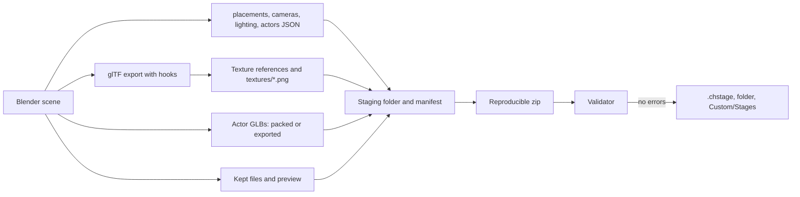
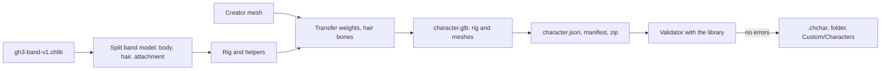

# Blender add-on: CH Stage Tools

This is the reference of the add-on. For a first stage or character, start with [CREATOR-GUIDE.md](CREATOR-GUIDE.md).

Status: **venue tool set and character tools** (PACKAGING-PLAN step 5, parts 1 to 4). The add-on makes a venue from a template or opens a venue package, edits all venue data that [package format v1](PACKAGE-FORMAT.md) defines, validates it, and exports a `.chstage` package. Actors (animated scenery) are Blender armatures with their clips. The add-on has a script bank browser, a shot browser with GH3 proxy rigs for camera bone anchors, a live lighting preview with beams, and lists of visibility groups, light groups, and node flags. The ten GH3 venues open and export again without a loss (section 2.6). The character tools (section 1.15) make characters on the fixed GH3 rigs and on the GH3 guitarist profiles of the character library, and export `.chchar` packages; the four GH3 band members and a GH3 guitarist package open and export again within the tolerances (section 2.11).

## 1. For creators

### 1.1 Requirements

- Blender 4.2 LTS or later (Linux, Windows, or macOS). The add-on was tested with Blender 4.2.23 and 5.2.1.
- No internet connection and no other add-on are necessary.

### 1.2 Install

Install the zip file `chstage_tools-<version>.zip` from **Edit > Preferences > Get Extensions > Install from Disk**, and set the add-on preferences. [CREATOR-GUIDE.md section 2](CREATOR-GUIDE.md#2-install-the-add-on) gives the steps.

To remove the add-on, open **Edit > Preferences > Add-ons**, find **CH Stage Tools**, and click **Uninstall**.

### 1.3 Make a new stage

1. Click **File > New > New Stage from Template**, or open the 3D view sidebar (key **N**), click the tab **CH Stage**, and click **New**. The add-on makes a new scene with:
   - A floor, a back wall, two pillars, and one light fixture.
   - Four band placements with proxy bodies. A proxy body shows the size of a performer. It is not part of the package.
   - One waypoint (`guitarist_walk01`) and two emitters for each effect.
   - Two camera shots (`wide` and `guitar`).
   - Two stage lights (`Stage` and `Band`), the snapshots `fill` and `chorus`, and the moods `intro`, `blackout`, and `chorus`.
   - No script bank. A script bank is optional; the stage lights apply also with a `scripts.json`, unless the bank has GH3 light objects (section 1.7).
2. Change the scenery. Use usual Blender meshes and materials.
3. Set the package information: open **Stage Package > Package Information**. Set the ID, the name, the version, the authors, and the license.

### 1.4 Start from a package (for example a GH3 venue)

1. Click **File > Import > CH Stage Package (.chstage)**, or **Open** in the **CH Stage** tab.
2. Select a `.chstage` file. For a development folder, select its `manifest.json`.
3. The add-on makes a new scene with the name of the venue:
   - The scenery of `stage.glb` with its materials, lightmaps, and GH3 data.
   - The collection **Markers** (band placements, waypoints, effect emitters), the collection **Camera Shots** (one Blender camera for each shot point), and the collection **Lights**.
   - The collection **Actors**: one actor root (an empty) for each actor, with the actor model (armature and meshes) and its start clip (section 1.6).
   - The collection **GH3 Rig Proxies**: the GH3 band rigs at the band placements, when the GH3 library is available (section 1.8).
   - All settings in the panels: package information, crowd, camera notes, snapshots, moods, colors, and the script bank.
   - **Kept Package Files**: `scripts.json` (a text block) and the other files that the add-on does not make.
4. The scene camera is the first shot of the group `wide`. A GH3 venue opens in 1 to 19 seconds.

The `.blend` file holds all package data: the JSON files are text blocks, and the actor GLBs and other binary files are packed into the `.blend` file. Export does not need the source package after Open.

### 1.5 What you can set

| Where | Panel | Data |
| --- | --- | --- |
| 3D view sidebar, tab **CH Stage** | Stage Package | New, Open, add a marker, Validate, Export .chstage, issue list, last export |
| | Package Information | ID, version, name, description, license, permissions, authors, credits, required packages, preview (Render, Image, or None) |
| | Kept Package Files | The files that export writes again without a change (text or packed) |
| | Stage Object | Marker type: band placement (role), waypoint (name), effect emitter (pyro, sparks, fireworks, smoke), actor. For scenery: light group, visibility group and start state, light fixture, script object and its pivot (none, object origin, or custom values) |
| | Actor (actor or actor part selected) | Actor name, model file, model export, start clip, playback, clip rate, clips (show a clip, load all clips), light group, cue role, start visibility, created state, script object, startup script, animation events, scale, cue actions |
| | Actors | All actors of the scene; **Make Actor** |
| | Camera Shot (camera selected) | Shot name, type, control, tag, groups, anchor and look-at target, screen offset, write rotation, more points, orbit angle, angular speed, step time, step count, step direction, height ease, hand camera, key times, waypoints. A camera that is not a shot shows its point settings |
| | Camera Shots | Shot browser: filter by group and type, preview, later points; camera bone anchors and the GH3 rig proxies |
| | Stage Light (light selected) | Light ID, group, type, script object, override color, intensity, near, far, hotspot and field |
| | Lighting | Live lighting preview (a snapshot or a mood), beams; snapshots (light settings with specular, and beams), **Capture** and **Apply**, moods, color presets |
| | Script Bank | Objects, events, and values of `scripts.json`; jump to object; set a simple value |
| | Groups and Flags | Visibility groups, node flags, light groups (show, hide, select, show only), start state, color by light group |
| | Crowd and Camera Notes | Crowd roles and models, GH3 camera note selectors |
| Properties editor, tab **Material** | CH Stage Material | Shading (lit, ambient, unlit, toon, not set); with toon: threshold, softness, shade texture and color, shade mask, sphere map, rim, outline, **Preview**, **glTF material**, **Toon from MMD**; hair layer (characters); transparency (opaque, cutout, blend, additive), alpha cutoff, two-sided, color alpha (opaque GH3 materials), color scale, lightmap and its UV map, movie slot, sorted transparency, crowd atlas, crowd role, billboard, flipbook. "Kept GH3 data" lists the GH3 shader data that export keeps |

### 1.6 Actors (animated scenery)

An actor is a skinned model with clips, for example a stage diver, a dancer in a cage, or a turning sign. In Blender, an actor is an **actor root** (an empty with the marker **Actor**) with the actor model as its children: one armature and the skinned meshes. The clips are actions of the armature, one on each NLA track with the clip name.


- **Placement and scale.** Move, turn, and scale the actor root. Its world transform is the actor `transform` and its scale is the actor `scale` in `actors.json`.
- **Fields.** The **Actor** panel sets the `actors.json` fields: the start clip, playback (loop or hold), the light group, the cue role (for example `stage-diver/1`), the start visibility and the created state, the script object, the startup script, the animation-event table, and the cue actions (an action name and its clips, separated by commas).
- **Clips.** Open imports the clips that `actors.json` uses (the start clip and the action clips). The panel lists all clips of the model. Click a clip to show it (it becomes the active action and the scene frame range). Click **Load All Clips** to import the model again with all clips (changes to the Blender model of this actor are lost). The add-on preference **Open: import all actor clips** imports all clips at Open (a GH3 venue then needs more memory: up to 2.6 million keys for one Hell actor).
- **Clip rate.** The scene frame rate must be the clip rate (60 for the GH3 venue actors). Open sets it. Export of a Blender model uses the clip rate of the actor.
- **Model export.** **Automatic** writes the packed GLB of the opened package while the Blender model did not change. When you change the model (mesh, weights, bones, materials, or the loaded clips), export writes the Blender model. The panel shows which one export writes. **Packed GLB** and **Blender model** force one of them.
- **A Blender model** is exported with the safe glTF settings. Then the add-on applies the actor rules of the format: it removes the unit scale channels that Blender writes (PACKAGE-FORMAT 6.7) and reports other scale keys as errors, adds the clips that Blender did not import from the packed GLB, gives the images and materials their package names again (Blender adds `.001` when a name is in use), and embeds the images of GH3 texture references that Blender does not export.
- **A new actor.** Make a skinned model in Blender (an armature with child meshes and clips). Select the armature and click **Actors > Make Actor**. Set the actor name. Each clip must be an action on an NLA track (click **Push Down** in the action editor), or the active action. A clip starts at 0 s: export moves the first key of each clip to 0 s.

### 1.7 Script bank (scripts.json)

The script bank holds the GH3 scripts of a venue as typed values. The **Script Bank** panel is a browser, not a script editor:


- **Objects**: each entry of the node arrays (the GH3 objects of the venue) with its class, its type, and the Blender objects that have its script object name (scenery, fixtures, lights, actors). Click the arrow to select the Blender objects and show them in the 3D view.
- **Events**: the scripts that start: the bank startup scripts, the performance script, the trigger script of each node, the startup script of each stage object (`gh3ObjectScript`), and the script and animation events of each actor. A script shows its size; the add-on does not show or change GH3 script code.
- **Values**: the startup scripts, the performance script, and the definitions with a simple value.
- **Set a value**: the pencil button of a field changes a simple typed value (integer, number, text, vector, or checksum; a checksum takes a name or `0x` and 8 hex digits). The node name cannot change (it is the identity of the node). Script code, structures, and arrays cannot change.

Lights: when the node arrays have one or more `LevelLight` objects (the GH3 lights), the game lights the stage with these objects. A stage light then has an effect only through its **Script object** (the name of a `LevelLight`); the validator warns for a stage light without one. Without `LevelLight` objects, the stage lights apply as in a stage without `scripts.json`.

The text block of `scripts.json` is also editable in the Blender text editor. Click the reload button of the panel after a change there. Names show as checksums; the panel shows the names that it knows (common GH3 field names, the bank names, and the Blender object names).


### 1.8 Camera tools

- **Shot browser**: the **Camera Shots** panel lists the shots of the scene. Filter them by group (menu) and by type. Click a shot to look through it in the 3D view (it becomes the scene camera). **Point 2**, **Point 3**, and so on look through the later points of a shot.
- **Camera bone anchors.** A camera with the anchor `head`, `hand_left`, `hand_right`, or `bone` moves with a performer bone in the game. When the GH3 library (`gh3-band-v1.chlib`) is available, Open loads the band rig of each band placement from it (`band/<role>/model.glb`), posed in the first frame of its first clip. Blender then shows each bone-anchored camera relative to that bone, and Validate gives no warning. The rig proxies are never exported.
- The add-on finds the library in the add-on preference **GH3 library (.chlib)**, or next to the opened package. **Load GH3 Rig Proxies** and **Remove Rig Proxies** load and remove the rigs later; the bone-anchored cameras keep their offset from the bone and move with it. Without the library, Blender shows the camera relative to the performer root, and Validate gives a warning for each bone anchor.


### 1.9 Lighting tools

- **Live lighting preview**: in the **Lighting** panel, turn on **Live lighting preview**. Select **Snapshot** to show the active snapshot, or a mood to show its snapshots (the arrow button shows the next snapshot of the mood). The 3D view goes to Material Preview with the scene lights and the scene world (EEVEE). A change of a snapshot setting shows at once.
- The preview sets the color and the power of the Blender lights, and a preview world. A stage light lights only the objects of its light group (Blender light linking). Ambient lights and fill lights (full intensity up to 20 m and more) give the ambient color of the world. The preview is an approximation: GH3 lights fade linearly from near to far, Blender lights use the inverse square law. Turn the preview off to get the scene world back. Export does not change.
- **Beams**: **Show beams** draws the beams of the previewed snapshot (cones in the beam color, from the start radius to the end radius over the range) and the beam axis of each fixture housing. The arrow on the active beam of the snapshot changes its range.
- **Color by light group**: in **Groups and Flags**, it colors the scenery by light group (Solid shading, object color).


### 1.10 Groups and node flags

The **Groups and Flags** panel lists the visibility groups (with their start state), the node flags (hidden at start, not created at start, light fixtures, script objects), and the light groups. For each group: show or hide (the eye), select, and show only this group. **Start State** shows the scenery as the game starts it; **Show All** shows all scenery. The eye changes only the 3D view: export writes hidden objects too.


### 1.11 Validate

Click **Validate**. The add-on writes the package into a temporary folder and runs the package validator of the mod on it. The list shows the errors and the warnings. Click the arrow button of an issue to select its object.

### 1.12 Export and play

1. Click **Export .chstage** (or **File > Export > CH Stage Package (.chstage)**).
2. Select the file name. The default is `<package ID>.chstage`.
3. Options:
   - **Development folder**: also write the unpacked package to `unpacked/<name>.chstage` next to the zip.
   - **Copy to Custom/Stages**: also copy the package into the `Custom/Stages` folder (the add-on preferences, or the folder in the option).
   - **Preview**: **Render** makes a 512 × 288 image from the scene camera (Workbench); **Image** uses an image; **None** writes no preview.
4. The add-on validates the package. It writes the package only when there is no error. The issue list shows the result.
5. Put the `.chstage` file into `Custom/Stages` (or use **Copy to Custom/Stages**). Group subfolders are permitted.

Export gives the same bytes for the same scene and Blender version (fixed zip times, sorted files, preview without date chunks).

### 1.13 Rules to know

- Blender is Z up. The package uses Y up. The add-on converts the data. Do not rotate the scene.
- A performer looks toward Blender −Y (the front view looks at the performer's face).
- A camera shot uses the Blender camera: its position, its direction, and its horizontal field of view. Set the render size to 16:9 (the template uses 1920 × 1080).
- **Camera anchors.** A camera with the anchor `guitarist.root` moves with the guitarist placement. A bone anchor uses the rig proxy bone (section 1.8). The add-on keeps the anchor and the offset: an anchored camera that you do not move exports the same offset, and a camera that you move exports its new offset from the anchor.
- A camera point without **Write rotation** has no rotation in `cameras.json`; the game aims it at the look-at target. Blender aims it at the rig bone, or at 1.5 m above the target performer root.
- **Lightmaps.** Set the lightmap image and its UV map in the material panel. The UV map must be the second UV map of the mesh (glTF `TEXCOORD_1`); Validate gives an error when it is not. Export puts the lightmap into the node tree as the glTF occlusion texture.
- The beam axis of a light fixture housing is its local −Y axis. A snapshot beam takes its position and its direction (local −Z, as a Blender spot light) from its beam object when you click **Capture**.
- Every snapshot must have settings for every stage light. Use **Capture** after you add a light.
- The moods `intro` and `blackout` are necessary. The group `wide` must have one shot.
- **Unchanged data stays the same.** After Open, export writes each row (a shot, a light, a snapshot, a material, a node, an actor) of the opened package again without a change while its Blender data did not change. A row that you change is written from the Blender data, with float32 precision. An actor model that does not change is the packed GLB, byte for byte.
- Blender can rename objects, materials, images, and actions when you open a package into a `.blend` file that has the same names (`floor.001`). Export uses the names of the package again.
- GH3 texture references (`#<image name>`) to images that Blender does not export (the GH3 shader samplers) become PNG files in `textures/` of the package (stage) or embedded images (actor GLB).

### 1.14 Not available yet

- Material preview node trees for GH3 shading in the viewport (toon materials have a preview, section 1.15).
- GH3 script code: the script bank browser shows and sets values only.
- A tool that moves a rigged model onto the GH3 bind pose (the fit alternative of [CREATOR-GUIDE.md section 5.1](CREATOR-GUIDE.md#51-use-your-models-skeleton-mmd-vrm-mixamo-fbx)). Use the model's own skeleton instead (section 1.17).

### 1.15 Make a character (.chchar)

A character is a skinned mesh on one GH3 rig, or a model with its own skeleton (section 1.17). The rig, its bind pose, and the clips come from the GH3 library (`gh3-band-v1.chlib`) for a fixed profile, or from the GH3 character library (`gh3-characters-v1.chlib`) for a GH3 guitarist profile. The game plays the library clips on your mesh. You do not make a skeleton or animations.

Before you start: set **Edit > Preferences > Add-ons > CH Stage Tools > GH3 library (.chlib)** to `gh3-band-v1.chlib`. Optional: set **Custom/Characters folder**, and **GH3 character library (.chlib)** (empty: the add-on uses `gh3-characters-v1.chlib` in the folder of the GH3 library).

The character tools are in the 3D view sidebar, tab **CH Character**.

| Profile | Band role | Attachment (helper) | Hair chains |
| --- | --- | --- | --- |
| `gh3-guitarist-axel-v1` | guitarist | guitar | 5 (9 bones) |
| `gh3-bassist-v1` | bassist | bass | 12 (15 bones) |
| `gh3-singer-male-v1` | singer | microphone and stand | 7 (15 bones) |
| `gh3-drummer-v1` | drummer | drum kit and sticks | 9 (15 bones) |

**GH3 guitarist profiles.** When the add-on finds the character library, the profile list also has its 20 profiles, for example `gh3-guitarist-midori-v1` (Midori, outfit 1) or `gh3-guitarist-judy-v1` (Judy Nails). Each profile has the GH3 skeleton, the animation set, the hair physics, and the IK of that GH3 guitarist. The proportions are different: Midori has a short torso and short arms, Lars has wide shoulders. Select the profile with the body that is nearest to your character. A character on such a profile plays the guitarist (with its own animations) and the bassist (PACKAGE-FORMAT 10.1).

- The rig comes from `characters.json`. The GH3 body and the guitar (helpers) come from the first GH3 character package of the profile (for example `gh3.midori.outfit1.style1.chchar`) in the folder of the character library. The mod installs these files together in `<game>/Mods/GH3Skin/Packages/`.
- **Hair bones of the profile** shows the hair chains of the profile (Midori: 9 chains, 15 bones; chains 1 and 2 are the pigtails).
- **Clip Preview** lists the clips of the animation set of the profile. The preview adds the position offsets of the profile to the clips (PACKAGE-FORMAT 10.1) and uses the game IK.
- Export writes `chchar/1.0` with `library` `gh3-characters-v1` in `character.json`, and `requires` `gh3-band-v1` and `gh3-characters-v1`. Validate checks the rig against the profile of `characters.json`.

Steps:

1. Click **File > New > New Character from GH3 Rig** (or **New** in the tab). Select the profile (a fixed profile or a GH3 guitarist profile). **Start from the GH3 body** makes the GH3 body the character mesh (use it to edit a GH3 member). The add-on makes a new scene with:
   - The rig (an armature, for example `guitarist-rig`). Do not move, rotate, scale, or edit the rig: Validate compares each bone with the profile (position 0.1 mm, rotation 0.01°, scale 1e-4).
   - **Helpers** that export never writes: the GH3 body as a wireframe reference, and the attachment preview (guitar, bass, microphone, or drum kit). The game adds the attachment from the library; do not model it. The eye buttons in **Weights and Hair** show and hide the helpers.
   - A preview camera that looks at the face (the performer looks toward Blender −Y).
2. Model your character over the GH3 reference body, or import a mesh (for example from FBX or OBJ) and move it onto the reference body. Use more than one mesh object if you like. Use usual Blender materials; images must be PNG.
3. Select your meshes and click **Transfer Weights from the GH3 Body**. For each vertex, the add-on takes the nearest point on the GH3 body surface and interpolates the weights of its triangle (Blender Data Transfer mode "Nearest Face Interpolated"). Then it keeps the 4 largest weights and makes their sum 1. It also applies the object transform, makes the rig the parent, and adds an Armature modifier. **Skip the GH3 hair cards** (on by default) does not take weights from the GH3 hair.
4. Change weights with Weight Paint if necessary. Then click **Limit and Normalize** (4 influences at most, sum 1).
5. **Hair.** Select the hair cards (Edit Mode: select the vertices; Object Mode: the whole mesh). Select a chain in **Hair bones of the profile** (or **All hair bones**) and click **Assign to Hair Bones**: each vertex gets full weight on the nearest hair bone. Make the hair material active and click **+** under **Hair materials**: the material gets sorted transparency (character.json `hairMaterials`).
6. **Clip preview.** In **Clip Preview**, click a clip. The add-on converts the library clip (q48) to an action of the rig at 30 fps, sets the scene rate to 30 and the frame range to the clip, and adds the arm and leg IK and the twist bones of the game (hands on the guitar or the drum sticks). Click **Play**. **Bind Pose** removes the preview. The clip names are the GH3 action groups (for example `stance_a/jump/good/fast`) or the GH3 clip name. The preview has no note-driven strum, fret, or face animation. Export never writes the preview actions.
7. Set the package information (ID, name, version, authors, license) in **Character Package > Package Information**. **Instrument** (empty: the profile default) is the character.json attachment. The game uses the instrument of the role that the character plays.
8. Click **Validate**. The list shows the errors and warnings of the add-on checks and of the package validator of the mod (with the library: the bind pose check). Click the arrow of an issue to select its object.
9. Click **Export .chchar**. Options: **Development folder**, **Copy to Custom/Characters**, **Preview** (Render: a 512 × 288 image from the scene camera). The add-on writes the package only when there is no error. Put the file into `Custom/Characters`, and select the character in the F6 picker ([PLAYER-GUIDE.md section 4](PLAYER-GUIDE.md#4-select-the-band-members)).

**Toon materials.** Set **Shading** to **Toon** in **CH Stage Material** for cel shading in the game ([CREATOR-GUIDE.md section 5.2](CREATOR-GUIDE.md#52-toon-look-and-eyebrows-over-the-hair), PACKAGE-FORMAT 6.5.1). The toon images (shade texture, shade mask, sphere map) go into the GLB as images with `#<name>` references.

- **Preview** (`chstage.toon_preview`) adds an EEVEE node tree to the material and makes its output active: the shade from a diffuse light (Shader to RGB), the threshold and softness, the shade texture and color, the mask, the sphere map on the camera-space normal, and the rim. It is an approximation of the game shader (the game uses the key light of the venue). **glTF material** removes it. Export always reads the Principled BSDF: the preview output is off while the glTF exporter runs.
- **Toon from MMD** (`chstage.toon_from_mmd`, the active material or all materials of the selected objects) reads the MMD Tools data of a material (`mmd_material`, the `mmd_toon_tex` and `mmd_sphere_tex` image nodes). The toon texture gives the threshold, the softness, and the shade color: the add-on reads the middle column of the ramp, finds the rows where the brightness passes 90 %, 50 %, and 10 % between the top and the bottom row, and divides the bottom color by the top color. MMD reads the ramp at `v = 0.5 − 0.5 N·L` from the top. The sphere map (`.sph` multiply, `.spa` add), the edge (on, color, size × 0.0025 m), and two-sided carry over. Without a toon texture the material is always lit, as in MMD. The per-vertex edge scale (`mmd_edge_scale`) is not used. Run it before you replace the MMD node groups with a Principled BSDF: the material copy keeps the settings (`material.copy()`).
- **Hair layer**: **Over hair** on eyebrow and eyelash materials, **Hair** on the hair materials of the same character (`gh3HairLayer`).

**Open .chchar** (**File > Import > CH Character Package (.chchar)**) makes a new scene from a package: the rig and the meshes of `character.glb`, the material settings, the hair materials, the package information, and (with the library) the helpers and the clip list. A package on a character library profile (for example a GH3 guitarist of the mod) needs the character library. Before 2026-10-09, Open stopped with "unknown profile" on these packages.

Rules to know:

| Check (Validate) | Fix |
| --- | --- |
| The rig has another transform than the origin | Clear the rig transform (Object > Clear) |
| A rig bone is missing | Start again from **New**; do not delete bones. You can add bones for chains (section 1.16) |
| A mesh has its own transform | Click **Transfer Weights**, or apply the transform (Object > Apply > All Transforms) |
| A mesh has no Armature modifier for the rig | Click **Transfer Weights** |
| Vertices without weight, more than 4 influences, weight sum not 1 | **Transfer Weights**, Weight Paint, then **Limit and Normalize** |
| An image is not PNG | Save the image as PNG |
| The glTF export does not read the surface node of a material (warning) | The material uses a node group or another shader (for example the toon shader of an MMD or VRM importer). Connect a **Principled BSDF** with the image on **Base Color** to the material output. Else the package has the material without its texture |
| A hair material is not on a character mesh | Remove it from **Hair materials** |
| Joint positions or rotations differ from the profile (validator) | The rig changed: start again from **New** |

### 1.16 Chains and colliders

A character can have its own hair, skirt, tail, and cable chains: bones that you add to the rig, with physics (PACKAGE-FORMAT section 9.5). The game moves them with the solver of the GH3 hair. Colliders are capsules on body bones: the chains do not go into them (for example a skirt into the legs, or a twin tail into the chest or the guitar). The tools are in the panel **Chains and Colliders** of the tab **CH Character**.


| Tool | What it does |
| --- | --- |
| **Chain along Strand** | Select the vertices of a strand in Edit Mode (a twin tail, a skirt panel, a tail), or select a curve. The tool puts the given number of **Joints** along the centre line of the points, from the end nearest to the **Parent bone** (empty: the nearest body bone), as new rig bones. It makes a chain with the **Preset**, and gives the selected vertices weights on the new bones (blended near the joints) |
| **Chain from Selected Bones** | Makes a chain of bones that you added to the rig yourself (Edit Mode of the rig, then select them in Pose Mode). The bones of the profile cannot be joints |
| **Chains from MMD Physics** | For an MMD model that you imported with MMD Tools (with physics) and moved onto the rig: a new bone for each dynamic rigid body, at its MMD bone, with the MMD mass, the damping, and the rotation limits of its joint, and a chain for each root. **MMD bones** selects bodies (empty: all). **Colliders** also makes colliders from the static bodies |
| Chain list | The chains. **Preset** and **Apply** set the values of a preset on all joints of the chain. **All colliders**, or the names of the colliders that the chain touches. **Assign to Chain** gives the selected vertices weights on the chain. **X** removes the chain (its bones stay and follow their parents) |
| Joint values | Make a joint bone active (Pose Mode) to edit **Swing limit**, **Side limit**, **Mass**, **Friction**, **Damping**, **Speed limit**, and **Radius** |
| **Fit Body Colliders** | Capsules on the hips, stomach, waist, chest, thighs, shins, upper arms, forearms, a sphere on the head, and a capsule on the guitar body (from the attachment preview). The radius comes from the vertices of your meshes near each part |
| **Add Collider** | A capsule on the active body bone. Move and turn the capsule in the viewport; set **Name**, **Radius**, and **Length** in the panel |

Presets (values for each joint; the speed limits keep the chain ends near the speeds of the GH3 hair):

| Preset | Swing limit | Side limit | Damping (/s) | Speed limit (rad/s) | Radius |
| --- | --- | --- | --- | --- | --- |
| Hair | 20° | — | 1 | 10 | 1 cm |
| Long hair or twin tail | 22° | — | 3 | 6 | 3 cm |
| Skirt | 35° | 15° | 3 | 10 | 1 cm |
| Tail or cable | 10° | — | 2 | 8 | 2 cm |
| Stiff accessory | 5° | — | 3 | 5 | — |

Rules:

- The swing limit is for each joint. A chain of 7 joints with 22° each can swing far; a chain of 2 joints swings less.
- Give a chain only the colliders near it. A twin tail touches the head, the chest, the waist, the hips, the thighs, and the guitar; a skirt touches the thighs and the shins. A collider that a chain touches at rest pushes the chain away all the time.
- A long tail can touch the floor: add a large sphere under the floor on the root bone (for example a radius of 3 m, 3 m under the floor).
- At most 64 joints and 32 colliders. More than 32 joints gives a warning: each joint costs solver time.
- MMD joints have springs that hold the shape inside wide limits. The chains have no spring, so the import uses the smaller of the MMD limit and the preset swing limit, and the larger damping, when the MMD joint has a spring.
- Export writes `character.json` `bones`, `colliders`, and `chains`. Open makes the chains and the colliders again. The colliders are helpers: the GLB export does not write them.

### 1.17 Use the model's skeleton

A character can keep the skeleton of its model (PACKAGE-FORMAT 9.6). The game retargets the GH3 clips of the profile to it. Steps for creators: [CREATOR-GUIDE.md section 5.1](CREATOR-GUIDE.md#51-use-your-models-skeleton-mmd-vrm-mixamo-fbx).

- **New Character from GH3 Rig** with **Use my model's skeleton**: the GH3 rig of the profile becomes a helper (`GH3 <role> rig (clip source)`, `character.source_rig`), the GH3 body reference is hidden, and the attachment preview hangs on the GH3 rig. The scene has no rig until **Use Selected Armature**.
- **Skeleton** panel (tab **CH Character**):
  - **Use Selected Armature** (`chstage.use_skeleton`): the active armature becomes the rig (`character.rig`). The add-on fills the role list from the VRM Add-on humanoid map, else from the bone names (`skeleton.auto_map`: MMD Japanese and English, VRM and VRoid `J_Bip_*`, Mixamo `mixamorig:*`, Unreal `pelvis`, `spine_01`, `thigh_l`...), the followers from the MMD append rotations (`mmd_bone.additional_transform_bone`, only for exported bones without a role), and the face shape keys (`skeleton.auto_face`).
  - **Auto Map** (`chstage.auto_map`) maps again.
  - The role list: a bone search field for each role. A required role (the 15 VRM required roles) without a bone has a red mark.
  - The face fields (blink, a, i, u, e, o) search the shape keys of the character meshes.
  - **Instrument bone**, **Instrument offset** (Blender axes), **Instrument scale** (0: automatic).
- **Validate** checks the map, the hierarchy, and the rest pose with the rules of the game (`skeleton.check_map`), the deform bone count (255 at most), the face shape keys, and the chain joints (a chain joint is a deform bone without a role, not a parent of a bone with a role, not a follower).
- **Export .chchar** writes the deform bones only (glTF option "deform bones only"), the shape keys as morph targets (modifiers are not applied, so the shape keys stay), and then keeps only the face morph targets in the GLB (`character.keep_morphs`). `character.json` gets `skeleton` (humanoid, followers, instrument) and `face`, and no `bones`.
- **Clip Preview**: the GH3 clip (with the game IK) plays on the GH3 rig helper; `skeleton.Retarget` (the algorithm of the game, vectorized over the frames) moves the armature. The add-on mutes the bone constraints of the armature during the preview (MMD IK and append rotation constraints) and turns them on again with **Bind Pose**. The GH3 instrument helper takes the instrument scale.
- **Open .chchar** of a package with `skeleton`: the GLB armature is the rig, the role list, the followers, the instrument, and the face come from `character.json`, and the GH3 rig of the profile becomes the clip source again.
- **Chains from MMD Physics** on the MMD armature itself (the rig) uses the MMD bones as the joints and adds no bones; the chains get ASCII names from the group prefix. **Fit Body Colliders** puts the capsules on the bones with the roles and makes no guitar capsule.

## 2. For developers

### 2.1 Files

| Path | Contents |
| --- | --- |
| `blender/chstage_tools/blender_manifest.toml` | Extension manifest (`blender_version_min = "4.2.0"`) |
| `blender/chstage_tools/properties.py` | Property groups. Each group maps to one package file (table below). Add-on preferences (Custom/Stages folder, GH3 library, import all actor clips) |
| `blender/chstage_tools/sidecars.py` | Builds `manifest.json`, `placements.json`, `cameras.json` (with the rig anchor frames), `lighting.json`, `actors.json`, and the `gh3*` extras from plain data, and reads them back (`open_*`). `Keeper` (section 2.5). The light power of the lighting preview. No `bpy`; the tests use it without Blender |
| `blender/chstage_tools/collect.py` | Reads the scene into plain data, exports `stage.glb`, and has the glTF export hooks |
| `blender/chstage_tools/package_export.py` | Export .chstage and Validate: writes all package files, texture files, preview, manifest, zip; runs the validator |
| `blender/chstage_tools/package_open.py` | Open .chstage: GLB import with fixes, sidecars into the property groups, kept files. Has the glTF import hooks |
| `blender/chstage_tools/materials.py` | Lightmap node tree (glTF occlusion texture), vertex alpha for the 4.2 exporter, image bytes |
| `blender/chstage_tools/glb_tools.py` | GLB read and write, GLB fixes before import, PNG text chunk removal; actor GLB edits (keep clips, drop unit scale channels, merge clips by joint name, rename clips, restore names, embed images). No `bpy` |
| `blender/chstage_tools/actor_tools.py` | Actors: import (with the used clips), linked copies for equal GLBs, the model fingerprint, export of a Blender model with the actor rules |
| `blender/chstage_tools/blobs.py` | Package files packed into the `.blend` file (bytes in a custom property of a text block) |
| `blender/chstage_tools/rig.py` | Joint frames of a library band model in the first key of its first clip (camera bone anchors). No `bpy` |
| `blender/chstage_tools/camera_tools.py` | Library search, proxy rigs, re-anchoring of the cameras, shot browser |
| `blender/chstage_tools/script_bank.py` | Index of `scripts.json` (objects, events, simple values) and value edits. No `bpy` |
| `blender/chstage_tools/scripts_ui.py` | Script bank browser rows, jump to object, value edits in the text block |
| `blender/chstage_tools/lighting_tools.py` | Lighting preview (lights, world, light linking), beam overlay (draw handler), beam range gizmo |
| `blender/chstage_tools/groups.py` | Light groups (with the color overlay), visibility groups, node flags, start state |
| `blender/chstage_tools/gltf_io.py` | Safe glTF import and export settings, and the Blender 4.2 import fix |
| `blender/chstage_tools/template.py` | The template scene, snapshot capture and apply |
| `blender/chstage_tools/operators.py`, `panels.py` | Operators and panels |
| `blender/chstage_tools/character_tools.py` | Characters: new character scene (fixed profiles and character library profiles), helpers from the library or the GH3 character package of the profile, weight transfer, limit and normalize, hair bones, clip preview (q48 to actions) |
| `blender/chstage_tools/chain_tools.py` | Custom chains and colliders: chain along a strand, from bones, from MMD physics; presets; colliders (fit, add); export and open of `bones`, `colliders`, `chains` (section 2.12) |
| `blender/chstage_tools/character_package.py` | Export .chchar, Validate, Open .chchar: add-on checks (also the material surface nodes that the glTF export does not read), GLB export of the rig and its meshes, character.json, manifest (format 1.0), zip, validator with the library and the character library |
| `blender/chstage_tools/character_ui.py` | Operators and panels of the tab CH Character |
| `blender/chstage_tools/toon.py` | Toon materials: the EEVEE preview node tree (on, off, off during export) and **Toon from MMD**. The ramp conversion (`toon_ramp_settings`), `gh3Toon` write and read, and the toon texture references are in `sidecars.py` |
| `blender/chstage_tools/brotli_decode.py`, `brotli_dictionary.bin` | Brotli decoder in pure Python (RFC 7932) for the library clips; the official Blender builds have no `brotli` module. The add-on uses the module when Blender has it |
| `pipeline/package/character.py` | Shared with the add-on (bundled): profile rigs, the character library (`CharacterLibrary`: profiles, rigs from `characters.json`, hair chains, clips with the rest offsets, the GH3 character package of a profile), split of a library band model into body and attachment, hair chains, clip poses with the game IK (`GuitarRig`, a port of `src/Stage/Band/StageGuitarArms.cs`), weight limits, character.json, and `python -m pipeline.package.character` (library band members as `.chchar`) |
| `blender/build.py` | Copies `pipeline/package` (validator, container, decisions, character) and `schemas/` into `chstage_tools/vendor/package_format/` and writes the zip |
| `blender/test.sh`, `blender/tests/blender_test.py`, `tools_test.py` | Headless test in Blender: template, validate, export, open, round trip of the template and of one GH3 venue, and the venue tools (packed files, actors, script bank, lighting preview, shot browser, proxy rigs, groups) |
| `blender/tests/actor_export.py`, `actor_compare.py` | Export every actor model of venue packages from Blender, and compare the actor GLBs with the source and compile them (section 2.6) |
| `blender/roundtrip.sh`, `blender/tests/roundtrip.py`, `roundtrip_summary.py` | Round trip of all venue packages, one Blender process each, with a Markdown summary |
| `blender/tests/screenshots.py`, `screenshots_package.py`, `screenshots_tools.py` | Panel screenshots; Open and Export screenshots; venue tool screenshots (need a window) |
| `pipeline/package/container.py` | JSON bytes, hashes, and the reproducible zip writer that the converter and the add-on share |
| `pipeline/package/compare.py` | Compares two packages by meaning (`python -m pipeline.package.compare A B`) |
| `blender/tests/character_test.py`, `screenshots_character.py` | Headless character test (section 2.11); character panel screenshots (need a window) |
| `tests/test_blender_addon.py`, `tests/test_blender_addon_tools.py`, `tests/test_blender_addon_characters.py` | Tests without Blender (part of `scripts/test.sh`) |

The add-on and the converter use one validator and one zip writer. `pipeline/package` uses relative imports and has no other repository dependency, so `build.py` copies it without changes. The copy is not in git.

### 2.2 Property map

The layout follows the package files, so that export and Open map one to one.

| Blender data | Package file and field |
| --- | --- |
| `scene.chstage.package` | `manifest.json` (`files` and `entry` come from the export) |
| `object.chstage.marker` = `BAND`, `WAYPOINT`, `EFFECT` | `placements.json` `band`, `waypoints`, `effects` (object world transform) |
| `object.chstage.marker` = `ACTOR`, `object.chstage.actor` | `actors.json` row (actor root world transform and scale); the actor GLB: the packed GLB (`actor.blob`) or the exported children of the root |
| `scene.chstage.crowd` | `placements.json` `crowd` |
| `object.chstage.shot` (camera), `object.chstage.point` (camera or empty), `scene.chstage.camera_notes` | `cameras.json` `shots`, `groups`, `notes` |
| `object.chstage.light` (light), `scene.chstage.snapshots`, `moods`, `colors` | `lighting.json` |
| `object.chstage` scenery fields | `stage.glb` node extras `gh3LightGroup`, `gh3VisibilityGroup`, `gh3InitiallyVisible`, `gh3Fixture*`, `gh3Object*` |
| `material.chstage` | `stage.glb` material extras `gh3*` and glTF `alphaMode`, `alphaCutoff`, `doubleSided`, `occlusionTexture`, base color alpha (opaque) |
| `material.chstage.toon_*`, `use_outline`, `outline_*`, `hair_layer` | `gh3Toon` (the images as `#<image name>` references, the image embedded in the GLB) and `gh3HairLayer` |
| `material.chstage.kept_extras`, `kept_images` | Other `gh3*` material extras (`gh3Shader`, `gh3SourceMaterial`, `gh3MaskTexture`, `gh3LayerTexture`, `gh3LayerColor`, `gh3UvWibble`) and the Blender image of each texture reference |
| `scene.chstage.kept_files` | Other package files (`scripts.json`, other files): text blocks or packed data (`blobs.py`) |
| `scene.chstage.anchor_frames` | The bone frames of the proxy rigs (JSON, runtime coordinates, relative to the performer roots) for the camera bone anchors |
| `scene.chstage.script_rows` | Rows of the script bank browser (made from the `scripts.json` text block) |
| `scene.chstage.character` | A character scene (`enabled`): `profile`, `hair_materials`, `instrument` (character.json); `rig`, `reference`, `attachment`, `library`, hair chains, clip list (tool state). Helpers have the custom property `chstage_helper` and the marker `PROXY` |
| `kept`, `order`, `source_name` (objects, materials, list items) | Source rows, package order, and package names of an opened package (section 2.5) |

The glTF export hooks (`glTF2ExportUserExtension` in `__init__.py`) write the `gh3*` extras, the glTF material fields, and the package names during an add-on export only. They remove the add-on property groups from the extras of every glTF export. The glTF import hooks (`glTF2ImportUserExtension`) map glTF node, material, and image indices to the Blender data during Open only.

### 2.3 Export



- glTF export settings: `gltf_io.EXPORT_OPTIONS` (spike 9.6), the selected scenery only (no markers, actors, or proxy rigs), no cameras and lights, `export_vertex_color="ACTIVE"`. Objects that the viewport hides are shown while the exporter runs (it exports only selected objects, and a hidden object cannot be selected).
- Before the export, `materials.sync_lightmap` makes the occlusion node chain (image, Separate Color, glTF Material Output group) for each material with a lightmap. The glTF exporter gives a texture the `TEXCOORD` index of its UV map in the mesh, so the lightmap UV map must be the second one.
- During the export, `materials.vertex_alpha_for_export` links the vertex color alpha to the shader alpha. Without it, the Blender 4.2 exporter writes `COLOR_0` without alpha for opaque materials (seen on `gh3.soundcheck` and `gh3.artdeco`).
- `package_export.finish_glb` keeps `#<name>` for images that Blender exported and writes the other referenced images to `textures/<name>.png` (PACKAGE-FORMAT 6.6).
- The preview render saves and restores the render settings and removes the PNG text and time chunks.

### 2.4 Open

- The add-on changes a copy of `stage.glb` before the import, so that the Blender importer keeps all data. The exporter writes the same triangles again:
  - `separate_faces`: a triangle that repeats the vertices of an earlier triangle (GH3 back faces and copies; Blender drops it), and a triangle with two corners at one position (Blender then gives all faces at that vertex a default normal, up to 90° wrong) get their own vertex copies.
  - `fill_texcoord_gaps`: the importer reads `TEXCOORD_n` only up to the first missing set. GH3 meshes have `TEXCOORD_3` (mask UV) without `TEXCOORD_1` and `TEXCOORD_2`. The add-on adds the missing sets with zeros; export then writes them as zeros.
  - `normalize_normals`: 12 GH3 meshes (prison, hell, budokan, party) have normals that are not unit length. The Blender 4.2 importer turns their custom normals up to 38° wrong. The add-on makes them unit length (glTF requires it, and Blender exports unit normals).
  - The 4.2 custom attribute fix (section 2.8).
- Images that no material socket uses (the GH3 shader samplers) are not imported by the glTF importer. The add-on packs them into the `.blend` file from the GLB.
- The add-on removes the `gh3*` custom properties that the importer makes from extras and sets the property groups.
- **Rigs.** When the GH3 library is available (the preference, or `gh3-band-v1.chlib` next to the package), Open loads `band/<role>/model.glb` for each band placement with its first clip, sets the pose of the first key, and removes the clip. `rig.anchor_frames` reads the joint frames of that pose from the GLB itself (glTF to runtime: negate Z), so the camera math does not depend on the Blender bone axes. The frames go into `scene.chstage.anchor_frames` before the cameras open; Open and Export use the stored frames, also when the library moves later.
- **Actors.** For each `actors.json` row, Open makes an actor root at the transform and scale, packs the GLB (`blobs.store`, one text block for equal GLBs), and imports the GLB with only the clips that the row uses (`glb_tools.keep_animations`) and without bone shapes. An actor with the same GLB bytes as an earlier actor gets linked copies (shared meshes, armature, and actions). Each action gets its clip name (`chstage_clip`) from its NLA track: Blender names an action `clip.001` when the name is in use, and the 4.2 importer names it `clip_Armature`. After the Keeper record, `actor_tools.fingerprint` stores a hash of the model (hierarchy, transforms, mesh data, weights, materials, bones, clip keys).
- All other package files (not JSON) are packed into the `.blend` file. A `.blend` file of add-on 0.1 still reads its kept files from the source package.

### 2.5 Unchanged rows (`sidecars.Keeper`)

Blender stores transforms and settings in float32, and the add-on writes rounded numbers. Thus a computed row is close to the source row, but not equal. The Keeper gives an exact round trip:

1. Open stores the source row on its owner (`kept` JSON: object, material, or list item).
2. Open then computes each row from the new Blender data with the export code (Keeper mode `record`) and stores it next to the source row.
3. Export computes each row again. When it is equal to the stored row, nothing changed in Blender, and export writes the source row. Else export writes the computed row.

Rows: placements (each marker, each crowd item), shots (with all points), camera groups, camera notes, lights, snapshots, moods, colors, actors, node extras, material data. `keep_source=False` on the export operator turns the Keeper off (tests).

Actor models use the same idea with the model fingerprint: while the fingerprint is the one of Open (or of **Load All Clips**), export writes the packed GLB, byte for byte. A changed model goes through `actor_tools.export_model`: the glTF export of the actor root children (the root at the identity while the exporter runs) with the safe settings, `export_animation_mode="NLA_TRACKS"` (the `ACTIONS` mode also exports the actions of other actors with the same bone names) and `export_anim_slide_to_zero` (the importer puts each clip strip at the scene start frame, one frame after the clip start), then the clip names, the unit scale channel removal, the clips that Blender did not import (`glb_tools.merge_animations`, by joint name, from the packed GLB), the image and material names, and the images of texture references (each with a glTF texture, because the pipeline compiler finds `#<name>` through the textures). The `actor_models` option of the export operator (hidden) forces the packed GLB or the Blender model for every actor (tests).

### 2.6 Round trip of the GH3 venues

Method: `blender/roundtrip.sh` opens each package of `assets/packages/` in a new Blender process (Open .chstage), exports it without edits (Export .chstage, the Keeper on), exports it again (same bytes?), and compares the export with the source package (`pipeline.package.compare`). A second export with the Keeper off shows what the Blender data alone gives. Date: 2026-10-09, Blender 5.2.1 and 4.2.23.

The comparison checks:

- All files: the same paths (plus `textures/*.png`), `manifest.json` equal except `files`, all JSON files JSON-equal, all other files byte-equal.
- `stage.glb`: nodes by name (world transform, PACKAGING-PLAN 9.6 limits: 0.1 mm, 0.01°, scale 1e-4; extras equal), materials by name (glTF fields with their defaults; extras equal, with texture references resolved to the image bytes), and mesh primitives by node and material (triangles in a canonical order; every vertex attribute: POSITION 0.1 mm, NORMAL 1°, TEXCOORD 1e-5, COLOR 2.5/255, `_GH3_*` 1e-5; added attributes only when all zero).
- The validator on the export: errors and warnings.

Result (2026-10-09, after part 3: actors imported, GH3 rig proxies loaded from `assets/packages/gh3-band-v1.chlib`, all files packed): **all 11 packages pass on both Blender versions.** Sidecars (`placements.json`, `cameras.json`, `lighting.json`, `actors.json`), `scripts.json`, the actor GLBs (byte-equal), `manifest.json`, node extras, and material extras are equal; the validator gives 0 errors and 0 warnings; a second export gives the same bytes. The 24 bone-anchored camera points (artdeco, budokan, hell, prison, video, wikker) open on the rig bones and export their source offsets.

| Package | Nodes | Materials | Primitives | Node rotation max (°) | NORMAL max (°) | COLOR_0 max (/255) | GLB images → exported + `textures/` | Open / export (s), 5.2.1 | Open / export (s), 4.2.23 | Max RSS 5.2.1 (MB) |
| --- | ---: | ---: | ---: | ---: | ---: | ---: | --- | --- | --- | ---: |
| `example.studio` | 5 | 1 | 5 | 0 | 0.00 | 0.69 | 0 → 0 + 0 | 0.9 / 0.1 | 0.8 / 0.1 | 496 |
| `gh3.artdeco` | 349 | 65 | 322 | 2e-05 | 0.75 | 1.05 | 70 → 46 + 24 | 6.0 / 2.5 | 12.7 / 2.4 | 1091 |
| `gh3.budokan` | 503 | 89 | 527 | 3e-05 | 0.69 | 1.05 | 99 → 73 + 26 | 5.4 / 2.9 | 14.8 / 3.3 | 1069 |
| `gh3.credits` | 100 | 13 | 82 | 0 | 0.10 | 1.00 | 19 → 14 + 5 | 0.7 / 0.5 | 0.6 / 0.5 | 536 |
| `gh3.dive` | 353 | 103 | 329 | 9e-06 | 0.75 | 1.05 | 123 → 87 + 36 | 5.1 / 2.6 | 13.5 / 3.0 | 1134 |
| `gh3.hell` | 405 | 100 | 394 | 1e-05 | 0.69 | 1.05 | 108 → 78 + 30 | 7.8 / 3.9 | 16.5 / 4.2 | 1588 |
| `gh3.party` | 252 | 68 | 214 | 2e-05 | 0.60 | 1.05 | 86 → 62 + 24 | 4.3 / 1.9 | 10.7 / 2.0 | 931 |
| `gh3.prison` | 389 | 74 | 376 | 2e-05 | 0.44 | 1.05 | 101 → 64 + 37 | 6.8 / 2.9 | 18.3 / 2.9 | 1196 |
| `gh3.soundcheck` | 239 | 59 | 220 | 6e-06 | 0.32 | 1.00 | 81 → 53 + 28 | 2.3 / 1.2 | 5.7 / 1.4 | 743 |
| `gh3.video` | 388 | 93 | 367 | 2e-05 | 0.78 | 1.05 | 117 → 80 + 37 | 4.0 / 2.3 | 9.8 / 2.5 | 978 |
| `gh3.wikker` | 420 | 93 | 413 | 3e-05 | 0.62 | 1.05 | 110 → 71 + 39 | 5.9 / 2.8 | 18.6 / 2.8 | 1050 |

Open takes up to 3.2 s (5.2.1) longer than in part 2 (actor import with the used clips, four rigs) and up to 0.3 GB more memory (hell: 1,287 → 1,588 MB).

POSITION, TEXCOORD, and `_GH3_*` differ by 0 in all packages. Node positions differ by 0. All triangles survive. No normal of a triangle with area differs by more than 1°.

Differences that remain, and why:

| Difference | Where | Why |
| --- | --- | --- |
| `COLOR_0` up to 1.05/255 | All venues | Blender stores vertex colors as 8-bit sRGB; the package has 8-bit linear values |
| NORMAL up to 0.78° | All venues | Blender stores custom normals in its own encoding. Normals of triangles without area (0–117 for each venue) are not compared: they do not show, and Blender gives them a default normal |
| Normal length | 12 meshes (prison, hell, budokan, party) | The source normals are not unit length; Blender writes unit normals (the comparison uses the directions) |
| `TEXCOORD_1`, `TEXCOORD_2` added, all zero | Primitives with `TEXCOORD_3` only (7 in `gh3.credits`, also in other venues) | Blender cannot have gaps in UV maps (section 2.4) |
| Texture references `#<name>` → `textures/<name>.png` | 5–39 images for each venue | Blender exports only images that a material socket uses (PACKAGE-FORMAT 6.6). The image bytes are equal |
| Vertex order and count, primitive split, glTF defaults written or not | All venues | Blender rebuilds the vertex buffers; the triangles and their data are the same |
| Zip size | −0.2 % to +1.0 % (GH3 venues) | Other GLB layout, PNG files outside the GLB |

Export from the Blender data only (Keeper off) is the path of an edited row. Its differences to the source rows: numbers within 2.3e-6 in the sidecars and within 3e-8 in the node extras (float32 and rounding to 6 digits), and keys with default values that the add-on does not write (`handCam`, `disableOrbit1`, `disableOrbit2`: false; `waypoints`: []; note `tag` and `type`: ""; `overrideColor`, `gh3FixtureFixedPosition`: false; `gh3ObjectScript`: ""). The compiler (`pipeline/stagepack/pack.py`) and the runtime (`StageCameraPath.cs` `OriginalCameraShot`, `StageLighting.cs`) read each missing key as the same default (false, empty node list, empty string; a shot without `waypoints` matches all nodes, as `[]` does).

Check on the compiled runtime data: the source package and the Keeper-off export of artdeco, dive, hell, and credits, compiled with the pipeline compiler and compared by meaning (materials by `gh3SourceMaterial`, textures by PNG bytes, objects by ID, fixtures by script object). The only differences are numbers within 2.3e-6 and the default keys above (`~/.cache/gh3-evidence/addon-export/evidence/compiled-edited-path.txt`).

A missing `gh3Shading` is not the same as `lit`: the mod then draws the material without the stage surface model (`StageMaterial.ShadingMode` −1). The material panel has the shading value **Not set** for it; Open uses it for the 58 GH3 materials without `gh3Shading`. (Before this fix, an edited material of that kind became `lit`; `compiled-edited-path-before-fix.txt` shows it.)

Evidence: `~/.cache/gh3-evidence/addon-tools/evidence/roundtrip/` (`summary.md`, one JSON report for each package and Blender version); part 2: `~/.cache/gh3-evidence/addon-export/evidence/`. Command:

```sh
TMPDIR=~/.cache/addon-tools/tmp flock /tmp/opencode/gh3-heavy.lock bash blender/roundtrip.sh ~/.cache/addon-tools/rt "blender-clean $HOME/.cache/blender/blender-4.2-clean"
```

The outputs are about 1.2 GB for each Blender version. Use a disk folder, not `/tmp` (a RAM disk on this machine).

**Edited actors (the Blender model path).** `blender/tests/actor_export.py` opens each venue with actors and exports every actor model from Blender (`actor_models="BLENDER"`, the path of a changed model). `blender/tests/actor_compare.py` compares each actor GLB with the source and compiles the package with the pipeline venue compiler (`compile_stage`, which runs `compile_actor`). 29 actors in 8 packages, both Blender versions, the same numbers:

| Check | Result (maximum over all actors) |
| --- | --- |
| Export | All 8 packages written, validator 0 errors and 0 warnings; export of the actor models 0.1–15.7 s |
| Pipeline compiler (`compile_actor`) | All 8 packages compile |
| Clip names | Equal (no clip lost, none added); 0 scale channels |
| Clip keys, sampled at the source key times | Translation 3.3e-6 m, rotation 0.00041° |
| Joints, inverse bind matrices | Joint position 1.8e-6 m, rotation 0.00041°; inverse bind matrices 7.2e-6 |
| Skinned vertices in the bind pose and the first key of each clip | 3.0e-6 m (928,899 vertex poses; 49,266 have no partner at the 0.01 mm rounding of the bind position) |
| Triangles (by corner positions, 0.1 mm) | 104,015 in both; 4 artdeco triangles have no source triangle at 0.1 mm (not examined further); corner normals 0.43° |
| Mesh attributes (`pipeline.package.compare`) | POSITION and `_GH3_*` 0, COLOR_0 1.0/255, except `ven_artdeco_knight1`: its coincident two-sided cards pair wrongly in the 1 mm sort of the compare tool (the triangle and vertex checks above pass) |
| Materials | All by name, extras equal |

The joint order and the vertex order differ (Blender rebuilds them), so the compiled `actors/*` files are not byte-equal. Evidence: `~/.cache/gh3-evidence/addon-tools/evidence/actors/` (`export-*.jsonl`, `compare-*.jsonl`, `summary.txt`).

### 2.7 Build and test

```sh
python3 blender/build.py                      # writes blender/dist/chstage_tools-<version>.zip
flock /tmp/opencode/gh3-heavy.lock bash blender/test.sh ~/.cache/chstage-test blender-clean ~/.cache/blender/blender-4.2-clean
```

With `assets/packages/gh3-band-v1.chlib` present (or `CHSTAGE_TEST_LIBRARY`), `blender/test.sh` also runs the character test (`blender/tests/character_test.py`, section 2.11) in a second Blender process. Result on 2026-10-10: 60 of 60 venue checks and 47 of 47 character checks (with the toon and chain checks) pass on Blender 5.2.1 and on Blender 4.2.23.

`blender/test.sh` installs the zip into a temporary Blender user folder (`BLENDER_USER_RESOURCES`), so it does not change the Blender setup of the user. It also opens, exports, and compares `assets/packages/gh3.credits.chstage` when it exists (`CHSTAGE_TEST_VENUE` selects another package; an empty value turns it off), and then tests the venue tools (`tools_test.py`; `CHSTAGE_TEST_SKIP=actors,scripts,lighting,cameras,groups` skips parts). Set `CHSTAGE_TEST_RIG` to a GH3 rig GLB (for example a spike file from `tools/research/spike-blender/band_glb.py`) to also test the import fix. Result on 2026-10-09: 60 of 60 checks pass on Blender 5.2.1 and on Blender 4.2.23:

- Part 2 (30 checks): template, validate, export with folder and Custom/Stages copy, preview render, lightmap on `TEXCOORD_1`, bone anchor, reproducible export, open, template round trip with and without the Keeper, an edit after open, `gh3.credits` round trip.
- Packed files: `example.studio` opens from a copy, the copy is deleted, and export gives the source package.
- Actors: armature, mesh, and clip `turn` at 60 fps; not in `stage.glb`; a placement and field edit changes only that `actors.json` row and keeps the GLB bytes; a mesh edit exports the Blender model (valid, clip `turn`, no scale channel); a forced Blender model export is valid; the undone edit gives the packed GLB again; **Load All Clips**; **Make Actor**.
- Script bank (`gh3.credits`): 96 objects, 96 rows; jump to object; events (startup, trigger scripts, object startup scripts); a vector edit changes exactly its three numbers in `scripts.json`; the node name cannot change; the value set back gives the source bank.
- Lighting preview (`gh3.credits`): lights and preview world; a live intensity change doubles the light power; mood preview; one beam cone for each beam; off gives the scene world back; the export after the preview is equal to the export before it.
- Camera tools (template): group and type filters; preview sets the scene camera; the rigs of the four roles load from the library; the bone-anchored `guitar` camera moves to the rig bone and keeps its exported offset, without the bone warning; the rigs are proxies (never exported); removing the rigs puts the camera back.
- Groups (template): the visibility group with its start state; show, hide, and start state; hidden objects are still exported; light group colors; the fixture flag.

Python tests without Blender (`tests/test_blender_addon_tools.py`, in `scripts/test.sh`): rig joint frames and anchor names, the library rig head height, bone anchors with and without rig frames, re-anchoring, `actors.json` of all packages through open and build, edited actor rows and scale axes, actor GLB edits (keep clips, unit scale channels, merge by joint name, images), the script bank index of `gh3.dive` (all node rows, events, labels, references), value edits and their errors, and the preview light power.

Screenshots (real Blender window in a nested Xwayland display, `gh3.prison`): `~/.cache/gh3-evidence/addon-tools/evidence/screenshots/blender-clean/` and `blender-4.2-clean/` (`panel-actor.png`, `panel-script-objects.png`, `panel-script-events.png`, `panel-shots-rig.png`, `panel-lighting-preview.png`, `panel-groups-overlay.png`).

### 2.8 Blender 4.2 result

The Blender round trip of the spike (`tools/research/spike-blender/`, [report](spike/blender.md)) ran again with the portable Blender 4.2.23 LTS (glTF add-on 4.2.83). Guitarist and singer, maximum of the two:

| Variant | Joint local T (mm) 5.2.1 / 4.2 | Joint local R (°) | IBM max | world·IBM − mesh | GH3 clip on rig (cm) | Exported clip (cm) |
| --- | --- | --- | --- | --- | --- | --- |
| `default-default` | 0.00053 / 0.00053 | 0.00032 / 0.00032 | 8.1e-6 / 8.1e-6 | 7.3e-7 / 7.3e-7 | 7.4e-5 / 7.4e-5 | 1.1 / 1.1 |
| `fps30-keep` (recommended) | 0.00053 / 0.00053 | 0.00032 / 0.00032 | 8.1e-6 / 8.1e-6 | 7.3e-7 / 7.3e-7 | 7.4e-5 / 7.4e-5 | 0.00014 / 0.00014 |
| `blend-keep` | 0.00053 / 0.00053 | 0.00032 / 0.00032 | 8.1e-6 / 8.1e-6 | 7.3e-7 / 7.3e-7 | 7.4e-5 / 7.4e-5 | 1.1 / 1.1 |
| `temperance-default` | 2200 / 2200 | 180 / 180 | 2.6 / 2.6 | 6.5e-6 / 6.5e-6 | 210 / 210 | 1.1 / 1.1 |
| `default-flatten` | 2200 / 2200 | 180 / 180 | 8.1e-6 / 8.1e-6 | 1e-6 / 1e-6 | 230 / 230 | 1.1 / 1.1 |
| `default-posed-frame` | 680 / 680 | 140 / 140 | 8.1e-6 / 8.1e-6 | 2.2 / 2.2 | 100 / 100 | 100 / 100 |
| `default-zup` | 0.00053 / 0.00053 | 0.00032 / 0.00032 | 1.4 / 1.4 | 6.8e-7 / 6.8e-7 | 190 / 190 | 210 / 210 |

- With the import fix, all 15 variants give the same numbers on 4.2 and 5.2.1 (except `merge`, a wrong setting in both). Extras (125/125 and 121/121 joints, 15/15 and 7/7 materials), the `_GH3_*` streams (maximum difference 6e-7), the unit scale channels (|scale − 1| ≤ 3.5e-6), and the character check of the validator give the same results.
- **The Blender 4.2 glTF importer has a bug.** It keeps the names of custom vertex attributes in a Python `set` and their data in a list. With two or more `_GH3_*` attributes the orders differ (Python string hashes change for each process). Without a fix, 39 of 40 imports of the guitarist and the singer failed ("all the input array dimensions … must match"). Blender 5.2 uses a dict. `gltf_io.fix_custom_attribute_import()` gives the 4.2 importer an ordered set; the add-on calls it before each import.
- Decision: **the minimum is Blender 4.2**, with the import fix.

Evidence: `~/.cache/gh3-evidence/addon/rt42/` (`results.jsonl`, `summary-4.2.md`, `accept-fixed.txt`, `characters.txt`), `~/.cache/gh3-evidence/addon/rt42-stock/` (imports without the fix).


### 2.9 Known limits

- Bone anchors use the rig bone in the first key of the first library clip. The game uses the bone of the clip that plays. Without the library, Blender uses the performer root (section 1.8).
- Blender lights have no ambient type. A light with the type `Ambient` is a Blender point light; the lighting preview puts it into the world color.
- The lighting preview approximates GH3 attenuation (linear from near to far) with the inverse square law, and has no negative lights, no specular setting, and no beam volumes (the beams are lines).
- `export_vertex_color` is `ACTIVE` for the stage GLB, so a mesh exports its active color attribute also when the material does not use it.
- GH3 shader records (`gh3Shader`) and UV wibble are kept, not edited. GH3 script code is not shown or changed; the script bank browser sets simple values only.
- An actor model that Blender exports has another joint order and vertex order than the source GLB (section 2.6). Materials of actor models keep their GH3 data as custom properties (Blender extras); the material panel does not edit them.
- The actor model fingerprint covers the data that the glTF exporter writes for skinned models. A change that it does not cover (for example a node tree change that does not change the exported material) needs **Model export: Blender model**.
- Open imports only the used clips of an actor. **Load All Clips** imports the model again (Blender model changes of that actor are lost).
- An edited row is written from float32 Blender data (section 2.5). An alpha cutoff of exactly *n*/255 can then move by less than 1e-7.
- A material that the importer splits into two Blender materials (used with and without `COLOR_0`) exports as two glTF materials. Open gives a warning. The GH3 venues do not have this case.
- Blender 5.2.1 crashes after an operator that makes a scene when a script runs it under a `view_layer` context override. A script that runs an operator under a `view_layer` override for a scene that is older than the last scene that an operator made also crashes (seen with Export after an Open of another package). The tests run Open without that override and use the add-on functions for older scenes. The user interface is not affected.

### 2.10 Open questions

- **Texture references, done.** PACKAGE-FORMAT 6.6 says that `#<name>` names an image of the GLB. The pipeline compiler (`pack.py` `texture_reference`) and the C# importer now also find an image without a glTF texture. The add-on still adds a texture for each image that it embeds.
- **First key at 0 s.** PACKAGE-FORMAT 6.7 does not say where an actor clip starts. The add-on export moves the first key of each clip to 0 s (all source clips start at 0 s). A clip that must start later needs a format rule.
- **Bone anchor frames.** The rig proxy uses the first key of the first clip in `band/<role>/model.glb`. The game uses the clip that plays, so a bone-anchored camera can be some centimeters away from its preview. A per-shot preview clip is not in the format.
- The add-on is GPL-3.0-or-later (manifest and `blender/chstage_tools/LICENSE`; Blender requirement). The rest of the repository has no license yet (owner decision).
- **Instrument attachment, done.** The library has no separate instrument models: `band/<role>/model.glb` has the body and the instrument in one mesh. The add-on separates them by the joints (section 2.11), and the game adds the instrument part of the role's band model with the same rule ([PACKAGE-FORMAT.md section 20.6](PACKAGE-FORMAT.md#206-characters)). `attachments.instrument` must be a library instrument (`SG_Black`, `tobB4`, `Microphone001`, `Drum_Set001`); the validator warns for another name. The instrument follows the role that the character plays.
- **Hand IK in the preview.** The clip preview uses a port of the game IK (`StageGuitarRig`), not compared with the game frame by frame. The fret hand reaches its target only where the game elbow limit (cosine 0.97) permits it.
- **Hair physics.** The game moves the hair bones with `band/hair.json` physics. Clips do not animate them, so the preview shows hair cards in the bind pose relative to the head.

### 2.11 Characters



- **Split of a band model** (`character.split_model`). A primitive is an **attachment** when most of its vertices have their largest weight outside the body joints (the subtree of the parent of `bone_pelvis`; the other subtrees of the root are the instrument, microphone stand, drum kit, and IK helpers). A primitive is **hair** when 30 % of its vertices have weight on the hair joints of `band/hair.json`. Result: guitarist 3 attachment primitives, bassist 2, singer 2, drummer 1 (kit and sticks); one hair primitive each, equal to the materials with `gh3SortedTransparency`. `keep_primitives` removes the other primitives and the materials, textures, images, accessors, and buffer views that nothing uses.
- **Export** writes the rig and the meshes skinned to it with the safe glTF settings, no animations, `export_apply` (the Armature modifier stays a skin), and the material extras of the material panel. The glTF exporter gives the evaluated copy of a skinned mesh's material to the export hook; the hook uses its original (without this, the material settings were lost). After the export: animations removed, material names restored, the images of `#<name>` texture references embedded. Blender adds the node `Armature` (identity) above the root joint; the format permits it.
- **Clip preview.** A clip decodes with `brotli` or `brotli_decode`, then `q48.decode`. `character.clip_local_poses` starts from the bind pose, sets the channels in the track mask, applies `GuitarRig` for the guitarist, bassist, and drummer, and converts to glTF. For each bone, the pose matrix in armature space is `A · world · A⁻¹ · C`, with `A` the glTF-to-Blender axes and `C = (A · rest · A⁻¹)⁻¹ · bone.matrix_local` (the constant turn of the bone axes that the importer makes). The pose bone basis comes from the parent chain; keys are written with `keyframe_points.foreach_set` (`fcurve_ensure_for_datablock` on Blender 4.4 and later, `fcurves.new` on 4.2). Actions have the custom property `chstage_clip_preview`; a new preview removes the old one.
- **Compare.** `pipeline.package.compare` compares character packages too: skin weights by joint name (`SKIN`, tolerance 1e-3), inverse bind matrices by joint name (1e-4), and identity nodes without a mesh that only one GLB has are ignored.

**Round trip of the GH3 band members.** `python -m pipeline.package.character --library assets/packages/gh3-band-v1.chlib --output DIR` writes each band member as `gh3.<role>.chchar` (the body and hair of the band model, no attachment, no clips; valid with the library, 0 errors, 0 warnings). The test opens each package (**Open .chchar**), exports it without edits, and compares. Result on Blender 5.2.1 and 4.2.23 (maximum of both):

| Member | Joint world position (mm) | Joint world rotation (°) | Inverse bind | POSITION (m) | NORMAL (°) | SKIN | COLOR_0 | Validator | Second export | Open / export (s) |
| --- | ---: | ---: | ---: | ---: | ---: | ---: | ---: | --- | --- | --- |
| guitarist | 0.0007 | 0.00032 | 8.1e-6 | 5e-7 | 0.64 | 0 | 0 | 0 errors, 0 warnings | same bytes | 0.47 / 0.42 |
| bassist | 0.0010 | 0.00016 | 2.6e-6 | 6e-7 | 0.22 | 2.9e-5 | 1.05/255 | 0 errors, 0 warnings | same bytes | 0.29 / 0.18 |
| singer | 0.0007 | 0.00014 | 3.2e-6 | 1e-6 | 0.18 | 4.5e-5 | 0 | 0 errors, 0 warnings | same bytes | 0.41 / 0.25 |
| drummer | 0.0007 | 0.00054 | 9.9e-6 | 4e-7 | 0.45 | 1.7e-5 | 0 | 0 errors, 0 warnings | same bytes | 0.33 / 0.16 |

The limits are 0.1 mm, 0.01°, and 1e-4 (PACKAGING-PLAN 9.6). TEXCOORD and all `_GH3_*` streams differ by 0. Materials and extras are equal.

**Test character** (not GH3 data). The test makes a body from Blender primitives (cones and spheres at the guitarist bone positions, 1,366 vertices, a generated PNG texture) and 6 hair cards. Transfer Weights gives weights on 56 rig bones (at most 4 for each vertex, sum 1); Assign to Hair Bones puts the cards on 4 hair bones; the hair material goes into `hairMaterials`. Validate: 0 errors. Export: valid with the library (0 errors, 0 warnings), 414 KB, the same bytes on a second export, and the same package after Open and export. The renders use EEVEE in background mode, with the guitar helper shown:

| Image | Clip |
| --- | --- |
| `renders/test-character-idle.png` | `gh3_guit_axel_a_fst_idle1`, frame 67 |
| `renders/test-character-jump.png` | `stance_a/jump/good/fast` (`0a9c2b20`), frame 38 |
| `renders/gh3-body-idle.png` | The GH3 body (reference helper) in the same frame as the first image |

**Clip preview accuracy** (`gh3_guit_axel_a_fst_idle1`, 136 frames, every 7th frame, all 125 bones): the Blender pose against the poses that `clip_local_poses` gives: 0.001 mm and 0.00003°. The spine and head bones against the glTF importer animation of the same clip in `band/guitarist/model.glb`: 0.063 mm and 0.012° (q48 error along the chain; the arms and legs are not compared, because the model clip has the older pipeline arm solve). Conversion of the clip: 0.06–0.10 s (5.2.1 with the `brotli` module, 4.2.23 with `brotli_decode`). Without the IK, the arms stay in the clip pose (`raw-clip-without-ik-vs-library-clip.png`).

Rotation errors use the chord form; `acos` of a float32 trace gives up to 0.05° of noise for equal rotations.

Evidence: `~/.cache/gh3-evidence/addon-chars/evidence/` (`<blender>/character-summary.json`, `characters.log`, `renders/`, `screenshots/` with `panel-character.png`, `panel-character-issues.png`, `panel-character-weights.png`, `panel-character-clips.png`; nested Xwayland display). Command:

```sh
TMPDIR=~/.cache/addon-chars/tmp flock /tmp/opencode/gh3-heavy.lock bash blender/test.sh ~/.cache/addon-chars/full blender-clean ~/.cache/blender/blender-4.2-clean
```

**Character library profiles.** When the scene profile is a profile of `gh3-characters-v1` (`scene.chstage.character.library_profile`; `profile` is then the fixed profile of the same role, so that earlier `.blend` files keep their enum value), the rig comes from `characters.json` (`character.Rig.from_bind`: runtime to glTF, then the import of the rig GLB), and the helpers come from the GH3 character package of the profile: the first `gh3.*.chchar` with that profile in the folder of the character library (a custom character on the same profile in the folder comes after the GH3 packages). `split_model` uses the hair joints of the profile. The clip list is the animation set of the profile; the preview adds `CharacterLibrary.clip_offsets` (the profile rest position minus the `clipRig` rest position of the bone with the same name, as `CharacterMotion.RestOffsets`) to the position tracks and uses the game IK. Export writes `character.json` with `library` (and `animations` when set), manifest format `chchar/1.0`, and the two libraries in `requires` (`character.complete_requirements`). Validate and export run the validator with `character_library`.

The character test checks (Blender 5.2.1 and 4.2.23): New Character on `gh3-guitarist-midori-v1` (125 bones at the profile bind pose within 0.0007 mm, the helpers, 9 hair chains, 325 clips, the requirements); Transfer Weights and export of a valid package (0 errors, 0 warnings with both libraries); the clip preview against `clip_local_poses` with the offsets (0.0009 mm); Open of `gh3.midori.outfit1.style1.chchar` and export without edits (all triangles of each material within 0.0006 mm, joints within 0.0008 mm and 0.0003°, valid). That GH3 package has two materials that no mesh uses (Blender drops them) and coincident cards that the attribute pairing of `pipeline.package.compare` matches wrongly, so the test compares triangle corners.

**Creator test with a third-party model (2026-10-09).** An MMD model (Tda式初音ミク・アペンド Ver1.10, 25,164 vertices, 17 materials) went onto `gh3-guitarist-midori-v1` with the add-on: fit to the bind pose with a script (the add-on has no retarget tool), Transfer Weights, head, finger, and tail weights from the MMD weights, Assign to Hair Bones for the twin tails, Validate, and Export (7.2 MB, valid with both libraries). The mod imported it in 0.42 s and played it as guitarist and bassist on gh3.dive and gh3.prison. Problems that this test found and that are now fixed: the add-on had no character library profiles; Open stopped on packages on a character library profile ("unknown profile"); MMD toon materials exported without a texture and without a message (now a warning). The model and the package are not in the repository (third-party terms). Steps: [CREATOR-GUIDE.md section 5.1](CREATOR-GUIDE.md#51-use-your-models-skeleton-mmd-vrm-mixamo-fbx).

Python tests without Blender (`tests/test_blender_addon_characters.py`): the Brotli decoder against the `brotli` module (texts at 4 qualities, 2 modes, 3 windows; every 60th library clip; a damaged stream), weight limits, quaternions, character.json, the model split of the four roles, the four members as valid and reproducible packages, the hair chains, the clip list, bind pose of channels that a clip does not animate, the game IK (the strum hand on its target in all frames), the comparison with another joint order, the bundle, character.json and the manifest requirements of both kinds of profile, and the character library (the rig from `characters.json` against the GH3 package GLB, the hair chains, the split of a GH3 character, the GH3 package before a custom character, the clip offsets).

### 2.12 Chains

`chain_tools.py` holds the chain tools; `pipeline/package/chains.py` (bundled) holds the presets, the rows of `character.json` from the exported GLB (`character_rows`: the added bones parents first, the bind poses from the GLB joint nodes in runtime coordinates, the joint direction and the collider ends in the runtime frame of their bone), the strand centre line (`strand_points`), the collider fits (`segment_radius`, `flat_capsule`), and the MMD mapping (`mmd_damping`: Havok damping −ln(1 − d) of an MMD damping fraction d; `mmd_limits`: the cone is the largest of the two swing ranges about the axes across the bone, and the planes come from the narrow range when it is less than 0.8 of the wide range).

- The joint settings are `bone.chstage_joint`; the chains are `scene.chstage_chains`; a collider is a mesh with `object.chstage_collider`, the marker `PROXY`, and a bone parent. The export hooks remove `chstage*` properties from the node, joint, and scene extras.
- Blender bones point along +Y, so the joints have `direction` `[0, 1, 0]`; the solver turns each joint frame so that +X points along the joint (`StageHair` `_align`).
- Open sets the bone length of each joint to its `length` (the glTF import gives an end bone another length), and puts each collider at its ends in the GLB joint frame.

The character test (`blender/tests/character_test.py`, section 8) makes a twin tail along a strand (4 joints on the head), fits the colliders (14), exports a valid package (the joints end at the next joint), opens and exports it again (bones, colliders, and chains equal within 2e-4), and makes chains from MMD-like physics data (an armature, three bodies, two joints). `tests/test_chains.py` tests the rows, the strand, the fits, and the MMD mapping without Blender.


**Creator test with chains (2026-10-10).** The two Miku test characters of section 2.11 (not in the repository) were made again with chains, by scripts that call the add-on as a creator does (`~/.cache/custom-hair/scripts/build_*_chains.py`):

| Character | Chains | Joints | Colliders | Bench, My Curse 120 s (`GH3_HAIR_BENCH=character:`) |
| --- | --- | --- | --- | --- |
| Tda Miku Append (MMD) | **Chains from MMD Physics**: 2 twin tails (7 joints each), the cable tail (13), 6 waist wings (8), the necktie (5) | 40 | 15: **Fit Body Colliders** and a floor sphere | Peak joint end 16.3 m/s; solver 0.36 ms per frame at 60 fps, 0.13 ms at 144 fps; joint ends in their colliders p99 6.5 mm, maximum 17.1 mm (a waist wing in the thigh) |
| Project SEKAI Miku (FBX) | **Chain along Strand** at the source bones: 2 twin tails (8 joints each), 8 skirt panels (2 each) | 32 | 14: **Fit Body Colliders** | Peak 4.3 m/s; solver 0.28 / 0.11 ms; maximum depth 0.1 mm |

The poses at common times at 60 and 144 fps are equal (0.0 difference). The values of the MMD import that hold the shape in MMD (springs) gave twin tails that whipped up to 60–90° from vertical; the preset limits (22°, damping 3, speed limit 6 rad/s) keep 95% of the frames within 30–35° of vertical. Each chain touches only the colliders near it: with the arm colliders, a twin tail rested on the upper arm and flicked over it.

### 2.13 Own skeleton

`skeleton_tools.py` holds the tools of section 1.17; `pipeline/package/skeleton.py` (bundled) holds the roles, the checks (`check_map`, the rules of `src/Packages/CharacterSkeleton.cs`), the automatic map, and the retarget (`Retarget`, the algorithm of `src/Stage/Band/CharacterRetarget.cs` for whole clips).

- Blender world coordinates go to runtime coordinates with the reflection (x, y, z) → (x, z, y) (`skeleton_tools.A`). `rest_rows` gives the exported bones (deform bones, each with its nearest deform parent) and their runtime bind rows.
- The preview keys the pose bones of the exported bones; a bone that the export does not write keeps its rest pose relative to its parent.
- `tests/fixtures/retarget-case.json` is the shared test case of the Python and the C# retarget: an MMD-like skeleton (center and waist above sibling upper and lower body, twist bones, followers, a T-pose, bone rolls, 0.85 scale) and six GH3 poses with arm IK strengths. `tests/test_skeleton.py` writes it (`RETARGET_FIXTURE_WRITE=1`) and checks the Python output against it; `tests/RetargetLogicTests.cs` checks the C# output against it (0.1 mm, 0.005°).

The character test (`blender/tests/character_test.py`, section 8, own skeleton) makes an armature with Mixamo names (0.85 scale, T-pose arms, random bone rolls) and a primitive body with the shape keys `Blink` and `A`, maps it, validates, exports (valid, morph targets `A` and `Blink` only, no `bones`), checks the retargeted preview (spine, neck, and shoulder bones point along their GH3 bones: 0.0°; the heads move 3.6 and 4.2 cm), and opens the package again. Result 2026-10-10: 53 checks pass on Blender 5.2.1 and 4.2.23.

**Creator test (2026-10-10).** The two Miku test characters (not in the repository) were made again on their own skeletons by scripts that call the add-on as a creator does (`~/.cache/retarget/scripts/build_miku_own.py`, `prep_sekai_own.py`, `build_sekai_own.py`):

| Character | Skeleton | Roles | Followers | Chains | Face shapes | Package |
| --- | --- | --- | --- | --- | --- | --- |
| Tda Miku Append (MMD, MMD Tools import) | 206 deform bones | 57 (all fingers, twist bones, legs on the `D` bones) | 20 | 10 chains, 40 joints on the MMD bones (**Chains from MMD Physics**), 13 colliders | まばたき, あ, い, う, え, お | 9.2 MB, valid |
| Project SEKAI Miku (FBX from the game, body and face armatures merged, scaled to 1.58 m) | 144 bones | 52 (all fingers; the roll bones are siblings and keep their rest pose under the arm) | 0 | 10 chains, 24 joints on the source bones, 13 colliders | eye_close, mouth_a, i, u, e, o (named from the FBX channels) | valid |
