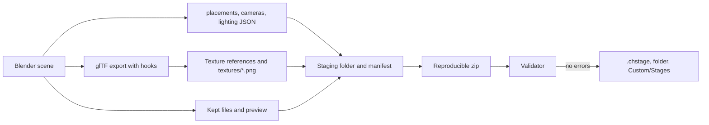

# Blender add-on: CH Stage Tools

Status: **venue MVP** (PACKAGING-PLAN step 5, parts 1 and 2). The add-on makes a venue from a template or opens a venue package, edits all venue data that [package format v1](PACKAGE-FORMAT.md) defines, validates it, and exports a `.chstage` package. The ten GH3 venues open and export again without a loss (section 2.6). Actors (animated scenery) and script banks stay in the package as files without a change; Blender cannot edit them yet.

## 1. For creators

### 1.1 Requirements

- Blender 4.2 LTS or later (Linux, Windows, or macOS). The add-on was tested with Blender 4.2.23 and 5.2.1.
- No internet connection and no other add-on are necessary.

### 1.2 Install

1. Get the file `chstage_tools-<version>.zip`. Do not extract it.
2. In Blender, open **Edit > Preferences > Get Extensions**.
3. Open the menu at the top right (the arrow), then click **Install from Disk**.
4. Select the zip file. Blender installs and enables the add-on.
5. Optional: open **Edit > Preferences > Add-ons > CH Stage Tools** and set **Custom/Stages folder** to the `Custom/Stages` folder of Clone Hero. Export can then copy the package into the game.

To remove the add-on, open **Edit > Preferences > Add-ons**, find **CH Stage Tools**, and click **Uninstall**.

### 1.3 Make a new stage

1. Click **File > New > New Stage from Template**, or open the 3D view sidebar (key **N**), click the tab **CH Stage**, and click **New**. The add-on makes a new scene with:
   - A floor, a back wall, two pillars, and one light fixture.
   - Four band placements with proxy bodies. A proxy body shows the size of a performer. It is not part of the package.
   - One waypoint (`guitarist_walk01`) and two emitters for each effect.
   - Two camera shots (`wide` and `guitar`).
   - Two stage lights (`Stage` and `Band`), the snapshots `fill` and `chorus`, and the moods `intro`, `blackout`, and `chorus`.
   - An empty script bank (`scripts.json`, a text block).
2. Change the scenery. Use usual Blender meshes and materials.
3. Set the package information: open **Stage Package > Package Information**. Set the ID, the name, the version, the authors, and the license.

### 1.4 Start from a package (for example a GH3 venue)

1. Click **File > Import > CH Stage Package (.chstage)**, or **Open** in the **CH Stage** tab.
2. Select a `.chstage` file. For a development folder, select its `manifest.json`.
3. The add-on makes a new scene with the name of the venue:
   - The scenery of `stage.glb` with its materials, lightmaps, and GH3 data.
   - The collection **Markers** (band placements, waypoints, effect emitters), the collection **Camera Shots** (one Blender camera for each shot point), and the collection **Lights**.
   - All settings in the panels: package information, crowd, camera notes, snapshots, moods, and colors.
   - **Kept Package Files**: the files that the add-on does not edit (`scripts.json`, `actors.json`, and the actor GLBs). Export writes them again without a change.
4. The scene camera is the first shot of the group `wide`. A GH3 venue opens in 1 to 19 seconds.

Keep the source package where it is. The actor GLBs stay in it, and export reads them from there (the panel shows "source package missing" when it moved). JSON files are text blocks in the `.blend` file.

### 1.5 What you can set

| Where | Panel | Data |
| --- | --- | --- |
| 3D view sidebar, tab **CH Stage** | Stage Package | New, Open, add a marker, Validate, Export .chstage, issue list, last export |
| | Package Information | ID, version, name, description, license, permissions, authors, credits, required packages, preview (Render, Image, or None) |
| | Kept Package Files | The files that export writes again without a change, and their source |
| | Stage Object | Marker type: band placement (role), waypoint (name), effect emitter (pyro, sparks, fireworks, smoke). For scenery: light group, visibility group and start state, light fixture, script object and its pivot (none, object origin, or custom values) |
| | Camera Shot (camera selected) | Shot name, type, control, tag, groups, anchor and look-at target, screen offset, write rotation, more points, orbit angle, angular speed, step time, step count, step direction, height ease, hand camera, key times, waypoints. A camera that is not a shot shows its point settings |
| | Stage Light (light selected) | Light ID, group, type, script object, override color, intensity, near, far, hotspot and field |
| | Lighting | Snapshots (light settings with specular, and beams), **Capture** and **Apply**, moods, color presets |
| | Crowd and Camera Notes | Crowd roles and models, GH3 camera note selectors |
| Properties editor, tab **Material** | CH Stage Material | Shading (lit, ambient, unlit, not set), transparency (opaque, cutout, blend, additive), alpha cutoff, two-sided, color alpha (opaque GH3 materials), color scale, lightmap and its UV map, movie slot, sorted transparency, crowd atlas, crowd role, billboard, flipbook. "Kept GH3 data" lists the GH3 shader data that export keeps |

### 1.6 Validate

Click **Validate**. The add-on writes the package into a temporary folder and runs the package validator of the mod on it. The list shows the errors and the warnings. Click the arrow button of an issue to select its object.

### 1.7 Export and play

1. Click **Export .chstage** (or **File > Export > CH Stage Package (.chstage)**).
2. Select the file name. The default is `<package ID>.chstage`.
3. Options:
   - **Development folder**: also write the unpacked package to `unpacked/<name>.chstage` next to the zip.
   - **Copy to Custom/Stages**: also copy the package into the `Custom/Stages` folder (the add-on preferences, or the folder in the option).
   - **Preview**: **Render** makes a 512 × 288 image from the scene camera (Workbench); **Image** uses an image; **None** writes no preview.
4. The add-on validates the package. It writes the package only when there is no error. The issue list shows the result.
5. Put the `.chstage` file into `Custom/Stages` (or use **Copy to Custom/Stages**). Group subfolders are permitted.

Export gives the same bytes for the same scene and Blender version (fixed zip times, sorted files, preview without date chunks).

### 1.8 Rules to know

- Blender is Z up. The package uses Y up. The add-on converts the data. Do not rotate the scene.
- A performer looks toward Blender −Y (the front view looks at the performer's face).
- A camera shot uses the Blender camera: its position, its direction, and its horizontal field of view. Set the render size to 16:9 (the template uses 1920 × 1080).
- **Camera anchors.** A camera with the anchor `guitarist.root` moves with the guitarist placement. For the anchors `head`, `hand_left`, `hand_right`, and `bone`, the game places the camera relative to the animated bone. Blender has no animated performer, so Blender shows the camera relative to the performer root. The add-on keeps the anchor and the offset: an anchored camera that you do not move exports the same offset, and a camera that you move exports its new offset from the performer root. Validate gives a warning for each bone anchor.
- A camera point without **Write rotation** has no rotation in `cameras.json`; the game aims it at the look-at target. Blender aims it at 1.5 m above the target performer root.
- **Lightmaps.** Set the lightmap image and its UV map in the material panel. The UV map must be the second UV map of the mesh (glTF `TEXCOORD_1`); Validate gives an error when it is not. Export puts the lightmap into the node tree as the glTF occlusion texture.
- The beam axis of a light fixture housing is its local −Y axis. A snapshot beam takes its position and its direction (local −Z, as a Blender spot light) from its beam object when you click **Capture**.
- Every snapshot must have settings for every stage light. Use **Capture** after you add a light.
- The moods `intro` and `blackout` are necessary. The group `wide` must have one shot.
- **Unchanged data stays the same.** After Open, export writes each row (a shot, a light, a snapshot, a material, a node) of the opened package again without a change while its Blender data did not change. A row that you change is written from the Blender data, with float32 precision.
- Blender can rename objects and materials when you open a package into a `.blend` file that has the same names (`floor.001`). Export uses the names of the package again.
- GH3 texture references (`#<image name>`) to images that Blender does not export (the GH3 shader samplers) become PNG files in `textures/` of the package.

### 1.9 Not available yet

- Actors (animated scenery), script banks, and characters in Blender. Open keeps them as package files.
- Material preview node trees, the shot preview, and the lighting preview.

## 2. For developers

### 2.1 Files

| Path | Contents |
| --- | --- |
| `blender/chstage_tools/blender_manifest.toml` | Extension manifest (`blender_version_min = "4.2.0"`) |
| `blender/chstage_tools/properties.py` | Property groups. Each group maps to one package file (table below). Add-on preferences (Custom/Stages folder) |
| `blender/chstage_tools/sidecars.py` | Builds `manifest.json`, `placements.json`, `cameras.json`, `lighting.json`, and the `gh3*` extras from plain data, and reads them back (`open_*`). `Keeper` (section 2.5). No `bpy`; the tests use it without Blender |
| `blender/chstage_tools/collect.py` | Reads the scene into plain data, exports `stage.glb`, and has the glTF export hooks |
| `blender/chstage_tools/package_export.py` | Export .chstage and Validate: writes all package files, texture files, preview, manifest, zip; runs the validator |
| `blender/chstage_tools/package_open.py` | Open .chstage: GLB import with fixes, sidecars into the property groups, kept files. Has the glTF import hooks |
| `blender/chstage_tools/materials.py` | Lightmap node tree (glTF occlusion texture), vertex alpha for the 4.2 exporter, image bytes |
| `blender/chstage_tools/glb_tools.py` | GLB read and write, GLB fixes before import, PNG text chunk removal. No `bpy` |
| `blender/chstage_tools/gltf_io.py` | Safe glTF import and export settings, and the Blender 4.2 import fix |
| `blender/chstage_tools/template.py` | The template scene, snapshot capture and apply |
| `blender/chstage_tools/operators.py`, `panels.py` | Operators and panels |
| `blender/build.py` | Copies `pipeline/package` (validator, container, decisions) and `schemas/` into `chstage_tools/vendor/package_format/` and writes the zip |
| `blender/test.sh`, `blender/tests/blender_test.py` | Headless test in Blender: template, validate, export, open, round trip of the template and of one GH3 venue |
| `blender/roundtrip.sh`, `blender/tests/roundtrip.py`, `roundtrip_summary.py` | Round trip of all venue packages, one Blender process each, with a Markdown summary |
| `blender/tests/screenshots.py`, `screenshots_package.py` | Panel screenshots; Open and Export screenshots (need a window) |
| `pipeline/package/container.py` | JSON bytes, hashes, and the reproducible zip writer that the converter and the add-on share |
| `pipeline/package/compare.py` | Compares two packages by meaning (`python -m pipeline.package.compare A B`) |
| `tests/test_blender_addon.py` | Tests without Blender (part of `scripts/test.sh`) |

The add-on and the converter use one validator and one zip writer. `pipeline/package` uses relative imports and has no other repository dependency, so `build.py` copies it without changes. The copy is not in git.

### 2.2 Property map

The layout follows the package files, so that export and Open map one to one.

| Blender data | Package file and field |
| --- | --- |
| `scene.chstage.package` | `manifest.json` (`files` and `entry` come from the export) |
| `object.chstage.marker` = `BAND`, `WAYPOINT`, `EFFECT` | `placements.json` `band`, `waypoints`, `effects` (object world transform) |
| `scene.chstage.crowd` | `placements.json` `crowd` |
| `object.chstage.shot` (camera), `object.chstage.point` (camera or empty), `scene.chstage.camera_notes` | `cameras.json` `shots`, `groups`, `notes` |
| `object.chstage.light` (light), `scene.chstage.snapshots`, `moods`, `colors` | `lighting.json` |
| `object.chstage` scenery fields | `stage.glb` node extras `gh3LightGroup`, `gh3VisibilityGroup`, `gh3InitiallyVisible`, `gh3Fixture*`, `gh3Object*` |
| `material.chstage` | `stage.glb` material extras `gh3*` and glTF `alphaMode`, `alphaCutoff`, `doubleSided`, `occlusionTexture`, base color alpha (opaque) |
| `material.chstage.kept_extras`, `kept_images` | Other `gh3*` material extras (`gh3Shader`, `gh3SourceMaterial`, `gh3MaskTexture`, `gh3LayerTexture`, `gh3LayerColor`, `gh3UvWibble`) and the Blender image of each texture reference |
| `scene.chstage.kept_files` | Other package files (`scripts.json`, `actors.json`, actor GLBs): text blocks or source package references |
| `kept`, `order`, `source_name` (objects, materials, list items) | Source rows, package order, and package names of an opened package (section 2.5) |

The glTF export hooks (`glTF2ExportUserExtension` in `__init__.py`) write the `gh3*` extras, the glTF material fields, and the package names during an add-on export only. They remove the add-on property groups from the extras of every glTF export. The glTF import hooks (`glTF2ImportUserExtension`) map glTF node, material, and image indices to the Blender data during Open only.

### 2.3 Export



- glTF export settings: `gltf_io.EXPORT_OPTIONS` (spike 9.6), the selected scenery only, no cameras and lights, `export_vertex_color="ACTIVE"`.
- Before the export, `materials.sync_lightmap` makes the occlusion node chain (image, Separate Color, glTF Material Output group) for each material with a lightmap. The glTF exporter gives a texture the `TEXCOORD` index of its UV map in the mesh, so the lightmap UV map must be the second one.
- During the export, `materials.vertex_alpha_for_export` links the vertex color alpha to the shader alpha. Without it, the Blender 4.2 exporter writes `COLOR_0` without alpha for opaque materials (seen on `gh3.soundcheck` and `gh3.artdeco`).
- `package_export.finish_glb` keeps `#<name>` for images that Blender exported and writes the other referenced images to `textures/<name>.png` (PACKAGE-FORMAT 6.6).
- The preview render saves and restores the render settings and removes the PNG text and time chunks.

### 2.4 Open

- The add-on changes a copy of `stage.glb` before the import, so that the Blender importer keeps all data. The exporter writes the same triangles again:
  - `separate_faces`: a triangle that repeats the vertices of an earlier triangle (GH3 back faces and copies; Blender drops it), and a triangle with two corners at one position (Blender then gives all faces at that vertex a default normal, up to 90° wrong) get their own vertex copies.
  - `fill_texcoord_gaps`: the importer reads `TEXCOORD_n` only up to the first missing set. GH3 meshes have `TEXCOORD_3` (mask UV) without `TEXCOORD_1` and `TEXCOORD_2`. The add-on adds the missing sets with zeros; export then writes them as zeros.
  - `normalize_normals`: 12 GH3 meshes (prison, hell, budokan, party) have normals that are not unit length. The Blender 4.2 importer turns their custom normals up to 38° wrong. The add-on makes them unit length (glTF requires it, and Blender exports unit normals).
  - The 4.2 custom attribute fix (section 2.8).
- Images that no material socket uses (the GH3 shader samplers) are not imported by the glTF importer. The add-on packs them into the `.blend` file from the GLB.
- The add-on removes the `gh3*` custom properties that the importer makes from extras and sets the property groups.

### 2.5 Unchanged rows (`sidecars.Keeper`)

Blender stores transforms and settings in float32, and the add-on writes rounded numbers. Thus a computed row is close to the source row, but not equal. The Keeper gives an exact round trip:

1. Open stores the source row on its owner (`kept` JSON: object, material, or list item).
2. Open then computes each row from the new Blender data with the export code (Keeper mode `record`) and stores it next to the source row.
3. Export computes each row again. When it is equal to the stored row, nothing changed in Blender, and export writes the source row. Else export writes the computed row.

Rows: placements (each marker, each crowd item), shots (with all points), camera groups, camera notes, lights, snapshots, moods, colors, node extras, material data. `keep_source=False` on the export operator turns the Keeper off (tests).

### 2.6 Round trip of the GH3 venues

Method: `blender/roundtrip.sh` opens each package of `assets/packages/` in a new Blender process (Open .chstage), exports it without edits (Export .chstage, the Keeper on), exports it again (same bytes?), and compares the export with the source package (`pipeline.package.compare`). A second export with the Keeper off shows what the Blender data alone gives. Date: 2026-10-09, Blender 5.2.1 and 4.2.23.

The comparison checks:

- All files: the same paths (plus `textures/*.png`), `manifest.json` equal except `files`, all JSON files JSON-equal, all other files byte-equal.
- `stage.glb`: nodes by name (world transform, PACKAGING-PLAN 9.6 limits: 0.1 mm, 0.01°, scale 1e-4; extras equal), materials by name (glTF fields with their defaults; extras equal, with texture references resolved to the image bytes), and mesh primitives by node and material (triangles in a canonical order; every vertex attribute: POSITION 0.1 mm, NORMAL 1°, TEXCOORD 1e-5, COLOR 2.5/255, `_GH3_*` 1e-5; added attributes only when all zero).
- The validator on the export: errors and warnings.

Result: **all 11 packages pass on both Blender versions.** Sidecars (`placements.json`, `cameras.json`, `lighting.json`), `scripts.json`, `actors.json`, the actor GLBs, `manifest.json`, node extras, and material extras are equal; the validator gives 0 errors and 0 warnings; a second export gives the same bytes.

| Package | Nodes | Materials | Primitives | Node rotation max (°) | NORMAL max (°) | COLOR_0 max (/255) | GLB images → exported + `textures/` | Open / export (s), 5.2.1 | Open / export (s), 4.2.23 | Max RSS 5.2.1 (MB) |
| --- | ---: | ---: | ---: | ---: | ---: | ---: | --- | --- | --- | ---: |
| `example.studio` | 5 | 1 | 5 | 0 | 0.00 | 0.69 | 0 → 0 + 0 | 0.1 / 0.0 | 0.1 / 0.0 | 355 |
| `gh3.artdeco` | 349 | 65 | 322 | 2e-05 | 0.75 | 1.05 | 70 → 46 + 24 | 3.8 / 2.7 | 12.0 / 2.4 | 940 |
| `gh3.budokan` | 503 | 89 | 527 | 3e-05 | 0.69 | 1.05 | 99 → 73 + 26 | 4.5 / 2.9 | 13.9 / 3.3 | 934 |
| `gh3.credits` | 100 | 13 | 82 | 0 | 0.10 | 1.00 | 19 → 14 + 5 | 0.4 / 0.5 | 0.4 / 0.5 | 472 |
| `gh3.dive` | 353 | 103 | 329 | 9e-06 | 0.75 | 1.05 | 123 → 87 + 36 | 4.0 / 3.2 | 13.0 / 3.1 | 1051 |
| `gh3.hell` | 405 | 100 | 394 | 1e-05 | 0.69 | 1.05 | 108 → 78 + 30 | 4.6 / 4.4 | 14.3 / 5.6 | 1287 |
| `gh3.party` | 252 | 68 | 214 | 2e-05 | 0.60 | 1.05 | 86 → 62 + 24 | 3.4 / 1.9 | 10.7 / 1.8 | 820 |
| `gh3.prison` | 389 | 74 | 376 | 2e-05 | 0.44 | 1.05 | 101 → 64 + 37 | 4.6 / 2.6 | 17.7 / 3.0 | 1073 |
| `gh3.soundcheck` | 239 | 59 | 220 | 6e-06 | 0.32 | 1.00 | 81 → 53 + 28 | 1.2 / 1.3 | 5.3 / 1.5 | 679 |
| `gh3.video` | 388 | 93 | 367 | 2e-05 | 0.78 | 1.05 | 117 → 80 + 37 | 3.4 / 2.6 | 10.0 / 2.8 | 876 |
| `gh3.wikker` | 420 | 93 | 413 | 3e-05 | 0.62 | 1.05 | 110 → 71 + 39 | 5.9 / 2.9 | 18.7 / 3.1 | 956 |

POSITION, TEXCOORD, and `_GH3_*` differ by 0 in all packages. Node positions differ by 0. All triangles survive. No normal of a triangle with area differs by more than 1°.

Differences that remain, and why:

| Difference | Where | Why |
| --- | --- | --- |
| `COLOR_0` up to 1.05/255 | All venues | Blender stores vertex colors as 8-bit sRGB; the package has 8-bit linear values |
| NORMAL up to 0.78° | All venues | Blender stores custom normals in its own encoding. Normals of triangles without area (0–117 for each venue) are not compared: they do not show, and Blender gives them a default normal |
| Normal length | 12 meshes (prison, hell, budokan, party) | The source normals are not unit length; Blender writes unit normals (the comparison uses the directions) |
| `TEXCOORD_1`, `TEXCOORD_2` added, all zero | Primitives with `TEXCOORD_3` only (7 in `gh3.credits`, also in other venues) | Blender cannot have gaps in UV maps (section 2.4) |
| Texture references `#<name>` → `textures/<name>.png` | 5–39 images for each venue | Blender exports only images that a material socket uses (PACKAGE-FORMAT 6.6). The image bytes are equal |
| Vertex order and count, primitive split, glTF defaults written or not | All venues | Blender rebuilds the vertex buffers; the triangles and their data are the same |
| Zip size | −0.2 % to +1.0 % (GH3 venues) | Other GLB layout, PNG files outside the GLB |

Export from the Blender data only (Keeper off) is the path of an edited row. Its differences to the source rows: numbers within 2.3e-6 in the sidecars and within 3e-8 in the node extras (float32 and rounding to 6 digits), and keys with default values that the add-on does not write (`handCam`, `disableOrbit1`, `disableOrbit2`: false; `waypoints`: []; note `tag` and `type`: ""; `overrideColor`, `gh3FixtureFixedPosition`: false; `gh3ObjectScript`: ""). The compiler (`pipeline/stagepack/pack.py`) and the runtime (`StageCameraPath.cs` `OriginalCameraShot`, `StageLighting.cs`) read each missing key as the same default (false, empty node list, empty string; a shot without `waypoints` matches all nodes, as `[]` does).

Check on the compiled runtime data: the source package and the Keeper-off export of artdeco, dive, hell, and credits, compiled with the pipeline compiler and compared by meaning (materials by `gh3SourceMaterial`, textures by PNG bytes, objects by ID, fixtures by script object). The only differences are numbers within 2.3e-6 and the default keys above (`/tmp/opencode/addon-export/evidence/compiled-edited-path.txt`).

A missing `gh3Shading` is not the same as `lit`: the mod then draws the material without the stage surface model (`StageMaterial.ShadingMode` −1). The material panel has the shading value **Not set** for it; Open uses it for the 58 GH3 materials without `gh3Shading`. (Before this fix, an edited material of that kind became `lit`; `compiled-edited-path-before-fix.txt` shows it.)

Evidence: `/tmp/opencode/addon-export/evidence/` (`roundtrip-summary.md`, one JSON report for each package and Blender version, screenshots, template preview). Command:

```sh
TMPDIR=~/.cache/addon-export/tmp flock /tmp/opencode/gh3-heavy.lock bash blender/roundtrip.sh ~/.cache/addon-export/rt "blender-clean $HOME/.cache/blender/blender-4.2-clean"
```

The outputs are about 1.2 GB for each Blender version. Use a disk folder, not `/tmp` (a RAM disk on this machine).

### 2.7 Build and test

```sh
python3 blender/build.py                      # writes blender/dist/chstage_tools-<version>.zip
flock /tmp/opencode/gh3-heavy.lock bash blender/test.sh ~/.cache/chstage-test blender-clean ~/.cache/blender/blender-4.2-clean
```

`blender/test.sh` installs the zip into a temporary Blender user folder (`BLENDER_USER_RESOURCES`), so it does not change the Blender setup of the user. It also opens, exports, and compares `assets/packages/gh3.credits.chstage` when it exists (`CHSTAGE_TEST_VENUE` selects another package; an empty value turns it off). Set `CHSTAGE_TEST_RIG` to a GH3 rig GLB (for example a spike file from `tools/spike-blender/band_glb.py`) to also test the import fix. Result on 2026-10-09: 30 of 30 checks pass on Blender 5.2.1 and on Blender 4.2.23 (template, validate, export with folder and Custom/Stages copy, preview render, lightmap on `TEXCOORD_1`, bone anchor, reproducible export, open, template round trip with and without the Keeper, an edit after open, `gh3.credits` round trip).

### 2.8 Blender 4.2 result

The Blender round trip of the spike (`tools/spike-blender/`, [report](spike/blender.md)) ran again with the portable Blender 4.2.23 LTS (glTF add-on 4.2.83). Guitarist and singer, maximum of the two:

| Variant | Joint local T (mm) 5.2.1 / 4.2 | Joint local R (°) | IBM max | world·IBM − mesh | GH3 clip on rig (cm) | Exported clip (cm) |
| --- | --- | --- | --- | --- | --- | --- |
| `default-default` | 0.00053 / 0.00053 | 0.00032 / 0.00032 | 8.1e-6 / 8.1e-6 | 7.3e-7 / 7.3e-7 | 7.4e-5 / 7.4e-5 | 1.1 / 1.1 |
| `fps30-keep` (recommended) | 0.00053 / 0.00053 | 0.00032 / 0.00032 | 8.1e-6 / 8.1e-6 | 7.3e-7 / 7.3e-7 | 7.4e-5 / 7.4e-5 | 0.00014 / 0.00014 |
| `blend-keep` | 0.00053 / 0.00053 | 0.00032 / 0.00032 | 8.1e-6 / 8.1e-6 | 7.3e-7 / 7.3e-7 | 7.4e-5 / 7.4e-5 | 1.1 / 1.1 |
| `temperance-default` | 2200 / 2200 | 180 / 180 | 2.6 / 2.6 | 6.5e-6 / 6.5e-6 | 210 / 210 | 1.1 / 1.1 |
| `default-flatten` | 2200 / 2200 | 180 / 180 | 8.1e-6 / 8.1e-6 | 1e-6 / 1e-6 | 230 / 230 | 1.1 / 1.1 |
| `default-posed-frame` | 680 / 680 | 140 / 140 | 8.1e-6 / 8.1e-6 | 2.2 / 2.2 | 100 / 100 | 100 / 100 |
| `default-zup` | 0.00053 / 0.00053 | 0.00032 / 0.00032 | 1.4 / 1.4 | 6.8e-7 / 6.8e-7 | 190 / 190 | 210 / 210 |

- With the import fix, all 15 variants give the same numbers on 4.2 and 5.2.1 (except `merge`, a wrong setting in both). Extras (125/125 and 121/121 joints, 15/15 and 7/7 materials), the `_GH3_*` streams (maximum difference 6e-7), the unit scale channels (|scale − 1| ≤ 3.5e-6), and the character check of the validator give the same results.
- **The Blender 4.2 glTF importer has a bug.** It keeps the names of custom vertex attributes in a Python `set` and their data in a list. With two or more `_GH3_*` attributes the orders differ (Python string hashes change for each process). Without a fix, 39 of 40 imports of the guitarist and the singer failed ("all the input array dimensions … must match"). Blender 5.2 uses a dict. `gltf_io.fix_custom_attribute_import()` gives the 4.2 importer an ordered set; the add-on calls it before each import.
- Decision: **the minimum is Blender 4.2**, with the import fix.

Evidence: `/tmp/opencode/addon/rt42/` (`results.jsonl`, `summary-4.2.md`, `accept-fixed.txt`, `characters.txt`), `/tmp/opencode/addon/rt42-stock/` (imports without the fix).


### 2.9 Known limits

- Bone anchors (`head`, `hand_left`, `hand_right`, `bone`) use the performer root in Blender. The game uses the animated bone (section 1.8).
- Blender lights have no ambient type. A light with the type `Ambient` is a Blender point light.
- `export_vertex_color` is `ACTIVE` for the stage GLB, so a mesh exports its active color attribute also when the material does not use it.
- Actors, script banks, GH3 shader records (`gh3Shader`), and UV wibble are kept, not edited. Binary kept files (actor GLBs) stay in the source package; export stops with an error when the source package is missing or changed.
- An edited row is written from float32 Blender data (section 2.5). An alpha cutoff of exactly *n*/255 can then move by less than 1e-7.
- A material that the importer splits into two Blender materials (used with and without `COLOR_0`) exports as two glTF materials. Open gives a warning. The GH3 venues do not have this case.
- Blender 5.2.1 crashes after an operator that makes a scene when a script runs it under a `view_layer` context override. The tests run Open without that override. The user interface is not affected.

### 2.10 Open questions

- Actor and script editing in Blender (part 3). Actors need the skinned import and export of the spike (`fps30-keep` settings) and the actor checks of the validator.
- Kept binary files are references to the source package, not data in the `.blend` file. Packing them into the `.blend` file (or a sidecar folder) is possible; the owner can choose.
- The repository has no license file; the add-on manifest says GPL-3.0-or-later (Blender requirement).
