# Creator guide: stages, characters, and instruments

This guide tells you how to make a stage (`.chstage`), a character (`.chchar`), and an instrument (`.chinst`) for the mod with Blender and the CH Stage Tools add-on. The reference for each panel is [BLENDER-ADDON.md](BLENDER-ADDON.md). The reference for the file format is [PACKAGE-FORMAT.md](PACKAGE-FORMAT.md).

The folder [`examples/`](../examples/) has an example stage and an example character. Open them in Blender to see a finished result.

## 1. Before you start

You need:

- Blender 4.2 LTS or later (Linux, Windows, or macOS). The add-on also works on macOS, but the mod does not run on macOS Clone Hero.
- The add-on file `chstage_tools-<version>.zip`. To make it from the repository: `python3 blender/build.py` (the file goes to `blender/dist/`).
- Clone Hero with the mod installed ([PLAYER-GUIDE.md](PLAYER-GUIDE.md)), to test your package.
- For characters and for camera bone anchors: the GH3 band library `gh3-band-v1.chlib`. The mod installs it in `<game>/Mods/GH3Skin/Packages/`.
- For characters on the rig of a GH3 guitarist (for example Midori or Judy Nails): the GH3 character library `gh3-characters-v1.chlib` and the GH3 character packages (`gh3.<name>...chchar`). The mod installs them in the same folder.

## 2. Install the add-on

1. In Blender, open **Edit > Preferences > Get Extensions**.
2. Open the menu at the top right (the arrow), and click **Install from Disk**.
3. Select `chstage_tools-<version>.zip`. Do not extract the zip file. Blender installs and enables the add-on.
4. Open **Edit > Preferences > Add-ons > CH Stage Tools**, and set these fields:
   - **Custom/Stages folder** and **Custom/Characters folder**: the folders of Clone Hero (see [PLAYER-GUIDE.md section 6](PLAYER-GUIDE.md#6-add-stages-characters-and-instruments)). Export can then copy your package into the game.
   - **GH3 library (.chlib)**: `gh3-band-v1.chlib`.
   - **GH3 character library (.chlib)**: `gh3-characters-v1.chlib`. You can keep it empty when the file is in the folder of the GH3 library.

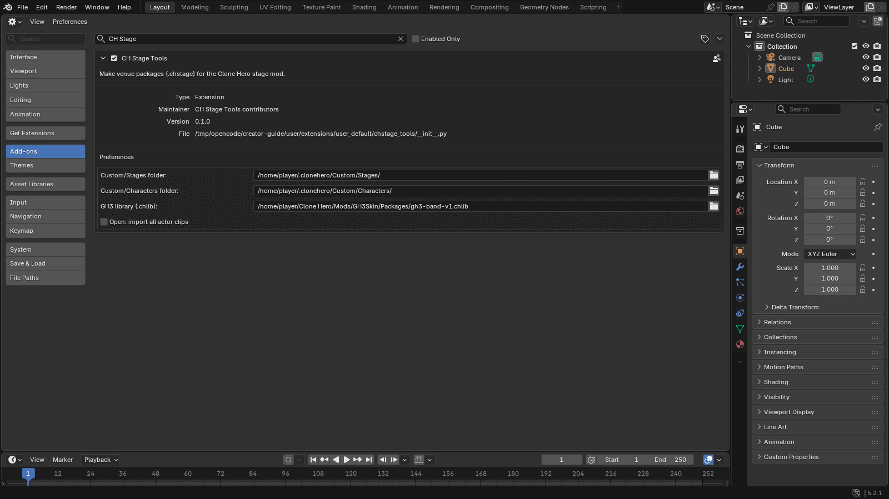

The stage tools are in the 3D view sidebar (push **N**), tab **CH Stage**. The character tools are in the tab **CH Character**.

## 3. Make your first stage

The example of this section is `examples/example-club.blend`.

### 3.1 Start from the template

1. Click **File > New > New Stage from Template**. The add-on makes the scene `CH Stage`.
2. Open **Stage Package > Package Information** and set:
   - **ID**: a stable ID with lowercase letters, digits, `.`, and `-`, for example `yourname.my-club`. Do not change it in later versions.
   - **Name**: the name that the picker shows.
   - **Version**: `1.0.0`. Increase it when you publish a change.
   - **Authors** and **License** (an SPDX ID, for example `CC-BY-4.0`). Set **Redistribute**, **Modify**, and **Commercial use**.
   - **Preview**: **Render** makes a 512 × 288 image from the scene camera.

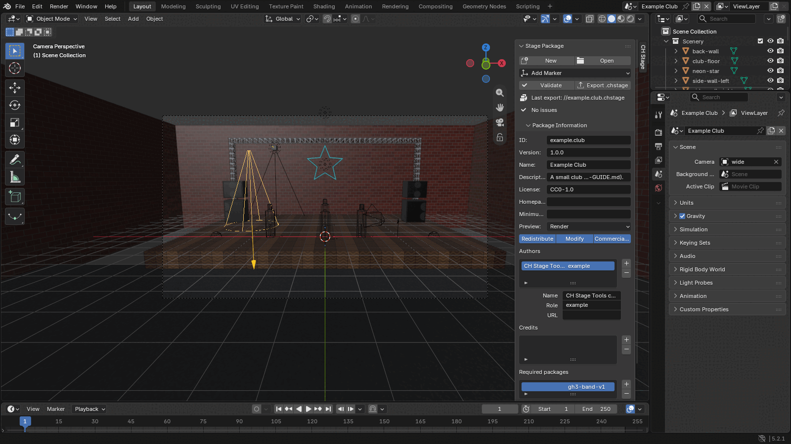

Rules:

- Blender is Z up. Do not turn the scene. The add-on converts the data for the game.
- The performers look toward Blender −Y. The audience is on the −Y side.
- 1 Blender unit is 1 metre. A performer is about 1.8 m tall.

### 3.2 Make the geometry

1. Delete the template boxes `floor`, `backdrop`, `left`, and `right`, or change them.
2. Make your scenery with usual Blender meshes: a stage floor at Z = 0 (the band stands at Z = 0), walls, a truss, speakers.
3. Keep the meshes simple. The example has 17 meshes and 624 vertices.

Export writes all scenery meshes. It does not write markers, cameras, lights, or proxy bodies.

### 3.3 Add a material

1. Select a mesh. Use a usual Principled BSDF material. Connect an **Image Texture** to **Base Color**. The image must be PNG.
2. Open **Properties > Material > CH Stage Material** and set:

| Field | Values |
| --- | --- |
| **Shading** | **Lit** (the stage lights light the surface; the default), **Ambient**, **Unlit** (full brightness, for example a sign), **Not set** |
| **Transparency** | **Opaque**, **Cutout** (alpha test, for example a truss), **Blend**, **Additive** (for example a light glow) |
| **Two-sided** | Draws both sides of each face |

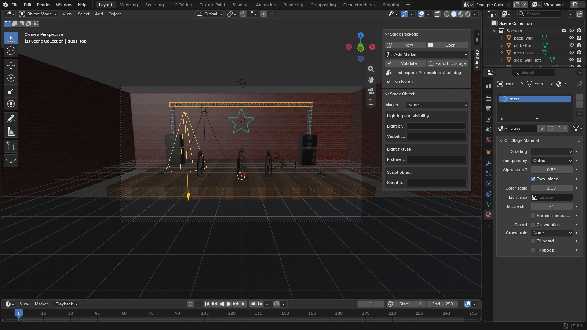

The example uses **Lit** for the walls and the floor, **Cutout** with **Two-sided** for the truss, and **Unlit** with **Additive** for the neon star. For a lightmap, see [BLENDER-ADDON.md section 1.13](BLENDER-ADDON.md#113-rules-to-know).

### 3.4 Put the band on the stage

The template has four band placements (`band-guitarist`, `band-bassist`, `band-singer`, `band-drummer`) with proxy bodies. A proxy body shows the size of a performer. Export does not write it.

1. Select a band placement. Move it and turn it around Z. The arrow of the proxy body points to the audience.
2. To add a placement, put the 3D cursor at the position, then click **Add Marker > Band placement** in **Stage Package**. Set the **Role** in **Stage Object**.

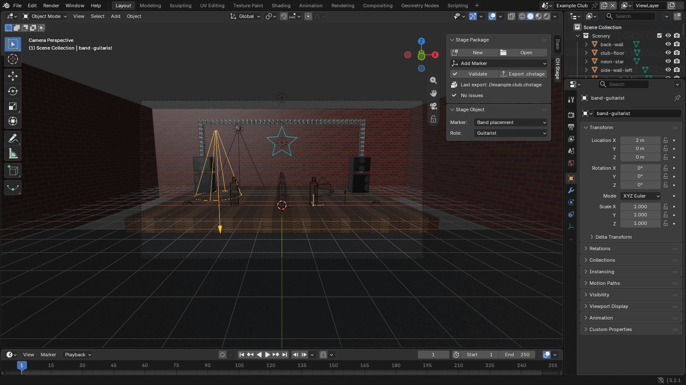

Each role can have one placement. A stage needs at least one placement. The template also has a waypoint (`guitarist_walk01`, a place where the guitarist can walk) and effect emitters (pyro, sparks, fireworks, smoke).

### 3.5 Set two cameras

The template has two camera shots:

| Shot | Groups | Use |
| --- | --- | --- |
| `wide` | `wide`, `default` | The whole stage. The group `wide` is necessary |
| `guitar` | `guitarist`, `default` | The guitarist. **Anchor**: Guitarist, root: the camera moves with the guitarist |

1. Select a camera. Look through it (**View > Cameras > Set Active Object as Camera**) and move it.
2. In **Camera Shot**, set the groups. The game selects a shot from a group when the chart or the generated direction asks for that group: `wide`, `guitarist`, `bassist`, `singer`, `drummer`, `orbit`, or `default`. A group that the stage does not have uses the shots of `wide`.
3. **Look at**: with a target (for example Singer, head), the game turns the camera to the target. With **None** and **Write rotation**, the game uses the rotation of the camera.
4. Set the render size to 16:9 (the template uses 1920 × 1080). The game uses the horizontal field of view of the camera.

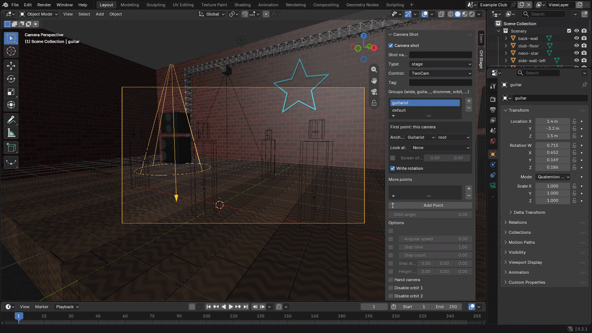

The highway covers the center of the screen. In the example, the guitarist camera turns 22° to the left, so the guitarist is at the right of the highway.

### 3.6 Set a light and two moods

The template has two stage lights (`Stage` for the scenery and `Band` for the performers, both **Ambient**), two snapshots (`fill` and `chorus`), and three moods (`intro`, `blackout`, and `chorus`). A snapshot holds the color and the intensity of each stage light. A mood is a list of snapshots. Charts select the moods.

1. Open **Lighting**. Select the snapshot `fill`, and click **Apply**. The add-on sets the lights to the snapshot.
2. Select the light `Stage`. Change its Blender light color, and its **Intensity** in **Stage Light** (for example warm white, 0.7).
3. Select the snapshot `fill` again, and click **Capture**. The snapshot gets the new settings.
4. Do steps 1 to 3 again for `chorus` with other colors (for example magenta and cyan).
5. Look at the moods: `intro` and `blackout` use `fill`; `chorus` uses `chorus`, then `fill`.
6. Turn on **Live lighting preview** and select a mood to see it in the 3D view.

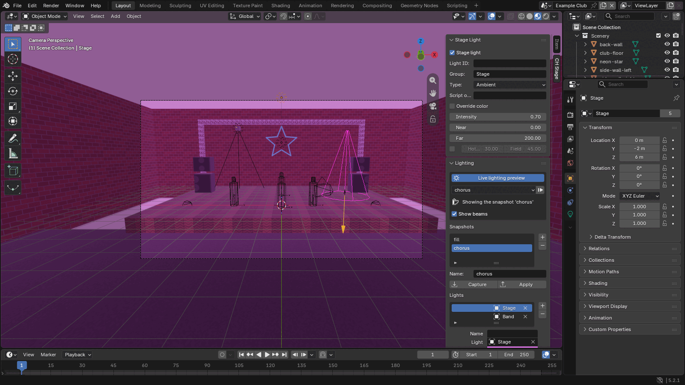

Rules:

- The moods `intro` and `blackout` are necessary.
- Every snapshot must have settings for every stage light. Click **Capture** after you add a light.
- A scenery object uses the light group `Stage` when its **Light group** (in **Stage Object**) is empty. The band uses `Band`.
- Charts can ask for the moods `intro`, `verse`, `chorus`, `solo`, `flare`, `blackout`, and `strobe`. When the stage does not have a mood, the game plays `intro`.

### 3.7 Validate and export

1. Click **Validate**. The list shows errors and warnings. Click the arrow of an issue to select its object. Correct all errors.
2. Click **Export .chstage**. Select a file name (the default is `<ID>.chstage`). Options:
   - **Copy to Custom/Stages**: also copies the package into the game.
   - **Development folder**: also writes the unpacked files to `unpacked/<name>.chstage`.
   - **Preview**: **Render**, **Image**, or **None**.
3. The add-on writes the package only when there is no error.

### 3.8 Play the stage

1. Put the `.chstage` file into `Custom/Stages` of Clone Hero (or use **Copy to Custom/Stages**).
2. Start Clone Hero. The mod imports the package one time.
3. In the menus, push **F6**. Select your stage in the **Stage** list. Push **F6** again to close the picker.
4. Start a song.

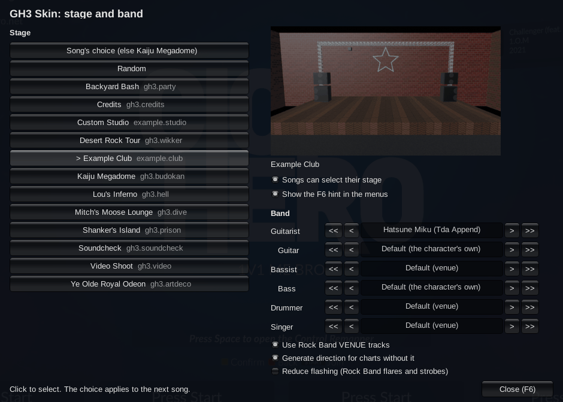

## 4. Edit a GH3 venue

1. Click **File > Import > CH Stage Package (.chstage)**. Select a venue of the mod, for example `<game>/Mods/GH3Skin/Packages/gh3.dive.chstage`. A venue opens in 1 to 19 seconds.
2. Change something, for example the color of a snapshot, a camera, or a material.
3. In **Package Information**, set a new **ID** (for example `yourname.dive-blue`) and a new **Name**. When two packages have the same ID, the mod uses only the package with the higher version (the log tells you `... is not used: ... has the same id`).
4. Click **Validate**, then **Export .chstage**. Put the file into `Custom/Stages`.

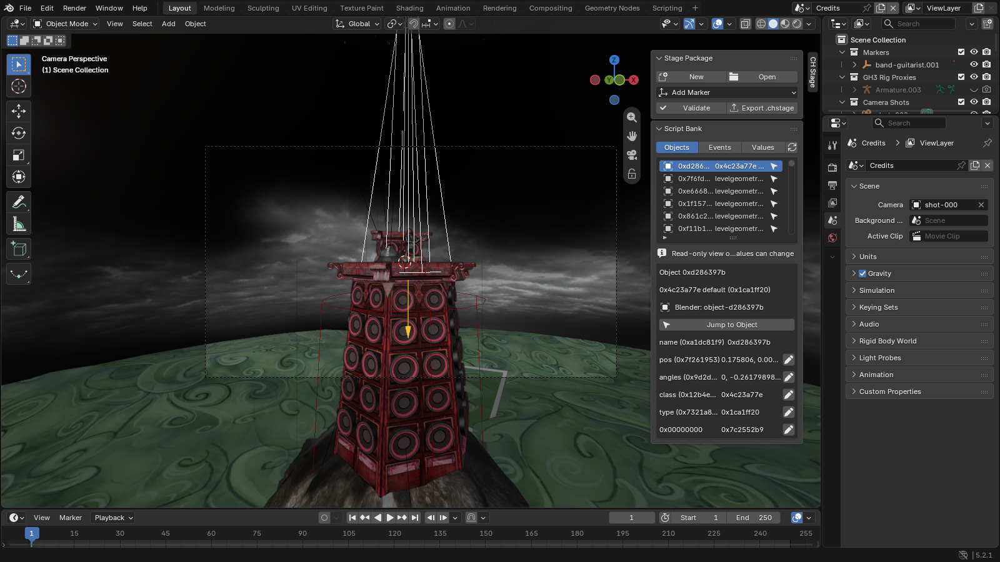

The `.blend` file holds all package data. Export does not need the source package after Open. Unchanged rows (shots, lights, materials, actors) export exactly as in the source. The script bank (`scripts.json`) shows the GH3 objects and values; you can change simple values, not the script code. See [BLENDER-ADDON.md sections 1.4 to 1.10](BLENDER-ADDON.md#14-start-from-a-package-for-example-a-gh3-venue).

The GH3 venues have the license `LicenseRef-GH3-Derived` with the permissions `redistribute: true`, `modify: true`, and `commercial: false`. You can change a GH3 venue and share it under a new ID. Do not sell it.

## 5. Make a character on a GH3 rig

A character is a mesh on one GH3 rig. The game plays the GH3 animations of the band member on your mesh and adds the instrument. You do not make a skeleton or animations. The example is `examples/example-guitarist.blend`.

1. Set **GH3 library (.chlib)** in the add-on preferences (section 2).
2. Click **File > New > New Character from GH3 Rig**. Select a profile:
   - A fixed profile: guitarist (Axel), bassist, singer, or drummer.
   - A GH3 guitarist, for example **Midori (outfit 1)** or **Judy Nails (outfit 1)**. Your character then gets the skeleton, the animations, and the hair physics of that guitarist. It plays the guitarist and the bassist. Select the guitarist with the body that is nearest to your character (height, length of the legs and the arms, width of the shoulders).

   The add-on makes a scene with the rig, the GH3 body as a wireframe reference, the instrument as a preview, and a preview camera. Export never writes the reference body and the instrument.
3. Do not move, turn, scale, or edit the rig.
4. Model your character over the reference body, or import a mesh and move it onto the reference body. Use PNG images.
5. Select your meshes, and click **Transfer Weights from the GH3 Body** in **Weights and Hair**. Each vertex gets the weights of the nearest point on the GH3 body (4 bones at most).
6. Change the weights with Weight Paint if necessary. Then click **Limit and Normalize**.
7. Hair: select the hair cards, select a chain in **Hair bones of the profile**, and click **Assign to Hair Bones**. Make the hair material active and click **+** under **Hair materials**. For long hair, a skirt, or a tail that the profile does not have, make your own chains (section 5.3).
8. Optional: click a clip in **Clip Preview** and click **Play** to see your character move.

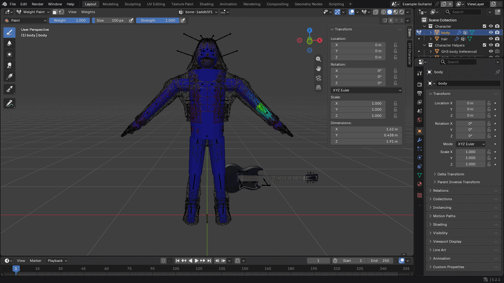

9. Set the package information in **Character Package > Package Information** (ID, name, version, authors, license).
10. Click **Validate**. Correct all errors.
11. Click **Export .chchar**. Put the file into `Custom/Characters` of Clone Hero.

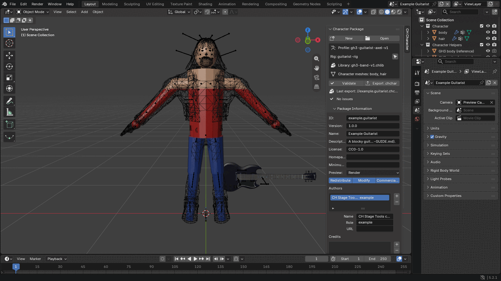

### 5.1 Use a rigged model (MMD, VRM, FBX)

You can use a model that has its own skeleton, for example an MMD model (`.pmx`). Read the terms of the model first: many models do not permit changes or distribution. The steps below are the steps of a test with an MMD model of a small anime character on the profile **Midori (outfit 1)**.

1. Import the model. Blender cannot read `.pmx`: install the extension **MMD Tools** (Blender extensions platform). Import at the scale 0.08 (1 MMD unit is 8 cm).
2. **Move the model onto the GH3 bind pose.** The add-on has no tool for this step. In Pose Mode of the model's armature, turn and scale the bones so that each joint is on the joint of the GH3 rig: hips, knees, ankles, toes, spine, neck, head, shoulders, elbows, wrists, and each finger joint. Then apply the Armature modifier of the mesh (**Object > Apply**), and delete the model's armature. Small differences in the proportions are normal: the GH3 rig sets the length of each bone, so the mesh stretches a little.
   - If you move the mesh with a script, use only the vertex groups of deform bones, as the Armature modifier does. MMD Tools adds the vertex groups `mmd_edge_scale` and `mmd_vertex_order`; they are not bones. A script that used them as weights moved the parts of the head of the test model against each other by up to 1.4 cm: the bangs and the face skin then covered the inner part of the eyes, and the eyes looked too far apart.
   - A model that comes from a Unity game (FBX from an asset tool) can be mirrored: object scale −1 and the face toward +Y. Mirror it so that the face looks toward −Y and the left side of the character is at +X, and check that the normals point out.
3. Remove the shape keys (**Object Data > Shape Keys**). The mod does not play shape keys; the GH3 clips move the face with bones.
4. **Materials.** Importers of MMD and VRM models make toon shader node groups. The glTF export does not read them, and the package then has no texture (the character is white in the game). Validate gives a warning for each such material. Give each material a **Principled BSDF** with the image on **Base Color**, and save the images as PNG. Images of 1024 × 1024 pixels are sufficient (the GH3 characters use 1024 pixels or less).
5. Set the material panel: for example **Toon** for an anime look ([section 5.2](#52-toon-look-and-eyebrows-over-the-hair)), **Unlit** for parts that glow, **Blend** for hair cards and other parts with transparency. For an MMD model, click **Toon from MMD** before you replace the MMD node groups: it reads the toon texture, the sphere map, and the edge of each MMD material.
6. **Weights.** Click **Transfer Weights from the GH3 Body**. Then correct these parts with Weight Paint:
   - The face and the hair on the head: full weight on `bone_head`. The face bones of the GH3 body are at other places than the eyes and the mouth of your character; with their weights, the face changes shape when the GH3 face moves.
   - The hands: Transfer Weights can give a finger the weight of the next finger. When the model has good finger weights, keep them: rename the finger vertex groups to the GH3 finger bones (the add-on shows the bone names), then remove the other vertex groups.
   - Parts far from the body (a long tail, cables): they get the weights of the nearest body part (for example the heels). Paint them to `bone_pelvis`.
7. **Long hair, skirt, tail.** Make your own chains (section 5.3). With MMD Tools, **Chains from MMD Physics** makes them from the MMD rigid bodies of the model. Or use the hair chains of the profile: select the vertices of each pigtail and click **Assign to Hair Bones** (Midori has two pigtail chains; the vertices below the end of a chain go to the last bone and move as one part). Add the hair materials to **Hair materials**.
8. Click **Limit and Normalize**, look at some clips in **Clip Preview**, then Validate and export.

Compare the face of your export with the source model: render both front-on in Blender (the export with **File > Import > glTF**). The eyes must be at the same places. Measure a ratio, for example the distance between the eyes divided by the width of the face at the height of the eyes: it must be the same in the source and in the export. To see the face in the game at a fixed angle, use `GH3_SKIN_DEBUG_VIEW_HEAD=local` ([VERIFICATION.md](VERIFICATION.md)). The game shows the face as Blender does with the same camera. Thus, if the eyes look too far apart in the game but the ratios are correct, the cause is the design of the model or the camera angle, not the export. (In a test on gh3.dive, half of the frames that show the guitarist's face are 12° to 42° to the side of the face.)

Known limits: the character does not blink and does not move its mouth (the face is on the head bone). The hair chains of the profile collide only with the head; use your own chains with colliders for long hair.

### 5.2 Toon look and eyebrows over the hair

Anime models look flat with the **Lit**, **Ambient**, or **Unlit** shading. Use **Toon** (cel shading). The venue lights still color a toon character: in a red light the character is red, and in a blackout the character is dark.

1. Set **Shading** to **Toon** in **CH Stage Material**.
2. Set the light and the shade:
   - **Threshold**: where the shade starts. 0.5 shades the side that turns away from the key light. 0 is always lit (use it for the eyes).
   - **Softness**: the width of the edge between light and shade. 0.02 gives a hard anime edge.
   - **Shade texture** and **Shade color**: the color of the shaded side. A model from a game often has a shadow color texture (Project SEKAI: the `_S` texture). Without a texture, the shade is the base color times the shade color, for example (0.8, 0.8, 0.9).
   - **Shade mask**: red 0 is always shaded, 0.5 follows the light, 1 is always lit (Project SEKAI: the blue channel of the `_H` texture).
   - **Sphere map**: an MMD sphere map (`.sph` multiply, `.spa` add) for shine on hair and cloth.
   - **Rim width** and **Rim color**: a thin light at the silhouette.
3. **Outline**: set **Width** to about 0.0015 (1.5 mm at 1 m from the camera) and the **Color**. **Textured** multiplies the color by the base texture (a darker line in the color of the part). Do not use an outline on the eyes, the eyelashes, and the eye highlights. The mesh needs smooth normals; split normals give gaps in the line.
4. Click **Preview** to see the toon look in Material Preview (EEVEE). Click **glTF material** to see the Principled BSDF again. Export always writes the glTF material and the toon settings.

**Eyebrows over the hair.** In anime games the eyebrows and the eyelashes show through the bangs. Set **Hair layer** to **Over hair** on the eyebrow (and eyelash) material, and to **Hair** on the hair materials of the same character. The game then draws the hair around the eyebrows. Rules:

- The eyebrows need their own material. If the eyebrows are in the face texture, select their faces in Edit Mode and give them a copy of the face material.
- The feature shows only where its faces turn to the camera, so it never shows through the back of the head. Other parts (the hands, the instrument, other band members) still cover it.
- To check it in the game, use `GH3_SKIN_DEBUG_HAIR_LAYER=mark` ([VERIFICATION.md](VERIFICATION.md#runtime-variables)): the features then show in a flat color.

### 5.3 Make hair, skirt, and tail chains

A chain is a line of bones that you add to the rig. The game moves the chain with gravity and the motion of the body, as GH3 moves its hair. Colliders are capsules on the body: the chain does not go into them.

1. Open **Chains and Colliders** in the tab **CH Character**.
2. Select your mesh, go to Edit Mode, and select the vertices of one strand: one twin tail, one skirt panel, or a tail.
3. Click **Chain along Strand**. Set:
   - **Chain name**, for example `twin_tail_l`.
   - **Joints**: the number of bones. Use 5 to 8 for a long twin tail, 2 for a skirt panel, 6 to 13 for a tail.
   - **Parent bone**: the bone that holds the chain (for a twin tail the head, for a skirt the pelvis). Empty: the nearest body bone.
   - **Preset**: **Long hair or twin tail**, **Skirt**, **Tail or cable**, **Hair**, or **Stiff accessory**.

   The tool adds the bones and gives the selected vertices weights on them.
4. Do steps 2 and 3 again for each strand.
5. Click **Fit Body Colliders**. The tool adds capsules on the hips, the body, the legs, the arms, a sphere on the head, and a capsule on the guitar. Look at them in the viewport. Move a capsule or change its radius if necessary.
6. For each chain, clear **All colliders** and type the colliders near it. Example: a twin tail touches `head, chest, waist, stomach, hips, thigh_l, thigh_r, guitar`; a skirt touches `thigh_l, thigh_r, shin_l, shin_r`.
7. To change the motion, make a joint bone active in Pose Mode and change its values: **Swing limit** (how far it swings), **Damping** (how fast it stops), **Speed limit** (how fast it can turn).
8. Click **Validate**, then **Export .chchar**.

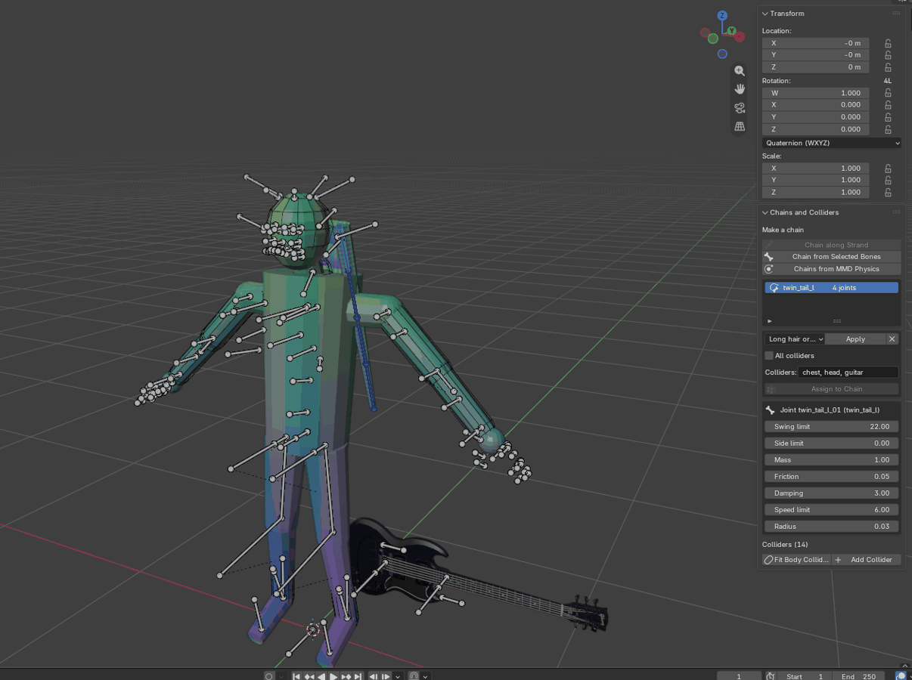

With an MMD model: import the model with MMD Tools with physics, move the MMD model onto the rig (the same fit as the mesh), and click **Chains from MMD Physics**. The tool makes a bone for each moving rigid body, with the MMD mass, damping, and limits. Then remove the MMD model.

Hints:

- Make the swing limit small for a long chain: each joint adds its swing.
- A chain that touches a collider at rest pushes away from it all the time. Give each chain only the colliders near it.
- A long tail can hit the floor: add a large sphere under the floor on the root bone (**Add Collider** on the root bone, radius 3 m, 3 m under the floor).
- At most 64 joints. Each joint costs time in the game; 40 joints of the test character take 0.13–0.36 ms of each frame on the test computer.

### 5.4 Play the character

To use the character:

1. Start Clone Hero, and push **F6** in the menus.
2. In **Band**, click **<** or **>** on the line of the band member (for example **Guitarist**) until your character shows.
3. Start a song. A guitarist character can also play the bassist (the two rigs have the same bones).


The example `.blend` file has no helpers (the GH3 body and the guitar are not in the file). Set the library in the preferences, then click the reload button in **Weights and Hair** to load them.

## 6. Make an instrument

An instrument is a guitar or a bass that the player can select in the picker. It can have its own highway image. The Blender add-on has no instrument panel yet; use the character template and the command-line packer.

1. Click **File > New > New Character from GH3 Rig** and select the guitarist (for a guitar) or the bassist (for a bass). The scene has the rig and the GH3 instrument as a preview.
2. Model your instrument at the place of the preview instrument. The neck goes along `bone_guitar_neck`; the hands of the band member hold it at `BONE_GUITAR_FRET_POS` and `BONE_GUITAR_STRUM_POS`. Use PNG images.
3. Give every vertex the weight 1 on `bone_guitar_body` (the GH3 instruments do the same). Do not move the rig.
4. Export the scene as GLB from Blender (glTF Binary, +Y up, the armature in its rest position).
5. Optional: draw a highway image, a PNG of 512 × 1024 pixels. The bottom of the image is near the player; the image repeats along the highway.
6. Pack and check the instrument (the `--split` option keeps only the mesh parts on the instrument bones, so the export can contain the body):

```sh
MISE_QUIET=1 uv run --with numpy python -m pipeline.package.instrument my-guitar.glb --id me.my-guitar --name "My Guitar" \
  --kind guitar --highway my-highway.png --author "My Name" --license CC-BY-4.0 --split \
  --library assets/packages/gh3-band-v1.chlib --output out
```

7. Put `out/me.my-guitar.chinst` into `Custom/Instruments` of Clone Hero.
8. In the picker, select your instrument in the **Guitar** (or **Bass**) line. When you play the guitarist, your highway image shows.

The format is in [PACKAGE-FORMAT.md section 9.4](PACKAGE-FORMAT.md#94-instrument-chinst).

## 7. Direction in charts

The mod plays camera cuts, lights, and effects from the chart. Your stage gets them through its camera groups and moods. Chart authors can use these sources:

| Source | What it does | Reference |
| --- | --- | --- |
| GH `CAMERAS` and `LIGHTSHOW` tracks | GH3 camera notes (77–117) and light notes in a `.chart` section or a MIDI track | [CUSTOM-CONTENT.md, Direction tracks](CUSTOM-CONTENT.md#direction-tracks) |
| Text events | `stage pyro`, `stage lights chorus`, `[stage camera singer]`, and more, in `[Events]` | [CUSTOM-CONTENT.md, Text events](CUSTOM-CONTENT.md#text-events) |
| Rock Band `VENUE` track | Camera cuts, lighting, and effects of converted Rock Band charts (MIDI only) | [CUSTOM-CONTENT.md, Rock Band VENUE track](CUSTOM-CONTENT.md#rock-band-venue-track) |
| No direction | The mod makes cuts and light changes from the chart sections | [CUSTOM-CONTENT.md, Generated direction](CUSTOM-CONTENT.md#generated-direction) |
| `gh3_stage = <id>` in the `[song]` section of `song.ini` | The song selects an installed stage | [PLAYER-GUIDE.md, Stages that a song selects](PLAYER-GUIDE.md#stages-that-a-song-selects) |
| `venue.chstage` in the song folder | The song brings its own stage. The mod imports it when the song starts | [PLAYER-GUIDE.md, Stages that a song selects](PLAYER-GUIDE.md#stages-that-a-song-selects) |

On a custom stage, the GH3 camera notes select these groups: 84 and 86 close-up shots, 85 mid shots, 87 `wide`, 88 `singer`, 89 `drummer`, 95 `guitarist`, 97 `bassist`, the orbit notes `orbit`, and the other notes `default`. Give your stage shots in these groups, so that charts can cut to each band member.

## 8. Problems

### Validate and export messages

| Message | Do this |
| --- | --- |
| `the stage needs at least one band placement` | Add a band placement (**Add Marker > Band placement**) |
| `two band placements for the role ...` | Keep one placement for each role |
| `no camera shot is in the group 'wide' (required)` | Add the group `wide` to a camera shot |
| `shot '...': anchor ... needs a band placement for ...` | Add the placement, or change the anchor of the shot |
| `shot '...': a point without rotation needs a look-at target` | Turn on **Write rotation**, or set **Look at** |
| `lighting needs the mood 'intro'` (or `'blackout'`) | Add the mood in **Lighting > Moods** |
| `snapshot '...' has no settings for the light '...'; use Capture` | Select the snapshot and click **Capture** |
| `lighting needs at least one stage light` | Select a light and turn on **Stage light** |
| `the stage has no scenery meshes` | Add a mesh that is not a marker |
| `shot '...': the game places the camera relative to the ... bone` (warning) | Set the GH3 library in the preferences and click **Load GH3 Rig Proxies** |
| `mesh '...' has no Armature modifier for the rig` | Click **Transfer Weights** |
| `mesh '...': N vertices have no weight on a rig bone` | Click **Transfer Weights**, or paint the weights |
| `... more than 4 influences` or `... do not sum to 1` | Click **Limit and Normalize** |
| `mesh '...' has its own transform` | Click **Transfer Weights**, or **Object > Apply > All Transforms** |
| `the rig must stay at the origin ...` or `the rig has no bone ...` | Clear the rig transform, or start again from **New** |
| `material '...': image '...' is ...; packages use PNG only` | Save the image as PNG |
| `material '...': the glTF export does not read its surface node ...` (warning) | Connect a Principled BSDF with the image on Base Color to the material output (section 5.1) |
| `... needs the GH3 character library ...` (Open) | Set **GH3 character library (.chlib)** in the add-on preferences |
| `no GH3 library: ...` (warning) | Set **GH3 library (.chlib)** in the add-on preferences |

### In the game

Look in `<game>/MelonLoader/Latest.log`:

| Log line | Meaning |
| --- | --- |
| `GH3 packages: imported <id> <version> in ...` | The mod read your package. The line gives the meshes, textures, and materials |
| `GH3 packages: skipped <file>: <reason>` | The package is not valid. Validate it in Blender |
| `GH3 stage choice: <id> (<reason>)` | The stage that plays, and why (the player's choice, the song, `GH3_SKIN_STAGE`) |
| `GH3 stage loaded: <name>` | The stage is on the screen |
| `GH3 band guitarist: character <id> (...) with instrument ...` | Your character plays, with this instrument |
| `GH3 band <role>: character <id> is not installed or did not import; the venue default plays` | The character file is not in `Custom/Characters`, or it did not import (look for `skipped`) |

| Problem | Do this |
| --- | --- |
| The stage is not in the picker | Look for `skipped` in the log. Make sure that the file is in `Custom/Stages` and that its extension is `.chstage` |
| The stage and the band are dark in the game | Mod versions before 2026-10-09 lit a stage with a `scripts.json` (script bank) only through GH3 light objects (`LevelLight`), so a bank without them gave no light. Update the mod. Now the stage lights apply unless the bank has `LevelLight` objects |
| `light '...' has no GH3 light object` (warning) | `scripts.json` has `LevelLight` objects, so only these light the stage. Set the **Script object** of the light to a `LevelLight` name, or remove the `LevelLight` objects from `scripts.json` |
| The camera shows only the highway | Move the camera, or turn it so that the performers are to the left or the right of the highway |
| A change does not show | Export again and start the game again. The mod imports a package again when its file changes. When two packages have the same ID, the mod uses the higher version |
