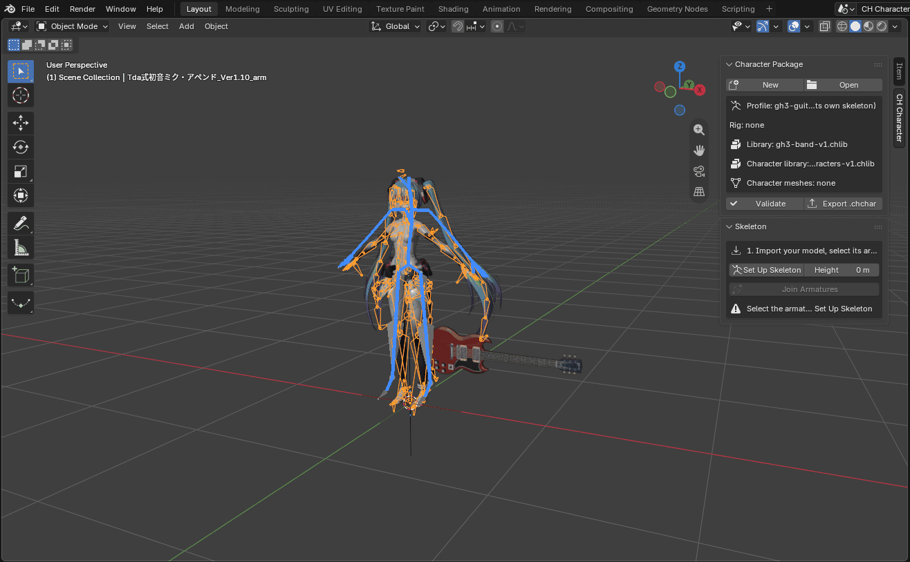
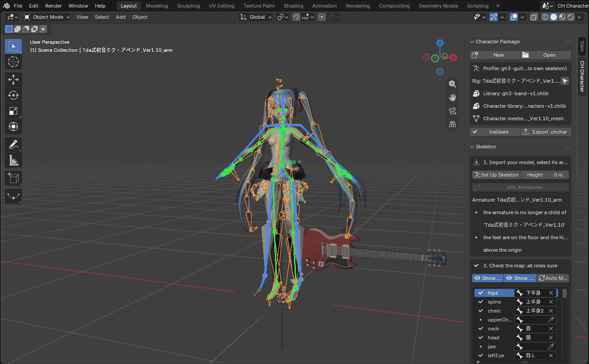
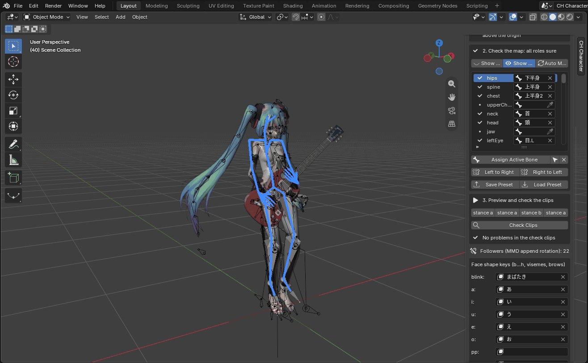
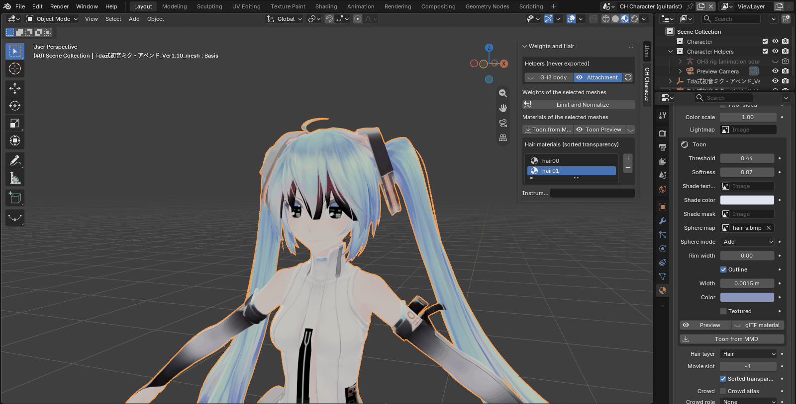
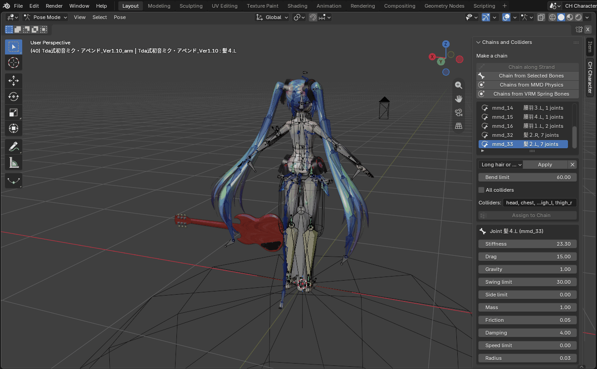
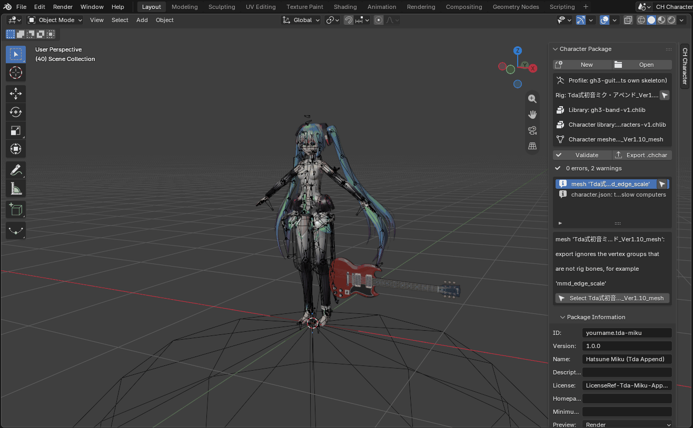
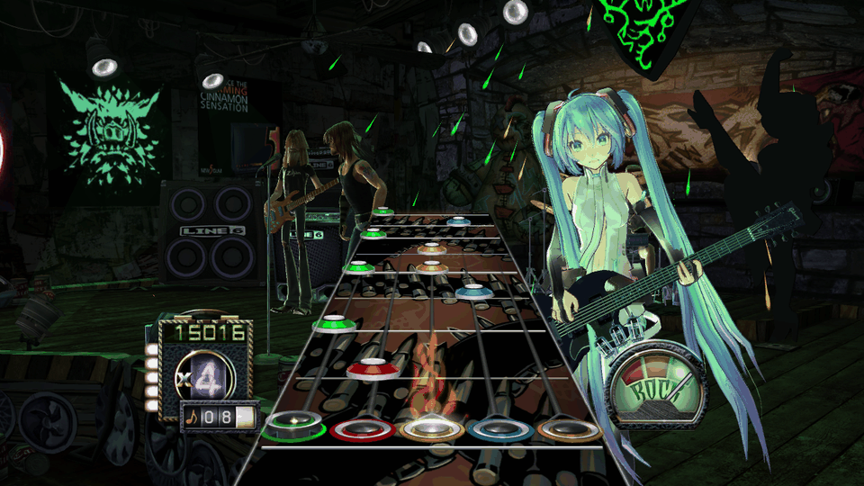
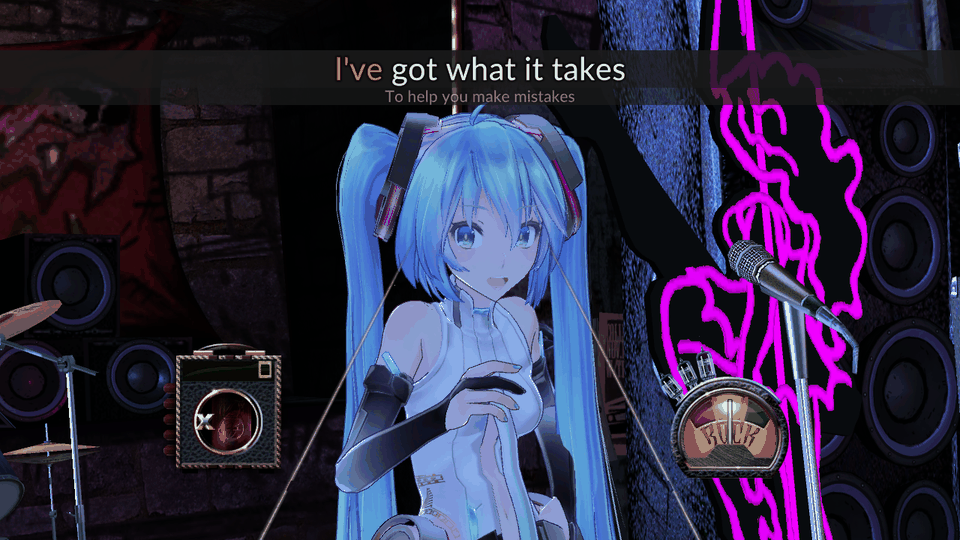

# Creator guide: stages, characters, and instruments

This guide tells you how to make a stage (`.chstage`), a character (`.chchar`), and an instrument (`.chinst`) for the mod with Blender and the CH Stage Tools add-on. The reference for each panel is [BLENDER-ADDON.md](BLENDER-ADDON.md). The reference for the file format is [PACKAGE-FORMAT.md](PACKAGE-FORMAT.md).

The folder [`examples/`](../examples/) has the example stage of section 3. Open it in Blender to see a finished result. The character tutorial (section 5) uses Hatsune Miku: a free MMD model that you download yourself.

## 1. Before you start

You need:

- Blender 4.2 LTS or later (Linux, Windows, or macOS). The add-on also works on macOS, but the mod does not run on macOS Clone Hero.
- The add-on file `chstage_tools-<version>.zip`. To make it from the repository: `python3 blender/build.py` (the file goes to `blender/dist/`).
- Clone Hero with the mod installed ([PLAYER-GUIDE.md](PLAYER-GUIDE.md)), to test your package.
- For characters and for camera bone anchors: the GH3 band library `gh3-band-v1.chlib`. The mod installs it in `<game>/Mods/GH3Skin/Packages/`.
- For characters on the rig of a GH3 guitarist (for example Midori or Judy Nails): the GH3 character library `gh3-characters-v1.chlib` and the GH3 character packages (`gh3.<name>...chchar`). The mod installs them in the same folder.

## 2. Install the add-on

1. In Blender, open **Edit > Preferences > Get Extensions**.
2. Open the menu at the top right (the arrow), and click **Install from Disk**.
3. Select `chstage_tools-<version>.zip`. Do not extract the zip file. Blender installs and enables the add-on.
4. Open **Edit > Preferences > Add-ons > CH Stage Tools**, and set these fields:
   - **Custom/Stages folder** and **Custom/Characters folder**: the folders of Clone Hero (see [PLAYER-GUIDE.md section 6](PLAYER-GUIDE.md#6-add-stages-characters-and-instruments)). Export can then copy your package into the game.
   - **GH3 library (.chlib)**: `gh3-band-v1.chlib`.
   - **GH3 character library (.chlib)**: `gh3-characters-v1.chlib`. You can keep it empty when the file is in the folder of the GH3 library.


The stage tools are in the 3D view sidebar (push **N**), tab **CH Stage**. The character tools are in the tab **CH Character**.

## 3. Make your first stage

The example of this section is `examples/example-club.blend`.

### 3.1 Start from the template

1. Click **File > New > New Stage from Template**. The add-on makes the scene `CH Stage`.
2. Open **Stage Package > Package Information** and set:
   - **ID**: a stable ID with lowercase letters, digits, `.`, and `-`, for example `yourname.my-club`. Do not change it in later versions.
   - **Name**: the name that the picker shows.
   - **Version**: `1.0.0`. Increase it when you publish a change.
   - **Authors** and **License** (an SPDX ID, for example `CC-BY-4.0`). Set **Redistribute**, **Modify**, and **Commercial use**.
   - **Preview**: **Render** makes a 512 × 288 image from the scene camera.


Rules:

- Blender is Z up. Do not turn the scene. The add-on converts the data for the game.
- The performers look toward Blender −Y. The audience is on the −Y side.
- 1 Blender unit is 1 metre. A performer is about 1.8 m tall.

### 3.2 Make the geometry

1. Delete the template boxes `floor`, `backdrop`, `left`, and `right`, or change them.
2. Make your scenery with usual Blender meshes: a stage floor at Z = 0 (the band stands at Z = 0), walls, a truss, speakers.
3. Keep the meshes simple. The example has 17 meshes and 624 vertices.

Export writes all scenery meshes. It does not write markers, cameras, lights, or proxy bodies.

### 3.3 Add a material

1. Select a mesh. Use a usual Principled BSDF material. Connect an **Image Texture** to **Base Color**. The image must be PNG.
2. Open **Properties > Material > CH Stage Material** and set:

| Field | Values |
| --- | --- |
| **Shading** | **Lit** (the stage lights light the surface; the default), **Ambient**, **Unlit** (full brightness, for example a sign), **Not set** |
| **Transparency** | **Opaque**, **Cutout** (alpha test, for example a truss), **Blend**, **Additive** (for example a light glow) |
| **Two-sided** | Draws both sides of each face |


The example uses **Lit** for the walls and the floor, **Cutout** with **Two-sided** for the truss, and **Unlit** with **Additive** for the neon star. For a lightmap, see [BLENDER-ADDON.md section 1.13](BLENDER-ADDON.md#113-rules-to-know).

### 3.4 Put the band on the stage

The template has four band placements (`band-guitarist`, `band-bassist`, `band-singer`, `band-drummer`) with proxy bodies. A proxy body shows the size of a performer. Export does not write it.

1. Select a band placement. Move it and turn it around Z. The arrow of the proxy body points to the audience.
2. To add a placement, put the 3D cursor at the position, then click **Add Marker > Band placement** in **Stage Package**. Set the **Role** in **Stage Object**.


Each role can have one placement. A stage needs at least one placement. The template also has a waypoint (`guitarist_walk01`, a place where the guitarist can walk) and effect emitters (pyro, sparks, fireworks, smoke).

### 3.5 Set two cameras

The template has two camera shots:

| Shot | Groups | Use |
| --- | --- | --- |
| `wide` | `wide`, `default` | The whole stage. The group `wide` is necessary |
| `guitar` | `guitarist`, `default` | The guitarist. **Anchor**: Guitarist, root: the camera moves with the guitarist |

1. Select a camera. Look through it (**View > Cameras > Set Active Object as Camera**) and move it.
2. In **Camera Shot**, set the groups. The game selects a shot from a group when the chart or the generated direction asks for that group: `wide`, `guitarist`, `bassist`, `singer`, `drummer`, `orbit`, or `default`. A group that the stage does not have uses the shots of `wide`.
3. **Look at**: with a target (for example Singer, head), the game turns the camera to the target. With **None** and **Write rotation**, the game uses the rotation of the camera.
4. Set the render size to 16:9 (the template uses 1920 × 1080). The game uses the horizontal field of view of the camera.


The highway covers the center of the screen. In the example, the guitarist camera turns 22° to the left, so the guitarist is at the right of the highway.

### 3.6 Set a light and two moods

The template has two stage lights (`Stage` for the scenery and `Band` for the performers, both **Ambient**), two snapshots (`fill` and `chorus`), and three moods (`intro`, `blackout`, and `chorus`). A snapshot holds the color and the intensity of each stage light. A mood is a list of snapshots. Charts select the moods.

1. Open **Lighting**. Select the snapshot `fill`, and click **Apply**. The add-on sets the lights to the snapshot.
2. Select the light `Stage`. Change its Blender light color, and its **Intensity** in **Stage Light** (for example warm white, 0.7).
3. Select the snapshot `fill` again, and click **Capture**. The snapshot gets the new settings.
4. Do steps 1 to 3 again for `chorus` with other colors (for example magenta and cyan).
5. Look at the moods: `intro` and `blackout` use `fill`; `chorus` uses `chorus`, then `fill`.
6. Turn on **Live lighting preview** and select a mood to see it in the 3D view.


Rules:

- The moods `intro` and `blackout` are necessary.
- Every snapshot must have settings for every stage light. Click **Capture** after you add a light.
- A scenery object uses the light group `Stage` when its **Light group** (in **Stage Object**) is empty. The band uses `Band`.
- Charts can ask for the moods `intro`, `verse`, `chorus`, `solo`, `flare`, `blackout`, and `strobe`. When the stage does not have a mood, the game plays `intro`.

### 3.7 Validate and export

1. Click **Validate**. The list shows errors and warnings. Click the arrow of an issue to select its object. Correct all errors.
2. Click **Export .chstage**. Select a file name (the default is `<ID>.chstage`). Options:
   - **Copy to Custom/Stages**: also copies the package into the game.
   - **Development folder**: also writes the unpacked files to `unpacked/<name>.chstage`.
   - **Preview**: **Render**, **Image**, or **None**.
3. The add-on writes the package only when there is no error.

### 3.8 Play the stage

1. Put the `.chstage` file into `Custom/Stages` of Clone Hero (or use **Copy to Custom/Stages**).
2. Start Clone Hero. The mod imports the package one time.
3. In the menus, push **F6**. Select your stage in the **Stage** list. Push **F6** again to close the picker.
4. Start a song.


*Model: Tda式初音ミク・アペンド by Tda; Hatsune Miku © Crypton Future Media, INC. www.piapro.net ([section 5](#5-make-a-character-on-a-gh3-rig))*

## 4. Edit a GH3 venue

1. Click **File > Import > CH Stage Package (.chstage)**. Select a venue of the mod, for example `<game>/Mods/GH3Skin/Packages/gh3.dive.chstage`. A venue opens in 1 to 19 seconds.
2. Change something, for example the color of a snapshot, a camera, or a material.
3. In **Package Information**, set a new **ID** (for example `yourname.dive-blue`) and a new **Name**. When two packages have the same ID, the mod uses only the package with the higher version (the log tells you `... is not used: ... has the same id`).
4. Click **Validate**, then **Export .chstage**. Put the file into `Custom/Stages`.


The `.blend` file holds all package data. Export does not need the source package after Open. Unchanged rows (shots, lights, materials, actors) export exactly as in the source. The script bank (`scripts.json`) shows the GH3 objects and values; you can change simple values, not the script code. See [BLENDER-ADDON.md sections 1.4 to 1.10](BLENDER-ADDON.md#14-start-from-a-package-for-example-a-gh3-venue).

The GH3 venues have the license `LicenseRef-GH3-Derived` with the permissions `redistribute: true`, `modify: true`, and `commercial: false`. You can change a GH3 venue and share it under a new ID. Do not sell it.

## 5. Make a character on a GH3 rig

A character plays the GH3 animations of a band member. You do not make animations. The game takes the GH3 rig of a profile (for example the guitarist Midori), plays its animations, and moves your model with them. Your model can keep its own skeleton and its proportions. The game adds the instrument.

This section is a tutorial: you make Hatsune Miku from a free MMD model, and play her as the guitarist and as the singer. Do the steps in their order. After the tutorial, [section 5.10](#510-use-any-humanoid-model-with-its-own-skeleton) tells you how to use other models (VRM, FBX, glTF), and [section 5.12](#512-alternative-fit-a-model-to-a-gh3-rig) tells you how to fit a model to the GH3 skeleton.

The folder [`examples/`](../examples/) also has `example.guitarist.chchar`. It is a minimal test package for the automatic tests (a body from Blender primitives), not a tutorial.


The Miku images in this guide show Tda's model:

*Model: Tda式初音ミク・アペンド by Tda; Hatsune Miku © Crypton Future Media, INC. www.piapro.net. These images show the character Hatsune Miku of Crypton Future Media, INC. under the [Piapro Character License](https://piapro.jp/license/pcl/summary).*

### 5.1 Get the model and read its terms

1. Open the author's download page: [bowlroll.net/file/4576](https://bowlroll.net/file/4576) (BowlRoll account "Tda"). Download `Tda式初音ミク・アペンドVer1.10.zip` (Tda式初音ミク・アペンド, Type Tda Hatsune Miku Append, version 1.10, 17,267,524 bytes, MD5 `2385604d7fe8359489351879a1e201b5`). You do not need a login.
2. Extract the zip file. The folder has `Tda式初音ミク・アペンド_Ver1.10.pmx`, the textures, `readme_English.txt`, and `よんでね.txt` (the Japanese terms; they apply when the two texts are different).
3. Read the terms. In short:
   - The model shows Crypton Future Media's character Hatsune Miku Append under the [Piapro Character License](https://piapro.jp/license/pcl/summary). Use the model only in the limits of that license and of the readme.
   - Commercial use needs the permission of Crypton Future Media, and then a contact to Tda. Do not sell the character.
   - You can edit the model for your videos and pictures with no request to Tda, if the result stays a Tda-style model, and if you remove the CRYPTON logo on the anklet (step 4).
   - Do not share the unchanged model. If you share an edited model, include both readmes and give the model name, Tda, and the editors. Do not move parts of the model to other models. No nude, base, or adult edits.
   - The readme names videos and pictures. A game package is not named. Keep your Miku package for your own use, and ask Tda before you share it.
4. Remove the CRYPTON logo: copy `ロゴ違いテクスチャ/body00_MikuAp.tga` (the texture without the logo) over `body00_MikuAp.tga` in the main folder.

The repository has no file of the model, its textures, or its package.

### 5.2 Install MMD Tools

1. In Blender, open **Edit > Preferences > Get Extensions**. If Blender asks, click **Allow Online Access**.
2. Search for **MMD Tools**, and click **Install**. The guide uses MMD Tools 4.5.14 ([extensions.blender.org/add-ons/mmd-tools](https://extensions.blender.org/add-ons/mmd-tools/)), which works with Blender 4.2 and later.
3. Set **GH3 library (.chlib)** in the preferences of CH Stage Tools ([section 2](#2-install-the-add-on)). The add-on finds `gh3-characters-v1.chlib` in the same folder.

### 5.3 Make the character scene and import Miku

1. Click **File > New > New Character from GH3 Rig**.
2. In the dialog, set **Profile** to **Midori (outfit 1)**, and set **Use my model's skeleton**. Click **OK**.

   The add-on makes the scene `CH Character (guitarist)` with the GH3 rig of Midori (**GH3 rig (animation source)**, blue), the GH3 guitar as a preview, and a preview camera. These are helpers: export never writes them. Do not move, turn, or edit the GH3 rig.
3. Click **File > Import > MikuMikuDance Model (.pmd, .pmx)**, and select `Tda式初音ミク・アペンド_Ver1.10.pmx`. Keep the default options: **Scale** 0.08 (1 MMD unit is 8 cm) and all **Types** (Mesh, Armature, Physics, Display, Morphs). The morphs become shape keys (68 on this model), and the physics gives the rigid bodies for the chains ([section 5.7](#57-make-chains-from-the-mmd-physics)).
4. Open the sidebar of the 3D view (**N**), tab **CH Character**.
5. Convert the materials now, while MMD Tools still knows the model (after **Set Up Skeleton**, its panel shows "Select a MMD Model"). MMD Tools makes MMD shader node groups, and the glTF export does not read them: a material without a **Principled BSDF** has no texture in the game. Do the two steps in this order, because **Toon from MMD** reads the MMD nodes and **Convert to Blender** removes them:
   1. Select the mesh `Tda式初音ミク・アペンド_Ver1.10_mesh`. In **CH Character > Weights and Hair > Materials of the selected meshes**, click **Toon from MMD**. All 17 materials get **Shading** **Toon**: the MMD toon texture gives the threshold, the softness, and the shade color; the sphere map and the MMD edge (outline) carry over. A material without a toon texture (the eyes, the cheeks) is always lit, as in MMD.
   2. Open the sidebar tab **MMD**, panel **Model Setup**, and click **Convert to Blender** (in **Material**). Each material gets a Principled BSDF with its image on **Base Color**.



*Model: Tda式初音ミク・アペンド by Tda; Hatsune Miku © Crypton Future Media, INC. www.piapro.net*

### 5.4 Set up the skeleton and check the map

1. Select the armature of Miku (`Tda式初音ミク・アペンド_Ver1.10_arm`, in the outliner or with a click on a bone).
2. In the panel **Skeleton**, click **Set Up Skeleton**. Keep **Height** at 0 m: Miku is 1.6 m tall, and the add-on keeps a height between 0.5 m and 3 m.

   The panel lists the changes: "the armature is no longer a child of 'Tda式初音ミク・アペンド_Ver1.10'" (the MMD root object) and "the feet are on the floor and the hips above the origin". The MMD model already stands on +Z and looks toward −Y.
3. Look at **2. Check the map**. For Miku it says **all roles sure**: 57 roles have a bone with a green mark. Only `upperChest` and `jaw` are empty; they are optional. **Show Map** (on after the set-up) draws the roles on the armature in green.
4. The blue skeleton is the GH3 rig. The add-on gives it the size of Miku: its hips are at her hip height. Click **Show GH3 Rig** to hide or show it.



*Model: Tda式初音ミク・アペンド by Tda; Hatsune Miku © Crypton Future Media, INC. www.piapro.net*

The map uses the MMD bones: `下半身` (hips), `上半身` and `上半身2` (spine and chest), `首`, `頭`, the arms on `腕`, `ひじ`, and `手首` with the twist bones `腕捩` and `手捩`, all fingers, and the legs on the `D` bones (`足D`, `ひざD`, `足首D`). The panel also shows **Followers (MMD append rotation): 22**: the MMD bones that copy the turn of another bone (for example the IK leg bones) follow it in the game.

To correct a role on another model, select the role in the list, click the bone in the viewport, and click **Assign Active Bone** ([section 5.10](#510-use-any-humanoid-model-with-its-own-skeleton)).

### 5.5 Check the clips and the face

1. In **3. Preview and check the clips**, click a clip button (for example **stance a**, the first idle clip). Miku plays the GH3 clip with the retarget of the game. The blue GH3 rig shows the GH3 animation, and the GH3 guitar takes the size of her arms. Click **Play** in the timeline to play the clip.
2. Click **Check Clips**. The add-on plays six GH3 clips of the profile (for example idle, stance change, solo, and jump) and looks for problems: a hand far from its place on the guitar, a bone that flips, a knee or an elbow that bends the other way, a foot that slides, a forearm that twists too far, mesh edges that stretch. For Miku the result is **No problems in the check clips**.
3. Look at **Face shape keys**. The add-on found the MMD morphs: **blink** `まばたき`, **a** `あ`, **i** `い`, **u** `う`, **e** `え`, **o** `お`, **brow up** `上`, and **brow down** `下`. Miku has no consonant visemes, so the game mixes the five vowel shapes for the lyrics. The export writes only these shape keys.
4. Click **Bind Pose** (in **Clip Preview**) before you continue.



*Model: Tda式初音ミク・アペンド by Tda; Hatsune Miku © Crypton Future Media, INC. www.piapro.net*

The game blinks with the GH3 blink timing. As the singer, Miku moves the mouth with the words of the lyrics and the loudness of the vocal stem, and her brows rise on long and high notes.

### 5.6 Make the materials: toon look and eyebrows over the hair

The materials have the toon settings and a Principled BSDF from step 5 of [section 5.3](#53-make-the-character-scene-and-import-miku). If you did not do that step before Set Up Skeleton, use **Ctrl Z** to go back, or give each material a Principled BSDF with its image on **Base Color** yourself (Validate gives a warning for each material that the glTF export does not read).

1. Select the mesh `Tda式初音ミク・アペンド_Ver1.10_mesh`.
2. Save the textures as PNG. Packages use PNG images only. In an **Image Editor** (for example in the workspace **Shading**), select each of the six `.tga` images (`body00_MikuAp`, `body01_MikuAp`, `body02_MikuAp`, `face_MikuAp`, `hair_MikuAp`, `wing_MikuAp`), click **Image > Save As**, set **File Format** to **PNG**, and click **Save As Image**. The materials then use the PNG files. The `.bmp` sphere maps can stay: export writes the toon images as PNG.
3. Set the transparency in **Properties > Material > CH Stage Material** for each of these materials (select it in the material list):

| Material | Part | Settings |
| --- | --- | --- |
| `face01` | Eyes, eyelashes, eyebrows | **Transparency** Cutout |
| `eye_hi`, `eye_hi2` | Eye highlights | **Transparency** Cutout |
| `cheek`, `hairshadow` | Blush, hair shadow on the face | **Transparency** Blend |
| `hair00`, `hair01` | Hair | **Transparency** Blend, **Hair layer** Hair |
| `body02`, `body_green2`, `lens` | Clear parts of the clothes and the headset | **Transparency** Blend |
| `wing` | Waist wings | **Transparency** Blend, **Two-sided** on |

   The other materials stay **Opaque**.
4. Hair materials: make `hair00` the active material, and click **+** under **Hair materials** in **Weights and Hair**. Do the same for `hair01`. The game sorts their transparent faces.
5. Eyebrows over the hair. In anime games the eyebrows show through the bangs. Miku's eyebrows are in `face01`, so give them their own material:
   1. Push **Tab** (Edit Mode), and push **3** (face select). Push **Alt A** to clear the selection.
   2. Put the mouse on each part of the two eyebrows and push **L** (each eyebrow has two parts, 4 parts and 66 faces in total; L adds the linked faces to the selection).
   3. In **Properties > Material**, click **+** (a new slot). In the new slot, select `face01` in the material list, and click the **New Material** button (two sheets) to make a copy. Rename the copy `eyebrow`.
   4. Click **Assign**, then push **Tab** (Object Mode).
   5. In **CH Stage Material** of `eyebrow`, set **Hair layer** to **Over hair**.
6. Click **Toon Preview** in **Materials of the selected meshes**, and set the viewport to **Material Preview**: you see the toon look in EEVEE. The eye button next to it shows the glTF material again. Export always writes the glTF material and the toon settings.



*Model: Tda式初音ミク・アペンド by Tda; Hatsune Miku © Crypton Future Media, INC. www.piapro.net*

The toon settings in **CH Stage Material** (**Toon from MMD** sets them; you can change them):

| Field | Meaning |
| --- | --- |
| **Threshold** | Where the shade starts. 0.5 shades the side that turns away from the key light. 0 is always lit (the eyes) |
| **Softness** | The width of the edge between light and shade. 0.02 gives a hard anime edge |
| **Shade texture**, **Shade color** | The color of the shaded side. Without a texture, the shade is the base color times the shade color. A model from a game often has a shadow color texture (Project SEKAI: the `_S` texture) |
| **Shade mask** | Red 0 is always shaded, 0.5 follows the light, 1 is always lit (Project SEKAI: the blue channel of the `_H` texture) |
| **Sphere map** | An MMD sphere map (`.sph` multiply, `.spa` add) for shine on hair and cloth |
| **Rim width**, **Rim color** | A thin light at the silhouette |
| **Outline** | **Width** about 0.0015 (1.5 mm at 1 m from the camera, about 1.7 pixels at 900 pixels; the line keeps this screen width in close-ups) and **Color**. **Textured** multiplies the color by the base texture. Do not use an outline on the eyes, the eyelashes, and the eye highlights. The mesh needs smooth normals; split normals give gaps in the line |

The venue lights still color a toon character: in a red light the character is red, and in a blackout the character is dark. Rules for the hair layers:

- The eyebrows need their own material (step 5).
- The eyebrows show over the hair only where their faces turn to the camera, so they never show through the back of the head. Other parts (the hands, the instrument, other band members) still cover them.
- To check it in the game, use `GH3_SKIN_DEBUG_HAIR_LAYER=mark` ([VERIFICATION.md](VERIFICATION.md#runtime-variables)): the eyebrows then show in a flat color.

### 5.7 Make chains from the MMD physics

A chain is a line of bones that the game moves with gravity and the motion of the body, as GH3 moves its hair. A stiffness pulls the chain back to the shape of the model, as the spring bones of MMD and VRM do. Colliders are capsules on the body: the chains do not go into them.

1. Select the mesh and click **Limit and Normalize** in **Weights and Hair** (four bone influences for each vertex at most). Miku keeps her MMD weights.
2. Open the panel **Chains and Colliders**, and click **Chains from MMD Physics**. Keep the options empty: the tool uses the rigid bodies of Miku's MMD import, and her MMD bones become the joints (no new bones). Each joint gets the MMD mass, damping, rotation limits, and spring (the stiffness).
3. The tool makes 18 chains. The list shows the name, the first joint, and the number of joints of each chain. A character can have 16 chains at most. Remove the short and stiff chains, which move very little: select each chain whose first joint is `胸` (chest), `アホ毛` (the hair tuft on top), `もみあげ` (sideburns), or `前髪` (bangs), and click **X**. Eight chains go. Their bones stay and follow the head and the chest.
4. Select each of the 10 chains that stay, select its **Preset**, and click **Apply**:

| First joint | Part | Joints | Preset | Colliders |
| --- | --- | --- | --- | --- |
| `髪２.L`, `髪２.R` | Twin tails | 7 each | **Long hair or twin tail** | `head, chest, stomach, hips, thigh_l, thigh_r` |
| `しっぽ１` | Cable tail | 13 | **Tail or cable** | `floor, hips, thigh_l, thigh_r, shin_l, shin_r` |
| `腰羽１`, `腰羽３`, `腰羽４` (`.L` and `.R`) | Waist wings | 1–2 each | **Skirt** | `thigh_l, thigh_r, shin_l, shin_r` |
| `ﾈｸﾀｲ１` | Necktie | 5 | **Hair** | `chest, stomach` |

5. Click **Fit Body Colliders**. The tool adds capsules on the hips, the stomach, the chest, the legs, the arms, and a sphere on the head, with a radius from Miku's mesh (12 colliders).
6. Add a floor for the cable tail: select the armature, push **Ctrl Tab** (Pose Mode), click the root bone `全ての親`, and click **Add Collider**. Push **Ctrl Tab** again (Object Mode), and click the new object `Collider chain` in the outliner (collection **Character Helpers**). In its box in **Chains and Colliders**, set **Name** `floor`, **Radius** 3 m, and **Length** 0. Then put its centre 3 m under the floor: push **Shift S** and click **Cursor to World Origin**, push **Shift S** and click **Selection to Cursor**, then push **G Z**, type `-3`, and push **Enter**. The top of the sphere is then at the floor, and the sphere keeps the tail above the floor.
7. For each chain, clear **All colliders** and type the colliders of the table in **Colliders**.
8. To change the motion of a joint, make a joint bone active in Pose Mode. The panel shows **Stiffness** (how strongly the joint goes back to the shape of the model), **Drag** (how fast the swings stop), **Gravity** (1: full gravity, 0: none), **Swing limit**, **Side limit**, **Mass**, **Friction**, **Damping** (how much the chain trails behind the head), **Speed limit**, and **Radius**. **Bend limit** in the chain box is the largest angle of the chain end from its rest direction: 60° keeps a hanging twin tail below the head.



*Model: Tda式初音ミク・アペンド by Tda; Hatsune Miku © Crypton Future Media, INC. www.piapro.net*

Hints:

- Hair that whips: add drag. Hair that is too stiff: less stiffness. Hair that does not trail behind the head: more damping.
- A chain that touches a collider at rest pushes away from it all the time. Give each chain only the colliders near it.
- Each joint costs time in the game: the 40 joints of Miku take 0.15–0.47 ms of each frame on the test computer. A character can have 64 joints at most.

### 5.8 Validate and export

1. Open **Character Package > Package Information** and set:
   - **ID**: `yourname.tda-miku`. **Name**: `Hatsune Miku (Tda Append)`. **Version**: `1.0.0`.
   - **Authors**: `Tda` (role `model`), and your name.
   - **License**: `LicenseRef-Tda-Miku-Append`. Clear **Redistribute**, **Modify**, and **Commercial use**: the terms of the model apply.
   - **Credits**: `Hatsune Miku © Crypton Future Media, INC. www.piapro.net`.
2. Click **Validate**. Miku gives 0 errors and 2 warnings:
   - `mesh '...': export ignores the vertex groups that are not rig bones, for example 'mmd_edge_scale'`: MMD Tools adds the vertex groups `mmd_edge_scale` and `mmd_vertex_order`. They are not bones, and export does not need them. You can ignore this warning.
   - `character.json: the chains have 40 joints; more than 32 cost frame time on slow computers`: the twin tails, the cable, the wings, and the necktie have 40 joints. Keep them, or remove the necktie and the wings (27 joints) for a slow computer.
3. Click **Export .chchar**. Set **Copy to Custom/Characters** if you set that folder in the preferences. The package `yourname.tda-miku.chchar` is about 3.9 MB. The add-on writes it only when there is no error.



*Model: Tda式初音ミク・アペンド by Tda; Hatsune Miku © Crypton Future Media, INC. www.piapro.net*

The steps of this tutorial work the same in Blender 4.2 LTS and Blender 5.2 (checked with Blender 4.2.23 and 5.2.1, MMD Tools 4.5.14). Save your `.blend` file: it holds all the settings, and you can export again after a change.

### 5.9 Play Miku in the game

1. Put `yourname.tda-miku.chchar` into `Custom/Characters` of Clone Hero (or use **Copy to Custom/Characters**).
2. Start Clone Hero. The mod imports the package one time (about 0.3 s).
3. In the menus, push **F6**. In **Band**, click **<** or **>** on the line **Guitarist** until **Hatsune Miku (Tda Append)** shows. Push **F6** again to close the picker.
4. Start a song. Miku plays the guitar with the animations of Midori, on any stage.
5. To make Miku the singer, select her on the line **Singer** (and set the guitarist back to **Default (venue)**). The singer moves the mouth with the lyrics of the chart. A song with a vocal stem (`vocals.ogg` or `vocals.opus`) also gives the loudness. Every character can play every role: in the other roles, the game uses the animations of that role on her skeleton.


*Model: Tda式初音ミク・アペンド by Tda; Hatsune Miku © Crypton Future Media, INC. www.piapro.net*



*Model: Tda式初音ミク・アペンド by Tda; Hatsune Miku © Crypton Future Media, INC. www.piapro.net*



*Model: Tda式初音ミク・アペンド by Tda; Hatsune Miku © Crypton Future Media, INC. www.piapro.net*

The log (`<game>/MelonLoader/Latest.log`) has the line `GH3 band guitarist: character yourname.tda-miku (Hatsune Miku (Tda Append)) on its own skeleton (206 joints, 57 humanoid roles), retargeted from profile gh3-guitarist-midori-v1 ...` and the face shapes. The singer close-up uses `GH3_SKIN_DEBUG_VIEW_HEAD=local` and `GH3_SKIN_DEBUG_VIEW_ROLE=singer` ([VERIFICATION.md](VERIFICATION.md#runtime-variables)).

### 5.10 Use any humanoid model with its own skeleton

The steps of the tutorial work for any humanoid model with an armature: MMD (`.pmx`), VRM and VRoid, Mixamo, Unity, Unreal, Daz, Rigify, 3ds Max Biped, Ready Player Me, or a model with bone names that say nothing (`joint1`, `Bone.023`, Chinese or Japanese names). The proportions of your model do not change. Read the terms of the model first: many models do not permit changes or distribution.

The add-on finds the humanoid in your skeleton from the hierarchy and the bone positions, not from a list of names. It finds the left and right sides of the body, the legs (the pair of limbs that reaches the floor), the arms (the pair that hangs from the spine below the head), the elbow and the knee (where a limb divides into two parts of almost the same length), twist bones (bones on the straight line of a limb part), the fingers (in their order across the palm), the head, and the front of the model (the toes and the feet). The bone names help only when the bone positions do not decide.

Import the model into the character scene with the importer of its format:

- glTF, GLB, VRM: **File > Import > glTF**. With the **VRM Add-on for Blender**, the add-on uses the humanoid map of the VRM file.
- FBX (Mixamo, Unity, Unreal, a game): **File > Import > FBX**.
- MMD: MMD Tools at the scale 0.08, with the morphs (the tutorial).
- A model in two parts with two armatures (a body and a head): select both armatures, the body last, and click **Join Armatures** in the **Skeleton** panel. Bones with the same name become one bone, and the head moves onto the body at these bones.

**Set Up Skeleton** does these changes. The panel lists each change in words, and **Ctrl Z** restores the model:

- It applies the object transforms of the armature and of its meshes (an import root, a 0.01 scale, a Z-up node).
- It turns the model so that it stands on +Z and looks toward −Y, with its left side at +X, and mirrors a mirrored export back (a Unity model that comes in with its left bones on its right side).
- It puts the feet on the floor and the hips above the origin.
- It gives the model a height in metres: a model of 0.5–3 m keeps its height; else the add-on finds the unit (centimetres, millimetres) or uses 1.7 m. To set a height, type it in **Height** before you click (for example 1.58 m).
- It makes meshes that follow one bone (no weights) skinned to that bone, and gives deform bones under control bones (Rigify `DEF-` bones) the deform bone at the place of their control bone as parent, so that the exported skeleton is one tree.
- It finds the roles, the followers, and the face shape keys.

Correct the map:

- Green is sure, yellow is a role to check, red is not sure. A required role without a bone is red.
- To correct a role: select the role in the list, click the bone in the viewport (Pose Mode or Edit Mode), and click **Assign Active Bone**. The next role in the list is then selected.
- **Left to Right** gives each right role the bone on the other side of its left role (by the name, else by the place). **Right to Left** does the opposite.
- The X button clears a role. A finger, a toe, a shoulder, a neck, a twist bone, the eyes, and the jaw are optional.
- **Save Preset** writes the map to a JSON file. **Load Preset** applies it to another model of the same rig family.

The face fields also find the shapes of other formats: blink and the mouth shapes a, i, u, e, o (VRM `Blink`, `A`; VRoid `Fcl_EYE_Close`, `Fcl_MTH_A`; `eye_close`, `lip_a`, `mouth_a`; VRChat visemes; Ready Player Me `mouthOpen`), the consonant visemes pp, ff, th, dd, kk, ch, ss, nn, rr (VRChat `vrc.v_pp`, Oculus and Ready Player Me `viseme_PP`), brow up and brow down (VRoid `Fcl_BRW_Surprised`, `Fcl_BRW_Angry`; `eyeblow_up`, `eye_brow_up`), and squint (`eyeSquint`). A model with the consonant visemes shows them in the lip sync.

Other model settings:

- **Materials**: a VRM importer also makes toon node groups. Give each material a **Principled BSDF** with the image on **Base Color**, and save the images as PNG (1024 × 1024 pixels are sufficient).
- **Weights**: keep the weights of your model, and click **Limit and Normalize**. The export writes only the deform bones, 255 at most.
- **Instrument** (in the **Skeleton** panel): the instrument hangs in front of the top spine bone, at the GH3 distance scaled by your torso. Its size is your arm length divided by the GH3 arm length. **Instrument bone**, **Instrument offset**, and **Instrument scale** change this.

When Set Up Skeleton does not find the humanoid, the notes in the panel say what is missing:

| Note | What to do |
| --- | --- |
| no left and right body parts | The model is not symmetric enough, or it has no limbs as bones. Map the roles by hand |
| the arm chain has no elbow / the leg chain has no knee | The limb has fewer than three joints. A humanoid needs an upper arm, a forearm, and a hand (an upper leg, a lower leg, and a foot). Add the missing bone in Edit Mode, with weights |
| hips must be a parent of the upper leg (a Validate error) | A foot or a leg is not a child of the leg above it (IK rigs). In Edit Mode, make the foot a child of the lower leg (**Keep Offset**) |
| the bone names say left where the body is right | The model is mirrored. Set Up Skeleton mirrors it back (the **Mirror** option of the operator turns this off) |
| the front of the model is not clear | The model has no toes and no feet in the mesh. Check that it looks toward −Y after the set-up; if not, turn it 180° about Z, apply the rotation, and click **Auto Map** |
| a role with a yellow or red mark | Select the bone of the role (the arrow button), and correct it if it is wrong |

What the game does with your skeleton:

| Part | Rule |
| --- | --- |
| Bones with a role | The turn of the GH3 bone from the GH3 rest pose, on your rest pose. At rest, each bone points along its GH3 bone, so a T-pose, an A-pose, and a relaxed pose (arms down) are all correct |
| Spine and neck | One to three spine roles take the GH3 spine bones (bottom, top, and the middle one). Spine and neck bones between two roles turn part of the way, so a long spine or a two-bone neck bends along its length |
| Hips | They move as the GH3 pelvis moves, scaled by your hip height |
| Legs | IK with your leg lengths: the feet go where the GH3 feet go from the GH3 hips, scaled by the hip height. The knees bend in the plane of the GH3 knees |
| Arms | IK with your arm lengths: the hands go to the GH3 hand places on the instrument. The elbows bend in the plane of the GH3 elbows. When your arms are too short, the instrument moves nearer |
| Hands and fingers | The hand points to the middle finger (else the ring, index, or little finger). Fingers without a bone, and a missing thumb, keep their rest pose. A hand with three fingers maps them to the index, middle, and ring roles |
| Wrists and upper arms | The twist goes to the twist bones and the followers (MMD `手捩`, `腕捩`); without a twist bone, the forearm takes half of the hand twist |
| Helper bones | A weighted helper bone that starts where a mapped sibling bone starts (VRM aim and roll bones, clothing helpers) follows that bone. Other bones without a role keep their rest pose relative to their parent |
| Face | Blink and lip sync with the shape keys (visemes from the lyrics, opening from the vocal stem loudness, brows on long and high notes); the head nods at phrase starts and the eyes look around. In songs with GH3 facial clips, the jaw opening gives `a` and the eyelids give blink |
| Roles | Every character plays every role. In the role of its profile it has the animations of the profile; in another role, the animations of that role. The drum kit and the microphone stand take the size of the character ([PACKAGE-FORMAT.md section 9.7](PACKAGE-FORMAT.md#97-character-model-and-band-roles)) |

Measured (2026-10-10): the automatic map gave the hand-made map with no change for 27 of the 28 humanoid test models of the rig corpus (Mixamo, Ready Player Me, VRM 0 and 1, VRoid, Unity-chan, 3ds Max Biped, Rigify, Unreal-like, KayKit, Khronos samples, MMD, Project SEKAI, and synthetic variants with other names, turns, units, rest poses, and missing bones; [STATUS.md](STATUS.md#characters-on-their-own-skeleton)). The own skeleton keeps the proportions of the source model. In the game, the hands miss their places on the guitar by at most 0.2 mm.

Compare the face of your export with the source model: render both front-on in Blender (the export with **File > Import > glTF**). The eyes must be at the same places. To see the face in the game at a fixed angle, use `GH3_SKIN_DEBUG_VIEW_HEAD=local` and `GH3_SKIN_DEBUG_VIEW_ROLE` ([VERIFICATION.md](VERIFICATION.md)).

### 5.11 Chains on other models

A model without MMD physics gets its chains from its mesh or from its VRM spring bones.

**Chain along Strand** (a twin tail, a skirt panel, a tail):

1. Select your mesh, go to Edit Mode, and select the vertices of one strand.
2. Click **Chain along Strand**. Set **Chain name** (for example `twin_tail_l`), **Joints** (5 to 8 for a long twin tail, 2 for a skirt panel, 6 to 13 for a tail), **Parent bone** (the bone that holds the chain, for example the head; empty: the nearest body bone), and **Preset** (**Long hair or twin tail**, **Skirt**, **Tail or cable**, **Hair**, or **Stiff accessory**). The tool adds the bones and gives the selected vertices weights on them.
3. Do steps 1 and 2 again for each strand, then click **Fit Body Colliders** and set the colliders of each chain (as in [section 5.7](#57-make-chains-from-the-mmd-physics)).

On a character with its own skeleton, the bones of your model can also be chain joints (**Chain from Selected Bones**): a joint is a bone that has no role, that is not a parent of a bone with a role, and that is not a follower.

**Chains from VRM Spring Bones**: click it and select the `.vrm` file. The tool makes a chain for each VRM spring with the VRM stiffness, drag, gravity, and hit radius, and the VRM colliders.

A long tail can hit the floor: add a large sphere under the floor on the root bone (step 6 of [section 5.7](#57-make-chains-from-the-mmd-physics)). Each joint adds its swing: the bend limit of the chain stops a long chain from folding.

### 5.12 Alternative: fit a model to a GH3 rig

You can also put a mesh on the GH3 skeleton itself. The character then has the GH3 proportions of the profile, and it does not blink and does not move its mouth (a character on a GH3 rig moves the face with bones). Use this to edit a GH3 band member (**Start from the GH3 body** in the dialog of **New Character from GH3 Rig**) or for a model without a skeleton.

1. Click **File > New > New Character from GH3 Rig**, select a profile, and do not set **Use my model's skeleton**. Select the GH3 guitarist with the body that is nearest to your character (height, length of the legs and the arms, width of the shoulders). The scene has the rig, the GH3 body as a wireframe reference, and the instrument preview. Do not move, turn, scale, or edit the rig.
2. Model your character over the reference body, or import a mesh and move it onto the reference body. For a rigged model: in Pose Mode of its armature, turn and scale the bones so that each joint is on the joint of the GH3 rig, apply the Armature modifier, delete the model's armature, and remove the shape keys.
3. Select your meshes, and click **Transfer Weights from the GH3 Body** in **Weights and Hair**. Each vertex gets the weights of the nearest point on the GH3 body (4 bones at most). Change the weights with Weight Paint if necessary (give the face and the head hair full weight on `bone_head`), then click **Limit and Normalize**.
4. Hair: select the hair cards, select a chain in **Hair bones of the profile**, and click **Assign to Hair Bones**. For long hair, a skirt, or a tail, make your own chains ([section 5.11](#511-chains-on-other-models)). **Chains from MMD Physics** then makes new bones from the MMD bodies of the fitted MMD model.
5. Click **Validate**, then **Export .chchar**.

## 6. Make an instrument

An instrument is a guitar or a bass that the player can select in the picker. It can have its own highway image. The Blender add-on has no instrument panel yet; use the character template and the command-line packer.

1. Click **File > New > New Character from GH3 Rig** and select the guitarist (for a guitar) or the bassist (for a bass). The scene has the rig and the GH3 instrument as a preview.
2. Model your instrument at the place of the preview instrument. The neck goes along `bone_guitar_neck`; the hands of the band member hold it at `BONE_GUITAR_FRET_POS` and `BONE_GUITAR_STRUM_POS`. Use PNG images.
3. Give every vertex the weight 1 on `bone_guitar_body` (the GH3 instruments do the same). Do not move the rig.
4. Export the scene as GLB from Blender (glTF Binary, +Y up, the armature in its rest position).
5. Optional: draw a highway image, a PNG of 512 × 1024 pixels. The bottom of the image is near the player; the image repeats along the highway.
6. Pack and check the instrument (the `--split` option keeps only the mesh parts on the instrument bones, so the export can contain the body):

```sh
MISE_QUIET=1 uv run --with numpy --with pillow python -m pipeline.package.instrument my-guitar.glb --id me.my-guitar --name "My Guitar" \
  --kind guitar --highway my-highway.png --author "My Name" --license CC-BY-4.0 --split \
  --library assets/packages/gh3-band-v1.chlib --output out
```

7. Put `out/me.my-guitar.chinst` into `Custom/Instruments` of Clone Hero.
8. In the picker, select your instrument in the **Guitar** (or **Bass**) line. When you play the guitarist, your highway image shows.

The format is in [PACKAGE-FORMAT.md section 9.4](PACKAGE-FORMAT.md#94-instrument-chinst).

## 7. Direction in charts

The mod plays camera cuts, lights, and effects from the chart. Your stage gets them through its camera groups and moods. Chart authors can use these sources:

| Source | What it does | Reference |
| --- | --- | --- |
| GH `CAMERAS` and `LIGHTSHOW` tracks | GH3 camera notes (77–117) and light notes in a `.chart` section or a MIDI track | [CUSTOM-CONTENT.md, Direction tracks](CUSTOM-CONTENT.md#direction-tracks) |
| Text events | `stage pyro`, `stage lights chorus`, `[stage camera singer]`, and more, in `[Events]` | [CUSTOM-CONTENT.md, Text events](CUSTOM-CONTENT.md#text-events) |
| Rock Band `VENUE` track | Camera cuts, lighting, and effects of converted Rock Band charts (MIDI only) | [CUSTOM-CONTENT.md, Rock Band VENUE track](CUSTOM-CONTENT.md#rock-band-venue-track) |
| No direction | The mod makes cuts and light changes from the chart sections | [CUSTOM-CONTENT.md, Generated direction](CUSTOM-CONTENT.md#generated-direction) |
| `gh3_stage = <id>` in the `[song]` section of `song.ini` | The song selects an installed stage | [PLAYER-GUIDE.md, Stages that a song selects](PLAYER-GUIDE.md#stages-that-a-song-selects) |
| `venue.chstage` in the song folder | The song brings its own stage. The mod imports it when the song starts | [PLAYER-GUIDE.md, Stages that a song selects](PLAYER-GUIDE.md#stages-that-a-song-selects) |

On a custom stage, the GH3 camera notes select these groups: 84 and 86 close-up shots, 85 mid shots, 87 `wide`, 88 `singer`, 89 `drummer`, 95 `guitarist`, 97 `bassist`, the orbit notes `orbit`, and the other notes `default`. Give your stage shots in these groups, so that charts can cut to each band member.

## 8. Problems

### Validate and export messages

| Message | Do this |
| --- | --- |
| `the stage needs at least one band placement` | Add a band placement (**Add Marker > Band placement**) |
| `two band placements for the role ...` | Keep one placement for each role |
| `no camera shot is in the group 'wide' (required)` | Add the group `wide` to a camera shot |
| `shot '...': anchor ... needs a band placement for ...` | Add the placement, or change the anchor of the shot |
| `shot '...': a point without rotation needs a look-at target` | Turn on **Write rotation**, or set **Look at** |
| `lighting needs the mood 'intro'` (or `'blackout'`) | Add the mood in **Lighting > Moods** |
| `snapshot '...' has no settings for the light '...'; use Capture` | Select the snapshot and click **Capture** |
| `lighting needs at least one stage light` | Select a light and turn on **Stage light** |
| `the stage has no scenery meshes` | Add a mesh that is not a marker |
| `shot '...': the game places the camera relative to the ... bone` (warning) | Set the GH3 library in the preferences and click **Load GH3 Rig Proxies** |
| `mesh '...' has no Armature modifier for the rig` | Click **Transfer Weights** |
| `mesh '...': N vertices have no weight on a rig bone` | Click **Transfer Weights**, or paint the weights |
| `... more than 4 influences` or `... do not sum to 1` | Click **Limit and Normalize** |
| `mesh '...' has its own transform` | Click **Transfer Weights**, or **Object > Apply > All Transforms** |
| `the rig must stay at the origin ...` or `the rig has no bone ...` | Clear the rig transform, or start again from **New** |
| `material '...': image '...' is ...; packages use PNG only` | Save the image as PNG |
| `image N is PNG; package format 1.0 stores textures pre-encoded ...` (validator, or `texture ... is a PNG image` in the game log) | The package comes from an older add-on. Open the `.blend` file and export again with the current add-on |
| `material '...': the glTF export does not read its surface node ...` (warning) | Connect a Principled BSDF with the image on Base Color to the material output. For an MMD model, use **Convert to Blender** of MMD Tools before **Set Up Skeleton** (section 5.3) |
| `character.json: .chains: too many items` | A character can have 16 chains at most. Remove chains (section 5.7) |
| `character.json: the chains have N joints; more than 32 cost frame time on slow computers` (warning) | Keep the joints, or remove chains for slow computers (section 5.8) |
| `mesh '...': export ignores the vertex groups that are not rig bones, for example '...'` (warning) | Nothing to do. MMD Tools adds `mmd_edge_scale` and `mmd_vertex_order`; export does not need them |
| `... needs the GH3 character library ...` (Open) | Set **GH3 character library (.chlib)** in the add-on preferences |
| `no GH3 library: ...` (warning) | Set **GH3 library (.chlib)** in the add-on preferences |

### In the game

Look in `<game>/MelonLoader/Latest.log`:

| Log line | Meaning |
| --- | --- |
| `GH3 packages: imported <id> <version> in ...` | The mod read your package. The line gives the meshes, textures, and materials |
| `GH3 packages: skipped <file>: <reason>` | The package is not valid. Validate it in Blender |
| `GH3 stage choice: <id> (<reason>)` | The stage that plays, and why (the player's choice, the song, `GH3_SKIN_STAGE`) |
| `GH3 stage loaded: <name>` | The stage is on the screen |
| `GH3 band guitarist: character <id> (...) with instrument ...` | Your character plays, with this instrument |
| `GH3 band <role>: character <id> is not installed or did not import; the venue default plays` | The character file is not in `Custom/Characters`, or it did not import (look for `skipped`) |

| Problem | Do this |
| --- | --- |
| The stage is not in the picker | Look for `skipped` in the log. Make sure that the file is in `Custom/Stages` and that its extension is `.chstage` |
| The stage and the band are dark in the game | Mod versions before 2026-10-09 lit a stage with a `scripts.json` (script bank) only through GH3 light objects (`LevelLight`), so a bank without them gave no light. Update the mod. Now the stage lights apply unless the bank has `LevelLight` objects |
| `light '...' has no GH3 light object` (warning) | `scripts.json` has `LevelLight` objects, so only these light the stage. Set the **Script object** of the light to a `LevelLight` name, or remove the `LevelLight` objects from `scripts.json` |
| The camera shows only the highway | Move the camera, or turn it so that the performers are to the left or the right of the highway |
| A change does not show | Export again and start the game again. The mod imports a package again when its file changes. When two packages have the same ID, the mod uses the higher version |
