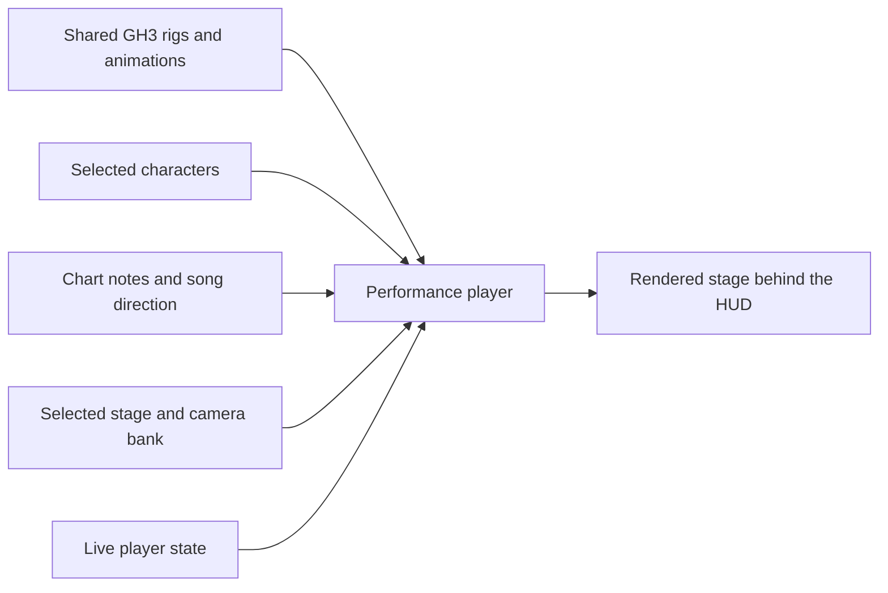
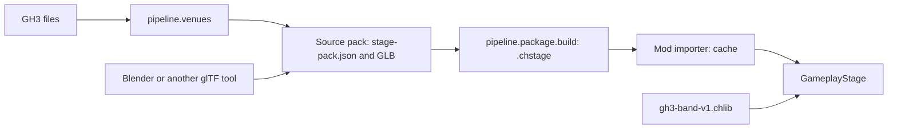
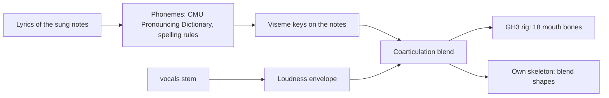

# Custom stages and song direction

## Status

This is the reference for song direction (sections 6 and 10 to 12) and for the stage-pack source format (sections 2 to 5 and 9). Players and creators use packages: stages (`.chstage`) and characters (`.chchar`) in [package format v1](PACKAGE-FORMAT.md), made with the Blender add-on ([CREATOR-GUIDE.md](CREATOR-GUIDE.md)). A `.chstage` package holds a stage pack of this format in a zip. The pipeline writes the GH3 venues as source packs, and the converter makes the packages from them ([PIPELINE.md](PIPELINE.md)). All ten GH3 venues and custom stages use the same compiler and the same loader.

The authoring target is Moonscraper's chart workflow with complete GH3 data and behavior. Native GH3 archives are reference inputs and a possible export target. Authors do not need to edit or distribute PAK files. Sections 9 to 12 give the workflow.

The library uses **four original GH3 skeletons and their animations**. Characters use these fixed profiles (PACKAGING-PLAN decision 2), or a GH3 guitarist profile of the character library `gh3-characters-v1` with its own skeleton and animations ([PACKAGE-FORMAT.md section 10.1](PACKAGE-FORMAT.md#101-character-library)), or keep the skeleton of their model: the mod retargets the clips of the profile to it (PACKAGING-PLAN decision 13, [PACKAGE-FORMAT.md section 9.6](PACKAGE-FORMAT.md#96-own-skeleton)). Instruments are packages too ([PACKAGE-FORMAT.md section 9.4](PACKAGE-FORMAT.md#94-instrument-chinst)). Stages supply the setting and camera shots. Charts select the performance through timed cues.

## 1. Data ownership

| Owner | Data |
| --- | --- |
| Shared GH3 library | Skeletons, bind poses, original animation clips, state tables, blend rules, hand and drum layers, IK constraints, instruments, attachment targets, facial clips, hair constraints, and hand-fire effects |
| Character package (`.chchar`) | Character meshes, skin weights, materials, and textures for one fixed rig |
| Stage pack | Scenery, performer placements, walking destinations, camera shots, lighting, and effect positions |
| Song | Timing, instrument notes, and optional camera, body, hand, drum, face, movement, lighting, and effect cues |
| Live game state | Streak effects and other player-state reactions |

The player selects a stage and a character for each role. A character works on every stage that uses the shared library. A chart refers to roles and shared actions. For example, `camera guitarist` selects a shot supplied by the active stage.



## 2. Versions and identifiers

- `gh3-band-v1` identifies the shared library contract. It fixes the rigs, animation identifiers, action tables, attachment rules, and coordinate conventions.
- Pack manifests use `version: 1`. Song direction uses `version: 2` so that existing version 1 files keep their current behavior.
- Pack IDs use lowercase letters, digits, hyphens, and dots, for example `example.neon-axel`. File paths are relative to the pack folder and use `/` separators.
- An incompatible rig or interface change requires a new profile or format version. Cosmetic changes keep the pack ID.
- Manifests reject unknown fields and invalid field types. Optional fields use the defaults specified here. All numbers are finite. File references remain within the pack folder.
- The importer compiles readable names to runtime identifiers. Authors use rig-template bone names and stage-local names. The compiled files can retain GH3 checksums and bone indices.
- JSON transforms use metres, Y up, and the Unity runtime coordinate system. Quaternions are `[x, y, z, w]` and have unit length. Stage depth extends along positive Z in the supplied template. GLB files use glTF coordinates; the importer converts them once.

Source packs contain a manifest, a GLB model with embedded textures, and the listed JSON files. The importer produces a runtime cache. The cache files (`GH3STG04`, `GH3BND02`, `GH3ANM01`, q48 clips; [PACKAGE-FORMAT.md section 14](PACKAGE-FORMAT.md#14-cache)) are implementation formats, not the authoring interface.

## 3. Fixed rig profiles

The initial library has these profiles:

| Profile ID | Role | Original skeleton | Bones |
| --- | --- | --- | ---: |
| `gh3-guitarist-axel-v1` | `guitarist` | `GH3_guitarist_axel` | 125 |
| `gh3-bassist-v1` | `bassist` | `GH3_bassist` | 125 |
| `gh3-singer-male-v1` | `singer` | `GH3_singer_male` | 121 |
| `gh3-drummer-v1` | `drummer` | `GH3_drummer` | 100 |

Each profile supplies an authoring template with the complete original rig. The importer checks bone identities, parent links, local bind transforms, and inverse bind matrices against that template. Export order can differ; the importer maps bones back to the canonical order. Bone count alone does not establish compatibility.

The character must preserve the template's scale, origin, bone axes, joint positions, and hierarchy. All vertices must have valid, normalized weights on template bones. The importer checks that the exported bind pose matches within its documented numeric tolerance. Meshes are fitted to the rig, including the source hand and finger positions.

The full rig includes instrument, target, face, and accessory bones. Unused bones remain in the exported template. Original IK targets, drumstick grips, microphone attachments, and hand-fire anchors come from the shared profile. The profile also supplies hair physics for the existing hair bones. Hair that should move is weighted to those bones.

The shared library owns the original instruments and animated props. A character replaces the character art; the mod adds the instrument of the role ([PACKAGE-FORMAT.md section 20.6](PACKAGE-FORMAT.md#206-characters)). In Blender, proxy bodies at the band placements show the size of the performers ([BLENDER-ADDON.md section 1.3](BLENDER-ADDON.md#13-make-a-new-stage)).

## 4. Characters

Characters are `.chchar` packages: one skinned GLB on a fixed profile rig and `character.json`. The format is in [PACKAGE-FORMAT.md section 9](PACKAGE-FORMAT.md#9-character-chchar), the import in [section 20.6](PACKAGE-FORMAT.md#206-characters), and the Blender workflow in [CREATOR-GUIDE.md section 5](CREATOR-GUIDE.md#5-make-a-character-on-a-gh3-rig). An earlier plan of this document had a `skin.json` skin pack; the `.chchar` package replaces it.

Instruments are `.chinst` packages: a guitar or a bass on the guitarist or bassist rig, with an optional highway image ([PACKAGE-FORMAT.md section 9.4](PACKAGE-FORMAT.md#94-instrument-chinst), [CREATOR-GUIDE.md section 6](CREATOR-GUIDE.md#6-make-an-instrument)).

## 5. Stage pack

The manifest is `stage-pack.json`. Example: [stage-pack.json](examples/custom-content/stage-pack.json).

| Field | Required | Meaning |
| --- | --- | --- |
| `version` | Yes | `1` |
| `kind` | Yes | `stage` |
| `id`, `name` | Yes | Stable ID and display name |
| `library` | Yes | `gh3-band-v1` |
| `model` | Yes | Relative path to the scenery GLB |
| `band` | Yes | One position and rotation for each of the four roles |
| `waypoints` | No | Named movement destinations, each with a position and rotation; default `{}` |
| `cameras` | Yes | Relative path to the camera bank described below |
| `lighting` | No | Relative path to a lighting bank; omission selects the shared basic fill-light preset |
| `effects` | No | Effect name to a list of emitter transforms; default `{}` |
| `actors` | No | Named animated scenery models; see [animated scenery](#animated-scenery); default `{}` |
| `crowd` | No | Crowd profile, model, and yaw entries; see [crowd and scenery visibility](#crowd-and-scenery-visibility); default shared assignments |

A transform has `position` and `rotation`. Performer placement has unit scale. A performer's root, instrument, and moving props use the same placement transform. The drummer's fixed kit reference uses the drummer placement. The scenery contains any matching static kit geometry.

The stage model supplies scenery materials through the same base-color and alpha rules as character models. Mesh nodes can set `extras.gh3LightGroup` to a stage-local light-group name. The default is `Stage`; the reserved `Band` group lights the performers. The importer resolves these names to compiled lighting group IDs.

### Waypoints

The four reserved start names are `guitarist_start`, `bassist_start`, `singer_start`, and `drummer_start`. They are derived from `band`. A stage can also supply `guitarist_walk01`, `guitarist_walk02`, `bassist_walk01`, and `bassist_walk02`.

These names belong to the portable interface. They map to local stage positions. The shared library provides the matching GH3 walk cycle and root-motion rules. If a requested optional waypoint is absent, the performer keeps its current position. An authored destination must have a clear path that suits the supplied walk controller.

### Camera bank

The authoring camera file has `version: 1`, a `shots` object, and a `groups` object. Example: [cameras.json](examples/custom-content/cameras.json).

- `shots` maps a stage-local name to a camera definition.
- `groups` maps each portable group name to a nonempty list of shot names.
- The portable groups are `wide`, `guitarist`, `bassist`, `singer`, `drummer`, and `orbit`.
- `wide` is required. A missing optional group uses `wide`.

Each shot has a `type`, a `control`, and `points`. The type is its GH3 selection category: `stage`, `longshot`, `mid`, `closeup`, `normal`, or `demonik`. It controls repeat avoidance and the applicable hand-camera rules. Supported controls follow the GH3 library: `TwoCam`, `HandCam`, `Orbit`, `OrbitAndMorphTwoCam`, `Pan`, `ThreePos`, `FourPos`, and `SpecialStepMove`. `ThreePos` and `FourPos` have three and four points. The other controls have one or two points; one point defines a stationary base pose. Original entries with no type import as `normal`.

`OrbitContinuous` uses one point and the song clock. It adds the public `angularSpeed` and `heightEase` fields described in [continuous orbit cameras](#continuous-orbit-cameras).

`Keyframes` accepts 2–64 points and an equally sized `times` array in seconds from the cut. Times start at zero and increase. `interpolation` is `smooth` by default, or `linear`. Repeated poses create holds; the last pose remains until the next cut. This format supports scripted intros and timed zooms.

Each point has:

| Field | Meaning |
| --- | --- |
| `position` | Position relative to `anchor` |
| `rotation` | Quaternion relative to `anchor`; used when `lookAt` is absent |
| `horizontalFov` | Horizontal field of view in degrees, greater than zero and less than 170 |
| `anchor` | `world`, or a shared actor anchor such as `guitarist.root` |
| `lookAt` | Optional shared actor anchor to track |
| `screenOffset` | Two-element framing offset in GH3 normalized screen units; default `[0, 0]` |

Actor anchors are `<role>.root`, `<role>.head`, `<role>.hand_left`, and `<role>.hand_right`. The shared rig profile resolves head and hand aliases to `bone_head` and `Bone_Palm_L/R`. `root` means the placed performer root. An exact bone anchor uses `<role>.bone.<template-bone-name>`; this preserves original camera targets such as the neck or instrument bones. Character geometry cannot change these mappings. `lookAt`, when supplied, sets orientation from the target and framing offset; otherwise `rotation` is required.

Optional shot fields are `orbitAngle` in degrees, `stepTime` in seconds, `stepCount`, `stepDirection`, `handCam`, `disableOrbit1`, `disableOrbit2`, and `waypoints`. Orbit movement uses the last point's anchor as its center, as in the translated GH3 controller. The three flags default to false; `HandCam` control enables hand-camera behavior directly. `waypoints` lists guitarist destinations where the shot is eligible. The stage must supply an unrestricted wide shot. The importer validates fields against the selected control and checks all shot and waypoint references.

The shared camera player owns cut selection, transition timing, and repeat avoidance. A song selects a group and can supply a duration. The stage supplies the resulting camera movement. A stable random seed makes repeated playback and seeks repeatable. The new camera file compiles into `StageCameraBank`; it differs from the current exported `direction/cameras.json` layout.

### Lighting and effects

Lighting banks retain the version 1 structure described by `StageLightingBank` in `src/Stage/Lighting/StageLighting.cs`: lights, snapshots, mood-to-snapshot lists, and color presets. Authoring IDs and group names are readable, stage-local names. The importer resolves them to internal IDs. All snapshots must cover the same lights and beam IDs. The standard mood names are `intro`, `verse`, `chorus`, `solo`, `flare`, `blackout`, and `strobe`. Each supported mood maps to one or more snapshots. Missing optional moods use `intro`; `intro` and `blackout` are required when a lighting bank is supplied.

The lighting bank lights the stage also when the stage has a script bank (`scripts.json`). Only when the script bank's node arrays have `LevelLight` objects (the GH3 venues) does the mod light the stage through these GH3 lights (`StageLightScene.DrivesLighting`); then a light in the lighting bank has an effect only through its `object`, the name of a `LevelLight`. GH3 light commands (`SetLightColor`, `EnableLight`, light groups) only change existing `LevelLight` objects, so a bank without them cannot light anything.

Movable light housings are model nodes whose `extras.gh3FixtureId` matches a beam ID. Their exported transforms define the source pose. The lighting controller applies snapshot movement to those nodes. Static nodes remain part of the scenery.

The `effects` keys are `pyro`, `sparks`, `fireworks`, and `smoke`. A cue triggers the emitter list for that type. An absent or empty list produces no particles. `flash` is camera-wide and needs no emitter. Effect styles come from the shared library. Hand fire remains attached to the player's GH3 hand bones and follows the live streak.

## 6. Song direction, version 2

The optional file remains `stage-events.json` beside the chart. Example: [stage-events.json](examples/custom-content/stage-events.json).

Events are stored in one array. The loader groups them by type and role to choose each channel's source when the song loads. A channel does not require a separate file or a `channel` field. The combined timeline then runs on the song clock.

| Field | Required | Meaning |
| --- | --- | --- |
| `version` | Yes | `2` |
| `library` | Yes | `gh3-band-v1` |
| `offsetSeconds` | No | Offset applied to events in this file only; default `0` |
| `originalSongLookup` | No | `auto` or `off`; default `auto` |
| `clearChannels` | No | Channels whose inherited cues are removed; default `[]` |
| `events` | Yes | Timed cues; an empty list supplies no overrides |

Times and durations are seconds on the song clock. Chart and MIDI ticks are converted with the tempo map and chart offset. The file offset applies after that conversion and does not shift inherited cues. Negative event times are permitted for setup before the first note. Cue times after the offset range from -86,400 to 86,400 seconds; durations range from zero to 86,400 seconds. An event file has at most 100,000 cues. Events at the same time retain their order within the source.

The event fields remain `time`, `type`, `value`, `duration`, `role`, `immediate`, `loop`, `count`, and `disableArms`. Only `time` and `type` are always required. Fields that identify a target or action are required for that event type. Defaults match version 1: `duration: 0`, `immediate: false`, `loop: false`, `count: 1`, and `disableArms: 0`. `type`, `value`, and `role` are strings; `immediate` and `loop` are booleans. `count` is an integer from 1 to 100, and `disableArms` is an integer from 0 to 2.

| Event | Required target/value | Meaning |
| --- | --- | --- |
| `camera` | Portable group in `value` | Select a camera group; positive `duration` sets the next shot's length |
| `stance` | `role`, stance in `value` | Select a GH3 stance, such as `stance_a` or `intro` |
| `perform` | `role`, action in `value` | Select an original action group, such as `jump` or `solo` |
| `clip` | `role`, original clip ID in `value` | Select a specific installed GH3 body clip |
| `face` | `role`, original clip ID in `value` | Start an installed GH3 facial clip at this time |
| `walk` | Guitar/bass `role`, portable waypoint in `value` | Move through the shared GH3 walking controller |
| `strum-style` | Guitar/bass `role`, style in `value` | Select an installed GH3 strum style |
| `arms` | Guitar/bass `role`, `value` of `0`, `1`, or `2` | Enable automatic arms, disable automatic strumming, or disable both automatic arms |
| `strum` | Guitar/bass `role`, five-bit chord mask in `value` | Playing gesture; sustain length is `duration` |
| `fret` | Original animation-note number in `value` | Select the GH3 fret-position layer; the note mapping determines the role |
| `drum` | Original drum-animation-note number in `value` | Select the GH3 drum or cymbal layer |
| `lighting` | Mood in `value` | Select a stage lighting mood |
| `color`, `blend`, `snapshot`, `strobe-toggle` | Existing GH3 lightshow values where applicable | Change lightshow state |
| `pyro`, `sparks`, `fireworks`, `smoke`, `flash` | Effect type; optional `duration` | Trigger the shared effect at stage locations |
| `tempo`, `beat` | BPM in `value` for `tempo` | Supply timing when the chart has no timing data |
| `crowd-lighters` | `start`, `stop`, `on`, or `off` in `value` | Start/stop the performance monitor, or directly change lighter-mesh visibility |
| `crowd-animation` | `idle`, `special`, or `starpower` in `value`; optional crowd `role` | Replace the selected crowd animation loop; an empty role calls all eight profiles with source frame waits |
| `crowd-hand` | `left/clap`, `right/lighter`, or another side/type pair; optional crowd `role` | Select `clap`, `lighter`, `rock`, or `fist`; an empty role changes all members |

Original numeric `gh3-camera` and `gh3-note` cues remain import-compatible. They resolve through the shared GH3 note mappings into the same channels as named cues. The drum-animation map is distinct from a Clone Hero `PART DRUMS` gameplay chart. Conversion of gameplay drum notes must use an explicit mapping.

Crowd roles are `crowd1` through `crowd8`; they are separate from band roles. Crowd controls require the version 2 crowd library. A `gh3-script` value can retain an entire original command row instead of using these convenience cue types. See [GH3 script calls in charts](#gh3-script-calls-in-charts).

The library supplies a catalog of valid stances, actions, styles, and clip IDs for each profile. The initial profiles have different capabilities: for example, the drummer has idle groups rather than guitarist jump groups. A cue must select an action from the target role's catalog. If the current stance has no variation for a valid action, the shared GH3 fallback rules select an idle. The importer reports unresolved original clip references.

`immediate` interrupts the current body clip when true. Otherwise body commands wait for the current clip boundary. `loop` repeats an action until a later body command changes it; `count` supplies a repeat count when `loop` is false. `disableArms` uses the same `0`/`1`/`2` meanings as the `arms` event and belongs to the selected body action. Face, drum, and hand layers use their own GH3 timing rules. Without `face` cues for the singer, the chart's vocals move the singer's mouth ([Lip sync from vocals](#lip-sync-from-vocals)).

### Channel selection and fallback

Version 2 chooses each channel separately. The source order is:

1. Cues in the song's version 2 file, or a matching `clearChannels` entry.
2. Explicit direction cues in the chart or MIDI (GH tracks such as `CAMERAS` and `LIGHTSHOW`, and `stage ...` or `gh3 ...` text events).
3. Original song cues matched by title and artist, when `originalSongLookup` is `auto`.
4. The Rock Band `VENUE` track of the MIDI file ([section 10](#rock-band-venue-track)).
5. Cues that the mod makes from the chart's sections ([section 10](#generated-direction)).
6. Shared default behavior.

Without a song file, the same order applies from step 2.

A source with events for a channel replaces that channel for the whole song. It does not append its events to a lower-priority source. A `clearChannels` entry selects an empty channel. A file cannot both clear and supply the same channel. Channels omitted from the file keep their inherited data.

| Channel | Cue types |
| --- | --- |
| `camera` | `camera`, `gh3-camera` |
| `body/<role>` | `stance`, `perform`, `clip` for that role |
| `walk/<role>` | `walk` for that role |
| `face/<role>` | `face` for that role |
| `arms/<role>` | `arms` for that role |
| `strum-style/<role>` | `strum-style` for that role |
| `strum/<role>` | `strum` for that role |
| `fret/<role>` | `fret`, resolved through the GH3 note map |
| `drum` | `drum` |
| `lighting` | All lightshow state cues, including lighting `gh3-note` values |
| `pyro`, `sparks`, `fireworks`, `smoke`, `flash` | The matching effect; GH3 note 56 belongs to `pyro` |
| `timing` | `tempo`, `beat` |
| `crowd-control` | `crowd-lighters`, `crowd-animation`, `crowd-hand`, and handled original crowd commands |

Two channels have source rules that preserve the playable chart:

- **Strums:** explicit song-file cues, then explicit chart direction cues, then gestures derived from the chart's Expert guitar/bass notes, then the original-song library. A camera-only file therefore keeps note-driven playing gestures.
- **Timing:** use the playable chart's tempo map when available. File timing is a fallback for charts without timing data, followed by original-song timing and the shared default tempo. `timing` cannot appear in `clearChannels`.

Missing body cues use GH3 idle groups at the song tempo. Missing camera cues use automatic selection from the stage's camera bank. Missing lighting cues keep the initial lighting state (the venue's `intro` mood). Missing effects produce no bursts. Missing drum direction adds no drum-hit layers. Missing face direction adds no GH3 facial clips; the singer then gets lip sync from the chart's vocals, if the chart has them. Clearing a channel selects these same defaults, without the cues of steps 4 and 5; it does not hide the performer or disable the stage.

Version 1 files keep their complete-timeline replacement behavior. Migrating a full original export to version 2 must check the new channel boundaries, especially the combined body and lighting channels. Raw legacy `vocal` and `crowd` note tracks remain import metadata until a playback rule is implemented; they are not advertised as version 2 authored features.

## 7. Import and playback requirements

The importer must check:

1. Manifest version, IDs, relative file references, and the selected library/profile.
2. Rig identity, bind transforms, weights, material references, and model bounds.
3. Four valid performer placements, camera references, and an unrestricted wide shot.
4. Waypoint names, lighting groups, complete snapshots, and fixture references.
5. Event timing, roles, action references, and channel conflicts.

The runtime resolves the selected character for each fixed role and the selected stage independently. A selected character that cannot load gives the venue's default band member. An unavailable optional stage feature uses the fallback defined above. Import reports identify the file, field, and unresolved reference.

All performance and camera playback uses `GameManager.songTime`. Pause holds the state. Seek reconstructs the pose, camera, and authored effect state at the new time. Live streak effects clear their old trails and use the current player state, as in the installed hand-fire implementation.

## 8. Implementation status

- **Implemented:** the shared `gh3-band-v1` library and action catalog, stage-local placements and waypoints, public camera and lighting banks, stage import and selection, animated scenery, all ten GH3 performance packs, version 2 per-channel song direction with role/action checks and source diagnostics, and character packages on the fixed profiles (section 4).
- **Checked:** every stage and the independently generated Studio stage use the common loader. Renaming the Budokan pack produces identical runtime assets.

The JSON examples are manifest and cue examples. Their referenced GLB files are author-supplied assets. `python -m pipeline.stagepack.template` creates a complete, installable example stage pack.

## 9. Create and import a stage

Most creators use the Blender add-on ([CREATOR-GUIDE.md](CREATOR-GUIDE.md)). Without Blender, create the example pack, compile it, convert it to a package, install it, and play it:

```bash
MISE_QUIET=1 uv run --with pillow --with numpy --with 'shapely>=2.1' python -m pipeline.stagepack.template
MISE_QUIET=1 uv run --with pillow --with numpy --with 'shapely>=2.1' \
  python -m pipeline.stagepack.install assets/stage-packs/example.studio
MISE_QUIET=1 uv run --with pillow --with numpy --with 'shapely>=2.1' --with brotli \
  python -m pipeline.package.build --venue example.studio --no-library
MISE_QUIET=1 bash install.sh
MISE_QUIET=1 GH3_SKIN_STAGE=example.studio bash run-gh3-skin.sh --preview
```

The example has four performer placements, cameras, a walking destination, a moving light fixture, effect emitters, and a rotating skinned sign. You can edit its GLB files in a glTF tool. The shared band library must be installed.

The GH3 venue exporter writes the same source format and then calls the same compiler. The converter puts the source pack into a `.chstage` package, and the mod compiles the package into its cache with a C# port of the same compiler. The runtime does not read the GH3 PAK files or select behavior from venue names.



The compiler accepts embedded glTF 2.0 GLB files with triangle meshes, normals, base-color textures, UVs, vertex colors, and `OPAQUE`, `MASK`, or `BLEND` materials. It applies node transforms, handedness, winding, and UV conversion. Bake unsupported extensions and morph targets before import.

Material properties in glTF `extras`:

| Property | Meaning |
| --- | --- |
| `gh3Additive: true` | Additive transparent material |
| `gh3CrowdAtlas: true` | Use the shared animated crowd atlas (eight columns, three rows) |
| `gh3SortedTransparency: true` | Sort triangles of a skinned actor's transparent material |

Fixture mesh nodes set `extras.gh3FixtureId` to a lighting beam ID. Local +Z is the beam axis. `extras.gh3FixtureFixedPosition: true` keeps the authored housing position while the controller turns it.

### Crowd and scenery visibility

| Node property | Meaning |
| --- | --- |
| `gh3VisibilityGroup` | Named group that the runtime controls; `crowd-lighters` receives crowd lighter commands |
| `gh3InitiallyVisible` | Start state; default `true` |

All meshes of one group must have the same start state. The optional `crowd` array of `stage-pack.json` selects up to eight profiles (`role` `crowd1`–`crowd8`, `model` from the shared crowd library, `yaw` in degrees):

```json
"crowd": [
  {"role": "crowd1", "model": "crowd_prison_01", "yaw": 0},
  {"role": "crowd2", "model": "crowd_prison_02", "yaw": 0}
]
```

### Animated scenery

The optional `actors` object maps names to:

| Field | Required | Meaning |
| --- | --- | --- |
| `model` | Yes | Pack-relative GLB with one skin |
| `transform` | Yes | Position and unit quaternion |
| `clip` | No | GLB animation; default the first clip |
| `playback` | No | `loop` (default) or `hold` |
| `lightGroup` | No | Default `Stage` |
| `role` | No | Cue target, for example `stage-diver/1` |
| `initiallyVisible` | No | Default `true` |
| `actions` | No | Action names mapped to lists of clip names |
| `object`, `script`, `created` | No | Script object name, startup script, initial creation state |
| `scale` | No | Default `[1, 1, 1]` |
| `animationEvents` | No | Typed animation-event table (`time`, `scr`, `params` rows) |

The compiler checks inverse bind matrices, the joint hierarchy, unit joint scale, weights, and channels. It accepts translation and rotation tracks (`LINEAR` or `STEP`), sampled at 60 Hz; at most 256 clips of 120 s each. It drops scale tracks whose keys are all within 1e-4 of 1 (Blender writes one for each joint) and rejects other scale keys.

### Scripted scenery

The pack field `scripts` points to a typed script bank (`version: 1`, `definitions`, `startup`). GLB nodes can set `gh3Object`, `gh3ObjectPivot`, `gh3ObjectRotation`, `gh3ObjectCreated`, and `gh3ObjectScript`. All meshes with one object ID share its placement. Object commands use these pivots for movement, rotation, attachments, scaling, and note-hit pulses.

### Continuous orbit cameras

`OrbitContinuous` uses one camera point with an `anchor` and `lookAt`. `angularSpeed` is degrees per second about the vertical axis. `heightEase` is `[start, end, rate]`: the height offset is `end + (start - end) * exp(-rate * songTime)`. `Keyframes` keeps timed holds, moves, and lens changes; `times` are seconds from the cut, and `interpolation` is `smooth` or `linear`.

### Lighting details

Light intensity can be negative. Equal near and far distances give a sharp attenuation edge. Each snapshot lists every light and beam; `inherit: true` keeps the earlier state.

## 10. Song direction in charts

### Direction tracks

`.chart` sections and MIDI tracks named `CAMERAS`, `LIGHTSHOW`, `ANIMS`, `DRUMS`, and `CROWD` hold GH3 direction notes with their original note numbers and lengths. Legacy names `ANIM`, `PERFORMANCE`, and `GH3 …` are also accepted. Playable `PART DRUMS` notes are separate from `DRUMS` animation notes. MIDI velocity is kept but does not change animation yet.

```text
[CAMERAS]
{
  192 = N 89 384
}
```

At 120 BPM and resolution 192, this is camera note 89 at 0.5 s for 1 s: the drummer camera group.

### Text events

In `[Events]` (or MIDI `EVENTS`, `VENUE`, `GH3 VENUE`, `LIGHTSHOW`; on the MIDI `VENUE` track, only the `stage ...` and `gh3 ...` forms, because the Rock Band rules below read the other text):

| Text | Result |
| --- | --- |
| `stage pyro`, `stage sparks`, `stage fireworks`, `stage smoke` | Effects |
| `stage flash`, `stage blackout`, `stage strobe` | Light states |
| `stage lights NAME` | Color (`red`, `green`, `blue`, `yellow`, `orange`, `purple`, `magenta`, `cyan`, `white`) or mood (`intro`, `verse`, `chorus`, `solo`, `flare`, `blackout`, `strobe`) |
| `[bonusfx]`, `[bonusfx_optional]` | Pyro |
| `[lighting (NAME)]` | Color or mood. A Rock Band lighting name gives its GH3 mood from the table below; `[lighting ()]` gives `verse` |
| `[stage camera GROUP]` | Camera group |
| `stage stance ROLE STANCE`, `stage perform ROLE ACTION`, `stage walk ROLE WAYPOINT` | Band actions |
| `stage clip ROLE ID`, `stage arms ROLE MODE`, `stage strum-style ROLE STYLE`, `stage strum ROLE MASK`, `stage fret NOTE`, `stage drum NOTE` | Band animation |

GH3 lightshow note numbers are in [PARITY-NOTES.md](PARITY-NOTES.md#lighting-and-node-flags).

### Rock Band VENUE track

A MIDI track with the name `VENUE` holds Rock Band camera and lighting cues ([format](https://github.com/TheNathannator/GuitarGame_ChartFormats/blob/main/docs/Implementation-Specific/Rock-Band/MIDI-Tracks/Venue.md)). Many converted charts have one. The mod reads both variants: RB1/RB2 notes and text events, and RB3 text events. `.chart` files have no VENUE section (Moonscraper and YARG also read the track only from MIDI); the `[lighting (NAME)]` and `[bonusfx]` events in `[Events]` use the same name table. `MV VENUE` (RB2 music-video venues) is not read.

The cues go into the normal channels (`camera`, `lighting`, `pyro`, `smoke`) and play through the same players as GH3 notes: camera cuts become `gh3-camera` notes, lighting becomes `lighting`, `color`, and `blend` cues, and keyframe steps become GH3 lightshow notes 58 (next snapshot) and 60 (strobe toggle). A channel uses the VENUE track only when no higher source supplies it ([channel selection](#channel-selection-and-fallback)). Clear **Use Rock Band VENUE tracks** in the picker ([PLAYER-GUIDE.md](PLAYER-GUIDE.md#5-direction-options)), or set `GH3_SKIN_VENUE_TRACK=off`, to ignore all VENUE tracks. The loader log shows the counts (`Rock Band VENUE: ... mapped; N repeated lighting cues blend into the next cue; ignored ...`) and the first 16 mapped cues.

In the tables, **J** marks a choice by judgment. The other rows follow the name of the Rock Band cue directly.

#### Camera cuts

GH3 camera notes select a group from the stage's camera bank (the GH3 `CameraCuts_NoteMapping` table, the same in all ten venues). A stage without a note table (a custom stage) maps each note to its portable group: 84 and 86 closeup shots, 85 mid shots, 87 `wide`, 88 `singer`, 89 `drummer`, 97 `bassist`, 95 `guitarist`, the orbit notes `orbit`, and the other notes `default`.

| Rock Band cue | GH3 note | GH3 group | |
| --- | --- | --- | --- |
| RB1 note 60 (random) | 79 | `cameras`, any type | |
| note 60 + 71 (only far) | 87 | `cameras`, type `stage` | |
| note 60 + 72 (only close-ups) | 84 | `cameras`, type `closeup` | |
| note 60 + 73 (no close-ups) | 85 | `cameras`, type `mid` | |
| note 61 (bassist) | 97 | `cameras_bassist` | |
| note 62 (drummer) | 89 | `cameras_drummer` | |
| note 63 (guitarist); with 72 | 84; 95 | `cameras` closeup (they aim at the guitarist); `cameras_guitar_closeup` | J |
| note 64 (vocalist); with 72 | 88; 104 | `cameras_singer`; `cameras_singer_closeup` | |
| two or more focus notes | 85 | `cameras`, type `mid` | J |
| `coop_g_near`, `coop_g_closeup_head` | 84 | `cameras` closeup | J |
| `coop_g_closeup_hand` | 95 | `cameras_guitar_closeup` | |
| `coop_b_*` | 97 | `cameras_bassist` | |
| `coop_d_*` | 89 | `cameras_drummer` | |
| `coop_v_near`; `coop_v_closeup` | 88; 104 | `cameras_singer`; `cameras_singer_closeup` | |
| `coop_gv_near` | 114 | `cameras_pan` (the GH3 pans move between the guitarist and the singer) | J |
| other two- and three-member `*_near`, `coop_all_near` | 85 | `cameras`, type `mid` | J |
| all `*_behind` | 102 | `cameras_vert_stagerear` (behind the drummer, looks over the band to the crowd) | J |
| all `*_far` | 87 | `cameras`, type `stage` | |
| `directed_guitar`, `_np`, `directed_crowd_g` | 84 | `cameras` closeup | J |
| `directed_guitar_cam`, `_cam_pr`, `_cam_pt`, `directed_all_cam` | 112 | `cameras_zoom_fast` | J |
| `directed_guitar_cls` | 95 | `cameras_guitar_closeup` | |
| `directed_bass*`, `directed_crowd_b`, `directed_duo_kb` | 97 | `cameras_bassist` | |
| `directed_drums*`, `directed_duo_drums` | 89 | `cameras_drummer` | |
| `directed_drums_lt` | 92 | `cameras_orbit`, `orbit_drummer` | |
| `directed_vocal(s)*`, `directed_duo_kv` | 88 | `cameras_singer` | |
| `directed_vocal(s)_cls` | 104 | `cameras_singer_closeup` | |
| `directed_stagedive`, `directed_crowdsurf` | 117 | `cameras_stagedive` | |
| `directed_duo_guitar` | 114 | `cameras_pan` | J |
| `directed_all`, `directed_duo_gb`, `directed_duo_bass`, `directed_keys*` | 85 | `cameras`, type `mid` | J |
| `directed_all_yeah`, `directed_brej`, `directed_crowd` | 87 | `cameras`, type `stage` | J |
| `directed_all_lt` | 113 | `cameras_zoom_out` | |
| `directed_bre` | 82 | `cameras_orbit`, `orbit_stage` | J |
| `directed_duo_kg` | 84 | `cameras` closeup | J |
| unknown `directed_*` | 79 | `cameras` | |

Rules:

- GH3 has no keyboard player. A cut that shows the keys player shows the other members of the cut; keys alone is a mid shot (J).
- RB3 stacks cuts at one time and plays the one that fits the band. The mod takes a directed cut first, then a cut without keys and not from behind, then a behind cut, then a cut with keys. When more than one cut has the best rank, the mod takes them in turn (the first stack takes the first cut, the next stack the second cut, and so on). Magma writes the stacked cuts in name order, so "the first cut" was nearly always `*_behind` (J: GH3 note 102 does not show the member of a behind cut).
- `do_directed_cut` and `do_optional_cut` (RB1) play always: the mod does not know if the player "does well" (J). The cut starts at the event time; the Rock Band pre-roll is not used (J).
- Each cut lasts until the next cut. When that is more than 8 s, the note has no length, and GH3's own 3–8 s cuts continue in the same group (J: GH3 shots move from one point to another, and a long hold is too slow).
- Note 70 (no behind cuts) has no effect, because the random groups have no behind shots.

#### Lighting

| Rock Band cue | GH3 mood | Color override | Blend | Steps | |
| --- | --- | --- | --- | --- | --- |
| `()`, `verse`, RB1 `[verse]` | `verse` | off | 0.15 s | keyframes | |
| `chorus`, RB1 `[chorus]` | `chorus` | off | 0.15 s | keyframes | |
| `intro` | `intro` | off | 0.15 s | | |
| `manual_cool` | `verse` | blue | 0.15 s | keyframes | J |
| `manual_warm` | `verse` | orange | 0.15 s | keyframes | J |
| `dischord` | `chorus` | red | 0.15 s | keyframes | J |
| `stomp` | `strobe` | off | 0.15 s | `next` toggles the strobe (note 60) | J |
| `loop_cool` | `verse` | blue | 0.15 s | snapshot each 2 beats | J |
| `loop_warm` | `verse` | orange | 0.15 s | snapshot each 2 beats | J |
| `harmony` | `verse` | off | 0.15 s | snapshot each 2 beats | J |
| `searchlights` | `verse` | off | 0.15 s | snapshot each beat | J |
| `sweep` | `chorus` | off | 0.15 s | snapshot each 2 beats | J |
| `frenzy`, `bre` | `chorus` | off | 0.15 s | snapshot each beat | J |
| `silhouettes`, `blackout_spot` | `blackout` | off | 0.15 s | | J |
| `silhouettes_spot` | `solo` | off | 0.15 s | | J |
| `blackout_fast` | `blackout` | off | 0.2 s | | |
| `blackout_slow` | `blackout` | off | 2 s | | |
| `flare_fast` | `flare`, as a pulse | off | see the flare rule; back in 0.3 s | | J |
| `flare_slow` | `flare`, as a pulse | off | see the flare rule; back in 1 s | | J |
| `strobe_fast` | `strobe` | off | | strobe toggle each 32nd note | |
| `strobe_slow` | `strobe` | off | | strobe toggle each 16th note | |
| a GH3 mood or color name | the same | | 0.15 s | | |
| unknown name | `verse` | off | 0.15 s | | J |

Rules:

- GH3 has seven moods and steps through each mood's snapshots on lightshow notes. Rock Band's automatic cues move by themselves, so the mod adds snapshot steps at a fixed beat rate until the next lighting cue (J: the rate follows the speed of the Rock Band cue).
- `[next]`, `[prev]`, and `[first]` (RB1 notes 48, 49, 50) step only in a keyframed cue (the "keyframes" rows), as in Rock Band. GH3 cannot step back, so `prev` and `first` also go to the next snapshot (J); `first` at the time of its lighting cue has no effect. `stomp` reacts only to `next`.
- A color override stays until a cue without a color. If the color changes while the mood stays the same, the mod adds a snapshot step, because GH3 applies a new color only with the next snapshot.
- A blend other than 0.15 s applies to its own cue; the next cue sets 0.15 s again.
- Two lighting cues at one time: the last one in the track plays. `intro` yields to the other cue.
- A flare is a short pulse, not a full flare snapshot (J). The light blends toward the flare snapshot over GH3's 0.15 s, and at 40% of the way (0.06 s) it turns back: to the next cue, which then reaches its own time, or, when the next cue is more than the return time away, to the cue before the flare. GH3 itself plays its flare mood (note 71) as a short state: in My Curse the next mood note comes 0.33 s after each flare. Rock Band charts often put a flare on each beat (You're Not Going Anywhere: 128 `flare_fast` in 3 minutes); the full Dive flare snapshot sets the ambient light to 2.0 and makes the walls nearly white on each beat. Measured on that chart on `gh3.dive` (frames 600–2400 of a 45 s recording, 160 × 90 mean luma): mean 69 → 50, peak 139 → 95, median rise of a flash 73 → 34 luma steps.
- Photosensitivity (WCAG 2.3.1, three flashes in one second): flares closer than 0.34 s to the last one are dropped. The picker option **Reduce flashing** ([PLAYER-GUIDE.md](PLAYER-GUIDE.md#5-direction-options); `GH3_SKIN_REDUCE_FLASHING=on` or `off` overrides it) makes flare pulses peak at 20% and come at most once each second, and keeps strobe toggles at least 0.2 s apart. It is off by default (J), because the default pulses already stay below three flashes per second.
- A repeated cue starts a blend, as in Rock Band ([RBN2 docs](http://docs.c3universe.com/rbndocs/index.php?title=RBN2_Camera_And_Lights), "Lighting and Post Process Blending"): for `A … A … B`, the mod starts `B` at the second `A` and blends over the time to `B`. At the time of `B` the blend goes back to 0.15 s, and the snapshot steps of `B` start. Charts use this for fades and for flashes (`flare_fast`, `flare_fast` 1/8 beat later, then `silhouettes_spot`). Before, the second cue had no effect and the stage stayed in the flare mood until `B`. A flare before `A … A` uses the flare rule: the fade starts at the pulse peak.

#### Effects and ignored cues

| Rock Band cue | Result | |
| --- | --- | --- |
| `[bonusfx]`, `[bonusfx_optional]` | `pyro` (GH3 lightshow pyro script where the venue has one) | |
| `[FogOn]` | `smoke` | J |
| `[FogOff]` | ignored: GH3 smoke ends by itself | |
| Post-processing (RB1 notes 96–110, RB3 `[*.pp]`) | ignored: GH3 has no matching screen filters | J |
| Spotlights (notes 37–41) | ignored: GH3 sets its spot flags from the players, not from the chart | J |
| Sing-alongs (notes 85–87) | ignored: no GH3 band action is mapped | J |

#### Tested charts

These charts were read with the mod's reader, and four of them were played in the game (2026-10-09). The downloads are not in the repository. The C# tests use event patterns of these charts, not the chart data.

| Chart | Charter | Kind | Music license | Played on |
| --- | --- | --- | --- | --- |
| Brad Sucks: Fake It, Gasoline, Out of It, There's Something Wrong, Total Breakdown, Understood by Your Dad, You're Not Going Anywhere | MB1Nightmare and Greninjo | RB3 text events, Clone Hero conversion with Onyx fields in `song.ini` | CC BY-SA ([Out of It](https://www.bradsucks.net/releases/out-of-it)) | You're Not Going Anywhere: `gh3.dive`, `gh3.hell` |
| Jonathan Coulton: Skullcrusher Mountain | Harmonix (RB1 DLC) | RB1 notes (60–64, 70–73, 48) and text lighting | CC BY-NC (Thing a Week) | `gh3.hell`, `gh3.budokan` |
| Jonathan Coulton: Big Bad World One, Mandelbrot Set | RBN1 | RB2 notes and text lighting | CC BY-NC | |
| Jonathan Coulton: The Future Soon, The Stache, Shop Vac, Creepy Doll, Ikea, Chiron Beta Prime | RBN2 | RB3 text events | CC BY-NC (The Stache: not known) | The Future Soon: `gh3.budokan`, `gh3.dive` |

The source is [Chorus Encore](https://www.enchor.us/) (`https://files.enchor.us/<md5>.sng`). The Brad Sucks charts are uploads by their charter. The Coulton charts come from Rock Band packages; their chart data is not under a free license, so use them only for local tests.

Results:

- No unknown event in the 16 charts. The mod ignores post-processing (11–62 per chart), spotlights (up to 581 notes), sing-alongs, `[FogOff]`, `[next]` in automatic cues, and `[first]`/`[prev]` in `stomp` (as Rock Band does).
- Camera subjects match the cues on all three venues: drummer, bassist, singer, singer close-up, guitar hand close-up, pans, and wide shots.
- Flares: each beat flash showed the full Dive flare snapshot (nearly white walls) and, on the singer, removed the hair (see [STATUS](STATUS.md)). Both are fixed; see the flare rule.
- Three bugs were found and fixed: stacked cuts played the behind shot (The Future Soon: 49 of 89 cuts, Creepy Doll: 70 of 104, Shop Vac: 73 of 94; now 0), repeated cues did not blend (66 repeats in You're Not Going Anywhere, 81 in The Stache), and two cues at one time played in a random order (List sort is not stable).

### Generated direction

A chart with no camera or lighting source (no GH track, no VENUE track, no song file, and no original song) gets small cues from its sections (`[Events]` `section NAME`, or MIDI `EVENTS` `[section NAME]` and `[prc_NAME]`):

- At each section: a lighting mood from the name (`solo` if the name contains "solo", `chorus` if it contains "chorus" but not "pre-chorus", `intro` if it starts with "intro", else `verse`) and a camera cut (GH3 note 81, `cameras_solo`, for a solo; else note 79).
- On each bar (four beats) from the first section to the last chart event: lightshow note 58 (next snapshot). GH3's random camera cuts then also end on bar lines, as in GH3 (`CameraCuts_CalcTime` extends a cut to the next note 58).
- A chart without sections gets the `verse` mood at time 0 and the bar steps. The camera keeps GH3's random cuts.

Before this, such a chart stayed in the `intro` mood for the whole song. Clear **Generate direction for charts without it** in the picker, or set `GH3_SKIN_GENERATED_DIRECTION=off`, to get that behavior (for example, for older reference captures).

### Lip sync from vocals

In GH3, the singer's face moves only with facial clips for each song (`Band_PlayFacialAnim` rows in the song's `_performance` array, for example five clips of 20 to 65 seconds in My Curse). A custom chart has none. When the singer has no `face` cue from any source, the mod moves the singer's mouth from the sung syllables of the chart:

| Source | Syllables |
| --- | --- |
| MIDI `PART VOCALS` (else `HARM1`) | Each pitched note (36 to 84) is one syllable, with its MIDI length. The lyric at the same tick gives the text. A note without a lyric, or with the lyric `+`, continues the previous syllable. Percussion notes (96, 97) and text events in brackets are ignored |
| MIDI vocal track with lyrics but no pitched notes | Each lyric lasts until the next lyric or the end of its phrase (notes 105 and 106), at most two beats |
| `.chart` `[Events]` | `lyric TEXT` events, with the same rule and `phrase_start` and `phrase_end` |

The lip sync has these steps:



1. **Phonemes.** The mod joins the syllables of each word (a syllable that ends with `-` or `=` continues in the next note) and finds the word in the CMU Pronouncing Dictionary (126,052 words, in the mod DLL). A word with a dropped "g" (`rockin'`) uses the "-ing" word. Words that the dictionary does not have use English spelling rules (`igh`, `ee`, the silent final `e`, and others). The phonemes of the word are then divided over its notes: each note gets one vowel; one consonant between two vowels starts the next note, and of two or more consonants the first stays with the note before. A syllable that starts with a vowel letter and is not a word (`yeah-` `eah`) holds the vowel of the note before.
2. **Visemes.** Each phoneme gives one of 15 mouth shapes (visemes): `AA`, `AH`, `EH`, `IY`, `OW`, `UW`, `ER`, `MBP`, `FV`, `TH`, `L`, `WR`, `SZ`, `SH`, `KG`, plus the rest pose. The consonants before the vowel come just before the note (0.025 to 0.07 s each), the vowel holds for the note, and the consonants after the vowel close the note. A diphthong (`AY`, `EY`, `OY`, `AW`, `OW`) glides to its second vowel in the last part of the note (for example "I" goes from "ah" to "ee"). The face is 0.04 s before the sound.
3. **Coarticulation.** All keys near the time blend with a weight that falls off with the distance. Vowels and the rest pose spread wider than consonants, and the tongue consonants (t, d, n, s, l, k, g) have a small weight. Thus the mouth stays open through a legato line and a consonant between two vowels is a partial closure. Only `m`, `b`, and `p` close the lips fully. The mouth goes to the rest pose only in a gap between notes that has room for it (about 0.35 s or more).
4. **Loudness.** When the chart folder has a vocal stem (`vocals.ogg`, `vocals.opus`, `vocals.mp3`, `vocals.wav`, and `vocals_1` and `vocals_2` for harmonies), a worker thread decodes it with Clone Hero's BASS library while the stage loads. It calculates the loudness (RMS in 20 ms windows, 100 values per second, fast rise and slow fall) and normalizes it to the loud singing of the song. The vowels open with the loudness: 25 % when silent, the full viseme at the normal loud level, and up to 140 % when louder. The mod keeps the envelope in `UserData/GH3Skin/Cache/vocals/` (a few kilobytes for each song), so the next start reads it. Without a stem, or while the decode is not complete, the vowels open with the notes: they open over 0.1 s, a long note relaxes to 75 %, and spoken notes (`#`, `^`) open less.
5. **Face.** The brows rise on long notes and on high notes (the top part of the song's pitch range). With a vocal stem, loud singing narrows the eyes and lowers the brows. The eyes look in other directions at random intervals (0.4 to 4 s). The head nods by 3 degrees at the start of a phrase and by 1.8 degrees on long notes, on top of the body clip. The eyes blink at random intervals of 2 to 18 seconds (fixed for each song).

On the GH3 rigs, each viseme is a pose of the 18 jaw, lip, cheek, and tongue bones. `tools/lipsync-shapes.py` measures the poses from the 570 GH3 singer facial clips (605,494 frames): it measures the lip gap, the mouth width, and the lip protrusion of each frame, and the pose of a viseme is the mean of the 400 frames nearest to the viseme target. Thus every viseme is a real GH3 mouth pose. The brow, squint, and eye motion also come from the GH3 clips (the mean of the frames with the highest and lowest brow, the highest lower lid; the eye range and the saccade intervals). The mod adds the poses to the body clip in the bone's own axes, as GH3's `applydifference` does.

A character on its own skeleton uses its blend shapes (`face` in `character.json`, [PACKAGE-FORMAT.md section 9.6](PACKAGE-FORMAT.md#96-own-skeleton)): a viseme uses its own shape when the character has it (the VRChat and Oculus visemes `pp`, `ff`, `th`, `dd`, `kk`, `ch`, `ss`, `nn`, `rr`), else a mix of the vowel shapes `a`, `i`, `u`, `e`, `o`. `browUp`, `browDown`, and `squint` show the brows and the eyes. The head and the eyes of the character follow the GH3 rig.

GH3 facial clips always have priority: a native song, an original song from the library, or a `face` cue keeps the GH3 face exactly; the mod then does not decode the stem. The guitarist does not get lip sync. Set `GH3_SKIN_LIPSYNC=off` to keep the face still. The F6 picker has no lip-sync option. The game log tells the source: `lip sync from 253 sung notes (197 syllables, 552 viseme keys; 149 words from the pronouncing dictionary, 0 from spelling rules)` and `vocal stem loudness from vocals.opus (221.5 s) ready 665 ms after the chart was read`.

### GH3 script calls in charts

A text event can hold `gh3 ` followed by the JSON of `Gh3ScriptEvent.Encode`: a version, the source track, and the typed source row. Checksums can be `0x12345678` or a name. The chart time controls playback; the row's original `time` stays as metadata. Such events can be on custom track names. Native and authored calls use the same dispatcher.

### Song event file

`stage-events.json` beside the chart can replace channels (version 2) or the whole direction (version 1). See [section 6](#6-song-direction-version-2). To start from the original direction of one song:

```bash
MISE_QUIET=1 python3 -m pipeline.events "$HOME/games/gh3-test-tools/game/DATA/SONGS/mycurse_song.pak.xen" \
  --output "/path/to/song/stage-events.json"
```

The command does not replace an existing file. `offsetSeconds` shifts all cues of the file; a positive value runs them later.

## 11. Native song PAK

Put exactly one `<song>_song.pak.xen` in the song folder, beside the playable chart and audio. It supplies direction, Expert guitar and bass gestures, and fretbar timing, and it has priority over the other sources. The audio and chart must use the native song's time origin.

`tools/Gh3SongTool` inspects a song PAK and changes one camera note. Only that four-byte field changes; all other bytes stay:

```bash
MISE_QUIET=1 dotnet run --project tools/Gh3SongTool -c Release -- inspect /path/to/mycurse_song.pak.xen
MISE_QUIET=1 dotnet run --project tools/Gh3SongTool -c Release -- \
  camera /path/to/mycurse_song.pak.xen 1 84 89 /path/to/edited/mycurse_song.pak.xen
```

The camera arguments are the zero-based row, the expected old note, and the new note. Split PAK/PAB song archives and console files are not supported. There is no general QB writer.

## 12. Moonscraper

The editor fork is <https://github.com/heditwo/gh3-chart-editor>, based on Moonscraper 1.5.13 (upstream `7b4a7eab62e286b2a7bc2b21d2c22d4f65ff44fd`). It adds preservation fixes and an event browser with search, filters, presets, raw arguments, and undo. The accepted workflow is: save `.msce`, export `notes.mid`, play with the mod.

The stock Moonscraper 1.5.13 importer changes data on tracks that it does not know (measured with `tools/MoonscraperAudit`):

| Check | Stock result |
| --- | --- |
| MIDI camera note at 10 s, 5 s long | Moves to 15 s (the note-off time); moves again after each round trip |
| MIDI drum note 12 ticks long | Length 0 |
| MIDI velocity | Written as 100 |
| Same-time text events | Sorted by text |
| Local text with spaces exported to `.chart` | Spaces become underscores; `.msce` keeps them |

A complete editor must keep track identity, note number, start, length, velocity, script identity, typed parameters, unnamed flags, same-time order, unresolved checksums, and unknown fields through unrelated edits.
