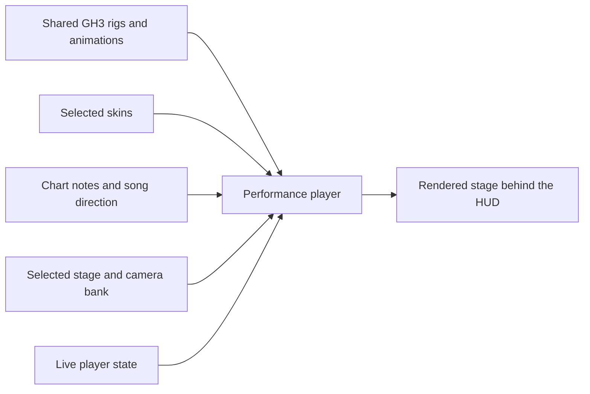
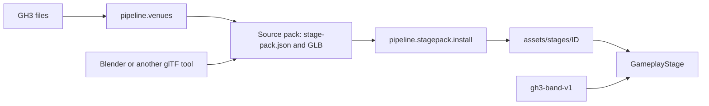

# Custom skins, stages, and song direction

## Status

This is the reference for authored content: stage packs, song direction, and the planned skin packs. The stage-pack importer, the common loader, and song direction versions 1 and 2 are implemented. All ten GH3 venues use the same loader as a custom pack. Skin-pack import is not implemented; playback uses the shared default skins.

The authoring target is Moonscraper's chart workflow with complete GH3 data and behavior. Native GH3 archives are reference inputs and a possible export target. Authors do not need to edit or distribute PAK files. Sections 9 to 12 give the workflow.

The current library uses **four original GH3 skeletons and their animations**. Those profiles are the implemented subset. Full character compatibility must also cover native profile choices, instrument packages, and their animation references. Stages supply the setting and camera shots. Charts select the performance through timed cues.

## 1. Data ownership

| Owner | Data |
| --- | --- |
| Shared GH3 library | Skeletons, bind poses, original animation clips, state tables, blend rules, hand and drum layers, IK constraints, instruments, attachment targets, facial clips, hair constraints, and hand-fire effects |
| Skin pack | Character meshes, skin weights, materials, and textures for one fixed rig |
| Stage pack | Scenery, performer placements, walking destinations, camera shots, lighting, and effect positions |
| Song | Timing, instrument notes, and optional camera, body, hand, drum, face, movement, lighting, and effect cues |
| Live game state | Streak effects and other player-state reactions |

The user selects a stage and a skin for each role. A skin works on every stage that supports the shared library. A chart refers to roles and shared actions. For example, `camera guitarist` selects a shot supplied by the active stage.



## 2. Versions and identifiers

- `gh3-band-v1` identifies the shared library contract. It fixes the rigs, animation identifiers, action tables, attachment rules, and coordinate conventions.
- Pack manifests use `version: 1`. Song direction uses `version: 2` so that existing version 1 files keep their current behavior.
- Pack IDs use lowercase letters, digits, hyphens, and dots, for example `example.neon-axel`. File paths are relative to the pack folder and use `/` separators.
- An incompatible rig or interface change requires a new profile or format version. Cosmetic changes keep the pack ID.
- Manifests reject unknown fields and invalid field types. Optional fields use the defaults specified here. All numbers are finite. File references remain within the pack folder.
- The importer compiles readable names to runtime identifiers. Authors use rig-template bone names and stage-local names. The compiled files can retain GH3 checksums and bone indices.
- JSON transforms use metres, Y up, and the Unity runtime coordinate system. Quaternions are `[x, y, z, w]` and have unit length. Stage depth extends along positive Z in the supplied template. GLB files use glTF coordinates; the importer converts them once.

Source packs contain a manifest, a GLB model with embedded textures, and the listed JSON files. The importer produces a runtime cache. The current `GH3STG01`, `GH3BND01`, `GH3ANM01`, and `GH3CLP01` files are implementation formats, rather than the authoring interface.

## 3. Fixed rig profiles

The initial library has these profiles:

| Profile ID | Role | Original skeleton | Bones |
| --- | --- | --- | ---: |
| `gh3-guitarist-axel-v1` | `guitarist` | `GH3_guitarist_axel` | 125 |
| `gh3-bassist-v1` | `bassist` | `GH3_bassist` | 125 |
| `gh3-singer-male-v1` | `singer` | `GH3_singer_male` | 121 |
| `gh3-drummer-v1` | `drummer` | `GH3_drummer` | 100 |

Each profile supplies an authoring template with the complete original rig. The importer checks bone identities, parent links, local bind transforms, and inverse bind matrices against that template. Export order can differ; the importer maps bones back to the canonical order. Bone count alone does not establish compatibility.

The skin must preserve the template's scale, origin, bone axes, joint positions, and hierarchy. All vertices must have valid, normalized weights on template bones. The importer checks that the exported bind pose matches within its documented numeric tolerance. Meshes are fitted to the rig, including the source hand and finger positions.

The full rig includes instrument, target, face, and accessory bones. Unused bones remain in the exported template. Original IK targets, drumstick grips, microphone attachments, and hand-fire anchors come from the shared profile. The profile also supplies hair physics for the existing hair bones. Hair that should move is weighted to those bones.

The shared library owns the original instruments and animated props. A skin replaces the character art. Each stage template includes instrument and drum-kit reference geometry so that its scenery can be fitted to the performance area.

## 4. Skin pack

The manifest is `skin.json`. Example: [skin.json](examples/custom-content/skin.json).

| Field | Required | Meaning |
| --- | --- | --- |
| `version` | Yes | `1` |
| `kind` | Yes | `skin` |
| `id` | Yes | Stable pack ID |
| `name` | Yes | Display name |
| `library` | Yes | `gh3-band-v1` |
| `rig` | Yes | One profile from the table above; this also selects the role |
| `model` | Yes | Relative path to the character GLB |
| `hairMaterials` | No | GLB material names whose triangles need sorted hair transparency; default `[]` |

The GLB supplies meshes, normals, UVs, weights, inverse bind matrices, base-color textures, and alpha settings. Material names must be unique. The importer maps the glTF `OPAQUE`, `MASK`, and `BLEND` modes to the supported renderer. Masked materials use their alpha cutoff. Materials listed in `hairMaterials` use the existing sorted hair path. Other glTF shader properties require an explicit renderer feature before they affect the result.

Animation comes from the selected profile. Skin imports validate that the GLB contains the template rig and character art without animation tracks. The importer copies the profile's animation and constraint references into the cache.

## 5. Stage pack

The manifest is `stage-pack.json`. Example: [stage-pack.json](examples/custom-content/stage-pack.json).

| Field | Required | Meaning |
| --- | --- | --- |
| `version` | Yes | `1` |
| `kind` | Yes | `stage` |
| `id`, `name` | Yes | Stable ID and display name |
| `library` | Yes | `gh3-band-v1` |
| `model` | Yes | Relative path to the scenery GLB |
| `band` | Yes | One position and rotation for each of the four roles |
| `waypoints` | No | Named movement destinations, each with a position and rotation; default `{}` |
| `cameras` | Yes | Relative path to the camera bank described below |
| `lighting` | No | Relative path to a lighting bank; omission selects the shared basic fill-light preset |
| `effects` | No | Effect name to a list of emitter transforms; default `{}` |
| `actors` | No | Named animated scenery models; see [animated scenery](#animated-scenery); default `{}` |
| `crowd` | No | Crowd profile, model, and yaw entries; see [crowd and scenery visibility](#crowd-and-scenery-visibility); default shared assignments |

A transform has `position` and `rotation`. Performer placement has unit scale. A performer's root, instrument, and moving props use the same placement transform. The drummer's fixed kit reference uses the drummer placement. The scenery contains any matching static kit geometry.

The stage model supplies scenery materials through the same base-color and alpha rules as skin models. Mesh nodes can set `extras.gh3LightGroup` to a stage-local light-group name. The default is `Stage`; the reserved `Band` group lights the performers. The importer resolves these names to compiled lighting group IDs.

### Waypoints

The four reserved start names are `guitarist_start`, `bassist_start`, `singer_start`, and `drummer_start`. They are derived from `band`. A stage can also supply `guitarist_walk01`, `guitarist_walk02`, `bassist_walk01`, and `bassist_walk02`.

These names belong to the portable interface. They map to local stage positions. The shared library provides the matching GH3 walk cycle and root-motion rules. If a requested optional waypoint is absent, the performer keeps its current position. An authored destination must have a clear path that suits the supplied walk controller.

### Camera bank

The authoring camera file has `version: 1`, a `shots` object, and a `groups` object. Example: [cameras.json](examples/custom-content/cameras.json).

- `shots` maps a stage-local name to a camera definition.
- `groups` maps each portable group name to a nonempty list of shot names.
- The portable groups are `wide`, `guitarist`, `bassist`, `singer`, `drummer`, and `orbit`.
- `wide` is required. A missing optional group uses `wide`.

Each shot has a `type`, a `control`, and `points`. The type is its GH3 selection category: `stage`, `longshot`, `mid`, `closeup`, `normal`, or `demonik`. It controls repeat avoidance and the applicable hand-camera rules. Supported controls follow the GH3 library: `TwoCam`, `HandCam`, `Orbit`, `OrbitAndMorphTwoCam`, `Pan`, `ThreePos`, `FourPos`, and `SpecialStepMove`. `ThreePos` and `FourPos` have three and four points. The other controls have one or two points; one point defines a stationary base pose. Original entries with no type import as `normal`.

`OrbitContinuous` uses one point and the song clock. It adds the public `angularSpeed` and `heightEase` fields described in [continuous orbit cameras](#continuous-orbit-cameras).

`Keyframes` accepts 2–64 points and an equally sized `times` array in seconds from the cut. Times start at zero and increase. `interpolation` is `smooth` by default, or `linear`. Repeated poses create holds; the last pose remains until the next cut. This format supports scripted intros and timed zooms.

Each point has:

| Field | Meaning |
| --- | --- |
| `position` | Position relative to `anchor` |
| `rotation` | Quaternion relative to `anchor`; used when `lookAt` is absent |
| `horizontalFov` | Horizontal field of view in degrees, greater than zero and less than 170 |
| `anchor` | `world`, or a shared actor anchor such as `guitarist.root` |
| `lookAt` | Optional shared actor anchor to track |
| `screenOffset` | Two-element framing offset in GH3 normalized screen units; default `[0, 0]` |

Actor anchors are `<role>.root`, `<role>.head`, `<role>.hand_left`, and `<role>.hand_right`. The shared rig profile resolves head and hand aliases to `bone_head` and `Bone_Palm_L/R`. `root` means the placed performer root. An exact bone anchor uses `<role>.bone.<template-bone-name>`; this preserves original camera targets such as the neck or instrument bones. Skin geometry cannot change these mappings. `lookAt`, when supplied, sets orientation from the target and framing offset; otherwise `rotation` is required.

Optional shot fields are `orbitAngle` in degrees, `stepTime` in seconds, `stepCount`, `stepDirection`, `handCam`, `disableOrbit1`, `disableOrbit2`, and `waypoints`. Orbit movement uses the last point's anchor as its center, as in the translated GH3 controller. The three flags default to false; `HandCam` control enables hand-camera behavior directly. `waypoints` lists guitarist destinations where the shot is eligible. The stage must supply an unrestricted wide shot. The importer validates fields against the selected control and checks all shot and waypoint references.

The shared camera player owns cut selection, transition timing, and repeat avoidance. A song selects a group and can supply a duration. The stage supplies the resulting camera movement. A stable random seed makes repeated playback and seeks repeatable. The new camera file compiles into `StageCameraBank`; it differs from the current exported `direction/cameras.json` layout.

### Lighting and effects

Lighting banks retain the version 1 structure described by `StageLightingBank` in `src/Stage/StageLighting.cs`: lights, snapshots, mood-to-snapshot lists, and color presets. Authoring IDs and group names are readable, stage-local names. The importer resolves them to internal IDs. All snapshots must cover the same lights and beam IDs. The standard mood names are `intro`, `verse`, `chorus`, `solo`, `flare`, `blackout`, and `strobe`. Each supported mood maps to one or more snapshots. Missing optional moods use `intro`; `intro` and `blackout` are required when a lighting bank is supplied.

Movable light housings are model nodes whose `extras.gh3FixtureId` matches a beam ID. Their exported transforms define the source pose. The lighting controller applies snapshot movement to those nodes. Static nodes remain part of the scenery.

The `effects` keys are `pyro`, `sparks`, `fireworks`, and `smoke`. A cue triggers the emitter list for that type. An absent or empty list produces no particles. `flash` is camera-wide and needs no emitter. Effect styles come from the shared library. Hand fire remains attached to the player's GH3 hand bones and follows the live streak.

## 6. Song direction, version 2

The optional file remains `stage-events.json` beside the chart. Example: [stage-events.json](examples/custom-content/stage-events.json).

Events are stored in one array. The loader groups them by type and role to choose each channel's source when the song loads. A channel does not require a separate file or a `channel` field. The combined timeline then runs on the song clock.

| Field | Required | Meaning |
| --- | --- | --- |
| `version` | Yes | `2` |
| `library` | Yes | `gh3-band-v1` |
| `offsetSeconds` | No | Offset applied to events in this file only; default `0` |
| `originalSongLookup` | No | `auto` or `off`; default `auto` |
| `clearChannels` | No | Channels whose inherited cues are removed; default `[]` |
| `events` | Yes | Timed cues; an empty list supplies no overrides |

Times and durations are seconds on the song clock. Chart and MIDI ticks are converted with the tempo map and chart offset. The file offset applies after that conversion and does not shift inherited cues. Negative event times are permitted for setup before the first note. Cue times after the offset range from -86,400 to 86,400 seconds; durations range from zero to 86,400 seconds. An event file has at most 100,000 cues. Events at the same time retain their order within the source.

The event fields remain `time`, `type`, `value`, `duration`, `role`, `immediate`, `loop`, `count`, and `disableArms`. Only `time` and `type` are always required. Fields that identify a target or action are required for that event type. Defaults match version 1: `duration: 0`, `immediate: false`, `loop: false`, `count: 1`, and `disableArms: 0`. `type`, `value`, and `role` are strings; `immediate` and `loop` are booleans. `count` is an integer from 1 to 100, and `disableArms` is an integer from 0 to 2.

| Event | Required target/value | Meaning |
| --- | --- | --- |
| `camera` | Portable group in `value` | Select a camera group; positive `duration` sets the next shot's length |
| `stance` | `role`, stance in `value` | Select a GH3 stance, such as `stance_a` or `intro` |
| `perform` | `role`, action in `value` | Select an original action group, such as `jump` or `solo` |
| `clip` | `role`, original clip ID in `value` | Select a specific installed GH3 body clip |
| `face` | `role`, original clip ID in `value` | Start an installed GH3 facial clip at this time |
| `walk` | Guitar/bass `role`, portable waypoint in `value` | Move through the shared GH3 walking controller |
| `strum-style` | Guitar/bass `role`, style in `value` | Select an installed GH3 strum style |
| `arms` | Guitar/bass `role`, `value` of `0`, `1`, or `2` | Enable automatic arms, disable automatic strumming, or disable both automatic arms |
| `strum` | Guitar/bass `role`, five-bit chord mask in `value` | Playing gesture; sustain length is `duration` |
| `fret` | Original animation-note number in `value` | Select the GH3 fret-position layer; the note mapping determines the role |
| `drum` | Original drum-animation-note number in `value` | Select the GH3 drum or cymbal layer |
| `lighting` | Mood in `value` | Select a stage lighting mood |
| `color`, `blend`, `snapshot`, `strobe-toggle` | Existing GH3 lightshow values where applicable | Change lightshow state |
| `pyro`, `sparks`, `fireworks`, `smoke`, `flash` | Effect type; optional `duration` | Trigger the shared effect at stage locations |
| `tempo`, `beat` | BPM in `value` for `tempo` | Supply timing when the chart has no timing data |
| `crowd-lighters` | `start`, `stop`, `on`, or `off` in `value` | Start/stop the performance monitor, or directly change lighter-mesh visibility |
| `crowd-animation` | `idle`, `special`, or `starpower` in `value`; optional crowd `role` | Replace the selected crowd animation loop; an empty role calls all eight profiles with source frame waits |
| `crowd-hand` | `left/clap`, `right/lighter`, or another side/type pair; optional crowd `role` | Select `clap`, `lighter`, `rock`, or `fist`; an empty role changes all members |

Original numeric `gh3-camera` and `gh3-note` cues remain import-compatible. They resolve through the shared GH3 note mappings into the same channels as named cues. The drum-animation map is distinct from a Clone Hero `PART DRUMS` gameplay chart. Conversion of gameplay drum notes must use an explicit mapping.

Crowd roles are `crowd1` through `crowd8`; they are separate from band roles. Crowd controls require the version 2 crowd library. A `gh3-script` value can retain an entire original command row instead of using these convenience cue types. See [GH3 script calls in charts](#gh3-script-calls-in-charts).

The library supplies a catalog of valid stances, actions, styles, and clip IDs for each profile. The initial profiles have different capabilities: for example, the drummer has idle groups rather than guitarist jump groups. A cue must select an action from the target role's catalog. If the current stance has no variation for a valid action, the shared GH3 fallback rules select an idle. The importer reports unresolved original clip references.

`immediate` interrupts the current body clip when true. Otherwise body commands wait for the current clip boundary. `loop` repeats an action until a later body command changes it; `count` supplies a repeat count when `loop` is false. `disableArms` uses the same `0`/`1`/`2` meanings as the `arms` event and belongs to the selected body action. Face, drum, and hand layers use their own GH3 timing rules. Lyrics alone do not provide facial animation.

### Channel selection and fallback

Version 2 chooses each channel separately. The source order is:

1. Cues in the song's version 2 file, or a matching `clearChannels` entry.
2. Explicit direction cues in the chart or MIDI.
3. Original song cues matched by title and artist, when `originalSongLookup` is `auto`.
4. Shared default behavior.

A source with events for a channel replaces that channel for the whole song. It does not append its events to a lower-priority source. A `clearChannels` entry selects an empty channel. A file cannot both clear and supply the same channel. Channels omitted from the file keep their inherited data.

| Channel | Cue types |
| --- | --- |
| `camera` | `camera`, `gh3-camera` |
| `body/<role>` | `stance`, `perform`, `clip` for that role |
| `walk/<role>` | `walk` for that role |
| `face/<role>` | `face` for that role |
| `arms/<role>` | `arms` for that role |
| `strum-style/<role>` | `strum-style` for that role |
| `strum/<role>` | `strum` for that role |
| `fret/<role>` | `fret`, resolved through the GH3 note map |
| `drum` | `drum` |
| `lighting` | All lightshow state cues, including lighting `gh3-note` values |
| `pyro`, `sparks`, `fireworks`, `smoke`, `flash` | The matching effect; GH3 note 56 belongs to `pyro` |
| `timing` | `tempo`, `beat` |
| `crowd-control` | `crowd-lighters`, `crowd-animation`, `crowd-hand`, and handled original crowd commands |

Two channels have source rules that preserve the playable chart:

- **Strums:** explicit song-file cues, then explicit chart direction cues, then gestures derived from the chart's Expert guitar/bass notes, then the original-song library. A camera-only file therefore keeps note-driven playing gestures.
- **Timing:** use the playable chart's tempo map when available. File timing is a fallback for charts without timing data, followed by original-song timing and the shared default tempo. `timing` cannot appear in `clearChannels`.

Missing body cues use GH3 idle groups at the song tempo. Missing camera cues use automatic selection from the stage's camera bank. Missing lighting cues keep the initial lighting state. Missing effects produce no bursts. Missing face or drum direction adds no song-specific facial or drum-hit layers. Clearing a channel selects these same defaults; it does not hide the performer or disable the stage.

Version 1 files keep their complete-timeline replacement behavior. Migrating a full original export to version 2 must check the new channel boundaries, especially the combined body and lighting channels. Raw legacy `vocal` and `crowd` note tracks remain import metadata until a playback rule is implemented; they are not advertised as version 2 authored features.

## 7. Import and playback requirements

The importer must check:

1. Manifest version, IDs, relative file references, and the selected library/profile.
2. Rig identity, bind transforms, weights, material references, and model bounds.
3. Four valid performer placements, camera references, and an unrestricted wide shot.
4. Waypoint names, lighting groups, complete snapshots, and fixture references.
5. Event timing, roles, action references, and channel conflicts.

The runtime resolves the selected skin for each fixed role and the selected stage independently. An invalid selected skin uses that role's default skin. An unavailable optional stage feature uses the fallback defined above. Import reports identify the file, field, and unresolved reference.

All performance and camera playback uses `GameManager.songTime`. Pause holds the state. Seek reconstructs the pose, camera, and authored effect state at the new time. Live streak effects clear their old trails and use the current player state, as in the installed hand-fire implementation.

## 8. Implementation status

- **Implemented:** the shared `gh3-band-v1` library and action catalog, stage-local placements and waypoints, public camera and lighting banks, stage import and selection, animated scenery, all ten GH3 performance packs, and version 2 per-channel song direction with role/action checks and source diagnostics.
- **Checked:** every stage and the independently generated Studio stage use the common loader. Renaming the Budokan pack produces identical runtime assets.
- **Remaining:** exact authoring rig templates, skin import and selection, and replacement-skin checks.

The JSON examples are manifest and cue examples. Their referenced GLB files are author-supplied assets. `python -m pipeline.stagepack.template` creates a complete, installable example stage pack.

## 9. Create and import a stage

Create the example pack, compile it, install it, and play it:

```bash
MISE_QUIET=1 uv run --with pillow --with numpy --with 'shapely>=2.1' python -m pipeline.stagepack.template
MISE_QUIET=1 uv run --with pillow --with numpy --with 'shapely>=2.1' \
  python -m pipeline.stagepack.install assets/stage-packs/example.studio
MISE_QUIET=1 bash install.sh
MISE_QUIET=1 GH3_SKIN_STAGE=example.studio bash run-gh3-skin.sh --preview
```

The example has four performer placements, cameras, a walking destination, a moving light fixture, effect emitters, and a rotating skinned sign. You can edit its GLB files in a glTF tool. The shared band library must be installed.

The GH3 venue exporter writes the same source format and then calls the same compiler. The runtime reads only the compiled `pack.json` and its files. It does not read the source PAK files or select behavior from venue names.



The compiler accepts embedded glTF 2.0 GLB files with triangle meshes, normals, base-color textures, UVs, vertex colors, and `OPAQUE`, `MASK`, or `BLEND` materials. It applies node transforms, handedness, winding, and UV conversion. Bake unsupported extensions and morph targets before import.

Material properties in glTF `extras`:

| Property | Meaning |
| --- | --- |
| `gh3Additive: true` | Additive transparent material |
| `gh3CrowdAtlas: true` | Use the shared animated crowd atlas (eight columns, three rows) |
| `gh3SortedTransparency: true` | Sort triangles of a skinned actor's transparent material |

Fixture mesh nodes set `extras.gh3FixtureId` to a lighting beam ID. Local +Z is the beam axis. `extras.gh3FixtureFixedPosition: true` keeps the authored housing position while the controller turns it.

### Crowd and scenery visibility

| Node property | Meaning |
| --- | --- |
| `gh3VisibilityGroup` | Named group that the runtime controls; `crowd-lighters` receives crowd lighter commands |
| `gh3InitiallyVisible` | Start state; default `true` |

All meshes of one group must have the same start state. The optional `crowd` array of `stage-pack.json` selects up to eight profiles (`role` `crowd1`–`crowd8`, `model` from the shared crowd library, `yaw` in degrees):

```json
"crowd": [
  {"role": "crowd1", "model": "crowd_prison_01", "yaw": 0},
  {"role": "crowd2", "model": "crowd_prison_02", "yaw": 0}
]
```

### Animated scenery

The optional `actors` object maps names to:

| Field | Required | Meaning |
| --- | --- | --- |
| `model` | Yes | Pack-relative GLB with one skin |
| `transform` | Yes | Position and unit quaternion |
| `clip` | No | GLB animation; default the first clip |
| `playback` | No | `loop` (default) or `hold` |
| `lightGroup` | No | Default `Stage` |
| `role` | No | Cue target, for example `stage-diver/1` |
| `initiallyVisible` | No | Default `true` |
| `actions` | No | Action names mapped to lists of clip names |
| `object`, `script`, `created` | No | Script object name, startup script, initial creation state |
| `scale` | No | Default `[1, 1, 1]` |
| `animationEvents` | No | Typed animation-event table (`time`, `scr`, `params` rows) |

The compiler checks inverse bind matrices, the joint hierarchy, unit joint scale, weights, and channels. It accepts translation and rotation tracks (`LINEAR` or `STEP`), sampled at 60 Hz; at most 256 clips of 120 s each.

### Scripted scenery

The pack field `scripts` points to a typed script bank (`version: 1`, `definitions`, `startup`). GLB nodes can set `gh3Object`, `gh3ObjectPivot`, `gh3ObjectRotation`, `gh3ObjectCreated`, and `gh3ObjectScript`. All meshes with one object ID share its placement. Object commands use these pivots for movement, rotation, attachments, scaling, and note-hit pulses.

### Continuous orbit cameras

`OrbitContinuous` uses one camera point with an `anchor` and `lookAt`. `angularSpeed` is degrees per second about the vertical axis. `heightEase` is `[start, end, rate]`: the height offset is `end + (start - end) * exp(-rate * songTime)`. `Keyframes` keeps timed holds, moves, and lens changes; `times` are seconds from the cut, and `interpolation` is `smooth` or `linear`.

### Lighting details

Light intensity can be negative. Equal near and far distances give a sharp attenuation edge. Each snapshot lists every light and beam; `inherit: true` keeps the earlier state.

## 10. Song direction in charts

### Direction tracks

`.chart` sections and MIDI tracks named `CAMERAS`, `LIGHTSHOW`, `ANIMS`, `DRUMS`, and `CROWD` hold GH3 direction notes with their original note numbers and lengths. Legacy names `ANIM`, `PERFORMANCE`, and `GH3 …` are also accepted. Playable `PART DRUMS` notes are separate from `DRUMS` animation notes. MIDI velocity is kept but does not change animation yet.

```text
[CAMERAS]
{
  192 = N 89 384
}
```

At 120 BPM and resolution 192, this is camera note 89 at 0.5 s for 1 s: the drummer camera group.

### Text events

In `[Events]` (or MIDI `EVENTS`, `VENUE`, `GH3 VENUE`, `LIGHTSHOW`):

| Text | Result |
| --- | --- |
| `stage pyro`, `stage sparks`, `stage fireworks`, `stage smoke` | Effects |
| `stage flash`, `stage blackout`, `stage strobe` | Light states |
| `stage lights NAME` | Color (`red`, `green`, `blue`, `yellow`, `orange`, `purple`, `magenta`, `cyan`, `white`) or mood (`intro`, `verse`, `chorus`, `solo`, `flare`, `blackout`, `strobe`) |
| `[bonusfx]`, `[bonusfx_optional]` | Pyro |
| `[lighting (NAME)]` | Color or mood |
| `[stage camera GROUP]` | Camera group |
| `stage stance ROLE STANCE`, `stage perform ROLE ACTION`, `stage walk ROLE WAYPOINT` | Band actions |
| `stage clip ROLE ID`, `stage arms ROLE MODE`, `stage strum-style ROLE STYLE`, `stage strum ROLE MASK`, `stage fret NOTE`, `stage drum NOTE` | Band animation |

GH3 lightshow note numbers are in [PARITY-NOTES.md](PARITY-NOTES.md#lighting-and-node-flags).

### GH3 script calls in charts

A text event can hold `gh3 ` followed by the JSON of `Gh3ScriptEvent.Encode`: a version, the source track, and the typed source row. Checksums can be `0x12345678` or a name. The chart time controls playback; the row's original `time` stays as metadata. Such events can be on custom track names. Native and authored calls use the same dispatcher.

### Song event file

`stage-events.json` beside the chart can replace channels (version 2) or the whole direction (version 1). See [section 6](#6-song-direction-version-2). To start from the original direction of one song:

```bash
MISE_QUIET=1 python3 -m pipeline.events "$HOME/games/gh3-test-tools/game/DATA/SONGS/mycurse_song.pak.xen" \
  --output "/path/to/song/stage-events.json"
```

The command does not replace an existing file. `offsetSeconds` shifts all cues of the file; a positive value runs them later.

## 11. Native song PAK

Put exactly one `<song>_song.pak.xen` in the song folder, beside the playable chart and audio. It supplies direction, Expert guitar and bass gestures, and fretbar timing, and it has priority over the other sources. The audio and chart must use the native song's time origin.

`tools/Gh3SongTool` inspects a song PAK and changes one camera note. Only that four-byte field changes; all other bytes stay:

```bash
MISE_QUIET=1 dotnet run --project tools/Gh3SongTool -c Release -- inspect /path/to/mycurse_song.pak.xen
MISE_QUIET=1 dotnet run --project tools/Gh3SongTool -c Release -- \
  camera /path/to/mycurse_song.pak.xen 1 84 89 /path/to/edited/mycurse_song.pak.xen
```

The camera arguments are the zero-based row, the expected old note, and the new note. Split PAK/PAB song archives and console files are not supported. There is no general QB writer.

## 12. Moonscraper

The editor fork is <https://github.com/heditwo/gh3-chart-editor>, based on Moonscraper 1.5.13 (upstream `7b4a7eab62e286b2a7bc2b21d2c22d4f65ff44fd`). It adds preservation fixes and an event browser with search, filters, presets, raw arguments, and undo. The accepted workflow is: save `.msce`, export `notes.mid`, play with the mod.

The stock Moonscraper 1.5.13 importer changes data on tracks that it does not know (measured with `tools/MoonscraperAudit`):

| Check | Stock result |
| --- | --- |
| MIDI camera note at 10 s, 5 s long | Moves to 15 s (the note-off time); moves again after each round trip |
| MIDI drum note 12 ticks long | Length 0 |
| MIDI velocity | Written as 100 |
| Same-time text events | Sorted by text |
| Local text with spaces exported to `.chart` | Spaces become underscores; `.msce` keeps them |

A complete editor must keep track identity, note number, start, length, velocity, script identity, typed parameters, unnamed flags, same-time order, unresolved checksums, and unknown fields through unrelated edits.
