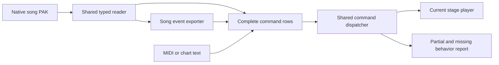

# GH3 event coverage

## Status

For the current repository state, remaining work, and continuation steps, read the [GH3 parity handoff](GH3-PARITY-HANDOFF.md).

Full GH3 event playback is **not complete**. Build **0.8.114** established a source inventory, complete song command preservation, and shared native and converted command playback. Build **0.8.115** adds crowd hands, animation selection, and performance-controlled lighters. The inventory does not count a parsed command as a working command. Newly exported `gh3-script` events require build 0.8.114 or later.

The local audit reads the owner's installed PC data:

| Check | Result |
| --- | ---: |
| Song archives | 159 |
| Song QB sections read and checked through typed-text round trips | 11,289 |
| Song script calls retained | 6,297 |
| Distinct commands called by songs | 33 |
| Global and venue script definitions catalogued | 3,569 |
| Named note-map tables | 5 |
| Performance venue archives | 10 |
| Reader failures | 0 |

The definition count includes engine and menu scripts. It is not a count of supported stage cues. The corpus includes the installed downloads and test songs. It does not establish coverage for every released game edition.

A further archive check found a second QB in 139 songs, with 138 song-startup script bodies. These call singer-animation loaders such as `animload_singer_male_anarchyintheuk` and `animload_singer_female_barracuda`. They are separate from the 33 direct song-event commands. The earlier script-body inventory covered the main chart QBs. Startup animation loading, export, and playback still need a complete comparison. The additional inventory is in `song-extra-qb-data.json`.

## Common command path



`StageGh3Events` supplies both native playback and `export-stage-events.py`. Export retains all eight direction tracks, note duration and velocity, and every script row. It no longer removes commands that lack a playback handler. Old generated libraries must be exported again to gain these fields.

`Gh3QbText` retains numeric types, checksum references, strings, vectors, arrays, ordered structure fields, repeated fields, unnamed flags, and opaque compiled script data. It does not convert a structure into a dictionary that could remove repeated fields. This is semantic data preservation; it is not a general binary QB writer.

The runtime keeps source cues separate from the generated playback cues. Rebuilding a timeline does not run a command twice. Unknown note IDs and commands remain in the source timeline. Version 2 channel resolution retains them and reports missing handlers.

### Chart and MIDI text

A text event can contain `gh3 ` followed by the JSON returned by `Gh3ScriptEvent.Encode`. The JSON holds a version, source track, and typed source row. Checksum values can use `0x12345678` or a name. Text case, parameter order, and repeated commands are retained. Such events can occur on custom track names.

The chart or MIDI event time controls playback. The row's original `time` value remains source metadata. Thus, moving an event in the editor changes when it runs without rewriting unrelated source fields.

This text carrier is available to the existing event browser. A complete typed GH3 inspector, original-song editor import, and a verified original-song UI round trip remain pending. The current original-corpus tests use the mod's MIDI reader, not the editor UI.

## Playback changes

- Native and authored commands now use `Gh3CommandDispatch`.
- Band command reports identify unused flags, parameters, repeated parameters, unresolved performers, and invalid values.
- Named `cycle` parameters follow the source script's parameter-presence rule.
- Native light mood, color override, color-off, and pyro calls reach the existing lighting and effect player.
- The default lighting blend is corrected from 0.30 to **0.15 seconds**, including note 39. The source is `lightshow_defaultblendtime` in `scripts\fx\lightshow.qb`.
- Pyro now executes the venue's source script. Particle, material, and original-game rendering comparisons remain partial.
- Band playback is still partial: asset selection, game-state behavior, and animation timing need further comparison.

### Crowd commands in 0.8.115

The shared dispatcher handles `Crowd_StartLighters`, `Crowd_StopLighters`, `Crowd_ToggleLighters`, `Crowd_SetHand`, `Crowd_AllSetHand`, `Crowd_PlayAnim`, and `Crowd_AllPlayAnim`. Original command rows and authored `gh3` text use the same path.

- Start replaces the existing monitor. The monitor reads player health, changes the right hands, starts `special` or `idle`, then changes venue-object visibility. Poor performance turns lighters off; recovery turns them on again.
- Stop cancels the monitor's pending calls. Its own idle calls finish before it hides the venue objects. All-member animation calls retain their eight one-frame waits. Immediate work runs before the next same-time song command.
- A toggle uses `ON` or `OFF` parameter presence, including named parameters. `ON` has priority. A call with neither parameter makes no change.
- The crowd library contains all eight source profiles, 102 distinct referenced clips, eight hand variants, six ordinary models, two prison models, and two biker models. Stage packs select their source crowd models and orientations.
- The converter includes the 18 lighter meshes previously omitted at startup. Art Deco retains its source exception: it keeps its one startup mesh and does not create the other three.
- Custom scenery can use the `crowd-lighters` visibility group. The runtime does not test venue names. The `crowd-control` channel can be replaced or cleared through direction v2.

These handlers remain **partial**. The script waits use a 60 Hz clock. Animation selection uses a repeatable random sequence and tempo categories derived from source constants. Exact native random selection, native tempo/skill functions, animation-event processing, camera-dependent crowd impostors, and original-game visual and scheduler comparisons remain pending. Crowd audio and other reactions are separate work.

Rebuild the crowd library and stage packs when upgrading. Old assets lack the hand variants, profile clips, and hidden scenery groups:

```bash
MISE_QUIET=1 uv run --with pillow --with numpy --with 'shapely>=2.1' \
  python prepare-library.py
MISE_QUIET=1 uv run --with pillow --with numpy --with 'shapely>=2.1' \
  python export-gh3-stages.py
MISE_QUIET=1 bash install.sh
```

### Actor, audio, and script work after 0.8.115

The current work is in the separate test game. The installed game remains at the verified 0.8.115 build.

- Stage-diver commands select the original indexed objects and the 11.5-second source clip in Art Deco, Wikker, and Budokan. Completion, hide, repeat, pause, and seek have logic checks. Actor and audio state checks passed in all ten venues before the scenery-script changes.
- The sound bank contains 227 original samples and 778 typed sound, bus, background, and note-map definitions. Playback uses Clone Hero's BASS library. The Unity audio component is absent from this game build.
- Count-off and crowd audio now execute their original QB script bodies. These include source waits, background fades, random one-shot loops, instance limits, and cancellation. Logic checks cover all 18 instrument/strength count-off combinations, interrupted fades, and reactions in ten venues. The two `GH3_AdjustCrowdSingingVolume*` bodies in this PC data set are empty.
- The script reader checked 4,098 script entries and 441,744 tokens across the collected global and venue files. Some definitions occur in more than one input. The shared JSON library retains 8,157 typed global definitions. These counts do not establish engine-function coverage.
- The script runtime supports the tested local/global values, arithmetic, grouped switch cases, loops, waits, spawned tasks, object context, cancellation, and event blocking. Unresolved engine commands stop the affected task and produce a diagnostic.
- Stage packs retain scenery object identities, source pivots, rotations, initial creation state, and startup scripts. This includes dormant scenery used by venue sequences. Lights retain their source object IDs. Current bindings include object creation/hiding, movement, rotation, scaling, event pulses, and light-volume density queries. Moving scenery is relit at its current position.
- A live Budokan probe passed the original monster setup, movement, idle, and wiggle scripts at nine controlled samples, including pause and backward seek. It reported no missing functions for that scenario. The probe also checked the diver and active BASS stream state. This is not a complete encore or original-game comparison.
- Local-axis rotation, continuous rotation, object attachments, hidden pivots, and source actor scale now reach the renderer. Source-script tests cover the Party globe loop and the Budokan monster-eye attachment, including removal and seek.
- The stage compiler now exports 25 scripted actors across Art Deco, Dive, Hell, Party, and Prison. These include guards, dancers, the dragon, knights, the puppet, and the hammer. Named-bone remapping connects the 125-bone clips to smaller original rigs. Clip choice, source waits, object visibility, and health-dependent branches use the script runtime.
- Actor animation events use the original `animeventtablename` tables. The scheduler retains event time, parameters, and object context. Tests cover replacement, disabled events, loops, and seek. Live Art Deco and Hell runs reach the dragon and hammer event scripts. Their particle functions still lack complete bindings.
- `MangleChecksums` uses 32-bit addition or subtraction, as confirmed in the owner's PC executable at `0x530a90`. Pulse registration also retains the object's scale at registration, as shown by `AddPulseEvent` at `0x4353e0`.
- The live guitar note reader now sends successful lane hits to the source `hitnote_*` events. A separate Clone Hero test used chords, a HOPO, a sustain, and an open note. Its nine lane events matched the engine's eight hit notes; the open note correctly produced no colored-lane event. Seven sampled frames showed pulses on 16 rendered objects. The test used Clone Hero's command-line bot. Input timing is sampled once per rendered frame; exact GH3 input timing and drum-animation events remain pending.
- Sound bus locks now block new bus parameter changes. Existing fades continue. Logic tests cover lock/unlock, fades, seek, and practice mode. A 24-second live BASS capture contained four original source samples with correlation above 0.5. This establishes audible output, not original-game mixing parity.
- Original lightshow processors now use the script scheduler. The checks cover performance-transition payloads and order, note 57/58 event parameters, poor-performance behavior, strobe entry and exit, active-state changes, and missing mappings. Lights and beams keep separate fades when a later snapshot omits their source rows. Scripted volume values can be replaced by a later snapshot.
- Encore tests execute each available source transition table through 60 seconds. Node flags create the associated objects, including Party car lights and Dive dancer lights. All ten packs now retain light-volume nodes from both node arrays and the source light objects. These checks do not establish complete encore rendering.
- The interpreter now omits missing optional values, replaces duplicate fields in evaluated structures, and supports vector dot products and local array updates. The original Prison color-conversion script is a regression case. Source animation calls with an omitted blend duration no longer fail.
- Particle definitions retain source textures and bone attachments. Live captures show particles in Art Deco, Hell, Party, and Video. Original-game composition comparisons remain partial.
- The PC command registry contains 1,170 entries. Native execution verifies 136 complete constant-result bodies through 1,632 calls, without memory writes. The shared runtime returns these exact results after its specific bindings. This includes the false result from `GetLightCurrentColor`. Unknown authored commands still produce diagnostics. This count does not include object member commands or imply support for the entire registry.
- Tesla command checks pass 2,676 actions and 61,577 slot states. GH3 uses 30 slots. Creation finds the first free slot or matching name in slot order, so a free slot before a matching name can create a duplicate. Lookup and deletion use the first matching slot. Omitted names use zero, not object context. Positive lifetimes decrease by each supplied frame delta; a result below zero removes the effect, while exact zero remains active. Nonpositive lifetimes do not decrease.
- Tesla rendering now uses the source eight-vertex strip, `_Tesla_2D` shader equations, and `e936482c` noise texture. Both native geometry paths pass 128 draw comparisons for positions, vertex data, shader constants, and blend modes. `fadeOut` controls the shader edge, not lifetime fading. The tapered path derives noise amplitude from `lightWidth`; it does not use the stored `amplitude` field. Shared render order, engine clock/update order, original sampler-state selection, and whole-stage composition remain incomplete.
- Video and Wikker pass 351 Tesla GPU samples each, including 36 samples from the exported source noise image. Authored add/blend/subtract effects have visible pixels in all 14 captures. Wikker source effects join them after the source encore command. The captures pass exact restoration and four exact pause/seek pairs. Both processes exit 0. `tesla-live-runs.json` verifies the images and retains three failed attempts: a shader vertex-channel error, a test-mode error, and a startup timeout. The runtime hash is `20944efeb509db4675ab3e48d252c325646b26674353f0a8699e1f9c5984bb3a`; the Tesla shader hash is `d37895ca9b95f3fce0f613e68924e9a4ff1b2e25ba6bd74d595c261e0575969d`.
- Particle QuickMaterial parsing now retains texture-enable flags, absent textures, the additive default, `QuadTextures` fallback, alpha cutoff, culling, burn, and separate color/alpha blend settings. The native parser comparison passes 138 definitions, including all 72 source definitions. The new OpenGL particle shader matches 160 interpreted native pixel-shader samples and 68 blend, cutoff, and culling samples in live GPU checks. Native render-state setup selects `D3DCMP_GREATER`: pixels at the alpha cutoff must be rejected. The checks include wrapped cutoff bytes and negative cutoff values. The checks use bytecode from the owner's `MaterialLibrary.bin.xen`; they do not run the original D3D GPU shader. Lighting, shadows, bloom, fill-burst passes, sort groups, and draw order remain incomplete. Batches now retain their complete material settings and draw only active quads.
- Soft edges now use source particle width, `SoftEdgeScale`, projected depth, and the absolute depth-difference formula from the native shaders. The flat, crossed, and ribbon geometry comparisons also check the stored soft-edge width. Live GPU checks pass 240 interpreted native vertex/pixel samples across perspective and orthographic projections, depths, widths, scales, scene offsets, and burn values. Another 144 checks render opaque scene geometry through Clone Hero's depth-texture path; their largest channel error is below `0.00478`. A Party `FillPath` run passes with exit status 0. Source lighting/shadow variants and whole-game depth composition remain unverified. The first perspective probe used a quad too small for its sampled pixel; the corrected probe sizes it from the reference case. The first scene-depth probe also included stage geometry; it now uses a separate layer. Failed attempts remain in history.
- Particle lighting now has a source-derived GPU kernel for directional front/back response, spherical-harmonic front/back response, minimum light, texture color, burn, soft edges, normal maps, and specular maps. The expanded reference passes 1,152 live pixel checks across six map/specular variants and powers 0, 4, 16, and 64. Nine default material constants are read from `sys_quickmaterial_sys_quickmaterial` in the original global scene. Shader inputs use their declared semantics; the first untextured reference used the wrong normal register and failed. A later zero-power case failed with a channel error of `0.2392157`; explicit zero-exponent handling corrected it. Failed runs remain in history. The runtime binds light values per emitter in separate lit batches. Party and Budokan pass separate normal-map and specular-map controls, exact restoration, and pause/seek images with exit status 0. The first map probe found missing shader texture properties; the shader exporter now adds them. Early Party captures show no map change; later captures show up to 7,213 normal-map pixels and 3,152 specular-map pixels. Budokan shows both controls in all 14 captures. Particle draw setup reads shared globals through `0x60eaf0`; whole-stage draw scheduling remains unverified.
- Native material creation at `0x620120` passes 1,044 cases for shader variants, texture lookup order, texture slots, missing resources, blend modes, and sort fields. Default sort group is 3 and draw order is 10 when `SortGroup` is -1; other groups truncate to a byte. A separate command-order comparison passes 1,440 keys, 18 list sorts, and 15 camera distance scales. Equal keys use reverse submission order in the checked list path. The runtime now applies these keys to separate emitter batches and retains particle slot order within each system. The Party authored-order probe passes visible order changes, exact restoration, and pause/seek images with exit status 0. Shared ordering with other stage geometry and native sort-job scheduling remain incomplete.
- Native technique loading at `0x60e700` and sort-ID access at `0x60ef90` match all 144 particle shader variants from `MaterialLibrary.bin.xen`. `prepare-particle-materials.py` exports these flags and IDs to `render/particle-materials.json`; the runtime selects them from the material's feature bits. Buffer capacity now follows the emitter's maximum geometry, with an 8,192-quad limit per mesh. Removed emitters can release their batches for reuse by a compatible material.
- The native particle render-list loop at `0x640680` passes 70 lists with 10,510 supplied candidates. It counts successful snapshots toward the 150-system limit; null, disabled, and failed snapshots do not consume a slot. Observed flags are set before snapshot allocation. Both immediate and queued paths retain the selected list. The runtime now caps active emitter submissions at 150. The current candidate list uses runtime emitter order; native spatial candidate order, allocation failures, and render-observation scheduling remain incomplete.
- Source particle light selection passes 220 native light sets, 24 group-filter queries, 42 `LightGroup` commands, and six parsed groups. The native spatial index now passes 29 scenes, 2,415 changes, and 22,898 queries, including boundaries, candidate order, removal, and `CompactIntervals`. Adjacent intervals with the same members merge when their gap is less than `0.00001`. Node parsing passes all 242 source light records, including direction, bounds, flags, attenuation, and spherical harmonics. The particle startup group uses `default_light_group` when nonzero. The source value is `None`, which replaces the constructor fallback.
- The combined light-scene comparison executes native manager startup, source-node registration, group creation, spatial queries, render-record copies, selection, and shader-input binding. It passes 9,355 queries and 1,174 commands across all ten venues. It checks `CreateLightGroup`, group intensity and enable state, light enable state, flags, and group changes. The PC dynamic-light modulation setter is a no-op; its getter returns two zeros. Source nodes use archive order in this test. Game creation order, allocation reuse, and shared render scheduling remain unverified.
- `MoveLight`, `SetLightDirection`, and `GetLightDirection` pass another 5,911 native queries and 360 commands. Movement retains the offset between light position and bounds center. Direction changes retain the bounds. These setters do not rebuild the native spatial index; changing the `Dynamic` flag registers the current bounds. Stage and band lighting use the changed position and direction, with cached surface weights cleared. Party, Budokan, and Soundcheck pass separate movement and direction image controls, exact restoration, and pause/seek pairs with exit status 0. The verified transform DLL hash is `edddf76c01129c8ea021408f641ec58b169167026859b19ae3a779a08914a35c`.
- `PushWorldLights` disables all current light groups; `PopWorldLights` enables all current groups. These commands do not save and restore a stack. They retain group weights and each light's own enabled flag. Native checks pass 340 commands and 4,351 queries across ten venues, including repeated calls, unnamed groups, and groups created between calls. Party and Soundcheck pass visible push/pop controls, exact restoration, and pause/seek pairs with exit status 0. The verified runtime hash is `5cb84de41850f9cee271dce39267baed3eae40bdfa2254aad51d313459a5b2e5`.
- The transform comparison exposed a reference-harness error: its QB vector getter copied XYZ but omitted the native W value of 1. This also affected the fourth `LightColor` component and ambient/harmonic components. The harness and runtime node parser are corrected; the node, scene, update, and transform references were regenerated. The next comparison found the wrong pitch sign in the runtime setter. Failed logs and old references remain in `behavior-work`; `light-transforms-check-3.log` is the passing comparison.
- Native particle submission passes 1,260 lit/unlit commands and 2,311 scene queries. It executes command creation, particle material/light accessors, and the light-binding part of command playback. Queries use emitter position. The submitted extent contains radius on all three axes, but the tested query path selects by position. Unlit commands retain preceding shared constants; lit commands replace them. Sorting, geometry draws, other render commands, and GPU uploads are outside this comparison.
- Stage surfaces and band meshes now use shared light-group enable and intensity state. Direct `SetLightColor`, `SetLightIntensity`, `SetLightSpecIntensity`, and `SetLightShadowIntensity` commands use the same component values as snapshot playback. Their getters also read those values. Group scaling does not change the stored component values. Absent snapshot rows retain their fades; omitted specular and shadow fields retain their current values. The native `ShadowIntensity` field is stored, but shadow-map rendering remains incomplete.
- Light components blend color, intensity, specular intensity, and the fourth light parameter separately. The first comparison passed 336 samples with a supplied fraction. The expanded comparison executes the original parameter traversal, timer, easing, blend, and completion functions: 42 transitions, 462 sampled clock updates, 32 replacement sequences, 1,016 checked states, and 256 setter/getter calls. Durations truncate to whole milliseconds. The default curve is `smooth`; `linear`, `ease_in`, and `ease_out` are supported, and an omitted curve retains the prior curve. Runtime components use fixed script updates and song milliseconds. Original global-clock mapping and cross-component update order remain unverified.
- The native geometry checks now compare lighting axes for 620 flat and 416 crossed cases. The renderer supplies those normals to the mesh. A further ribbon check found that `AlignTo` was not applied to trails; the geometry path now uses it. The expanded reference has 1,504 ribbon buffers, including 224 alignment cases, and 120 history states. Textured-ribbon normal checks pass. Flat trails use an unlit buffer and a separately lit billboard head when the material enables lighting. The Party lit-trail probe passes both paths, separate map controls, exact restoration, and pause/seek images with exit status 0.
- Particle controls now include `SetPos`, `SetEmitRange`, `SetSpeedRange`, `SetLife`, `SetParticleSize`, `SetParticleSizeScale`, `SetForce`, `Emit`, and `KillOldParticles`. Native execution checks 29 control cases, including omitted fields and the original removal order. Force and size changes affect existing particles. Object removal also cancels its callbacks and scripts.
- Native checks corrected `SizeRange` to start/end width-height pairs and `EmitNum` to a first-active-frame burst. Three size cases and three bounded bursts passed. Particle colors now use paired random ranges, source `VertexWeight` times, and byte conversion. Sixty color samples and 240 color frame updates match the original color routines exactly, including segment changes and pause.
- Particle emission uses a fixed 60 Hz script clock and the native accumulator reset rule. Constant, on/off, sine, triangle, sawtooth, and inverse-sawtooth functions match 2,520 native frame updates, including pauses and rate changes. The comparison substitutes the imported sine and remainder functions.
- Particle motion now uses native velocity-first frame integration. Ground collision is enabled by the presence of `BounceHeight`, including zero. Force changes, the ground clamp, and rebound coefficients match 360 native frame updates within `0.00001`. Cross-system random draw order still needs comparison.
- Particle direction controls now include `SetAngleSpread`, `SetEmitTarget`, `SetEmitAngle`, `SetRandomAngle`, and `SetCircularEmit`. Eighteen native control cases pass, including omitted fields, separate elevation/sweep ranges, and the original no-op for `SetEmitTarget target=(0,1,0)`. Six source `AngleSpread` cases confirm the different source and command units.
- The native birth comparison covers 1,152 particles across box, radial, circular, and `TargetPosition` emission, zero and oblique targets, combined XYZ emission angles, and `EmitterVelocityWeight`. Positions and velocities agree within `0.00001`; random draws and final RNG states match exactly. The velocity weight changes the emission target basis. It does not add speed, and a zero source target keeps the basis disabled. Five capacity cases and 48 rotation-speed slots also pass. Particle births use the shared main RNG, source half-angle spread, native range dimensions, and sequential texture indices. Seven additional cases check `ElevSpread`, `SweepSpread`, and their order relative to `AngleSpread`. Source object-velocity sampling and attachment update order still need a whole-game comparison.
- Particle defaults and all three constructor random draws now match the original instructions. Moving emitters, capacity limits, death removal, reused rotation speeds, and `RotVelTimeScale` pass 320 frame states. Native death removal rechecks the moved particle; `KillOldParticles` skips it. `FollowEmitter` moves existing particles each frame and accepts values above one.
- Flat-particle geometry now matches 620 native vertex-buffer cases. The cases include all four source texture layouts, texture-frame numbers, the 256-entry rotation table, negative angles, rotated cameras, path alignment, and zero velocity. The original flat vertex path does not apply `SizeScale`; the control value remains stored. These checks compare CPU geometry, not the original particle pixel shader or material functions.
- `TimeSeed` now fills the initial particle state before the first normal update. Eighteen systems pass 180 native frame states, including their history buffers. The check runs the original `MSVCR80.dll` random instructions as well as the game code. The runtime keeps this RNG separate from QB random draws. Initial CRT seed and cross-system call order still need a whole-game comparison.
- Emission delay now uses the original float countdown. Lifetime cutoff and empty-system removal use the particle component clock. Thirty-six systems pass 1,440 native frame states across delay, lifetime, initial time, and parent removal. Parent removal stops new emission and the update script, then retains live particles until they expire. The comparison replaces camera and visibility queries.
- `EngineConfig`, `EngineConfiguration`, `ParticleSystem`, `ParticleLOD`, and `SetLODParams` now control particle updates. Three LOD commands, ten configuration cases, six ordered source-field cases, and 7,680 component clock states match native execution. A further 11,520 motion frames check moving emitters, distance bands, skipped updates, emission scaling, delay, lifetime, prewarm, update-script calls, and random states. Particle bounds use the original update order and retain the first particle's pre-motion position. `UseDefLODDistances` retains its position in the source field list. Attached systems have the source `lockobj` exemption from off-screen stopping. `LODMinParticles` values from -1 to 128 and the stored `NoVisibilityTest` byte do not change these PC component runs. The separate minimum-count function at `0x5bf750` has no direct or pointer reference in the examined executable; it is not applied to the tested update path.
- Particle camera queries now use registered bounds and the preceding fixed-frame camera pose. The registration code clamps coordinates to ±1,023 and radius to 1,023, then stores signed fixed-point values with a 1/32-unit step. The native registration and six-plane visibility test match 252 cases across camera turns, camera translation, clip boundaries, small radii, and clamped bounds. Visibility starts true, retains render observations during delays and disabled component updates, and resets when the component consumes it. The LOD corpus checks this stored state. The live Party visibility probe passes with exit status 0: an off-screen emitter stops at 0.15 seconds, an attached off-screen emitter keeps updating, and the stopped emitter resumes when LOD is disabled and it moves into view. Captures show 559–2,727 changed pixels, with identical pause and repeat-seek states and images. Spatial-list ordering, the renderer's 150-system limit, occlusion, extra viewports, and original whole-stage camera/update timing remain incomplete.
- `FillPath` now distributes new particles between the emitter's previous and current positions. It consumes its additional random draw before rotation, color, and lifetime draws, and only when the positions differ. The birth corpus now checks 3,456 particles, including moving and stationary `FillPath` cases. Eight lifecycle runs check 640 frames with capacity limits, removal, emitter motion, and exact random states. The LOD motion corpus also checks `FillPath` with prewarm and skipped updates. The separate spline-particle `knot` path remains incomplete.
- The Party `FillPath` live probe compares two moving emitters. Only the flagged emitter creates particles between its endpoints. The final flat-particle capture setup passes with exit status 0 and 1,205–2,559 changed pixels. Pause and repeat-seek states and images are identical. An earlier setup used zero-speed path-aligned particles and had no active renderer in its early captures; that attempt remains in history. The probe now requires a capture file when it has selected live particles.
- Textured and flat ribbons now use source history buffers. Their geometry, texture coordinates, and alpha values match 1,280 native vertex buffers. The checks include four atlas layouts, two camera angles, and five alpha values. Another 120 frame states check circular history indices, particle birth, death, pause, and slot reuse. `KillOldParticles` retains the destination slot's old history, as the original dispatcher does. Flat ribbons render both the textured particle and its untextured fading trail. The Party live check shows both parts and identical pause and repeat-seek images. Original material rendering remains incomplete.
- Ribbon meshes now use additional batches when a texture exceeds one mesh's capacity. A live Party check rendered 1,000 ribbons with at least 20,000 quads. The ribbon build passed live checks in all ten venues.
- `EngineWind` now supports global wind, local field creation and replacement, modification, removal, and expiry. Directional, point, and both twist directions reach particle motion through `WindCoeff`, `LocalWindCoeff`, and `PerParticleWind`. Native checks pass 69 command cases, 280 field samples, 720 point/sphere selections, 30 expiry frames, 27 global blend frames, and 2,880 two-particle motion frames. The source stores global particle wind separately from its smoothed environment value. The live Party wind probe has visible ribbons and identical pause and repeat-seek images. Whole-stage update order and original-game pixels still need comparison.
- Native queued updates now have a separate wind-cache comparison. Twenty-four systems pass 1,920 frames through the original lifecycle, job setup, field-copy, worker, and motion functions. `JobQParticle` refreshes the global and local wind copies and consumes one additional main-RNG draw per queued update. Direct updates retain the cached data. The checks include switching modes, moving bounds, field modification and removal, expiry, zero field IDs, negative ranges, particle motion, and final random states. The job-submission substitute runs the copied descriptor in the same frame; cross-system job ordering remains unverified. The corrected live wind probe explicitly enables `JobQParticle`, passes with exit status 0, and has 4–3,049 changed pixels with identical pause and repeat-seek pairs.
- Particle types `v` and `x` now retain `DepthRange` and produce two three-dimensional surfaces. Their vertices and texture coordinates, plus flat-particle orientation, pass 416 native cases. These cover four atlas layouts, rotation, camera angles, depth changes, path alignment, zero velocity, `Rotate3D`, and `align_to`. The original `v` path uses a different velocity divisor from `x`; the comparison retains that behavior. The first live probe failed because no butterfly had emitted at its first sample. An explicit authored `Emit` corrected the test. Both types then had visible pixels and identical pause and repeat-seek images. Source path motion, material rendering, and original GPU comparisons remain incomplete.
- Particle `UpdateScript` now uses the component update clock. The original butterfly script changes wing size, retains its parameters, and restores its state on backward seek. Native component checks record script updates before emission and after initial-time processing. Component scripts remain separate from spawned scripts and stop when their object is removed.
- `BounceCallback` now resumes its persistent script at each selected collision. Twenty native cases pass 2,400 motion frames, 1,728 resume calls, and exact random states. The cases include zero, negative, fractional, and greater-than-one callback rates, missing callbacks, upward motion below the ground, and zero-duration updates. Native setup copies an empty parameter structure; it writes collision data into a separate buffer. The current runtime does not inject that buffer as script locals. A complete native script-level callback-parameter comparison remains pending.
- Component waits pass 32 native cases for default milliseconds, `frame`, `gameframe`, and `seconds` at two frame durations. Another 1,920 native clock states check `interleavable`, `one_per_frame`, `ignoreslomo`, flag priority, multiple components, repeated same-frame calls, zero-duration frames, and large clock values. These checks also pass through the script runtime. Waits consume component updates, including multiple collision updates in one frame. The runtime uses song time for the interleavable clock; its global-game clock mapping, gameplay time scaling, and general spawned-task clock parity remain pending. The PC executable's `EmitScript` setter at `0x5be500` is a no-op. Five `SetEmitterIndependent` cases and seven ordered source-parser cases also pass. The command stores its flag; source `EmitterIndependent` separately changes `FollowEmitter` during parsing.
- Video Shoot uses four seekable movie frame banks and the source movie surface. Tests cover frame boundaries, source rates, loops, hold, replacement, waits, and removal. Live captures show original movie frames. UV orientation and full original-game timing comparisons remain pending.
- Materials retain source identities and animated-texture constants. Budokan's backdrop uses its original two-row atlas and performance-controlled frame rate. The original executable confirms that `UpdateMaterialProperty time` uses a whole-second hold followed by restoration, not interpolation. Four durations and forty clock samples passed in Unicorn and in the C# state checks. General material parameters and prefix-target behavior still need further comparisons.
- Prison's outline and screen-flash bindings now let the original flare sequence finish. Source checks verify the skeleton change, outline values, delayed flash, return toward neutral, cleanup, pause, and backward seek. Native outline defaults and color packing also have executable checks. Shadow maps still lack rendering support and report explicit gaps.
- The outline shader now renders the source object's silhouette with its indexed color, depth-dependent pulse width, and fill-distance cutoff. A live Prison capture has 1,134 changed pixels. A separate bytecode interpreter evaluated the original D3D9 vertex shaders for 24 width cases and four fill-distance cases; their rendered silhouettes matched the new GLSL output with zero differing pixels. These checks do not execute the original GPU shaders. Native stencil interactions and the original global shader clock still need verification. The runtime currently uses song time; four pause and backward-seek captures matched exactly, and source removal cleared the rendered outline.
- Screen-color transforms now include source brightness, contrast, saturation, hue, and channel mixing. Fourteen parameter sets match the original executable's matrix construction within `0.000002`. This comparison substitutes the platform matrix-multiply, sine, and cosine functions. It does not execute the original pixel shader. The OpenGL shader passed live pixel checks for identity, channel scaling, offsets, and channel mixing. Prison's original flare also passed a stage-camera comparison: 895,250 pixels changed, and the largest channel error was below `1/255`. Other screen-effect types and viewport targets remain incomplete.

The source and runtime evidence is under `assets/event-audit/behavior-work/`. Each new probe run retains the previous result in `runtime-history/`. The runner now removes its remaining test-game child processes after each venue. Earlier retained processes filled memory and caused one timeout. Separate startup crashes occurred before stage creation; their logs remain available. The latest complete baseline sweep passed eight venues; Dive and Hell exited 139 before reports. A later Dive run exited 0 without a report and also failed verification. Successful focused runs do not resolve these startup failures.

The corpus regression passed all 159 songs, 6,297 calls, 159 exports, 102 crowd clips, 227 audio samples, and eleven packs. The 33-oracle run in `world-lights-regression.log` adds PC constant commands, Tesla slot/geometry checks, and world-light controls to the earlier render-list, shader-technique, material, light, LOD, visibility, wind, and component checks. Run `MISE_QUIET=1 python assets/event-audit/behavior-work/run-regression.py <log-name>` to repeat all configured native and corpus checks. The source-asset tests exercise all lighting-note controls and report normal and encore diagnostics. A fixed list of known gaps remains permitted; a new script failure fails the test. Passing these tests does not mean that all rendering is complete.

Light-group controls passed in all ten venues on the recorded builds; the focused Party authored-fade check also passed. `light-scene-live-runs.json` records per-run DLL hashes, process exits, pixel controls, restoration, repeat pairs, and retained failures. First Party and Dive probes each failed restoration by one color level in one pixel; explicit baseline refresh and repeat captures now pass. Credits pause checks failed because live note input changed speaker scale from 1 to 1.12. Fixed combo input resolved that test-input difference. A shared snapshot test also found raw eight-digit ID lookup was wrong; the corrected lookup passes. Failed evidence remains in `runtime-history/` and `light-shared-playback-regression.log`.

Input evidence is in `runtime-input/party/`; audio evidence is in `runtime-audio/`. A separate startup crash has retained core analysis in `crash-2748701*.txt`. The faulting native entry contains an indirect jump through a non-canonical address. The evidence identifies a damaged native hook path; it does not establish which component caused it.

`summarize-light-runs.py` independently checks particle-light, map, lit-trail, and world-light captures as well as stage and band controls. Its report retains 21 passing runs and eight failed attempts. The five mapped-particle runs use runtime SHA-256 `47f9922ee3edfcb240ff4ad1bdabe74af16f6053e362f7daee94cf71006a773e`; the current lit-trail run uses `f184a63d77e67c6f24e7c2e64324f4f0787f8692c705b3c6155571c569dcbd72`. Each new run records shader-bundle hashes. The first lit-trail attempt exited 139 before its report; core `3057823` shows a .NET finalizer thread in `NDirectImportWorker` and exception dispatch. The cause is unknown. The retained journal shows no OOM kill in that interval. A complete core read used the disk-backed cache after the `/tmp` extraction failed. The next run passed; that result does not establish a crash fix.

All ten venues passed live checks with the new screen and outline shaders. Intermittent crashes remain unresolved. Core `2816611` is a separate failure during stage loading: matching CoreCLR symbols identify `TypeVarTypeDesc::SatisfiesConstraints` with a null metadata module while loading `System.Linq.WhereSelectArrayIterator`. Cores `2809030` and `2820778` occurred during loader startup. The retained reports do not establish one cause for these failures.

The flat-ribbon probe first crashed after stage loading. Core `2868605` shows a null call through `GameAssembly.so`; its journal has no OOM kill. A second run timed out during loader startup. Their logs and stack data are retained. A later run passed, but this does not establish a fix for either failure.

The update-script build passed the Party `v` and `x` probes and the Art Deco, Budokan, and Dive behavior checks. These processes then aborted during shutdown after `Application.Quit()`, with `Il2CppExceptionWrapper` in the log. The next Hell run failed before its report: core `2886980` includes an access violation in `System.Net.Sockets.NetworkStream.get_CanRead`, followed by an abort through `il2cpp_raise_exception`. The journal interval has no OOM kill. The logs, process details, and all-thread native stacks are retained. These failures remain unresolved. The runner now records process exit status separately from its behavior result.

The later callback build passed the `v` and `x` probes and all ten venue behavior checks. All twelve processes then exited with status 134. Their reports retain the runtime and probe DLL hashes. Party's source butterfly script produced visible output in both types: `v` changed 12–391 pixels and `x` changed 6–601 pixels in the checked captures. Pause and repeat-seek image pairs were identical. These results establish behavior before the shutdown failure, not a clean process exit.

Later Party LOD and parent-removal probes pass with exit status 0. LOD captures show 215–2,619 changed pixels and identical pause and repeat-seek pairs. The first parent-removal capture setup showed no visible pixels; those results remain in history. Moving the test emitter above the stage and framing its particles gives 572–4,024 changed pixels. Parent removal stops emission and the wing-update script, retains existing particles, and removes the empty emitter. The paused live-particle pair is identical; later seek pairs correctly contain no particles. Reports are in `runtime-particle-lod/party/` and `runtime-particle-parent/party/`.

The `FillPath` build has passing behavior runs with exit status 0 for all ten venues. Dive first failed at startup with exit status 139, process 2932831, before producing a probe report. Its retry passed; this does not resolve the startup failure. The crash core places the saved instruction pointer in a captured read/write page without execute permission. The caller is in the matching `System.Private.CoreLib.dll` image, and its indirect call is retained in `crash-2932831-corelib-call.txt`. Core segments and file mappings are recorded separately. These facts establish an invalid execution target, not the source of that target. No OOM kill appears in the examined crash interval.

The visibility build also has passing runs with exit status 0 for all ten venues. Video first failed in `StageFixtures.Load` with a duplicate `00000000` key, then passed after diagnostic changes. The inspected source fixture IDs are nonzero. The retry does not establish a fix. The failed run remains in `particle-visibility-live-runs.json` and `runtime-history/`. Fixture-load errors now identify duplicate source objects; the probe reports missing stage audio directly.

The particle-material build passed all ten venues plus Party's capacity, flat-ribbon, `v`, and `x` checks. All fourteen processes exited with status 0. The runtime SHA-256 was `bfdfc42e431d10bd874ad690e1af444ca0204a473d7f1c93d7b41d1fc5ae3a8f`; the probe SHA-256 was `c953721c3770dcb63f3eb1508b12bbc7288f6fe1eece4caaace77831390e5cbb`. Results are in `particle-material-live-runs.json`. Earlier attempts exposed stripped Unity `SetTriangles` and `Color` indexer methods; the runtime now uses triangle arrays, and the probe reads named color channels. A separate blend check exposed an incorrect alpha equation in the test reference; it now applies reverse subtraction to alpha as well as color. All failed attempts remain in history.

The next soft-edge build passed eight venues in its first ten-venue run. Budokan crashed during loading, and Prison timed out before its report. Prison passed on retry; Budokan crashed again before gameplay initialization. The two run summaries are `particle-softedge-live-runs.json` and `particle-softedge-retry-runs.json`. Runtime SHA-256 was `7e5f1d699a3373871706f420ca63a2d60106baf14d1bd7e446bf4ef69c1651b3`. Core `2983016` shows `TypeVarTypeDesc::SatisfiesConstraints` reading a null metadata module, as in an earlier failure. Core `2986436` instead shows `Module::GetDomainFile` reading a null `DomainLocalModule` during `AssemblyHandle::GetManifestModule`. Their all-thread stacks and journal intervals are retained; neither interval contains an OOM kill. These facts do not establish the source of either invalid pointer.

The later alpha-cutoff build had a Party startup timeout before its material checks. Its timeout record shows about 3.2 GiB of available memory. Stack capture was denied by `ptrace`; that denial is retained. The runner now saves process status and memory data before timeout cleanup, attempts a bounded stack capture, and records the final process status. Startup crashes and timeouts remain unresolved.

Disabling tiered compilation did not prevent a later null native call. A requested hostfxr override was ignored by this installed loader. A separate isolated test then replaced only the test runtime's dependency path with a verified .NET 6.0.36 runtime; Party and Budokan passed with exit status 0. The original dependency path was restored. These two runs are in `particle-dotnet-6036-runs.json`. They do not establish a crash fix: the following lighting-kernel run also passed on the original .NET 6.0.25 runtime. That passing run checked 468 base-material/cutoff/soft-edge samples, 144 scene-depth samples, and 192 lighting samples. Its runtime SHA-256 was `eff54c39d699123b729ce9070efa01c921d882712404ba9f12c5f6047c135c4a`; probe SHA-256 was `9c7531fa1d15ef47c3339534d85fc383f5077f1616355667beb9652c3bca21db`.

Core `2898725` contains a `System.NullReferenceException` from `GameObject.SetActive`. Native function-table mapping identifies the Unity call. A shutdown trace places the failure after Melon deinitialization. Stage cleanup now runs in `OnApplicationQuit`, before Unity destroys scene objects. The deinitialization callback then has no stage to release. Party and Prison passed with exit status 0 after this change.

Six authored Party runs check `Rotate3D` and `align_to` for `flat`, `v`, and `x`. All six behavior reports pass with exit status 0. After backward seek, each orientation has visible output and differs from the same particles with that control disabled: 25–763 pixels across the checked images. All pause and repeat-seek pairs are identical. Four modes have no visible pixels in the first fixed-view capture at 14.5 seconds; those zero counts remain in their reports. The later seek captures establish visible orientation changes. These tests do not compare the original game's GPU output. Results are in `runtime-ribbon-rotate-*` and `runtime-ribbon-align-*`.

The trail-alignment runs pass for textured and flat trails, with exit status 0 and identical pause/repeat-seek image pairs. Their retained summary is `particle-trail-align-live-runs.json`. Textured trails change 10–844 pixels; flat trails change 16–118 pixels. Disabling alignment changes 38–289 and 47–382 pixels respectively. Later flat-trail and crossed-particle runs also pass the expanded 1,152 lighting samples, each with exit status 0. These runs used runtime SHA-256 `ba95c1f4dfd7e8d0f8e4008c4448318da6f585942e7cac21a41f79d9d2649bcf` and probe SHA-256 `9b20acfc6aee58c65af736a95bd9f37037c4f07222efed00aaca37013bb4061a`; they predate the separate color/intensity fade change. Each `execution.json` now records the dependency runtime version, path, and hash. Passing assertions and process exit remain separate checks.

Startup failures remain separate from the fixed shutdown failure. The later ten-venue run passed seven venues with exit status 0; Dive, Party, and Soundcheck crashed before their reports. Party core `2909027` resolves to `Assembly::GetLoaderAllocator(this=0x0)` during generic virtual-method resolution in CoreCLR. The managed dump reader still cannot initialize the DAC. The core metadata, native stacks, and journal are retained. A separate launch stopped while contacting MelonLoader's remote API. The test runner now uses offline assembly loading and an isolated D-Bus/audio session, and saves launch status and DLL hashes even when no behavior report is produced. It returns failure for a nonzero game exit.

Exact audio mixing, random scheduling across systems, further game-mode checks, and original-game comparisons remain pending. Particle, Tesla, material, shadow, outline, screen-effect, and gameplay rendering still need work. The two source mood-transition names without definitions in Dive and Wikker are optional engine calls: the native runner at `0x4960e0` returns false for them. Explicit missing authored commands still produce a diagnostic.

## Remaining coverage

The song inventory includes these missing commands and behaviors:

- Remaining crowd, stage-diver, crowd-audio, and drum count-off parity checks.
- `Z_JPPlay_SetVideoScreens` and venue-local model/material changes.
- Chord wrapper commands, battle/deathlick behavior, highway test commands, and two unresolved command checksums.
- Remaining band parameters, animation strength, character profiles, and asset references.

Venue scripts add further requirements beyond song commands: encore sequences, monster and tank actions, dancers, security, score-dependent scenery, particles, delayed scripts, cancellation, and event listeners. Script execution is now available, but its engine bindings and complete sequences remain partial.

Crowd lighters retain their dedicated state controller. Audio, source lighting, and scenery use the script runtime. Native integer RNG draws and range typing have executable comparisons. Weighted selection, no-repeat selection, and permutations now match native execution in 36 cases with 10,800 lifecycle actions. The checks include both RNG streams, overlapping tasks, released-history reuse, single-choice branches, and the 100-entry history limit. Seed initialization and full cross-system draw order still need work.

Full coverage requires verified command parameters, references, execution order, and visible behavior for song events, note maps, venue scripts, and native engine functions. Both imported and authored events must pass through the same implementation. Pause, seek, restart, and same-time ordering must also be checked.

## Reproduce the audit

Use an empty output directory. The optional checksum files supply names; numeric keys remain authoritative.

```bash
MISE_QUIET=1 dotnet run --project tools/Gh3SongTool -c Release -- \
  audit /path/to/DATA assets/event-audit/new-run \
  /path/to/gh3_keys.txt /path/to/keys.txt
```

The output includes source hashes, all song-section snapshots, note counts, typed note maps, script definitions, command parameter/flag inventories, and per-command playback gaps. Local verified output is in `assets/event-audit/verified/`. Generated source data is excluded from Git.

Export a song's complete direction through the shared reader:

```bash
MISE_QUIET=1 python export-stage-events.py \
  /path/to/DATA/SONGS/mycurse_song.pak.xen \
  --output /path/to/new/stage-events.json
```

The exporter now requires the .NET 10 SDK. It builds the shared tool once per export process. Its `playback` report records partial and missing script behavior. The mod also reports these gaps when it loads the cues.

Library export reads every installed song archive, including files without a title/artist entry in the shared song list. `export-report.json` lists those missing entries. The exported direction remains available by filename; automatic title/artist lookup requires metadata.

## Verification

Run `check-native-pc-commands.py`, `check-native-tesla.py`, and `check-native-tesla-render.py` in `assets/event-audit/behavior-work/` with `pefile` and `unicorn`. The regression runner loads their reference files. Run `check-native-tesla-shader.py` with `numpy` and `pillow` to produce the GPU reference samples. After building the mod and probe, use `GH3_BEHAVIOR_PARTICLE=tesla` with `run-runtime.py video wikker`. `summarize-tesla-runs.py` checks the captured images, process exits, and retained failures.

```bash
MISE_QUIET=1 GH3_NATIVE_DATA=/path/to/DATA \
  dotnet run --project tests/SkinLogic.Tests.csproj -c Release
MISE_QUIET=1 python -m unittest discover -s tests -p test_stage_formats.py -v
MISE_QUIET=1 dotnet build src/Gh3Skin.csproj -c Release --nologo
```

The corpus checks retain all 6,297 original script calls through standard MIDI text and JSON, then compare native and converted playback projections. Separate cases test unknown fields, repeated flags and fields, nested values, exact text, duplicate same-time commands, retiming, malformed data, and channel selection.

Set `GH3_EXPORTED_EVENTS` to a complete exported library to compare the actual exporter files with native playback. The local check compared all 159 exports. The logic suite also passed with `GH3_PACK_ASSETS` set to the repository's `assets` directory, which checks all eleven prepared packs. The release build passed with zero warnings and zero errors.

The native comparison tools are under `assets/event-audit/behavior-work/`. Run `check-native-random.py`, `check-native-material.py`, and `check-native-render-controls.py` with `uv run --with pefile --with unicorn`. They retain the executable hash and their results. Set `GH3_NATIVE_RANDOM_ORACLE`, `GH3_NATIVE_MATERIAL_ORACLE`, and `GH3_NATIVE_RENDER_ORACLE` to those JSON reports for the matching C# checks. Set `GH3_SCRIPT_SOURCE` to the decoded source directory and `GH3_STAGE_SCRIPT_REPORT` to the desired source-test report path.

`check-native-choices.py` checks random-choice task history with the same dependencies. Use `GH3_NATIVE_CHOICES_ORACLE` for its C# comparison. `check-native-screen.py` also needs `numpy`; use `GH3_NATIVE_SCREEN_ORACLE` for its matrix comparison. Build the OpenGL shader with `MISE_QUIET=1 uv run --with UnityPy --with numpy python prepare-stage-shaders.py`. The tool uses the installed Clone Hero Unity `2022.3.62f2` serialization format and the GLSL source under `src/Stage/Shaders/`.

Run `check-outline-shader.py` with `numpy` to interpret the source outline and inline vertex shaders. The live probe uses that output to compare rendered silhouettes. `check-screen.py` uses `pillow` and `numpy` to check the Prison flash, outline, and pause/seek captures.

Run `check-native-particle-material.py` with `pefile`, `unicorn`, and `numpy`. Use `GH3_NATIVE_PARTICLE_MATERIAL_ORACLE` for the C# material comparison. The tool runs the native constructor, field parser, and blend lookup with substituted typed QB getters. `particle-material-shaders.py` extracts the source shader bytecode and interprets the tested instructions. The live probe compares shader output and blend results with these references.

Run `check-native-particle-lighting.py` with `numpy` to read the source material defaults and generate the explicit-light-input shader reference. This does not compare the engine's selection or scheduling of light inputs.

Run `check-native-particle-lights.py`, `check-native-light-spatial.py`, and `check-native-light-nodes.py` with `pefile`, `unicorn`, and `numpy`. Use `GH3_NATIVE_PARTICLE_LIGHTS_ORACLE`, `GH3_NATIVE_LIGHT_SPATIAL_ORACLE`, and `GH3_NATIVE_LIGHT_NODES_ORACLE` for their C# comparisons. The reports list substituted functions and comparison limits. The node tool also checks color/intensity blends with a supplied elapsed fraction.

Run `check-native-particle-controls.py` with `pefile` and `unicorn`. Set `GH3_NATIVE_PARTICLE_ORACLE` to its `native-particle-controls-oracle.json` output for the C# control, size, burst, color, emission, and motion comparisons. The burst and emission checks intercept particle creation after the original capacity check. Motion uses separate seeded particles and runs the original update routine. These checks do not execute the original particle shaders.

Run `check-native-particle-birth.py` with `pefile`, `unicorn`, and `numpy`. Set `GH3_NATIVE_PARTICLE_BIRTH_ORACLE` to its `native-particle-birth-oracle.json` output. This check executes original particle creation and RNG instructions. It substitutes QB getters, D3DX matrix multiplication, imported sine/cosine functions, and memory-copy helpers.

Use the same dependencies for `check-native-particle-geometry.py`, `check-native-particle-prewarm.py`, `check-native-particle-schedule.py`, and `check-native-particle-ribbon.py`. Set `GH3_NATIVE_PARTICLE_GEOMETRY_ORACLE`, `GH3_NATIVE_PARTICLE_PREWARM_ORACLE`, `GH3_NATIVE_PARTICLE_SCHEDULE_ORACLE`, and `GH3_NATIVE_PARTICLE_RIBBON_ORACLE` to their corresponding JSON reports. The initial-time and component checks also use the owner's `MSVCR80.dll` and replace its thread-storage lookup. Set `GH3_BEHAVIOR_RIBBON=1`, `flat`, or `capacity` for an authored ribbon in the live test song. The runner saves results under `runtime-ribbon-<value>/`. Earlier textured-ribbon results remain under `runtime-ribbon/`.

Run `check-native-particle-callback.py` with `pefile`, `unicorn`, and `numpy`. Set `GH3_NATIVE_PARTICLE_CALLBACK_ORACLE` to `native-particle-callback-oracle.json`. It executes the original wait setup and timer updates, collision selection, and random draws. It records callback resumptions and payload-buffer writes, but substitutes the callback script runner and QB getters.

Run `check-native-wind.py` and `check-native-particle-cross.py` with `pefile`, `unicorn`, and `numpy`. Use `GH3_NATIVE_WIND_ORACLE` and `GH3_NATIVE_PARTICLE_CROSS_ORACLE` for the C# comparisons. Wind checks replace QB getters and list memory management. Crossed-particle checks also replace the imported inverse-cosine function. Live modes `GH3_BEHAVIOR_RIBBON=wind`, `v`, and `x` use the same authored command path.

The My Curse check changes the camera at 12.453 seconds from 84 to 89. Its 8.268-second duration and every other direction cue and script row remain unchanged after serialization. Reversing the edit restores the original converted timeline. These checks establish preservation and common dispatch; they do not establish full visual parity.

Crowd logic checks cover hand selection, parameter presence, delayed calls, cancellation during an eight-person transition, same-time command order, negative-time setup, health changes between game frames, pause, backward seek, and 30/60/144 Hz updates. Set `GH3_CROWD_ASSETS` to the prepared `crowd` directory to read all 102 clips and sample all eight profiles. Python checks cover public visibility groups and stage-specific model/profile/orientation assignments.

The actual Clone Hero player passed 11 controlled samples in each of the ten venues: startup, lighter start, poor performance, recovery, stop, backward seek, and held time. The probe checked active hand objects, finite bone poses, and lighter renderers. Crowd-atlas and stage captures show the original hand geometry, prison and biker models, and Video Shoot orientations. Soundcheck and Credits correctly have no crowd atlas. Local evidence is in `assets/event-audit/crowd-work/runtime/`; the probe was used only in a separate test game.

The Credits test had one startup crash in CLR/IL2CPP initialization before stage creation. Its log and core metadata did not establish the cause. A fresh run passed. The failed log is retained in `runtime/credits-startup-failure/`. Test audio-device startup failures were also resolved by using a fresh isolated audio server for each run. These retries are not source-game parity evidence.

Build **0.8.115** is installed in the local modded Clone Hero. The release build has zero warnings and errors. The final logic checks passed against all 159 original songs, all 159 new exports, all 102 crowd clips, and all eleven prepared packs. The Python suite passed 42 tests with one unrelated original-hair test skipped. SHA-256 checks matched the installed binary and 3,717 prepared asset files. The binary SHA-256 is `4594d138dab419a9354f5e98c0afdf525fedc7e9d63d48c891293bc344d48ded`. See `assets/event-audit/crowd-work/verification.json` for venue sample counts.
