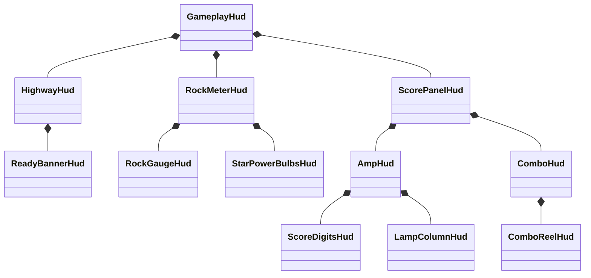

# HUD components

`GameplayHud` creates the component tree, sets the screen and camera transforms, and passes game state to each component.



## Layout ownership

- Each component owns its images and internal layout. Image names identify objects in captures; they do not control layout or behavior.
- The parent sets the component's position through its `Root`. Coordinates inside a component start at its upper-left origin, with positive Y downward.
- `HudVisual` creates Unity image groups and converts these coordinates to `RectTransform` coordinates. Unity applies parent movement and scale to all children.
- `ScorePanelHud` places the amp and combo meter. The existing score and counter tuning offsets apply to these complete components.
- `AmpHud` places the score display, multiplier, frame, and lamp column. The lamp column meets the visible frame edge. Its unlit images sit behind the amp body; its glow images sit in front of it. Both layers use the same local mount.
- `ComboHud` places its reels and supplies their common lower edge. Each `ComboReelHud` owns its background, numeral, clipping rectangle, and roll animation.
- `RockMeterHud` places the gauge and bulbs. A shared animation group moves both during the Star Power entrance. `RockGaugeHud` owns the needle and background fade. `StarPowerBulbsHud` owns each bulb's glass, glow, and extension.
- `HighwayHud` owns the normal rails, active rail animation, and ready effect. Its root follows the gameplay camera.

## Changes

To move the complete left panel, change its mount in `GameplayHud`. To move the combo meter relative to the amp, change its mount in `ScorePanelHud`. To change the lamp spacing, edit `LampColumnHud`.

Animation groups sit below placement roots. Animation therefore preserves the component's mount. Screen-size changes update the screen root; camera changes update the highway root.

On reset, `GameplayHud` destroys the canvas and releases the component references. The next gameplay scene creates new components with new animation state. `SkinAssets` retains the loaded textures across scenes.

## Runtime comparison

The saved build from before this refactor and the component build were run with the same seven display states at 1600 × 900 and 2560 × 1440. These states cover three- and four-digit streaks, scores up to eight digits, lamp colors, rock zones, Star Power activation, and a HUD reset.

Across these 14 settled captures, the maximum image-corner difference was 0.0002 pixels. The checked opaque HUD pixels had no RGB differences. Transparent edges and the moving gameplay scene are excluded from the pixel check.

A second comparison used a fixed 60 Hz HUD clock and 35 captures at each resolution. It covered the combo entrance, reel carries, rock-meter pulse, bulb extension and retraction, ready effect, active rails, and reset. All 70 captures passed. The maximum corner difference was 0.00091 pixels; the largest mean RGB difference in the checked opaque area was 0.00576 out of 255.

A separate 1440p run moved the amp by 50 local units right and 30 down, then set its scale to 1.125. Across 35 captures, all amp parts followed this transform. The other components kept their positions. The maximum corner difference from the expected transform was 0.000075 pixels.

The local captures, probe, and reports are in `/tmp/opencode/gh3-hud-components-2026-10-05/`. To compare a pair of capture folders:

```bash
MISE_QUIET=1 uv run --with pillow --with numpy --with opencv-python-headless python check-hud-composition.py before after --output comparison.json
```

The checker compares visible image sets, transformed corners, colors, textures, and opaque HUD pixels. The active highway frame can differ when separate game clocks are used.
