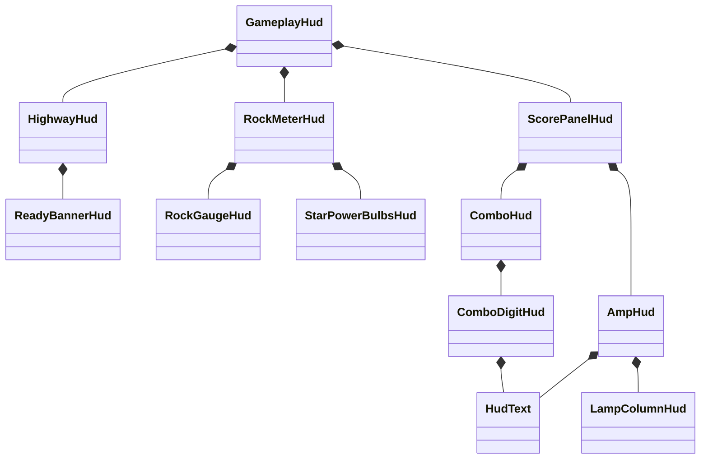

# HUD components

`GameplayHud` creates the component tree, sets the screen and camera transforms, and passes game state to each component.



## Layout ownership

- Each component owns its images and internal layout. Image names identify objects in captures; they do not control layout or behavior.
- The parent sets the component's position through its `Root`. Coordinates inside a component start at its upper-left origin, with positive Y downward.
- `HudVisual` creates Unity image groups and converts these coordinates to `RectTransform` coordinates. Unity applies parent movement and scale to all children.
- `ScorePanelHud` places the amp and combo meter. The score tuning offset moves both. The combo meter is at GH3's `counter_pos` relative to `score_pos`.
- `AmpHud` draws the multiplier behind the original amp texture. The texture supplies the metal ring and ×, with transparency and shadow shading over the multiplier. The amp texture is drawn once. The lamp column meets the visible frame edge. Its unlit images sit behind the amp body; its glow images sit in front of it. Both layers use the same local mount. The score digits sit in front of the amp.
- `ComboHud` draws GH3's note container: the drum texture, the counter body, four digits, and the note icon. Each `ComboDigitHud` owns one digit and its roll animation. For five or more digits, `ComboHud` opens the counter with `ComboReelLayout` and `ComboReelAnimation`.
- `HudText` draws one line of text from a `HudFont` (a GH3 font atlas from `prepare-fonts.py`). All glyphs of a line use one top line and one pitch. The score, the note-streak digits, and the gameplay messages use the same fonts as GH3.
- `RockMeterHud` places the gauge and bulbs. A shared animation group moves both during the Star Power entrance. `RockGaugeHud` owns the needle and background fade. `StarPowerBulbsHud` owns each bulb's glass, glow, and extension.
- `HighwayHud` owns the normal rails, active rail animation, and ready effect. Its root follows the gameplay camera.

## Changes

To move the complete left panel, change its mount in `GameplayHud`. To move the combo meter relative to the amp, change its mount in `ScorePanelHud`. To change the lamp spacing, edit `LampColumnHud`.

Animation groups sit below placement roots. Animation therefore preserves the component's mount. Screen-size changes update the screen root; camera changes update the highway root.

On reset, `GameplayHud` destroys the canvas and releases the component references. The next gameplay scene creates new components with new animation state. `SkinAssets` retains the loaded textures across scenes.

## Refactor comparison

The saved build from before the refactor and the component build at `1f5d70b` were run with the same seven display states at 1600 × 900 and 2560 × 1440. These states cover three- and four-digit streaks, scores up to eight digits, lamp colors, rock zones, Star Power activation, and a HUD reset. This comparison predates the correction to the amp's layer order.

Across these 14 settled captures, the maximum image-corner difference was 0.0002 pixels. The checked opaque HUD pixels had no RGB differences. Transparent edges and the moving gameplay scene are excluded from the pixel check.

A second comparison used a fixed 60 Hz HUD clock and 35 captures at each resolution. It covered the combo entrance, reel carries, rock-meter pulse, bulb extension and retraction, ready effect, active rails, and reset. All 70 captures passed. The maximum corner difference was 0.00091 pixels; the largest mean RGB difference in the checked opaque area was 0.00576 out of 255.

A separate 1440p run moved the amp by 50 local units right and 30 down, then set its scale to 1.125. Across 35 captures, all amp parts followed this transform. The other components kept their positions. The maximum corner difference from the expected transform was 0.000075 pixels.

The local captures, probe, and reports are in `/tmp/opencode/gh3-hud-components-2026-10-05/`. To compare a pair of capture folders:

```bash
MISE_QUIET=1 uv run --with pillow --with numpy --with opencv-python-headless python check-hud-composition.py before after --output comparison.json
```

The checker compares visible image sets, transformed corners, colors, textures, and opaque HUD pixels. The active highway frame can differ when separate game clocks are used.

## Amp layer correction

The multiplier is drawn behind `HUD_score_body`. The extra frame, ring, and × images are removed.

Runtime captures checked normal 1×, 2×, 3×, and 4× and active 2×, 4×, 6×, and 8× at 900p and 1440p. The capture probe verified that one amp image is drawn after the multiplier. Images and logs are in `/tmp/opencode/gh3-amp-layering-2026-10-05/`.

## Original multiplier geometry

GH3 defines all eight multiplier images at `(70, 90)` with a size of `128 × 128`, relative to the `256 × 256` amp texture. `AmpHud` uses these coordinates inside a shared artwork group. The group uses GH3's uniform scale: `268.8 × 268.8` at the HUD's 1920 × 1080 design resolution. This removes the former horizontal and vertical stretch difference.

The normal textures are `1a`, `2a`, `3a`, and `4a`. The Star Power textures are `2b`, `4b`, `6b`, and `8b`. The former normal-texture width adjustment is removed.

The amp and all eight multiplier textures use the DXT5 blocks captured from GH3's texture uploads. GH3 converts the reference installation's images before it uploads them. The resulting transparent RGB and alpha values differ from the earlier extracted PNG files. Bilinear filtering makes these differences visible around the amp opening. `prepare-assets.py` copies the captured DDS files from `~/games/gh3-skin-assets/hud-runtime-dds/`. `SkinAssets` uploads the blocks without decoding or recompressing them. `AmpHud` reverses the vertical UV direction for Unity.

The D3D9 draw trace also shows a clockwise rotation of `0.001` radians at both the container and sprite levels. `AmpHud` reproduces both transforms. A single `0.002` rotation gives the correct sprite angle but the wrong multiplier origin.

`ScorePanelHud.Layout` puts the amp at GH3's measured screen position. It adds the D3D9 half-pixel offset after viewport scaling. With the default tuning, the amp origin is `(263, 569.25)` at 1600 × 900 and `(420.5, 910.5)` at 2560 × 1440. The score digits and lamps move with the amp.

The amp material uses straight-alpha blending, as GH3 does. Unity's default UI shader uses premultiplied-alpha blending and gives different rounding at translucent edges. The shared material uses `Hidden/Internal-GUITextureClip` with a white clip texture and no color-space conversion.

The reference definitions are `career_hud_2d_elements` in GH3's extracted `0xbec57122.0xfa5ffaf5.q`. Each multiplier has `zoff = 4`; the amp has `zoff = 5`. Native GH3 captures show all eight states, with a temporary script that selects the visible image. The script does not change the image geometry, texture, or material. The source captures and comparison tools are in `/tmp/opencode/gh3-multiplier-match-2026-10-05/`.

Reference PNGs come directly from the GH3 game surface. Desktop-compositor captures darken the colors and are unsuitable for RGB equality checks. The comparison uses the same pixel size and position in both engines, with no image resampling.

To compare the eight captures, put them in each folder as `state-0.png` through `state-7.png`, in the order `1a`, `2a`, `3a`, `4a`, `2b`, `4b`, `6b`, `8b`:

```bash
MISE_QUIET=1 uv run --with pillow --with numpy --with scipy python check-multiplier-reference.py reference capture --output comparison.json
```

The checker includes the visible multiplier and the amp's translucent shading over it. It excludes opaque amp pixels and areas that depend on the gameplay background. Any RGB difference gives a nonzero exit status. A small mean error does not count as pixel equality.

## Measured result

The final 16 gameplay captures cover all eight states at 900p and 1440p. The amp and multiplier corners differ from the measured native transform by at most `0.000141` screen pixels. The prepared and installed DDS blocks are byte-identical to the captured GH3 texture uploads. The build and skin-logic checks pass.

For the RGB comparison, the amp artwork is drawn after the other HUD components at the measured native screen transform. This prevents Clone Hero's active combo reel from covering a reference captured with a zero streak. The comparison uses the production textures, material, and internal geometry. The separate gameplay captures check the production screen transform.

| Resolution | Checked pixels per state | Equal RGB channels | Maximum channel difference |
| --- | ---: | ---: | ---: |
| 1600 × 900 | 7,149 | 99.967%–99.995% | 1 / 255 |
| 2560 × 1440 | 18,255 | 99.626%–99.704% | 2 / 255 |

The rendered images are **not pixel-identical**. The strict comparison still fails on these small differences. Changing the quad diagonal and testing nearby subpixel positions did not remove them. A Vulkan capture reduced the 900p difference, but did not reach equality; the normal launch settings are retained.

The complete review is stored at `~/.cache/gh3-reference-tools/multiplier-match-2026-10-05/`, with a link at the temporary path above. `final-validation.json` records the geometry checks. `release-900-comparison.json` and `aligned-1440-comparison.json` record the isolated RGB comparisons. `verified-final-900/` and `verified-final-1440/` contain the complete gameplay HUD captures. Temporary probes and native reference settings were removed or restored after capture.
