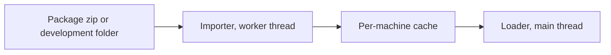
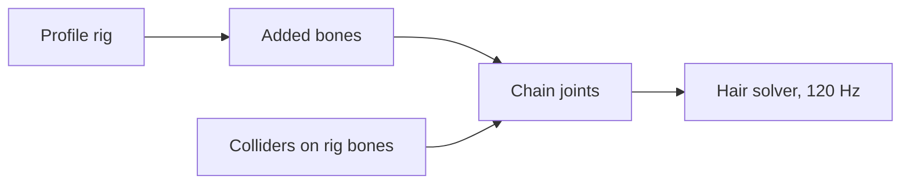
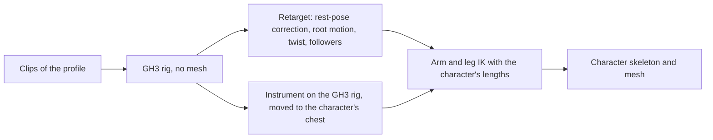
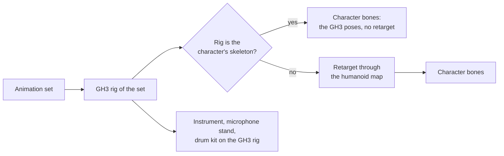
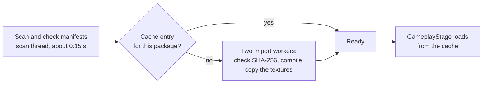
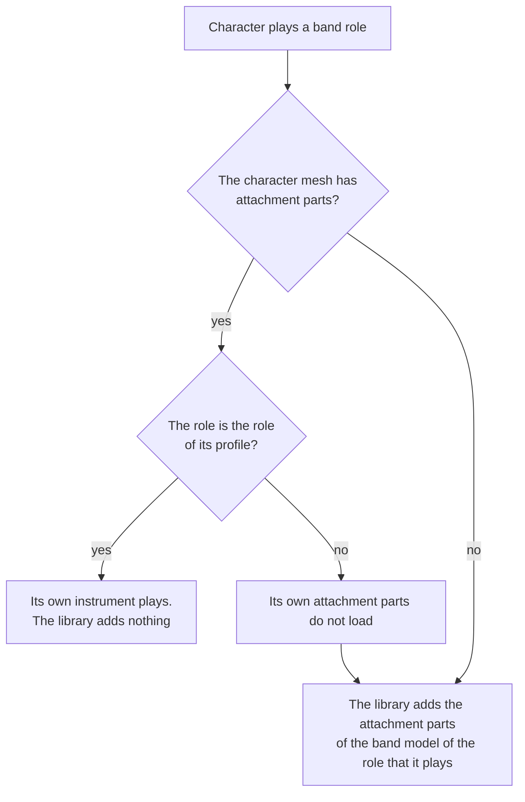

# Package format v1

Status: format 1.0 for all kinds (PACKAGING-PLAN step 3, part 1, [changelog](#21-changelog)). Before the first release, changes go into 1.0 directly (PACKAGING-PLAN decision 12). The format becomes frozen at the first release. This document is the reference for venue, character, instrument, and library packages. The JSON Schemas are in [`schemas/`](../schemas). The validator is `pipeline/package/validate.py`. The converter is `pipeline/package/build.py` ([section 19](#19-converter)). The C# importer is `src/Packages/` ([section 20](#20-c-importer)).

The words "must" and "must not" give rules. The validator reports a rule failure as an error. "Should" gives a recommendation. The validator reports it as a warning.

## 1. Overview

A package is one zip file. It holds glTF 2.0 binary files (GLB) with pre-encoded textures (GH3TEX02, [section 7](#7-textures)), JSON files, PNG images, and other data files. Package data is the same on Linux, Windows, and macOS. Only the per-machine cache holds platform-specific data.



| Kind | Extension | `format` | Contents |
|---|---|---|---|
| Venue | `.chstage` | `chstage/1.0` | `stage.glb`, cameras, lighting, scripts, placements, actors |
| Character | `.chchar` | `chchar/1.0` | One skinned GLB on a GH3 rig profile (a fixed profile of the band library or a profile of a character library), `character.json`, an optional highway image |
| Instrument | `.chinst` | `chinst/1.0` | A guitar or a bass: one skinned GLB on the guitarist or bassist profile, `instrument.json`, an optional highway image ([section 9.4](#94-instrument-chinst)) |
| Library | `.chlib` | `chlib/1.0` | The shared GH3 band, crowd, clips, audio, movies, and particle textures (`gh3-band-v1`), or a character library (`gh3-characters-v1`, [section 10.1](#101-character-library)) |

The extension selects the kind. The `format` field in `manifest.json` must agree with the extension.

## 2. Container

### 2.1 Zip rules

- The package is a standard zip file. Zip64 is permitted. Readers must support it.
- Each entry uses STORE (method 0) or DEFLATE (method 8). Other methods, encryption, and multi-part archives are not permitted.
- `manifest.json` is at the root of the zip.
- Directory entries are permitted and ignored. Symbolic links are not permitted.
- Each file occurs one time. Two paths must not differ only in letter case (Windows and macOS file systems ignore case).

### 2.2 Paths

All references in a package use package paths:

- Relative to the package root, with `/` as the separator.
- Each segment uses `A`–`Z`, `a`–`z`, `0`–`9`, `_`, `-`, and `.`. A segment must not start with `.` or end with `.`.
- Windows device names (`con`, `nul`, `com1`, and so on) are not permitted as segments.
- Maximum 240 bytes.

These rules make the paths safe on all three platforms. They also prevent paths outside the package (`..`).

### 2.3 Compression for each file type

| File type | Method | Reason |
|---|---|---|
| `.glb`, `.tex` | DEFLATE | Mesh data and BC1/BC3 textures compress to 40–60 % ([open question O1](#171-for-the-orchestrator-or-the-owner), decided on 2026-10-10 by measurement) |
| `.png` | STORE | Already compressed |
| `.q48.br` | STORE | Already compressed (Brotli) |
| `.ogg`, `.mp3` | STORE | Already compressed |
| `.json`, `.wav` | DEFLATE | Compresses well |
| Other | DEFLATE | — |

A different method is not an error. The validator gives a warning.

### 2.4 Development folders

For development, a folder can replace the zip. The folder name ends with the package extension, for example `my-stage.chstage/`. The folder contents are the same as the zip contents. In a folder, `manifest.json` can have an empty `files` object. Then the validator does not check hashes (warning). The cache key of a folder comes from its file contents (see [section 14](#14-cache)).

## 3. `manifest.json`

Schema: [`schemas/manifest.schema.json`](../schemas/manifest.schema.json).

| Field | Required | Meaning |
|---|---|---|
| `format` | Yes | `<kind>/<major>.<minor>`, for example `chstage/1.0` |
| `id` | Yes | Stable package ID: lowercase letters, digits, `.`, and `-`; 1–96 characters, for example `author.my-stage`. The ID does not change between versions |
| `version` | Yes | Semantic version 2.0.0 of the package, for example `1.2.0` |
| `name` | Yes | Display name, 1–128 characters |
| `description` | No | Text, maximum 4,000 characters |
| `authors` | Yes | 1–64 objects: `name` (required), `role`, `url` (`https://` or `mailto:`) |
| `license` | Yes | SPDX license expression, for example `CC-BY-4.0`. Use `LicenseRef-<name>` for other licenses |
| `permissions` | Yes | `redistribute`, `modify`, `commercial`: booleans. They give the author's permissions in a form that the game can show |
| `credits` | No | Text lines for other contributors and sources |
| `homepage` | No | `https://` URL |
| `requires` | No | Packages that this package needs: `id` and the lowest compatible `version` (see [section 4](#4-versions-and-compatibility)). Venues and characters should require `gh3-band-v1` |
| `entry` | Yes | Role names to package paths. The keys depend on the kind (see sections 8–10) |
| `files` | Yes | Package path to `sha256` (64 lowercase hex characters) and `size` (bytes) for each file of the package, except `manifest.json` |
| `minModVersion` | No | Lowest mod version (semantic version) that can load the package |
| `preview` | No | Package path of a PNG image, maximum 1024 × 1024. Recommended: 512 × 288 (16:9) |

Rules:

- A zip package lists every file in `files`. A file that is not listed, a listed file that is missing, a wrong size, or a wrong hash is an error.
- Unknown fields are errors.
- JSON files use UTF-8. Numbers are finite (no `NaN` or `Infinity`).

Example (venue):

```json
{
  "format": "chstage/1.0",
  "id": "gh3.dive",
  "version": "1.0.0",
  "name": "Mitch's Moose Lounge",
  "authors": [{"name": "Neversoft", "role": "original venue"}],
  "license": "LicenseRef-GH3-Derived",
  "permissions": {"redistribute": true, "modify": true, "commercial": false},
  "requires": [{"id": "gh3-band-v1", "version": "1.0.0"}],
  "entry": {"model": "stage.glb", "placements": "placements.json", "cameras": "cameras.json",
            "lighting": "lighting.json", "scripts": "scripts.json", "actors": "actors.json"},
  "files": {"stage.glb": {"sha256": "…", "size": 86000000}},
  "preview": "preview.png"
}
```

## 4. Versions and compatibility

| Item | Rule |
|---|---|
| Format major (`chstage/1`) | An incompatible change gives a new major. The mod rejects a major that it does not know |
| Format minor (`chstage/1.0`) | All kinds are 1.0. Before the first release, changes go into 1.0 (PACKAGING-PLAN decision 12). After the release, a new minor only adds optional fields, files, or extras. The mod rejects a minor that is higher than 0 with the message "needs a newer mod" |
| Package `version` | The author increments it for each release. With two packages of one `id`, the mod uses the higher version |
| `requires[].version` | Satisfied by an installed package with the same `id`, the same major version, and a version that is not lower |
| `minModVersion` | The mod rejects the package when the mod version is lower. The release packages do not set it |
| Library ID | `gh3-band-v1` names the library contract (rigs, clip IDs, action tables). An incompatible library change gives a new ID (`gh3-band-v2`), not only a new version |
| Schemas | Each schema file belongs to format major 1. A new minor can add properties to a schema. It does not remove or change them |

Unknown fields are errors at the known minor. This finds spelling errors early. A newer minor that adds fields also increments the minor in `format`, so an older mod gives the clear "newer mod" message.

## 5. Coordinates and units

- Units are metres and seconds. Angles in JSON are degrees.
- GLB files use glTF coordinates (right-handed, Y up, +Z forward).
- JSON sidecars use the Unity runtime coordinates of the mod (left-handed, Y up). The conversion from glTF negates Z of positions and X and Y of quaternions.
- Quaternions are `[x, y, z, w]` with unit length (tolerance 0.001).
- The GLB extras `gh3ObjectPivot` and `gh3ObjectRotation` use the Unity runtime coordinates, as the JSON sidecars do.

## 6. GLB rules

These rules apply to every GLB in a package.

### 6.1 Structure

- glTF 2.0 binary: a JSON chunk and at most one binary chunk. `asset.version` is `"2.0"`.
- One buffer, embedded in the binary chunk. External URIs are not permitted.
- Images are embedded (`bufferView`) with `mimeType` `image/vnd-gh3.tex`: each image is a GH3TEX02 texture ([section 7](#7-textures)). `extensionsRequired` and `extensionsUsed` contain `GH3_texture_bc`.
- Meshes are triangle lists (mode 4). `POSITION` and `NORMAL` are required.
- Sparse accessors are not permitted. Maximum 10,000,000 elements in each accessor.
- The importer reads the node hierarchy, `matrix` or TRS transforms, and all scene root nodes.

### 6.2 Extensions

| Extension | v1 |
|---|---|
| `KHR_materials_unlit` | Read. It gives `unlit` shading when `gh3Shading` is absent |
| `GH3_texture_bc` | Required when the GLB has images (all package GLBs with textures). It permits images with the media type `image/vnd-gh3.tex` (GH3TEX02, section 7) as the source of a glTF texture and of a `#<name>` reference. Other glTF tools do not read these images; the Blender add-on changes them back to PNG when it opens a package |
| `KHR_lights_punctual`, `KHR_materials_emissive_strength`, `KHR_texture_transform`, others | Ignored (warning). Lighting comes from `lighting.json` |
| `EXT_meshopt_compression`, `KHR_draco_mesh_compression`, `KHR_texture_basisu` | Not permitted in v1 |
| Any other entry in `extensionsRequired` | Not permitted in v1 |

### 6.3 Vertex attributes

| Attribute | Static scenery | Skinned (actors, characters, library) | Meaning |
|---|---|---|---|
| `POSITION`, `NORMAL` | Required | Required | — |
| `TEXCOORD_0` | Optional | Optional | Base color UV |
| `TEXCOORD_1` | Optional | — | Lightmap UV (`occlusionTexture`, `texCoord` 1) |
| `TEXCOORD_2`, `TEXCOORD_3` | Optional | — | Layer UV, mask UV |
| `COLOR_0` | Optional | Optional | Float or normalized integer, VEC3 or VEC4 |
| `JOINTS_0`, `WEIGHTS_0` | — | Required | Maximum four influences. Weights are not negative and their sum is 1 (tolerance 0.001) |
| `_GH3_UV0` … `_GH3_UV5`, `_GH3_BINORMAL` | Optional | Optional | Original GH3 streams for GH3 material templates |
| `_GH3_POSITION1`, `_GH3_BINORMAL1` | Optional | — | Original GH3 streams |
| `_GH3_TANGENT` | — | Optional | Original GH3 stream |

The importer ignores other attributes (warning). Morph targets are permitted only in character GLBs.

### 6.4 Node extras

Keys that start with `gh3` are reserved. An unknown `gh3` key is an error (this finds spelling errors). The importer ignores other keys, for example other Blender custom properties. Schema: [`schemas/glb-extras.schema.json`](../schemas/glb-extras.schema.json), `$defs/node`.

| Key | Type | Meaning |
|---|---|---|
| `gh3LightGroup` | string | Stage-local light group. Default `Stage`; `Band` lights the performers |
| `gh3VisibilityGroup` | string | Group that the runtime shows and hides; `crowd-lighters` gets crowd lighter commands |
| `gh3InitiallyVisible` | boolean | Start state, default `true`. All meshes of one group have the same start state |
| `gh3FixtureId` | string | Movable light housing for this lighting beam ID. Local +Z is the beam axis |
| `gh3FixtureFixedPosition` | boolean | Keep the housing position while the controller turns it |
| `gh3FixtureObject` | string | Script object name of the housing |
| `gh3FixtureCreated` | boolean | Start state of the housing object |
| `gh3Object` | string | Script object name (or `0x` and 8 hex digits) |
| `gh3ObjectPivot` | [x, y, z] | Object pivot (runtime coordinates) |
| `gh3ObjectRotation` | [x, y, z, w] | Object rotation (runtime coordinates) |
| `gh3ObjectCreated` | boolean | Object start state |
| `gh3ObjectScript` | string | Startup script of the object |

### 6.5 Material extras

Schema: `$defs/material` in the same file.

| Key | Type | Meaning |
|---|---|---|
| `gh3Shading` | `lit`, `ambient`, `unlit`, `toon` | Stage surface model. `toon` is for characters and instruments only ([section 6.5.1](#651-toon-materials-and-hair-layers)) |
| `gh3Additive` | boolean | Additive transparency |
| `gh3AlphaCutoff` | 0–1 | Alpha test for `BLEND` materials |
| `gh3SortedTransparency` | boolean | Sort the triangles of a skinned transparent material |
| `gh3CrowdAtlas` | boolean | Shared animated crowd atlas (8 columns, 3 rows) |
| `gh3CrowdRole` | `crowd1`–`crowd8` | Crowd card role |
| `gh3Billboard` | boolean | Camera-facing card |
| `gh3ColorScale` | 1–1000 | Multiplier for `baseColorFactor` (glTF limits the factor to 1) |
| `gh3MovieSlot` | −1–31 | Movie texture slot |
| `gh3TextureAnimation` | object | Flipbook: `columns`, `rows`, `fps`, `offset` |
| `gh3UvWibble` | 11 numbers | GH3 UV animation parameters |
| `gh3MaskTexture` | texture reference | Mask texture (UV `TEXCOORD_3`) |
| `gh3LayerTexture` | texture reference | Layer texture (UV `TEXCOORD_2`); needs `gh3LayerColor` |
| `gh3LayerColor` | 4 numbers | Layer color |
| `gh3SourceMaterial` | string | Original material name (identity for scripts) |
| `gh3Shader` | object | Original GH3 material record: `template` (8 hex digits), `vertexConstants` and `pixelConstants` (maximum 64 rows of 4 numbers), `textures` (maximum 16 texture references), `addressing` (one value for each texture), `flags`, `blend` (0–12), `alphaRef` (0–255), `drawOrder` |
| `gh3Toon` | object | Toon settings of a `toon` material ([section 6.5.1](#651-toon-materials-and-hair-layers)). Characters and instruments only |
| `gh3HairLayer` | `overHair`, `hair` | Draw order of face features and hair ([section 6.5.1](#651-toon-materials-and-hair-layers)). Characters and instruments only |

Standard glTF material data stays standard: `baseColorTexture` (texture coordinate 0), `baseColorFactor`, `alphaMode` (`OPAQUE`, `MASK`, `BLEND`), `alphaCutoff`, `doubleSided`, and `occlusionTexture` as the lightmap (texture coordinate 1).

A `gh3Shader.template` that the installed mod does not have uses the stage surface model. The package does not contain shaders.

#### 6.5.1 Toon materials and hair layers

A character or instrument material with `gh3Shading` `toon` uses cel shading. The stage lights color it: the key light direction of the band light group selects the base color or the shade color, and the color of the ambient and key lights multiplies both. The strongest channel of that light color is limited to 1, so the hue of the venue light stays and a bright GH3 light does not make the textures white. Thus a toon character follows the moods, the colors, and the blackouts of the venue. A venue (`.chstage`) must not use `toon`, `gh3Toon`, or `gh3HairLayer` (validator error). Schema: `$defs/toon` of [`glb-extras.schema.json`](../schemas/glb-extras.schema.json).

| `gh3Toon` field | Type | Default | Meaning |
|---|---|---|---|
| `threshold` | 0–1 | 0.5 | Light amount (half Lambert: `0.5 + 0.5 N·L`) where the shade starts. 0: always lit |
| `softness` | 0–0.5 | 0.05 | Half width of the blend between the shade and the lit color |
| `shadeTexture` | texture reference | none | Color of the shaded side (texture coordinate 0). None: the base color |
| `shadeColor` | 3 numbers, 0–4 | `[1, 1, 1]` | Multiplier for the shade texture or the base color |
| `shadeMaskTexture` | texture reference | none | Red channel moves the light amount by `2 r − 1`: 0 always shaded, 0.5 no change, 1 always lit (the Project SEKAI value texture) |
| `rimColor`, `rimWidth` | 3 numbers 0–4; 0–1 | black, 0 | Rim light on the lit side at the silhouette; the key light color multiplies it. Width 0: no rim |
| `sphereTexture`, `sphereMode` | texture reference; `add` or `multiply` | none, `add` | Sphere map (matcap) on the view-space normal, as MMD `.spa` (add) and `.sph` (multiply) files |
| `outline` | object | none | Inverted-hull outline: `width` (metres at 1 m from the camera at a vertical field of view of 45°, 0–0.05; the line keeps its screen width from 0.5 m to 4 m and at every field of view, farther than 4 m it gets thinner), `color` (3 numbers, 0–4, default black; the light color multiplies it), `textured` (`true`: the base texture multiplies the color) |

The outline draws the back faces of the mesh, pushed out along the vertex normals. Hard edges with split normals give gaps in the line. An opaque or cutout outline writes depth; the outline of a `BLEND` material draws before the material.

`gh3HairLayer` shows face features over the bangs, as Project SEKAI shows the eyebrows (the eyebrow material there writes the stencil, and the hair material does not draw where it is set):

- `overHair` (eyebrows, eyelashes): the material draws after the other opaque parts of all characters and marks its pixels in the stencil buffer. It marks only pixels where its surface turns to the camera (`N·V` ≥ 0.3), so the back and the far side of the head never show it.
- `hair`: the hair of the same character does not draw on the marked pixels.
- Each character has its own stencil value (7 values, stencil bits 1–3), so a feature never shows through the hair of another band member. Other parts (the face, the hands, an instrument, other band members) still hide the feature with the depth test.
- Without `gh3Shading` the hair layer has no effect (warning).

### 6.6 Texture references

A texture reference in extras is a string:

| Value | Meaning |
|---|---|
| `""` | No texture |
| `#<name>` | The image with this `name` in the same GLB. Image names in one GLB are unique |
| `<package path>.tex` | A GH3TEX02 texture file in the package (section 7) |

The texture references are `gh3MaskTexture`, `gh3LayerTexture`, the `gh3Shader.textures`, and the `gh3Toon` textures (`shadeTexture`, `shadeMaskTexture`, `sphereTexture`).

**A texture reference must not be a glTF texture or image index.** Blender renumbers textures on export and drops images that no material slot uses (spike result 9.6). Thus the Blender add-on writes sampler-only textures as package files. The pipeline GLB writer (`GlbWriter`) names every image (the GH3 texture checksum, for example `1a52a814`) and writes `#<name>`.

`#<name>` refers to an image, not to a glTF texture: the image does not need a glTF `textures` entry. Both compilers (`pipeline/stagepack/pack.py` and the C# `StageCompiler`) use the runtime texture name of the first glTF texture of the image when there is one (so the compiled GH3 venues do not change), and else the checksum of `image-<image index>`.

### 6.7 Animation channels and the unit-scale rule

- Channels target skin joints with `translation` or `rotation`, and `LINEAR` or `STEP` interpolation. `CUBICSPLINE` and `weights` channels are not permitted.
- **Unit-scale rule:** a `scale` channel is permitted when every key is within 1e-4 of 1 on each axis. The importer drops it. Other scale keys are errors. (Blender writes a constant scale channel for each joint.)
- Maximum 256 clips for each GLB; clip names are unique. Actor clips are at most 120 s long.

## 7. Textures

Packages store the textures of the models pre-encoded in the GPU format. The player's machine does not encode textures: the importer copies them into the cache ([section 20.2](#202-import)). The converter (`pipeline.package.build`) and the Blender add-on (Export) encode them with one shared encoder, `pipeline/package/texture.py`.

**GH3TEX02 file.** All values are little-endian.

| Offset | Size | Value |
|---|---|---|
| 0 | 8 | Magic `GH3TEX02` |
| 8 | 4 | Unity `TextureFormat`: 10 BC1 (DXT1), 12 BC3 (DXT5), or 4 RGBA32 |
| 12, 16 | 4 each | Width and height, 1 to 4096 pixels |
| 20 | 4 | Mip count: always the full chain, `floor(log2(max(width, height))) + 1` |
| 24 | 4 | Flags. Bit 0: the texture holds data, not colour (linear). Other bits must be 0 |
| 28 | — | The mip levels, largest first. Each level has its rows bottom first (Unity order, as `Texture2D.LoadRawTextureData` takes them). BC1: 8 bytes, BC3: 16 bytes for each 4 × 4 block; RGBA32: 4 bytes for each pixel |

Rules (the validator checks each one):

- A GLB image has the media type `image/vnd-gh3.tex`. A texture file in the package has the suffix `.tex`. PNG images in a GLB, and PNG texture references, are errors.
- The header is valid, the file size agrees with the header, and the mip chain is complete.
- BC1 and BC3 need a width and a height that are multiples of 4.
- Alpha needs BC3: a BC1 block must not use the transparent index (color0 ≤ color1 with index 3). A BC3 texture without alpha gives a warning (BC1 is half the size).
- The linear flag: the source of a glTF `normalTexture` should have it, other GLB images should not (warning). Clone Hero uses the gamma colour space, so the flag does not change the image in the game now.

**Encoder** (`texture.encode`). It gives the same bytes as the C# encoder that the importer used before (checked: all 1,536 different model textures of the 195 packages of 2026-10-10 are byte-equal):

- The image is opaque (every alpha 255): BC1. Else BC3.
- A width or a height that is not a multiple of 4: RGBA32. A first level under 36 dB PSNR in BC1/BC3 (art that GH3 did not store as DXT, for example smooth gradients): RGBA32 (13 GH3 textures).
- The mip chain comes from a 2 × 2 box filter with rounding (an odd last row or column repeats).
- BC1/BC3: principal-axis endpoints, least-squares refinement (two passes), exact single colours; BC3 alpha from the block minimum and maximum with 8 levels.

The color space is sRGB. Clone Hero uses Gamma color space. References are image names or package paths (see [section 6.6](#66-texture-references)).

Other images of a package stay PNG files (8 bits for each channel or an 8-bit palette, not interlaced, 1 to 4096 pixels on each side): the manifest `preview`, the character and instrument `highway`, the library particle and hand-fire textures and `effects/tesla-noise.png`, the movie frames, and the script textures of `scripts.json`. The game decodes them when it needs them.

**Size and choice (2026-10-10).** The 193 GH3 packages (11 venues, 2 libraries, 72 characters, 108 instruments; MB, 10^6 bytes):

| Variant | Venues | Libraries | Characters | Instruments | Total |
|---|---:|---:|---:|---:|---:|
| PNG only, GLB STORE (before) | 551.6 | 691.7 | 434.9 | 101.7 | 1,779.9 |
| BC only, GLB STORE | 536.2 | 700.8 | 525.9 | 142.6 | 1,905.5 |
| PNG and BC (estimate: PNG packages plus the GH3TEX02 bytes) | 732.6 | 712.4 | 822.1 | 212.9 | 2,479.9 |
| **BC only, GLB and `.tex` DEFLATE level 6 (format 1.0)** | **194.3** | **677.8** | **215.2** | **51.1** | **1,138.4** |

The model textures are 574.5 MB as PNG and 700.1 MB as GH3TEX02. A PNG copy beside the BC data is not necessary: the Blender add-on decodes GH3TEX02 for editing (section 19.6). DEFLATE takes the GLB mesh data to about one third. The importer then inflates the GLB files: all 195 packages imported in 10.0 s with DEFLATE GLBs and 9.3 s with STORE GLBs (`tools/PackageImport`, the same PC).

## 8. Venue (`.chstage`)

### 8.1 Files

| `entry` key | Required | Schema | Contents |
|---|---|---|---|
| `model` | Yes | GLB rules | Static scenery, materials, node extras, fixtures |
| `placements` | Yes | [`placements.schema.json`](../schemas/placements.schema.json) | `band` (1–4 roles), `waypoints`, `effects`, `crowd`, `smallVenue` |
| `cameras` | Yes | [`cameras.schema.json`](../schemas/cameras.schema.json) | Shots, groups, and GH3 camera note selectors |
| `lighting` | No | [`lighting.schema.json`](../schemas/lighting.schema.json) | Lights, snapshots, moods, color presets. Absent: the basic fill-light preset |
| `scripts` | No | [`scripts.schema.json`](../schemas/scripts.schema.json) | Typed script bank, and the GH3 zone name of the venue (`zone`) |
| `actors` | No | [`actors.schema.json`](../schemas/actors.schema.json) | Animated scenery. Each actor has its own skinned GLB |

The field meanings are the same as in [CUSTOM-CONTENT.md, section 5](CUSTOM-CONTENT.md#5-stage-pack). The package format moves the identity fields of `stage-pack.json` into `manifest.json`. It splits the other fields into `placements.json` and `actors.json`:

| Current `stage-pack.json` field | Package v1 |
|---|---|
| `version`, `kind`, `id`, `name`, `library` | `manifest.json`: `format`, `id`, `name`, `requires` |
| `model`, `cameras`, `lighting`, `scripts` | `manifest.json` `entry` |
| `band`, `waypoints`, `effects`, `crowd`, `smallVenue` | `placements.json` (with `version: 1`) |
| `actors` | `actors.json` (`{"version": 1, "actors": {…}}`) |
| `source-report.json` (pipeline report) | Not in the package |

Two fields give the runtime what it must not get from the stage ID (PACKAGING-PLAN decision 16):

| Field | Meaning | GH3 venues |
|---|---|---|
| `placements.json` `smallVenue` | `true`: the band plays the small-stage intro and win animations (`play_intro_anims`: `intro_smstg` for all members except the drummer; `play_win_anims`: `win_smstg` for the guitarist and the bassist). Absent or `false`: the normal animations | `true` for the zones that GH3 `UseSmallVenueAnims` (guitar_character.qb) selects without a condition: party, dive, video, prison, hell |
| `scripts.json` `zone` | The GH3 zone name of the venue scripts: `GetPakManCurrent` returns it, and the venue definitions `<zone>_lightshow_mapping` and `<zone>_snapshots` use it. Absent: no zone | `z_<name>` (for example `z_dive`) |

A creator sets **Small venue** in the Blender add-on ([BLENDER-ADDON.md section 1.5](BLENDER-ADDON.md#15-what-you-can-set)). A creator stage without a GH3 script bank has no zone.

### 8.2 Rules in addition to the schemas

- Every shot in `groups` exists. The `wide` group has a shot without `waypoints`.
- Shot `waypoints` refer to `placements` waypoints or the reserved `<role>_start` names.
- Camera anchors and `lookAt` targets refer to roles in `band`.
- Keyframe `times` start at 0, increase, and have one entry for each point.
- Camera note selectors refer to existing groups.
- Light IDs are unique. Each snapshot lists every light, in the order of `lights`. All snapshots have the same beam IDs. Moods refer to existing snapshots. `intro` and `blackout` are required.
- Each `gh3FixtureId` in the stage GLB is a beam ID in `lighting.json`, one time only.
- The stage GLB has no skins and no animations. Skinned or animated scenery is an actor.
- Actor GLBs have one skin, inverse bind matrices that agree with the joints (1e-4), and the clip names that `clip` and `actions` use.
- Script `textures` and `movies` refer to package files.

## 9. Character (`.chchar`)

### 9.1 Files

| `entry` key | Contents |
|---|---|
| `model` | One skinned GLB |
| `character` | `character.json` ([schema](../schemas/character.schema.json)) |

`character.json`:

| Field | Required | Meaning |
|---|---|---|
| `version` | Yes | `1` |
| `library` | Yes | `gh3-band-v1` for a fixed profile. For a character library profile: the ID of the character library that has the profile (`gh3-characters-v1`); the manifest `requires` lists it with `gh3-band-v1` |
| `profile` | Yes | `gh3-guitarist-axel-v1`, `gh3-bassist-v1`, `gh3-singer-male-v1`, or `gh3-drummer-v1` (the fixed profiles of `gh3-band-v1`: `catalog.json` `profile` of each role, section 10.2), or a profile of the character library that `library` names, for example `gh3-guitarist-judy-v1` ([section 10.1](#101-character-library)). The profile gives the GH3 rig and the animation set of the character and its own band role. The character plays every band role ([section 9.7](#97-character-model-and-band-roles)) |
| `animations` | No | Only for a character library profile: an animation set of the same character library, on a clip rig with the bones of the profile. Absent: the set of the profile. A character on a fixed profile must not have this field |
| `hairMaterials` | No | GLB material names with sorted hair transparency |
| `highway` | No | Package path of the highway image of the character: a PNG, 512 × 1024 in GH3 (other sizes stretch; the validator warns). When the character plays the role of the Clone Hero player, the player's highway uses it, as GH3 `create_guitarist` does ([PARITY-NOTES.md](PARITY-NOTES.md#instruments-and-highways)). The GH3 guitarist packages have the highway of their GH3 profile |
| `attachments` | No | `instrument`: a library instrument ID (the `instrument` of a `band/band.json` member: `SG_Black`, `tobB4`, `Microphone001`, `Drum_Set001`). Absent: the default. The v1 library has one instrument for each band role, and the instrument follows the role that the character plays (rules in [section 20.6](#206-characters)). Do not model the instrument in the character GLB |
| `bones`, `colliders`, `chains` | No | Custom hair, skirt, and tail chains: bones that the character adds to the profile rig, capsules on rig bones, and the physics of the added bones ([section 9.5](#95-custom-chains)) |
| `skeleton` | No | The character keeps its own skeleton: the GLB skin joints, a humanoid map, followers, and the instrument place. The mod retargets the clips of the profile to it ([section 9.6](#96-own-skeleton)). Without it, the GLB joints are the profile rig |
| `face` | No | Needs `skeleton`. The morph target names of the face shapes: `blink`, the mouth shapes `a`, `i`, `u`, `e`, `o`, the consonant visemes `pp`, `ff`, `th`, `dd`, `kk`, `ch`, `ss`, `nn`, `rr`, and `browUp`, `browDown`, `squint` ([section 9.6](#96-own-skeleton)) |

### 9.2 GLB rules

- One skin. All mesh nodes use it. Inverse bind matrices are required.
- With `skeleton` ([section 9.6](#96-own-skeleton)), the joints are free; the rules below that name the profile rig do not apply.
- Joints map to GH3 bones **by name**: `bone-<8 hex digits>` (the GH3 checksum) or the GH3 bone name. Joint order and vertex order are free.
- The skin contains every joint of the profile and the added bones of `character.json` `bones` ([section 9.5](#95-custom-chains)), and no other joints, with the profile parents. A character library profile gives its rig in `characters.json` (`bones`, `parents`, `bind`); the checks are the same. The added bones have the same tolerances against their `bind`.
- Nodes above the root joint (for example the Blender `Armature` node) have the identity transform (1e-4).
- Maximum four influences for each vertex. Blend shapes (morph targets) are optional. On a GH3 rig the mod does not animate them (warning): the GH3 clips move the face with bones. A character with its own skeleton uses the morph targets of `face` (section 9.6).
- Animations in the GLB are ignored (warning). The library supplies the clips.

### 9.3 Tolerances (spike result 9.6)

| Check | Limit | Good Blender export (measured) | Wrong export (measured) |
|---|---|---|---|
| Joint local position against the profile | 0.1 mm | 0.0007 mm | 360–1,860 mm |
| Joint local rotation against the profile | 0.01° | 0.0004° | 90–180° |
| Joint scale | \|scale − 1\| ≤ 1e-4 | 3.5e-6 | — |
| `world(joint) · IBM − world(mesh node)` | 1e-4 | 7e-7 | 2.0–2.2 |

After the check, the importer uses the profile local transforms for clip playback and the GLB inverse bind matrices for skinning.

### 9.4 Instrument (`.chinst`)

A guitar or a bass that the player can select for the guitarist or the bassist in the picker. The GH3 release has the 88 guitars and 20 basses of GH3 as `gh3.<name>.chinst`. A creator makes one from a Blender export of the guitarist or bassist template ([CREATOR-GUIDE.md](CREATOR-GUIDE.md#6-make-an-instrument)).

| `entry` key | Contents |
|---|---|
| `model` | One skinned GLB on a fixed profile of the band library (section 9.2 rules) |
| `instrument` | `instrument.json` ([schema](../schemas/instrument.schema.json)) |

| `instrument.json` field | Required | Meaning |
|---|---|---|
| `version` | Yes | `1` |
| `library` | Yes | `gh3-band-v1` |
| `profile` | Yes | `gh3-guitarist-axel-v1` or `gh3-bassist-v1`: the rig of the GLB joints |
| `kind` | Yes | `guitar` (the guitarist can hold it) or `bass` (the bassist can hold it) |
| `highway` | No | Package path of a highway image (PNG, 512 × 1024 in GH3). When the player selects this instrument for the role of the Clone Hero player, the highway uses it, and it wins over the highway of the character. GH3 instruments have no highway: in GH3 the highway follows the character |
| `brand`, `model`, `series`, `finish` | No | Display texts (1–64 characters). The manifest `name` is the name in the picker |

Rules:

- The skin has the joints of the profile, with the section 9.3 tolerances. Every mesh part follows the instrument joints: more than half of its vertices have their largest weight outside the body joints (the subtree of the parent of `bone_pelvis`; `BandAttachments`). A part on the body is an error. GH3 weights every vertex of an instrument to `bone_guitar_body`.
- The game binds the instrument to the rest pose of the band member that holds it, as GH3 binds an instrument to the skeleton of the band member. The GH3 guitarist skeletons put `bone_guitar_body` up to 9 mm and 2° from Axel's; the instrument follows the band member's own bone.
- Materials, textures, and vertex streams follow the character rules (section 20.6).
- `python -m pipeline.package.instrument GLB --id ID --name NAME --kind guitar --output DIR [--highway PNG] [--split]` packs and validates an instrument; `--split` keeps only the mesh parts on the instrument joints of a full template export.

**Layout decision: one package for each instrument.** The other choice was one `.chlib` with all instruments and highways. One package for each instrument was chosen:

| Item | One `.chinst` for each instrument (chosen) | One library with all instruments |
|---|---|---|
| Size (108 GH3 instruments, measured) | 101.7 MB zip (0.51–2.06 MB each), 101.7 MB as folders | About the same: GLB and PNG are stored |
| Cold import (measured, `tools/PackageImport`) | 0.04–0.10 s each, 5.6 s for all 108 on the background thread; the stage waits only for the selected instruments | One import of all instruments; a song with one instrument waits for all |
| Update of one instrument | One package imports again | The whole library imports again |
| Creators | The same kind as the GH3 instruments: one file in `Custom/Instruments/` | A second format for one instrument |
| Scan at start (measured) | 194 packages in 102–147 ms, all ready from the cache in 169–219 ms | Fewer files |
| Cache (measured) | 138.7 MB for the 108 instruments | The same textures and meshes |

The GH3 highways are in the character packages (13 images in 70 guitarist packages, 23.6 MB), because GH3 takes the highway from the character.

### 9.5 Custom chains

A character can have its own hair, skirt, tail, and cable chains. It adds bones to the rig of its profile (`bones`), gives physics to them (`chains`), and gives the chains capsules to collide with (`colliders`). The game simulates the chains with the solver of the GH3 hair ([PARITY-NOTES.md](PARITY-NOTES.md#hair-dynamics)): gravity, Havok angular damping, constraint friction, the cone, plane, and hinge limits, and the speed limit. Custom chains also have the spring-bone values of VRM and MMD models: a stiffness that pulls each joint to its bind direction, a drag that stops the swing against the parent, a share of gravity, and a bend limit for the whole chain. Without these fields a chain moves as the GH3 hair (no spring). The hair chains of the profile stay as they are (GH3 physics, no stiffness); a mesh can use both.



The rows name bones, not rig indices: a GH3 bone name, `bone-<8 hex digits>`, the name of an added bone, or a joint of the character's own skeleton (at most 64 characters, no control characters; MMD names are Japanese). A character with its own skeleton ([section 9.6](#96-own-skeleton)) has no `bones`: its chain joints are skeleton joints.

`bones` (at most 64):

| Field | Meaning |
|---|---|
| `name` | The GLB joint name of the added bone. It must not be the name (or the checksum) of a profile bone or of another added bone |
| `parent` | A profile bone or an earlier added bone |
| `bind` | Local bind pose `[x, y, z, qx, qy, qz, qw]` relative to the parent, runtime coordinates. The GLB joint must agree (section 9.3 tolerances) |

`colliders` (at most 32):

| Field | Meaning |
|---|---|
| `name` | Unique collider name |
| `bone` | A rig bone that is not a chain joint (a body bone, the guitar body, or the root) |
| `a`, `b` | The capsule ends in the bind frame of the bone, runtime coordinates. Without `b`: a sphere at `a` |
| `radius` | Metres, more than 0 and at most 5 (a large sphere below the floor keeps a long tail above the floor) |

`chains` (at most 16 chains, at most 64 joints in all; more than 32 gives a warning):

| Field | Meaning |
|---|---|
| `name` | Unique chain name |
| `colliders` | The collider names that the joints touch. Absent: all colliders. Empty: none |
| `bendLimit` | Optional. The largest angle (radians, more than 0, at most π) of the chord from the chain start to the chain end from its bind chord, in the frame of the parent of the first joint. Absent: no limit. Example: 1.05 (60°) keeps a hanging twin tail below the horizontal |
| `joints` | 1–16 joints, parents first |

A joint:

| Field | Required | Meaning |
|---|---|---|
| `bone` | Yes | An added bone. A bone is a joint one time only |
| `parent` | No | The bone that holds the joint (the constraint parent). Absent: the rig parent. A parent that is a joint comes before it |
| `length` | Yes | Metres, 0.005–1. The joint end is `length` along `direction`. When the next joint starts at this end, the two joints pull on each other (chain coupling); else the validator warns |
| `direction` | No | The unit axis of the bone frame that the joint points along. Absent: `[0, 1, 0]` (+Y, the bone axis of Blender exports; GH3 joints point along +X) |
| `radius` | No | The collision radius of the joint segment (metres, 0–0.5) |
| `mass`, `friction`, `angularDamping` | Yes | kg (more than 0, at most 100), constraint friction torque (N·m), Havok angular damping (per second), as in `band/hair.json` |
| `maxAngularVelocity` | No | Speed limit of the joint (radians per second). Absent or 0: no limit |
| `stiffness` | No | The pull of the joint toward its bind direction in the frame of its parent (per second squared, 0–5000). For a small angle, the angular acceleration is `stiffness` times the angle. Absent: 0 (no pull) |
| `drag` | No | The damping of the swing of the joint against its parent (per second, 0–100). The motion that the parent gives stays. Absent: 0 |
| `gravity` | No | The share of gravity (0–2). Absent: 1 |
| `type` | No | `ragdoll` (default) or `hinge` |
| `limits` | For `ragdoll` | `coneLimit` (the maximum, more than 0 and at most π/2, is the swing from the bind direction) and optional `planesLimit` (−π/2 to π/2) and `twistLimit` (not used) |
| `twistAxis`, `coneAxis`, `planeAxis` | No | The Havok limit frames of section 10.1, unit vectors in the bone frame; all three or none, with `planesLimit` |
| `axis`, `range` | For `hinge` | The hinge axis in the bone frame and the range (−π to π, radians) |

Rules in addition to the schema (the validator and `CharacterImporter` check them): names unique; parents exist and come first; the joint bones are added bones; colliders are not on joint bones and are within 10 m of their bone; unit vectors have unit length (±0.01); the GLB has every added bone with its bind pose.

At run time (`CharacterExtras`, `StageHair`): the added bones come after the rig bones. They are joints of the character's skeleton: in a role where the character is retargeted ([section 9.7](#97-character-model-and-band-roles)), they keep their bind pose relative to their parent until the chain physics moves them. A joint can hang from a rig bone that is below the joint above it (an offset bone of a game rig): that bone follows the simulated joint, and when the joint starts at the end of the joint above, the two joints pull on each other. Each step (120 a second), a joint moves with its speed (`angularDamping` slows it in the world, `drag` slows it against its parent), gravity (times `gravity`), and the pull of `stiffness`; then the solver applies the lengths, the limits, the bend limit of the chain (the whole chain turns about its start, with its speed), and the colliders. The joints of a chain collide with the capsules of the chain: in each solver iteration, a joint follows the end of its parent joint, keeps its direction, and its middle and its end leave the capsules that they enter (a joint that starts in a capsule, for example a skirt joint on the hips, is pushed out at its end). A contact stops the speed into the capsule, and a push does not become speed. The head capsule of the profile hair does not apply to custom joints; add a head collider. The profile hair does not collide with the colliders: the GH3 hair keeps the head capsule of GH3 (the body collision of GH3 was measured and is not used for the GH3 hair; [PARITY-NOTES.md](PARITY-NOTES.md#hair-dynamics)).

Example (one joint of a twin tail on the head, and one collider):

```json
{
  "bones": [{"name": "twin_tail_l_01", "parent": "bone_head", "bind": [0.12, -0.05, -0.13, -0.54, 0.38, 0.55, 0.51]}],
  "colliders": [{"name": "chest", "bone": "bone_chest", "radius": 0.07, "a": [0, 0, 0], "b": [0.17, 0, 0]}],
  "chains": [{"name": "twin_tail_l", "colliders": ["chest"], "joints": [
    {"bone": "twin_tail_l_01", "length": 0.17, "direction": [0, 1, 0], "radius": 0.03, "mass": 1, "friction": 0.05,
     "angularDamping": 4, "stiffness": 30, "drag": 15, "limits": {"coneLimit": [-0.52, 0.52]}}], "bendLimit": 1.05}]
}
```

The Blender add-on makes these rows ([BLENDER-ADDON.md section 1.16](BLENDER-ADDON.md#116-chains-and-colliders)).

### 9.6 Own skeleton

A character can keep the skeleton of its model (PACKAGING-PLAN decision 13). `profile` (and `library`, `animations`) still selects the animation set; the mod plays these GH3 clips on the GH3 rig of the set without a mesh and retargets them to the GLB joints. A character without `skeleton` has the GH3 rig of its profile as its skeleton ([section 9.7](#97-character-model-and-band-roles)).



`skeleton` fields:

| Field | Required | Meaning |
| --- | --- | --- |
| `humanoid` | Yes | Role to joint name (a GLB node name of a skin joint, or `bone-<8 hex digits>` of its checksum). Roles: the VRM 1.0 humanoid bone names (`hips`, `spine`, `chest`, `upperChest`, `neck`, `head`, `jaw`, `leftEye`, `leftShoulder`, `leftUpperArm`, `leftLowerArm`, `leftHand`, `leftThumbMetacarpal`, `leftThumbProximal`, `leftThumbDistal`, `leftIndexProximal`, `leftIndexIntermediate`, `leftIndexDistal`, and the same for `Middle`, `Ring`, `Little`; `leftUpperLeg`, `leftLowerLeg`, `leftFoot`, `leftToes`; and the `right` roles), and the twist roles `leftUpperArmTwist`, `leftLowerArmTwist` (and `right`). Required: the 15 VRM required roles (`hips`, `spine`, `head`, upper and lower arms, hands, upper and lower legs, feet). A joint has one role at most |
| `followers` | No | At most 128 rows `{bone, source, weight}`: the bone turns by `weight` (−4 to 4) times the turn of `source` from its rest pose, in its own rest frame (MMD append rotation). A follower has no role. No cycles |
| `instrument` | No | `bone`: the joint whose movement the instrument follows (default: the joint of the top spine role). `offset`: metres in runtime coordinates, in the GH3 frame of the chest (at most 1 m). `scale`: the instrument size, 0.5–1.5 (default: the arm length of the character divided by the arm length of the GH3 rig) |

The GH3 bone of each role: `hips` `bone_pelvis`, `neck` `bone_neck`, `head` `bone_head`, `jaw` `bone_jaw`, eyes `bone_eye_l`/`_r`, shoulders `bone_collar_*`, upper arms `bone_bicep_*`, lower arms `bone_forearm_*`, hands `bone_palm_*`, upper legs `bone_thigh_*`, lower legs `bone_knee_*`, feet `bone_ankle_*`, toes `bone_toe_*`, and the three joints of each GH3 finger. The spine roles that the skeleton has take, bottom to top: one role `bone_stomach_upper`; two roles `bone_stomach_lower` and `bone_chest`; three roles `bone_stomach_lower`, `bone_stomach_upper`, `bone_chest`.

`face`: the morph target name (GLB mesh `extras.targetNames`, as Blender writes it) of each slot. All slots are optional. Each name must be on at least one primitive. The importer keeps only these morph targets (position deltas); normal deltas are not used.

| Slots | Shape | Usual names |
| --- | --- | --- |
| `blink` | Both eyes closed | MMD `まばたき`, VRM `Blink`, VRoid `Fcl_EYE_Close` |
| `a`, `i`, `u`, `e`, `o` | The five vowel mouth shapes | MMD `あ` `い` `う` `え` `お`, VRM `A` `I` `U` `E` `O`, VRChat `vrc.v_aa` `vrc.v_ih` `vrc.v_ou` `vrc.v_e` `vrc.v_oh` |
| `pp`, `ff`, `th`, `dd`, `kk`, `ch`, `ss`, `nn`, `rr` | The consonant visemes (p b m, f v, th, t d, k g, ch j sh, s z, n l, r w) | VRChat `vrc.v_pp` and the others, Oculus and Ready Player Me `viseme_PP` and the others |
| `browUp`, `browDown`, `squint` | Brows up, brows down, narrowed eyes | MMD `上` `下`, VRoid `Fcl_BRW_Surprised` `Fcl_BRW_Angry`, ARKit `browInnerUp` `eyeSquint` |

The lip sync (CUSTOM-CONTENT.md, lip sync from vocals) uses a consonant viseme slot when it is there, else a mix of the five vowel shapes. A character with only `blink` and the vowels plays as before.

Rules (the validator and `CharacterSkeleton` check them):

- 1–255 joints with unique names and unit scale; the nodes above the root joints have no transform. `bones` is not allowed.
- Hierarchy: the hips are a parent of the upper legs; the spine roles are parents of the neck, the head, the shoulders, and the upper arms; each limb chain (shoulder, upper arm, upper arm twist, lower arm, lower arm twist, hand; upper leg, lower leg, foot, toes; hand and the finger joints) is in parent order.
- Rest pose, runtime coordinates: upright (the head 0.2–5 m above the lower foot, the hips between), the left roles on +X, the toes in front of the feet (−Z; the model looks toward +Z in glTF). A T-pose or an A-pose is correct; the validator warns when an arm points more than 80° below or 10° above the horizontal.
- Chain joints (section 9.5) are skeleton joints without a role, not parents of a joint with a role, and not followers. Colliders are on other joints.
- Warning: fewer than the 30 finger roles.

Retarget at run time (`CharacterRetarget`; the Blender add-on preview uses the same algorithm, `pipeline/package/skeleton.py`, and `tests/fixtures/retarget-case.json` and `retarget-any-rig.json` hold them equal within 0.1 mm and 0.005°). The Blender add-on finds the map for any humanoid skeleton ([BLENDER-ADDON.md section 2.13](BLENDER-ADDON.md#213-own-skeleton)); the format has no rule about bone names:

| Step | Rule |
| --- | --- |
| Rest-pose correction | For each role joint: the turn that points the joint's bone (to the joint of the next role: upper arm to lower arm, hand to the middle finger, else the ring, index, or little finger, with the line from the index (else middle) to the little (else ring) finger as a second axis, and so on) along its GH3 bone at rest. The hips, the head, the jaw, and the eyes keep their world frame; a joint without a next role takes the turn of its nearest corrected parent |
| Rotation | World rotation = GH3 world rotation × inverse(GH3 rest world rotation) × turn × own rest world rotation. A joint without a role between two torso role joints (hips, spine, chest, upper chest, neck, head) takes that turn of the upper role joint and the part of the turn to the lower one that is its distance along the path between them; another joint without a role keeps its rest pose relative to its parent |
| Root motion | The lowest common parent of the hips, the spine, and the upper legs (for MMD: `腰`) moves as the GH3 pelvis moves from rest, scaled by the hip height ratio (upper leg joints) |
| Twist | An upper arm with a twist joint keeps its swing; the twist joint takes the turn of the whole arm. A lower arm twist joint takes the hand's turn about the forearm; without it, the lower arm takes half of that turn |
| Followers | After their source, in the frame of their rest pose |
| Legs | Two-bone IK with the character's lengths, in the bend plane of the GH3 leg (the direction of the GH3 knee from its hip-ankle line; when the GH3 leg is straight within 5 mm, the plane of the pose): the foot goes where the GH3 foot is from the GH3 upper leg joint, scaled by the hip height ratio, plus the difference of the rest ankle heights (strength 1) |
| Instrument | Guitarist and bassist: the GH3 instrument subtree (`bone_guitar_body`) moves to the character's chest (the GH3 offset from `bone_chest`, scaled by the torso ratio, plus `offset`), takes the instrument scale, and moves nearer to the shoulders when a hand goal is beyond the reach of the arm (98 % of its length). Singer and drummer: the microphone stand and the drum kit fit the body ([section 9.7](#97-character-model-and-band-roles)) |
| Arms | Two-bone IK with the character's lengths and the strength of the GH3 arm IK, in the bend plane of the GH3 arm (as for the legs): the base of the middle finger (else the ring, index, or little finger; else the wrist) goes to the same GH3 finger base on the moved and scaled instrument or drum kit. The singer's hand that holds the microphone goes to the mouth (section 9.7) |
| Anchors | Camera anchors and hand fire use a frame on the role joint that turns as the GH3 bone; a GH3 bone without a role uses its nearest mapped parent, an instrument bone the moved GH3 bone |
| Face | Blink: the GH3 blink timing (`StageLipSync`, about 6 blinks per minute) for every role. Singer with sung notes: the visemes of the lyrics with the vocal stem loudness (the viseme slots, else a mix of a, i, u, e, o), and the brow and squint slots; the head and the eyes follow the GH3 rig, which also nods and looks around. Songs with GH3 facial clips: `a` from the GH3 jaw angle (24° = 1), blink from the eyelid turn past 20° (26° = 1; GH3 lowers the lids to 10–20° as an expression) |
| Roles | In the role of its profile: the profile's animation set (a guitarist profile also in the bassist role). In another role: the set of the role's band library member on its rig ([section 9.7](#97-character-model-and-band-roles)) |

### 9.7 Character model and band roles

Every character is one model (PACKAGING-PLAN decision 15): a skeleton, a humanoid map, and the animation set that it plays. Every character plays every band role (guitarist, bassist, singer, drummer).

| Part | A character without `skeleton` (GH3 characters, characters on a GH3 rig) | A character with `skeleton` (section 9.6) |
| --- | --- | --- |
| Skeleton | The rig of its profile (fixed profile: the role rig of `gh3-band-v1`; character library profile: the profile rig), and the added bones of section 9.5 | The GLB skin joints |
| Humanoid map | From the GH3 bone names (`HumanoidRoles.FromGh3`): the bones of the role table of section 9.6 and the three spine roles on `bone_stomach_lower`, `bone_stomach_upper`, and `bone_chest`. The jaw and the eyes are face bones (below). No field in the package | `skeleton.humanoid` |
| Animation set | The set of its profile on the rig of the profile (the clip rig with the clip offsets of section 10.1) | The same |

The set that plays and its GH3 rig:

| Band role | Set | GH3 rig that plays |
| --- | --- | --- |
| The role of the profile, and the bassist for a guitarist profile (GH3 co-op, `create_guitarist`) | The set of the profile | The profile rig |
| Another role | The set of the band library member of that role | The role rig of `gh3-band-v1` |



When the GH3 rig of the set is the character's skeleton (a GH3 character in its own role, or a guitarist profile as the bassist), the clips play directly on the character's bones. The poses are the poses of the GH3 clips on that skeleton, bit for bit as before decision 15 (`[trace] pose` hashes, [VERIFICATION.md](VERIFICATION.md#gh3-characters)). The character's own instrument plays in the role of its profile (section 20.6).

Else the GH3 rig plays without a mesh and the retarget of section 9.6 moves the character's skeleton. For a GH3 rig as the skeleton, the retarget also does these steps:

| Step | Rule |
| --- | --- |
| Scale | The profile `scale` scales the skeleton (the bones hang under a node with this scale); the GH3 rig that plays and its gear keep their size |
| Face | Each GH3 face bone of the skeleton (jaw, tongue, lips, mouth corners, cheeks, eyes, eyelids, brows, by GH3 name) that the GH3 rig also has takes the turn of that bone from its rest pose (in the parent frame) and its move: the facial clips and the lip sync of the singer rig move the face of a GH3 guitarist that sings. The drummer rig has no face bones; the face then keeps its rest pose |
| Twist bones | The GH3 twist and split bone constraints (`Hero_Ik_params` constraints, `StageGuitarRig`) on the skeleton's pose |
| Hair | The hair of its profile, on its own skeleton, and the custom chains |
| Instrument | The character's own instrument does not load; the role's library instrument (or the player's instrument) is on the GH3 rig that plays |

Face of a character with `skeleton`: the blend shapes of `face` (section 9.6). A character without a face (no `face` slots and no GH3 face bones) plays without face motion.

The gear fits the body (retarget only; `CharacterRetarget`). The GH3 bones of the gear are the rig points of the GH3 rig that plays (section 10.2); the table names them by their GH3 names:

| Gear | Rule |
| --- | --- |
| Guitar, bass | Section 9.6: with the chest, scaled by the arm length ratio (0.5–1.5) |
| Drum kit | The kit subtree of the drummer rig (the parent of `Bone_Drum_Stick_L` and `_R`) scales by the arm length ratio about the performer's place. The character sits so that its shoulders are at the scaled GH3 shoulders: its hips go to the scaled GH3 pelvis plus a seat lift (the arm ratio times the GH3 shoulder height above the hips, minus the character's own, at rest). The throne (GH3 bone `fdeaebd9`, top 0.505 m above it) takes the hip height (0.25–2 times the GH3 throne). The feet go to the scaled GH3 feet (the pedals), with the character's own ankle height. The hands go to the scaled GH3 hands. Each stick moves with its hand by the hand miss and turns about its end so that its tip points at the scaled GH3 stick tip (0.389 m along +X of the stick bone); it keeps its length |
| Microphone stand | The stand subtree of the singer rig (the parent of `bone_mic`) scales by the head height ratio (0.5–1.5) about the performer's place. The microphone stays in the scaled stand, and follows the nearer hand while the GH3 hand holds it (25 cm, fully at 10 cm) |
| Microphone at the mouth | While the GH3 hand holds the microphone and the GH3 microphone head (0.1 m along −Y of `bone_mic`) is within 20 cm of the GH3 mouth (between `Bone_Lip_Upper_Mid` and `Bone_Lip_Lower_Mid`; fully at 10 cm), that arm puts the hand so that the microphone is at the character's mouth with the GH3 offset scaled by the stand scale. The character's mouth: its own middle lip bones (a GH3 rig), else the GH3 mouth offset from the head, scaled |

The Blender add-on preview uses the same rules (`pipeline/package/skeleton.py`; `tests/fixtures/retarget-singer.json` and `retarget-drummer.json` hold the game and the preview equal within 0.1 mm, also for the moved gear).

## 10. Library (`.chlib`)

The library has the ID `gh3-band-v1`. The release ships it. Venues and characters require it.

| `entry` key | Required | Path in the package | Contents |
|---|---|---|---|
| `catalog` | Yes | `catalog.json` | For each role: bones, groups, layers, clips |
| `band` | Yes | `band/band.json` | Members, models, instruments, start clips |
| `performance` | Yes | `direction/performance.json` | Action tables, blend rules, constants, bones |
| `hair` | No | `band/hair.json` | Hair physics |
| `crowd` | No | `crowd/crowd.json` | Crowd models, groups, hands, clips |
| `handFire` | No | `hand-fire/hand-fire.json` | Hand-fire emitters |
| `audio` | No | `audio/audio.json` | Sound definitions, samples |
| `scripts` | No | `scripts.json` | Global typed script bank, particle textures, movies |

Other files have fixed paths:

| Path | Format |
|---|---|
| `band/<role>/model.glb` | Skinned GLB of the band member with its instrument. Its joints are the profile rig |
| `crowd/<model>/model.glb`, `crowd/hands/<name>/model.glb` | Skinned GLB |
| `direction/<role>/<clip>.q48.br`, `crowd/clips/<clip>.q48.br` | Clip in q48 + Brotli ([section 11](#11-clip-encoding-q48)) |
| `audio/<sample>.wav`, `.ogg`, or `.mp3` | Sound sample ([section 12](#12-audio-and-movies)) |
| `movies/<name>/movie.json`, `movies/<name>/frames/<NNNNNN>.png` | Movie ([section 12](#12-audio-and-movies)) |
| `particle-textures/<id>.png` | Particle textures |
| `hand-fire/*.png` | Hand-fire textures |
| `effects/particle-materials.json`, `effects/tesla-material.json`, `effects/tesla-noise.png` | Shader-independent effect data |

The library does **not** contain shader bundles (`render/*.bundle`) or `render/stage-templates.json`. They depend on the graphics API and the Unity version. The mod installation supplies them for each platform.

The library JSON files keep their current layouts (written by `pipeline.library`). Only file references change: `.bin.gz` clips become `.q48.br`, `.gh3video` movies become `movie.json`, and `.pcm.gz` samples become audio files.

| File | Schema |
|---|---|
| `catalog.json` | [`catalog.schema.json`](../schemas/catalog.schema.json) |
| `band/band.json` | [`band.schema.json`](../schemas/band.schema.json) |
| `direction/performance.json` | [`performance.schema.json`](../schemas/performance.schema.json) |
| `band/hair.json` | [`hair.schema.json`](../schemas/hair.schema.json) (with the optional Havok limit fields of [section 10.1](#101-character-library)) |
| `crowd/crowd.json` | [`crowd.schema.json`](../schemas/crowd.schema.json) (layout version 2) |
| `hand-fire/hand-fire.json` | [`hand-fire.schema.json`](../schemas/hand-fire.schema.json) |
| `audio/audio.json` | [`audio.schema.json`](../schemas/audio.schema.json) |
| `scripts.json` | [`scripts.schema.json`](../schemas/scripts.schema.json) |
| `movies/<name>/movie.json` | [`movie.schema.json`](../schemas/movie.schema.json) |
| `effects/particle-materials.json`, `effects/tesla-material.json` | [`particle-materials.schema.json`](../schemas/particle-materials.schema.json), [`tesla-material.schema.json`](../schemas/tesla-material.schema.json) |

Shared definitions are in [`library-common.schema.json`](../schemas/library-common.schema.json). The validator also checks that the files that the JSON files name exist: clips (`direction/<role>/<clip>.q48.br`, `crowd/clips/<clip>.q48.br`), models, audio samples, hand-fire textures, and all movie frames.

Library model GLBs (`band/<role>/model.glb`, `crowd/…/model.glb`):

- The joints are the rig, named `bone-<checksum>`, in rig order. The GLB has the bind pose and the start clips of `band.json` `clips` (or `crowd.json` `clips`) as animations with these names. The crowd hand models use the crowd rig without animations.
- Each material keeps the raw GH3 blend value in `gh3Shader.blend`. The importer takes `blend` from `gh3Shader.blend` when the record is present (section 17.2), and the cutoff from `alphaCutoff` (`MASK`) or `gh3AlphaCutoff` (`BLEND`). `color` is `baseColorFactor` × `gh3ColorScale`.
- The GLB also holds the materials that no mesh uses, so that the importer can write the full material table.

### 10.1 Character library

A character library is a `.chlib` package with one `entry` key, `characters` (`characters.json`, [schema](../schemas/characters.schema.json)). It gives rig profiles to characters, with their own animation sets, hair physics, and IK. It must not have the band library entries. The release ships `gh3-characters-v1`: the GH3 skeletons, animation sets, ragdolls, and IK parameters of the playable GH3 guitarists and of the two other GH3 singers (`pipeline/character_library.py`, [PIPELINE.md](PIPELINE.md#gh3-characters)). It requires `gh3-band-v1`.

| `characters.json` field | Contents |
|---|---|
| `version`, `library` | `1`, the library ID |
| `clipRig` | The rig that the clip files of a set without `clipRig` are recorded on: `profile` (its name), `bones`, `parents`, `bind` |
| `clipRigs` | Optional. Other clip rigs by ID (at most 16), each with the fields of `clipRig`. `gh3-characters-v1` has `singer` (`GH3_Singer_Male`, the rig of `gh3-singer-male-v1`) |
| `clipRig.points`, `clipRigs.<id>.points` | Optional. The rig points of the clip rig (section 10.2) |
| `constraints` | Optional. The twist and split constraints of the rigs (section 10.2) |
| `profiles` | Profile ID to: `role` (`guitarist` or `singer`), `name`, `outfit`, `skeleton` (GH3 checksum of the skeleton that the GH3 profile names; the God of Rock rig takes the accessory bones of another skeleton, [PARITY-NOTES.md](PARITY-NOTES.md#god-of-rock-hair)), `scale`, `animations` (set ID), `hair` (hair ID or `null`), `ik` (IK ID), and the rig: `bones` (checksums, the names and order of `clipRig`), `parents`, `bind` (local `[x, y, z, qx, qy, qz, qw]` for each bone, runtime coordinates). `bones` are the names and order of the clip rig of the profile's animation set |
| `animations` | Set ID to `animSet` (GH3 checksum of the `<name>_animations` struct), `clipRig` (optional: an ID of `clipRigs`; absent: `clipRig`), `groups`, `layers`, `clips`, `missingClips`, `walking` (optional): the layout of a `performance.json` member without `bones` |
| `hair` | Hair ID (the ragdoll checksum) to `head`, `joints`, `capsule`, `ragdoll`, as in `band/hair.json`, with the joint types below |
| `ik` | IK ID to a list of two-joint chains: `bones` (three checksums), `target`, `hinge`, `cosMax`, `cosMin`, and `hand` of an arm chain (GH3 `Hero_Ik_params`, `Satan_Ik_params`, `singer_IK_Params`; section 10.2) |

Other files: `clips/<clip>.q48.br`, one file for each clip ID of all sets ([section 11](#11-clip-encoding-q48)). Sets share clip files: a clip ID is one clip in the whole library.

Rules:

- **Clip offsets.** Clips hold local transforms on the clip rig of their set (`clipRig`, or the rig of `clipRigs` that the set names). A profile plays a clip with an offset on each position track: the profile rest position of the bone minus the clip rig rest position of the bone. GH3 keys the translations of a clip relative to the rest pose of the skeleton, so the result is the GH3 clip on the profile's own skeleton. The rotations do not change. The same rule applies to the song facial clips of the band library member of the role (they are on the role rig of `gh3-band-v1`; the offset uses that rig): GH3 plays the facial clip of a song on the skeleton of the song's singer by bone index, so a song facial clip on the female singer profile gives the GH3 face of that song ([PARITY-NOTES.md](PARITY-NOTES.md#singers)).
- **Walks.** The walk groups of a set or a `performance.json` member are `walk/forward/<clip>/<speed>` and `walk/backward/<clip>/<speed>` (`start_anim`, `cycle_anim`, `stop_left_anim`, `stop_right_anim`; `slow`, `med`, `fast`) and `walk/turn_left`, `walk/turn_idle`, `walk/turn_right`, from the GH3 `walking` struct of the set. `walking` has its scalars (`min_turn`, `max_turn`, `turn_speed`, `face_audience_speed`; degrees and degrees per second). The game does GH3's walk sequence with them: the backward walk to a target within `min_turn` degrees of the performer's back (else a turn and the forward walk), the start clip, whole or half cycles from the root displacement of the clips, the stop clip of the foot that is down, the root motion of the clips, and the turns at `turn_speed` and `face_audience_speed`; `performance.json` `constants` `min_walk_dist` is the shortest walk. The `turn_*` clips are in the groups but GH3 does not play them. A member without its own `walking` struct (the band library bassist) has only `walk/forward/...` (the GH3 `normal_walk_data` clips) and the `min_turn` and `max_turn` of GH3 `default_turn_data` ([PARITY-NOTES.md](PARITY-NOTES.md#walk-clips)).
- **Roles.** A character on a `guitarist` profile plays its set in the guitarist and the bassist roles; on a `singer` profile, in the singer role. In the other roles it plays the set of the role's band library member, retargeted to its rig ([section 9.7](#97-character-model-and-band-roles)).
- **Hair joints.** A joint without `type`, or with `type` `ragdoll`, has `limits` as in `band/hair.json`. `hinge` (Havok limited hinge): the joint turns only about `axis` (a unit vector in the bind frame of the joint), within `range` radians from the bind pose. `prismatic` (Havok prismatic): the joint slides along `axis` within `range` metres from the bind pose and does not turn; `linearDamping` is the body's linear damping. A chain can start at any bone that is not a hair joint (head, chest, pelvis, arms, legs). A joint `parent` can be a bone other than the rig parent (the ragdoll constraint pair).
- **Havok limit fields (optional, also in `band/hair.json`).** A `ragdoll` joint can have `twistAxis`, `coneAxis`, and `planeAxis` (all three or none; unit vectors in the bind frame of the joint). The cone limit (`coneLimit` maximum) is the largest angle from `twistAxis` (fixed to the joint) to `coneAxis` (fixed to the parent); the planes limit (`planesLimit`) is the range of the angle from `twistAxis` to the plane normal to `planeAxis`. These are the Havok `hkRagdollConstraintData` frames: in 39 of the 347 GH3 ragdoll joints the cone is not centred on the bind direction (up to 29°). Without the three axes, the cone is centred on the bind direction and the planes do not apply. Any joint can have `maxAngularVelocity`: the speed limit of its Havok body (radians per second). The runtime solver ([PARITY-NOTES.md](PARITY-NOTES.md#hair-dynamics)) uses all of them.
- **Scale.** The profile `scale` scales the whole band member (GH3 `create_guitarist`: Judy Nails 0.9).
- The profile IDs must not be IDs of the fixed profiles. Every reference (set, clip rig, hair, IK, clip file) must exist. The bones of a profile equal the bones of the clip rig of its set.

A character on a profile of a character library plays its own role with its own rig, set, hair, IK, and scale. A character on a guitarist profile also plays the bassist role with the same set and the bassist's library instrument (GH3 makes the co-op bassist with `create_guitarist`, so the character keeps its animation set; [PARITY-NOTES.md](PARITY-NOTES.md#playable-characters)). In the other roles it plays the role's set, retargeted ([section 9.7](#97-character-model-and-band-roles)).

### 10.2 Rig data

The libraries declare the bones that the band code needs by their use, so the runtime does not look for GH3 bone names (PACKAGING-PLAN decision 16). The pipeline writes them from the GH3 data (`pipeline/library/rigs.py`).

| Field | Where | Contents |
|---|---|---|
| `profile` | `catalog.json` `members.<role>` | The ID of the fixed profile of the role rig (`gh3-guitarist-axel-v1`, `gh3-bassist-v1`, `gh3-singer-male-v1`, `gh3-drummer-v1`). `character.json` and `instrument.json` name these IDs |
| `points` | `catalog.json` `members.<role>`; `characters.json` `clipRig` and each `clipRigs` entry | Bone checksums by use: `instrument` (the guitar or bass bone, GH3 `bone_guitar_body`), `microphone` (`bone_mic`; its parent is the stand), `mouthUpper` and `mouthLower` (`Bone_Lip_Upper_Mid`, `Bone_Lip_Lower_Mid`), `stickLeft` and `stickRight` (`Bone_Drum_Stick_L`, `_R`; their parent is the drum kit), `seat` (the throne of the drum kit, GH3 checksum `fdeaebd9`). A rig has only the points that it has bones for. A profile has the points of the clip rig of its set |
| `ik` | `catalog.json` `members.<role>` (guitarist and bassist: GH3 `Hero_Ik_params`; drummer: `drummer_IK_params`); `characters.json` `ik` | Two-joint chains as in section 10.1, with `hand`: `right` (the strum arm) or `left` (the fret arm) for an arm chain; absent for a leg. The strength of an arm chain follows its hand (`hero_toggle_arms`). The mod runs the IK only for the guitarist, the bassist, and the drummer |
| `constraints` | `catalog.json` and `characters.json` (top level) | GH3 `hero_ConstraintBones`: `type` (`Split`, `SplitR`, `Twist`, `TwistChild`), `bone`, `target`, and `amount` (0–1) |

## 11. Clip encoding q48

A clip file `<clip>.q48.br` is one Brotli stream (quality 11, window 24 recommended). The decompressed data has the layout below. All values are little-endian. The layout is the `GH3CLQ01` layout of the clip spike ([docs/spike/clips.md](spike/clips.md)). The reference encoder and decoder are in `pipeline/package/q48.py`.

### 11.1 Layout

| Offset | Type | Field |
|---|---|---|
| 0 | 8 bytes | Magic `GH3CLQ01` |
| 8 | u8 | `bits`: bits for each rotation component; 15 in q48 |
| 9 | u8 | `bones`: bone count of the rig (1–255) |
| 10 | u16 | `frames`: frame count (1–65535) |
| 12 | u16 | `tracks`: track count (1–65535) |
| 14 | f32 | `duration` in seconds |
| 18 | 3 bytes × `tracks` | Track table: `bone` (u8, less than `bones`, unique), `mask` (u8), `flags` (u8) |
| … | blocks | Position blocks of all tracks with mask bit 0, in track order |
| … | blocks | Rotation blocks of all tracks with mask bit 1, in track order |

The data ends after the last block. Extra bytes are an error.

| Bit | `mask` | `flags` |
|---|---|---|
| 0 (1) | Track has positions | Position is constant |
| 1 (2) | Track has rotations | Rotation is constant |

`mask` is 1, 2, or 3. A `flags` bit is set only when the same `mask` bit is set.

### 11.2 Blocks

| Block | Bytes | Contents |
|---|---|---|
| Constant position | 12 | x, y, z as f32 |
| Animated position | 24 + 6 × `frames` | `low` x, y, z (f32), `scale` x, y, z (f32), then three planes (x, y, z) of `frames` u16 values |
| Constant rotation | 16 | x, y, z, w as f32 |
| Animated rotation | 7 × `frames` | One plane of `frames` u8 index values, then three planes of `frames` u16 values |

Each u16 plane is delta-coded: the stored value *s*ᵢ is (*v*ᵢ − *v*ᵢ₋₁) mod 65536, with *v*₋₁ = 0. The decoder restores *v*ᵢ = (*v*ᵢ₋₁ + *s*ᵢ) mod 65536.

### 11.3 Quantization

Positions (each axis *a*, over all frames of the track):

- `low[a]` = minimum, `high[a]` = maximum.
- `scale[a]` = (`high[a]` − `low[a]`) / 65535, or 1 when `high[a]` = `low[a]`.
- Encode: *v* = round((*p* − `low`) / `scale`). Decode: *p* = `low` + *v* × `scale`.
- A track whose positions are all equal is constant.

Rotations (smallest three, *T* = 2^`bits` − 1):

- Normalize the quaternion *q* = (x, y, z, w). The index *k* (0–3, for x, y, z, w) is the component with the largest absolute value. If *q*ₖ < 0, negate *q*.
- The other three components, in ascending component order, are *c*ⱼ. Encode: *v*ⱼ = clamp(round((*c*ⱼ / √½ + 1) / 2 × *T*), 0, *T*).
- Decode: *c*ⱼ = (*v*ⱼ / *T* × 2 − 1) × √½; *q*ₖ = √max(0, 1 − Σ *c*ⱼ²); then normalize.
- A track whose encoded index and values are equal in all frames is constant. It stores the float rotation of frame 0. The decoder normalizes it.
- The encoder can flip the sign between frames. The sampler must use the shortest path (Unity `Quaternion.Slerp` does this).

### 11.4 Time and coordinates

- Frames are dense at 30 frames per second: `frames` = round(`duration` × 30) + 1. Frame *f* is at time *f* × `duration` / (`frames` − 1).
- Values are local bone transforms in Unity runtime coordinates and metres, as in the current `GH3CLP01` clips.
- A channel that is not in `mask` decodes as position 0 and identity rotation. The player uses `mask` to ignore it.

Measured error (spike): 0.0072° maximum rotation error, 0.03 cm maximum fingertip error. The reference decoder in this repository gives 0.0068° maximum against the current clips (219 clips checked).

## 12. Audio and movies

### 12.1 Audio

- Package audio files are WAV (PCM, 16-bit, 1 or 2 channels), Ogg Vorbis, or MP3. The importer writes PCM into the cache. Importer version 1 reads WAV only: it rejects a library with Ogg or MP3 samples (the GH3 library has WAV only, decision O4).
- `audio/audio.json` keeps its current fields. Each `samples` entry gets `file`, the package path of the sample. Loop points stay in sample frames of the decoded audio.

### 12.2 Movies

- A movie is a folder: `movie.json` and the frames `frames/000000.png`, `frames/000001.png`, and so on (six digits, from 0, without gaps).
- `movie.json`: `{"version": 1, "width": …, "height": …, "frames": …, "rate": [numerator, denominator]}`. Width and height are 1–4096. The frame count is 1–100,000.
- All frames have the size in `movie.json`. This is the content of the current `GH3VID01` file without the container.

## 13. Folders and discovery

- User packages: `Custom/Stages/`, `Custom/Characters/`, and `Custom/Instruments/` in each folder of `GlobalVariables.uniqueCustomContentPaths` (this includes portable mode and `custom_content_directories`). Do not use a fixed path.
- Group subfolders are permitted, to a depth of 4.
- Packages that the mod release ships (the GH3 venues, the libraries, the GH3 characters, and the GH3 instruments): `<game>/Mods/GH3Skin/Packages/`.
- The extension selects the kind, not the folder. A `.chchar` file in `Custom/Stages/` loads as a character, with a warning (the same for the other kinds in the wrong one of the three folders).
- With two packages of one `id`, the mod uses the higher version. With equal versions, the first in scan order wins: the `Custom` folders in the order of `uniqueCustomContentPaths`, then the mod folder. The mod logs the other package.

## 14. Cache

The importer converts a package one time and writes a per-machine cache.

- Location: `<MelonLoader UserData>/GH3Skin/Cache/<key>/`.
- Key: `<sha256>-i<importerVersion>`. For a zip, `<sha256>` is the SHA-256 of its `manifest.json`: the manifest has the SHA-256 and the size of each file, and the import checks each file against them, so the manifest identifies the content. A zip that is packed again with the same files keeps its cache. (Before 2026-10-10 the key was the SHA-256 of the zip file; such cache folders stay in use through `index.json` until the package changes.) For a development folder, it is the SHA-256 of the sorted lines `<path> <sha256 of file>\n` of all files.
- A new importer version gives a new key. The old cache folder becomes unused.
- **Cache content is platform-specific.** It can contain the GPU texture formats that this machine supports, compiled meshes (`GH3STG04`, `GH3BND02`), decoded or re-encoded clips, PCM audio, and compiled JSON. No package contains cache files.
- `cache.json` in each cache folder records the key, the platform, the graphics API, and the texture formats. The loader rebuilds the cache when they differ from the running game (for example a copied user folder or `-force-glcore` on Windows).
- The importer writes into a temporary folder and renames it when it is complete. A crash does not leave a partial cache.
- `index.json` in the cache root keeps the key of each package with its size and time (zip) or with a signature of its file list (folder). A warm start reads the manifests (the scan) and this index; it does not hash the packages. When the size or the time of a zip changes, the importer reads its manifest again; the same manifest gives the same cache folder without an import.
- Cache layout (importer version 2; version 1 encoded PNG textures): the runtime folders that the mod loaded before packages. A venue cache is a compiled stage folder (`pack.json`, `stage.json`, `meshes.bin` `GH3STG04`, `cameras.json`, `lighting.json`, `scripts.json`, `actors/`, `fixtures/`). A library cache is a library folder (`band/<role>/` and `crowd/…/` with `GH3BND02` meshes, `GH3ANM01` rigs, and `stage.json`; JSON files; `render/` with the effect files). Differences from the older install:

| Item | Cache file | Older install |
|---|---|---|
| Model textures | `textures/<name>.tex`: the GH3TEX02 file of the package ([section 7](#7-textures)), copied without a change. On a GPU without BC1/BC3, the importer decodes it to RGBA32 (`textureFormat` `rgba32` in `cache.json`) | `textures/<name>.png` |
| Clips | `<clip>.q48.br`, copied from the package; decoded by the clip prefetch | `<clip>.bin.gz` (`GH3CLP01`) |
| Sounds | `audio/<sample>.pcm` (raw 16-bit PCM) | `audio/<sample>.pcm.gz` |
| Shader bundles | Not in the cache: `Mods/GH3Skin/render/` | `libraries/gh3-band-v1/render/` |

## 15. Validation

```sh
MISE_QUIET=1 uv run --with numpy --with brotli python -m pipeline.package.validate PACKAGE [--library assets/libraries/gh3-band-v1] \
  [--character-library assets/packages/gh3-characters-v1.chlib]
```

- The validator reads a zip or a development folder. It checks the container, the paths, the manifest, the hashes, the schemas, the references, the GLB rules, the extras, and the textures (section 7). A PNG model texture gives the error `image N is PNG; package format 1.0 stores textures pre-encoded …`: export the package again with the current add-on, or run the converter again. For a character, `--library` adds the profile rig check (section 9.3); the value is a library package (`gh3-band-v1.chlib`, the rig comes from `band/<role>/model.glb`) or the current library folder. For a character on a character library profile, `--character-library` (`gh3-characters-v1.chlib` or the folder `assets/libraries/gh3-characters-v1`) gives the rig. For an instrument, `--library` adds the same rig check; without it, the validator checks that every mesh part follows the instrument joints. A highway image that is not 512 × 1024 gives a warning. For a library, it decodes all clips (needs the `brotli` module) and checks the library schemas and file references (sections 10 and 10.1).
- `pipeline/package/schema.py` evaluates the schemas without third-party packages, so the Blender add-on can bundle the validator (`blender/build.py` copies `pipeline/package` and `schemas/`). The tests compare it with the `jsonschema` reference implementation.
- Dry conversion check of the current outputs: `python -m pipeline.package.sources --json report.json` (see [section 16](#16-mapping-of-the-current-pipeline-outputs)).

## 16. Mapping of the current pipeline outputs

`pipeline.package.sources` maps every source pack in `assets/stage-packs/` to the venue layout (section 8.1) without a change to the GLB files. Then it runs the validator. Result on 2026-10-09, before the converter (ten GH3 venues and `example.studio`):

| Item | Result |
|---|---|
| `placements.json`, `cameras.json`, `lighting.json`, `scripts.json`, `actors.json` | All valid against the schemas and the reference rules |
| Node extras, all other material extras, vertex attributes, images | All valid |
| Actor GLBs (29): skin, inverse bind matrices, clips | All valid |
| `example.studio` | Valid, no errors |
| Texture references as glTF indices | Did not map: 2,378 materials in the ten venues: `gh3Shader.textures` (2,272), `gh3MaskTexture` (76), `gh3LayerTexture` (30). **Resolved** in the GLB writer (section 19): 0 errors now |
| `source-report.json` | Not in the package (pipeline report) |

The character rule was checked on the Blender round-trip outputs of the spike (guitarist and singer, 15 variants each). The default bone mode, `.blend` save, frame rate, `nobind`, and `defbones` variants pass. `temperance`, `fortune`, `flatten`, `posed-frame`, and `zup` fail with the expected message. The `keep` variants fail only because of the spike probe extras `gh3Probe` and `gh3Role` (reserved prefix). Evidence: `~/.cache/gh3-evidence/format-v1/characters.txt`.

The current library does not map file for file. Each part has a conversion step in `pipeline.package.build` (section 19):

| Current file | Package v1 | Status |
|---|---|---|
| `band/<role>/meshes.bin`, `animation.bin`, `stage.json`, `textures/` | `band/<role>/model.glb` | Done (`GlbWriter.actor`; see section 19.4 for the UV result) |
| `crowd/<model>/…`, `crowd/hands/<name>/…` | `model.glb` | Done |
| `direction/**/*.bin.gz`, `crowd/clips/*.bin.gz` (`GH3CLP01`, 1,240 files) | `*.q48.br` | Done. Added error as in section 11.4 |
| `audio/*.pcm.gz` (227) | `audio/*.wav` | Done: the current PCM in a WAV container (open question O4) |
| `movies/*.gh3video` (4) | `movies/<name>/` | Done (lossless) |
| `scripts.json` `movies` values (`.gh3video` paths) | `movie.json` paths | Done: 4 values change |
| `stage.json` material fields `textures` and `template` (85 materials) | Not mapped | The runtime does not read them. The `gh3Shader` record holds the same data |
| `render/particle-materials.json`, `tesla-material.json`, `tesla-noise.png` | `effects/` | Copied |
| `render/*.bundle`, `render/stage-templates.json` | Not in the package | Mod installation |
| `library.json` | `manifest.json` `files` | — |
| `assets/stages/events/` (original song direction, 169 MB) | Not in the package | Since 2026-10-12 (decision 16) the GH3 song direction is a sidecar in the song folder ([CUSTOM-CONTENT.md section 6](CUSTOM-CONTENT.md#6-song-direction-version-2)); before, the library carried it in `songs/` |

## 17. Open questions

### 17.1 For the orchestrator or the owner

The owner decided O1 to O5 as the converter defaults (PACKAGING-PLAN decisions 8 and 9): GLB and PNG stored (O1 changed on 2026-10-10: GLB DEFLATE, see the table), `LicenseRef-GH3-Derived` (redistribute and modify yes, commercial no), `.chlib`, WAV audio, and PNG movie frames. O6 is open (PACKAGING-PLAN section 10).

| # | Question | Data |
|---|---|---|
| O1 | Permit DEFLATE for `.glb`? **Decided 2026-10-10: DEFLATE** for `.glb` and `.tex` (`pipeline/package/decisions.py`, one line to change back). | With pre-encoded textures, the 193 GH3 packages are 1,905 MB with STORE GLBs and 1,138 MB with DEFLATE GLBs; the import of all packages takes about 1 s more (section 7). Before: all source-pack GLBs 550 MB stored, 299 MB with DEFLATE level 6 |
| O2 | License text for the GH3-derived packages (`LicenseRef-GH3-Derived`?) and the `permissions` values. The converter uses `LicenseRef-GH3-Derived`, redistribute and modify yes, commercial no. `example.studio` uses `CC0-1.0`. | Decision 1 accepts the IP risk |
| O3 | Library file extension `.chlib`. The plan names `.chstage` and `.chchar` only. The converter uses `.chlib`. | — |
| O4 | Audio in the library: the original MP3 data (smaller, as GH3 shipped it) or WAV of the current PCM (identical samples)? The converter writes WAV of the current PCM. | Current PCM gzip: 104 MB. WAV: 132.4 MB, 107.7 MB with DEFLATE 9 in the zip. MP3 size not measured. MP3 decoders can differ by a few samples at the start, which moves loop points |
| O5 | Movies stay PNG frames (357 MB today) or change to a video codec (smaller, but needs a decoder or Unity `VideoPlayer`)? The converter keeps the PNG frames. | Movies are 357 MB of the 658 MB library zip |
| O6 | Public URL for the schema `$id` values (now `https://schemas.gh3skin.invalid/v1/…`). | — |

### 17.2 For the converter

- Done: GLB image names and `#<name>` references; reproducible zips (section 19).
- Library band and crowd materials use the raw GH3 blend value (0–12) in `blend`. The stage material contract derives `blend` from `alphaMode` and `gh3Additive`. With a `gh3Shader` record, the importer must take the raw value from `gh3Shader.blend` for library models. The round trip (section 19.4) shows that this rule gives the current `stage.json` for all 85 library materials. The venue compiler (`pack.py`) still derives `blend` from `alphaMode` for venue materials; the C# importer must keep both rules.
- Done: `preview.png` for each venue. `scripts/capture-venue-previews.sh` captures GH3's intro of each venue in the game and writes `assets/previews/<id>.png` (512 × 288, 256 colours, 25–90 kB). The converter adds the image when it exists (`decisions.VENUE_PREVIEWS`).

### 17.3 For the C# importer (step 4)

- Done ([section 20](#20-c-importer)): `ZipArchive` reads the packages in the game (DEFLATE entries; the 658 MB library zip). Zip64 was not needed by the current packages and is not tested. The importer has its own GLB reader (`GlbDocument`) with the node hierarchy, extras, and materials. The packages hold BC1/BC3 textures (section 7); the importer copies them. The stage waits for the import of its package (it does not show RGBA32 first).
- Done: cache clean-up ([section 20.7](#207-cache-clean-up)). Open: development folders are hashed at start, but not watched while the game runs.

## 18. In-game check of Brotli

Question: does `System.IO.Compression.BrotliStream` work inside Clone Hero Linux, on a worker thread?

Method: the probe `src/Spike/BrotliSpike.cs` (removed in step 6) runs only with `GH3_SKIN_SPIKE=brotli`. It starts one `Task.Run` when the gameplay scene loads. It decodes the 356 guitarist clips of the clip spike in q48 + Brotli 11 and in q48 + gzip 9, and compares the bytes. `GH3_SKIN_SPIKE_CLIPS` points to a folder with the subfolders `brotli11/` and `gzip9/` (copies of `~/.cache/gh3-evidence/spike-clips/full/variants/q48-*/guitarist`). Game: `~/games/clonehero-gh3-format-v1`, gh3.dive, mycurse-native, started with `scripts/record-preview.sh`.

| Pass | Clips | Byte mismatches | Brotli (all clips) | Brotli, one clip max | gzip 9 (all clips) | gzip 9, one clip max |
|---|---:|---:|---:|---:|---:|---:|
| 0 (cold) | 356 | 0 | 176.4 ms | 11.0 ms | 138.1 ms | 10.3 ms |
| 1 | 356 | 0 | 133.5 ms | 4.0 ms | 107.0 ms | 5.5 ms |
| 2 | 356 | 0 | 138.6 ms | 4.5 ms | 110.1 ms | 3.9 ms |

- Brotli works in the game on .NET 6.0.25 (thread 5, not the main thread). The decompressed bytes are equal to the gzip bytes for all clips.
- Sizes: raw 28.3 MB, Brotli 10.3 MB, gzip 9 12.3 MB.
- The times include the decompression only, not the q48 decode.
- **Decision: q48 + Brotli for v1.**
- Windows and macOS were not tested in this check. Later, the Windows runs under Wine played the packages, so the importer and the clip prefetch decoded q48 + Brotli clips there ([STATUS.md](STATUS.md#release-build)). The Windows game copy (`~/games/clonehero-win-spike`) has the same MelonLoader .NET 6.0.25 runtime with `System.IO.Compression.Brotli.dll` and `System.IO.Compression.Native.dll` (file check only). macOS was not examined.

Evidence: `~/.cache/gh3-evidence/format-v1/brotli-Latest.log`. A run without `GH3_SKIN_SPIKE` logs no probe line and draws the stage as before (`~/.cache/gh3-evidence/format-v1/default-frame.png`, `default-Latest.log`).

## 19. Converter

`python -m pipeline.package.build` (the `packages` step of `scripts/regenerate.sh`) writes all packages to `assets/packages/`: `<id>.chstage` for each source pack, `gh3-band-v1.chlib`, `gh3-characters-v1.chlib` (from `assets/libraries/gh3-characters-v1`, `--no-character-library` skips it), the GH3 characters (with the highway of their GH3 profile from `assets/instruments/highways/`), the GH3 instruments `gh3.<name>.chinst` (from `assets/instruments`, `--no-instruments` skips them), and the same packages as development folders in `assets/packages/unpacked/`. The folder and the zip have the same files, with a full `files` list in `manifest.json`.

### 19.1 Texture references

The GLB writer (`pipeline/stagepack/gltf.py`, `GlbWriter.texture` and `reference`) gives each embedded image a unique `name`: the GH3 texture checksum, with `-1`, `-2` and so on when two different images have the same checksum. Extras use `#<name>`. The venue compiler (`pack.py`) reads `#<name>`, package paths, and (for older packs) glTF indices. It gives a named image the runtime texture name of its texture index, so the compiled packs do not change.

The fix is in the writer, not in a converter post-pass, for these reasons:

- The source packs in `assets/stage-packs/` are the creator-facing format. With the fix they are format v1 GLBs, and `pipeline.package.sources` gives 0 errors. A post-pass would keep two GLB dialects.
- The writer knows the texture checksum of each image. A post-pass sees only indices.
- The converter then copies the GLB bytes without a change, and refuses a GLB that still has index references ("export the source pack again").

Evidence: all ten venues were exported again. All 40 GLBs have the same binary chunk as before; the JSON chunks are equal after the names are mapped back to indices (1,276 images named, all unique). All 1,739 compiled files in `assets/stages` are byte-equal or JSON-equal to the files before the change. Only `pack.json` changes: its `sources` hashes of the GLBs, and the `cameras.json` hash of Credits and Soundcheck (key order, see 19.2).

### 19.2 Reproducible output

- Zip entries: `manifest.json` first, then the sorted paths; time 1980-01-01 00:00; Unix attributes `0644`; STORE or DEFLATE level 6 (`decisions.py`; level 9 until 2026-10-10: 3 times slower on the GH3TEX02 data for 0.1–0.7 % less size).
- JSON that the converter writes: two-space indent, UTF-8, key order of the source.
- The two old exceptions are fixed at their source: `pack.json` lists its files in sorted order, and the venue exporter sorts the camera arrays of Credits and Soundcheck (the order came from a Python set). An export of the two venues with two different `PYTHONHASHSEED` values gave byte-equal `cameras.json` files.
- Two full converter runs (the second with an empty clip cache and 3 processes) gave byte-equal packages.

### 19.3 Owner choices

`pipeline/package/decisions.py` holds every open choice of section 17.1: the zip method for each suffix (PNG STORE, GLB and `.tex` DEFLATE), the license and permissions, the library extension (`.chlib`), the audio format (`wav`: the current 16-bit PCM, decoded from the GH3 MP3 data by FFmpeg, in a WAV container, without re-encoding), and the movie format (`png-frames`).

### 19.4 Validation and round trip (2026-10-09)

All 12 packages (ten venues, `example.studio`, the library), as zip and as folder: **valid, 0 errors, 0 warnings**.

`python -m pipeline.package.roundtrip` converts each package back to the compiled runtime files (the pipeline outputs in `assets/stages` and `assets/libraries`; section 20.4 compares the mod cache with them) and compares them with the current assets:

| Part | Method | Result |
|---|---|---|
| Venues (10 and `example.studio`) | Package → `stage-pack.json` and files → `compile_stage` → compare with `assets/stages/<id>` | All 1,738 compiled files byte-equal (one `example.studio/pack.json` JSON-equal: its file list was in file-system order) |
| Library JSON (catalog, band, hair, performance, crowd, hand fire, effects) | Bytes | Byte-equal |
| `scripts.json`, `audio/audio.json` | Map `movie.json` back to `.gh3video`, remove `file` | JSON-equal |
| Audio (227 samples) | WAV → PCM → gzip with the pipeline header | 227 byte-equal `.pcm.gz` files |
| Movies (4) | Frames → `GH3VID01` | Byte-equal |
| Particle and hand-fire textures, Tesla noise | Bytes | Byte-equal |
| Band and crowd models (4 band, 10 crowd, 8 hands) | GLB → `meshes.bin`, `animation.bin`, `stage.json`, `textures/` | `animation.bin` byte-equal (bind pose and start clips), `stage.json` equal, textures byte-equal. `meshes.bin` byte-equal for 20 models. Guitarist and drummer: 159 of the 33,391 band vertices have a V coordinate that differs by at most 3.0e-8, because glTF stores 1 − v in float32 |
| Clips (1,138 band, 102 crowd) | q48 → `GH3CLP01` → compare the channels in the track mask | All within the bound: rotation 0.00715° maximum (bound 0.0075°), position 0.115 mm maximum, at most 0.99 of the half quantization step |

The rotation error uses the chord form 4 asin(|a − b| / 2). An `arccos` of the dot product in float32 gives up to 0.05° for the same data, which is only rounding.

Not carried into the library package, by design: the shader bundles and `render/stage-templates.json` (6 files, mod installation), `library.json` (replaced by `manifest.json` `files`), the 4 movie conversion stamps, 50 model textures that no material refers to (the runtime loads textures by material reference), and the `stage.json` material fields `textures`, `template`, and `geometryCutout` (173 values; the runtime does not read them). An explicit white `color` and an absent `color` draw the same (`StageAssets` keeps white), so the round trip treats them as equal (29 materials have an explicit white `color`; glTF writes no white `baseColorFactor`).

### 19.5 Sizes (MB, 10^6 bytes)

These sizes are from 2026-10-09 and 2026-10-10, before the pre-encoded textures and the GLB DEFLATE. The sizes of format 1.0 with GH3TEX02 are in [section 7](#7-textures).

| Package | Folder | Zip |
|---|---:|---:|
| `gh3.artdeco` | 50.8 | 47.7 |
| `gh3.budokan` | 35.0 | 29.8 |
| `gh3.credits` | 6.2 | 6.0 |
| `gh3.dive` | 87.0 | 84.7 |
| `gh3.hell` | 213.6 | 211.6 |
| `gh3.party` | 45.9 | 44.1 |
| `gh3.prison` | 50.9 | 48.7 |
| `gh3.soundcheck` | 18.7 | 18.3 |
| `gh3.video` | 26.1 | 24.3 |
| `gh3.wikker` | 38.1 | 35.9 |
| `example.studio` | 0.05 | 0.05 |
| **Ten venues** (without `example.studio`) | **572.4** | **550.9** |
| **`gh3-band-v1.chlib`** | **856.9** | **658.1** |
| `gh3-characters-v1.chlib` (2026-10-10) | 35.4 | 33.6 |
| **Total** | **1,429.3** | **1,209.0** |
| 108 GH3 instruments (`gh3.*.chinst`, 2026-10-10) | 101.7 | 101.7 |
| Highways in the 70 GH3 guitarist characters (2026-10-10) | 23.6 | 23.6 |

Library parts:

| Part | Files | Folder | Zip | Current library |
|---|---:|---:|---:|---:|
| Band clips (`direction/`, q48 + Brotli) | 1,138 | 121.1 | 121.1 | 455.7 (with `performance.json`) |
| Crowd clips | 102 | 0.8 | 0.8 | in `crowd/` |
| Band models (`band/`) | 6 | 19.9 | 19.9 | 19.4 |
| Crowd models and `crowd.json` | 19 | 5.0 | 4.9 | 9.1 (with clips) |
| Audio (WAV) | 228 | 132.4 | 107.7 | 108.4 |
| Movies (PNG frames) | 4,603 | 356.9 | 356.9 | 357.0 |
| Particle textures | 542 | 38.1 | 38.1 | 38.1 |
| `scripts.json` | 1 | 12.1 | 1.2 | 12.1 |
| Other JSON, hand fire, effects, manifest | 9 | 1.7 | 0.4 | 1.0 (with `render/` bundles and `library.json`) |

### 19.6 Pre-encoded textures (2026-10-10)

- The converter changes every PNG image of a package GLB to a GH3TEX02 image (`texture.encode_glb`; `TextureEncoder` in `build.py`, Pillow decodes the PNG). Worker processes encode the images (`--jobs`). `assets/packages/.texture-cache/` keeps each result by the SHA-256 of the PNG bytes and the encoder version (`TEXTURE_ENCODER`), so a second run encodes only changed images. Encoder speed: 822 megapixels (all model textures of the 195 packages, with duplicates) in 319 s of CPU time, 2.6 megapixels per second on one core; a full `packages` step with an empty texture cache and 6 processes: 2 min.
- The source packs (`assets/stage-packs/`) and the runtime folders keep PNG; only the packages change. `pipeline.package.roundtrip` compares a texture of a package with the encoder output of the PNG of the compiled pack: all 10 venues and the library are equal (1,199 venue textures, 117 library textures).
- The Blender add-on bundles `texture.py` (numpy only). **Export**: Blender decodes the PNG images of the exported GLB, and the encoder runs on worker threads (one texture each). Package texture files are `textures/<name>.tex`. **Open**: each GH3TEX02 image becomes a PNG image of its first level for Blender. The PNG keeps the GH3TEX02 file in a private chunk (`ghTx`); when an image comes back unchanged at the next export, the add-on writes the original texture again (the pixels are compared first), so Open and Export do not lose quality. An edited image is encoded again (a second BC1/BC3 encoding of a decoded texture: 68.9 dB or more against the first one on gh3.credits).
- Export times (Blender 5.2.1, this PC, export without the preview render, 3 runs): Tda Miku (10 textures, 6.3 megapixels) 2.0–3.1 s against 0.8–1.3 s with PNG; Project SEKAI Miku (11 textures, 7.6 megapixels) 1.3–1.9 s against 0.3–0.7 s; GH3 Johnny (25 textures, opened from its package, so the textures come back unchanged) 1.2–1.4 s against 0.3–0.5 s. The encoder takes 0.8–1.3 s of the Miku exports. Open .chchar of Johnny: 2.1 s against 0.7 s. Venue round trip of gh3.dive (`blender/roundtrip.sh`, 0 differences, the textures byte-equal): open 11.6–12.3 s, export 8.3–11.4 s, against 5.1 s and 2.6 s on 2026-10-09 (PNG, GLB STORE; the PC had less load then). In the export, the glTF exporter takes 3.7 s, the zip with DEFLATE 1.8 s, the validator 1.6 s, and the textures 1.1 s (the unchanged textures come from the PNG source chunk without a Blender decode).

## 20. C# importer

Step 4 of the plan, core part. The mod finds packages, checks them, converts each one to the cache (section 14), and loads the venue and the library from the cache. Code: `src/Packages/` (Unity-free, except `PackageRuntime.cs`).



### 20.1 Discovery and checks

- Folders: `Custom/Stages`, `Custom/Characters`, and `Custom/Instruments` of each `GlobalVariables.uniqueCustomContentPaths` entry (group subfolders to depth 4), then `Mods/GH3Skin/Packages/`. Zip files and development folders.
- Each bad package gives one warning line and is skipped: unknown or newer format (`needs a newer mod`), wrong extension for the format, newer `minModVersion`, a missing or unlisted file, a wrong size (at the scan), a wrong SHA-256 (at the import, `the package is damaged`), a missing required package (`requires gh3-band-v1 1.0.0 … which is not installed`), a failed import of the required library.
- With two packages of one ID, the higher version wins; with equal versions, the first in scan order.
- Characters (`.chchar`) import after the library ([section 20.6](#206-characters)).
- A venue package in a song folder (`venue.chstage`, [PLAYER-GUIDE.md](PLAYER-GUIDE.md#stages-that-a-song-selects)) is found when the song starts, checked as above, and imported first. It does not take part in the ID and version rules: the song uses its own package.

### 20.2 Import

- The scan and the cache check run on a background thread (`GH3 package scan`), so the first menu frame does not wait for them. A warm start starts no import worker.
- Up to two packages import at the same time (`GH3 package importer`, a quarter of the cores, at most 2): the libraries first and alone (the other packages need their caches), then the stage and the characters that a song waits for, then the player's stage (`GH3_SKIN_STAGE` or the picker choice), then the characters, then the instruments, then the other stages. At most one library or stage imports at a time (they need the most memory). The workers start again when a song adds its venue package. The RGBA32 decode for a GPU without BC1/BC3 uses up to 4 threads (half the cores) for each package. After a library or a stage, or when the managed heap is larger than 256 MB, a compacting collection gives the import memory back.
- Venues: a C# port of `compile_stage` and `compile_actor` (`StageCompiler`, `StageGeometry`). Library: the C# side of `roundtrip.py` (`LibraryImporter`).
- Textures: the GH3TEX02 files of the package ([section 7](#7-textures)) go into the cache without a change (`TextureCodec.ForCache` checks the header and the size). A GPU without DXT1/DXT5 (`SystemInfo.SupportsTextureFormat`) gets RGBA32: `BlockCompression` decodes each level as the GPU does (checked against the Python decoder on 1,395 levels). A PNG texture is refused: `texture <name> is a PNG image; package format 1.0 stores textures pre-encoded (GH3TEX02): export the package again with the current CH Stage Tools add-on`. Before 2026-10-10 the importer decoded PNG and encoded BC1/BC3 itself (77 % of the import time).
- Not ported: the alpha-mask mesh trimming of `pipeline/gh3/mesh_cutout.py`. It applies only to unshaded materials without a GH3 record; no GH3 venue has one. The importer logs a warning for such a material and keeps the full mesh (the shader discards the same pixels).
- Clips: copied as q48 + Brotli. Decision by measurement: the decoded clips (GH3CLP01 float32) would be about 1 GB on disk against 121 MB; the q48 decode of a song set takes 30–85 ms on worker threads in the game (below), less than the gzip decode of the older install (348 ms).

### 20.3 Loader

- `GameplayStage` uses only the cache folders. It selects the stage of a song from the song folder (no package import is necessary), then it waits until the stage package, the library, and the selected characters are ready; there is no time limit. A stage without a package, or a package that did not import, gives no stage (one warning line); the older install (`Mods/GH3Skin/assets/stages`, `assets/libraries`) was removed in step 6.
- At the start of the stage load, worker threads read the files that the load will need and that have no Unity objects (`StageModelPrefetch`): `stage.json` and `meshes.bin` of the stage, its fixtures and actors, the band, the crowd, and the selected characters and instruments (`StageModelData`), the actor clips (`animation.bin`), and the stage and library script banks (`scripts.json`). The main thread builds the Unity objects in the same order and waits for a file only when it is not read yet.
- `StageAssets` uploads `.tex` files with `LoadRawTextureDataImpl` from the pinned file bytes and `Apply(false, true)` (no decode and no second copy on the main thread). All uploads are in the stage load frame: 367 textures of gh3.dive take 37–70 ms.
- Clip prefetch: `PerformancePlayer.Prepare` gives the song's clip set to `PerformanceClipCache`, which decodes it with `Parallel.ForEach` on worker threads. The main thread waits for it in the stage load (16–35 ms measured). A clip outside the set loads on the main thread with a warning (`clip … was not prefetched`), and the stage reset logs the count. The crowd prefetches all its performance clips (102).

- The importer copies the manifest `preview` image to `preview.png` in the cache folder of a venue or a character, for the picker.

### 20.4 Comparison with the Python pipeline

`tools/PackageImport` runs the importer outside the game; `python -m pipeline.package.cachecheck` compares its cache with the Python output (`assets/stages/<id>`, `assets/libraries/gh3-band-v1`), which `roundtrip.py` showed to be the Python conversion of the same packages. Result on 2026-10-09 (all 12 packages):

| Part | Result |
|---|---|
| Venues (10 and `example.studio`) | All equal: `meshes.bin`, `stage.json`, cameras, lighting, scripts, and fixtures byte-equal or JSON-equal. 11 actor meshes have equal values (a few zeros have the other sign, `-0.0`). 28 actor `animation.bin` files are within 3.3e-16 |
| Library JSON, effect files, particle and hand-fire textures, movies (`GH3VID01`) | Byte-equal or JSON-equal |
| Sounds | 227 of 227 PCM equal |
| Band and crowd models (22) | `meshes.bin` byte-equal except the guitarist and drummer UV (3.0e-8, as `roundtrip.py`), `animation.bin` and `stage.json` equal |
| Clips | 1,240 `.q48.br` byte-equal to the package. The C# decoder against the `GH3CLP01` clips of the older install (C# test, `GH3_PACKAGE_ASSETS`): 0.0068° and 0.108 mm maximum |
| Textures, RGBA32 cache (`--rgba`) | All 1,520 textures pixel-equal to the Python PNG files |
| Textures, BC1/BC3 cache | 1,120 BC1, 387 BC3, 13 RGBA32 (quality limit). PSNR of the first level: median 61.6–65.4 dB per package, minimum 36.5 dB. On the three worst textures, `etcpak` (the spike's native encoder) gives 28.1, 28.1, and 33.3 dB where this encoder gives 30.5 (now RGBA32), 40.5, and 47.6 dB |
| Pre-encoded textures (2026-10-10, 195 packages with the two Miku test characters; compared by package ID, so `gh3.morello` is the character only) | The cache of the pre-encoded packages against the cache of `main` f91785d (the C# encoder): all 4,404 `.tex` files have the same mip data (only the header changed, `GH3TEX01` to `GH3TEX02`), and the other 5,383 files are byte-equal except the source hashes in the `pack.json` of the 10 venues |

### 20.5 Game measurements (Linux, 2026-10-09)

Game copy `~/games/clonehero-gh3-importer`, gh3.dive, mycurse-native, 1600 × 900. The PC had 13 of 15 GB RAM and 11 GB swap in use by other jobs, so the times vary.

| Measure | Packages (this importer) | `main` 18deb21, older install |
|---|---|---|
| Cold cache, import of all 12 packages | 23.5 s total on the background thread: library 4.1–4.3 s, gh3.dive 2.9–3.0 s, gh3.hell 4.9–5.1 s, others 0.2–2.6 s. The stage waits for the library and its own package only (7 s) | — |
| Scene loaded to stage loaded, warm | 2.09–2.38 s (8 runs, median 2.2 s) | 3.43–3.81 s (9 runs, median 3.5 s) |
| Stage load on the main thread, warm | 1.8–2.2 s; textures 140–200 ms | not logged (the same build with `GH3_SKIN_PACKAGES=off`, removed in step 6: 3.1 s) |
| Clip decode | 157 band clips in 30–85 ms on workers; 0 main-thread clip loads during play | gzip on the main thread at load |
| Peak RSS, warm | 1,160–1,210 MB | 1,107–1,171 MB |
| Peak RSS during the cold import of all packages, with the stage loaded | 1,472 MB (the import thread alone: 495 MB peak working set in `tools/PackageImport`) | — |

Visual result: the dive recording from packages and from `main` agree (aligned videos: mean RGB difference 2.3–2.9 in 8 of 10 samples, up to 7.7 when the frame times differ). Screenshot pairs at the same song times differ as much as two `main` runs differ from each other (21–41 dB in both cases, from timing). `tools/audit-materials.py` on the cache gives the same 921 template materials as on `assets/stages`.

Import speed on 2026-10-10 (195 packages: 11 stages, 2 libraries, 74 characters, 108 instruments; `tools/PackageImport` on the game's .NET 6.0.25 runtime, the same 16-thread PC): `main` 3313bed imports all packages in 46.5 s (peak working set 595 MB), this importer in 24.6 s with two workers (621 MB; one worker 34.1 s, three workers 22.1 s and 744 MB). The faster PNG decoder, the BC error from the encoder (the first level is not decoded again for the quality limit), and the faster actor clip sampler give the same bytes: all 9,787 cache files of the 194 imported packages are byte-equal to the cache of `main`. The game measurements are in [STATUS.md](STATUS.md#load-times).

Pre-encoded textures (2026-10-10, the same 195 packages, `tools/PackageImport`, two workers; the PC had a load average of 7–13 from other jobs): `main` f91785d with PNG packages 22.0–24.7 s, format 1.0 with GH3TEX02 and DEFLATE GLBs 10.0–16.2 s (STORE GLBs: 8.5–9.3 s). The texture work of all packages went from 30 s to 0.3 s of worker time (game logs).

### 20.6 Characters

`CharacterImporter` converts a `.chchar` into a band model folder in the cache: `meshes.bin` (`GH3BND02`), `stage.json`, `textures/*.tex`, `character.json` (ID, profile, band role, joint names in skin order), and `bindposes.bin` (magic `GH3BPS01`, joint count, then a row-major 4 × 4 float32 matrix for each joint: the GLB inverse bind matrix in Unity coordinates). It needs the library cache for the profile rig.

| Step | Rule |
| --- | --- |
| Joints | Names `bone-<checksum>` or GH3 bone names. The set equals the profile rig of `catalog.json` and the added bones of `character.json` `bones` (section 9.5), with the same parents |
| Rest pose | Local joint transforms against the profile bind pose of `band/<role>/animation.bin`: 0.1 mm, 0.01° (chord form), scale 1e-4. Nodes above the root joint have no transform |
| Bind | `world(joint) · IBM = world(mesh node)` within 1e-4 for each mesh node |
| Vertices | `POSITION`, `NORMAL`, `JOINTS_0`, `WEIGHTS_0` (float or normalized integer; sum 1 within 0.01, normalized again) required; `TEXCOORD_0`, `COLOR_0`, and the `_GH3_UV0`–`_GH3_UV5`, `_GH3_BINORMAL`, `_GH3_TANGENT` streams optional. A material with a `gh3Shader` record and a mesh without the streams uses the surface model (warning) |
| Materials | The library rules (`LibraryImporter`): `blend` from `gh3Shader.blend` when the record is present. `hairMaterials` add sorted transparency. Material and image names that are not 8 hex digits get checksum names. A `toon` material gets the `stage.json` rows `toon` (the `gh3Toon` fields with their defaults; texture references become cache texture names) and `hairLayer` (`StageToon`, `StageHairLayer`) |

A GH3 band member exported as one GLB with its instrument gave a cache that is byte-equal to the library member (`meshes.bin`, `stage.json`, and all textures; checked for the four members on 2026-10-09 with an earlier exporter). `python -m pipeline.package.character` now writes the body and hair only (the instrument is an attachment).

At load, `StageBand` loads every character in the same way ([section 9.7](#97-character-model-and-band-roles)): the set that plays, its GH3 rig, and then the character's bones. When the rig is the character's skeleton, the character joints map to the rig bones by name (`CharacterChainRig.ByName`), each joint follows the bone with the same name, and the GLB inverse bind matrices skin the mesh (`StageAssets.Load(bindposes:)`). Else the joints are the bones of the character's skeleton, and `StageRetarget` moves them. Before 2026-10-11, a fixed-profile character in another role used the role rig directly, with its face on the role's head and its accessories on their body parents; a character library profile could play only the roles of its profile.

**Attachments (instrument).** The library has no separate instrument models: `band/<role>/model.glb` contains the member and its instrument in one mesh. The loader (`StageBand`, `BandAttachments`) takes the instrument from that model with the rule of `pipeline/package/character.py` `split_model`, which the Blender add-on and `python -m pipeline.package.character` use to leave the instrument out:

- The body joints are the subtree of the parent of `bone_pelvis` (the `hips` bone of the GH3 humanoid map). The other subtrees of the root are the instrument, the microphone stand, the drum kit, and IK helpers.
- A mesh part (a GLB primitive; the cache keeps one part for each primitive) is an attachment when more than half of its vertices have their largest weight on a joint outside the body (the first influence wins a tie).



| Case | Result |
| --- | --- |
| No `attachments`, or `instrument` is the instrument of the role that the character plays | The role's instrument from the library |
| `instrument` names the instrument of another role (for example a guitarist character with `SG_Black` that plays the bassist) | The role's instrument (`tobB4`). The v1 clips of a role are made for the instrument of that role. The log tells which instrument plays |
| `instrument` is not a library instrument | Warning at the import (and in the validator); the role's instrument |
| The character GLB has its own instrument (the GH3 characters of `pipeline.characters`, or an earlier export of a GH3 member) | In the role of its profile: its own instrument; a name in `instrument` is not used. In another role: the role's instrument (since 2026-10-09; before, its own instrument played in every role) |

The instrument parts load with the library materials and textures of the role's band model (only the materials of these parts), on the role's bones with the library bind pose. The cache `character.json` keeps the `instrument` name; a cache that is older than this field reads as "no name". The format and the importer version did not change.

**The player's instrument.** The picker (and `GH3_SKIN_INSTRUMENT_GUITARIST`, `GH3_SKIN_INSTRUMENT_BASSIST`) can select an instrument package for the guitarist and the bassist (`choices.json` `instruments`; `default` keeps the rules above). `InstrumentImporter` writes the same band model folder as a character, with `instrument.json` (ID, name, kind, joint names, highway) and `highway.png`. At load (`StageBand`):

| Band member | The chosen instrument |
| --- | --- |
| Venue default (no character) | The library member without its library instrument parts, and the chosen instrument |
| A character in any role | Replaces its own instrument and the library instrument |
| Rig | The instrument joints map by name to the performer's bones (the role rig, or the profile rig of a character on a character library profile); the inverse bind matrices are the rest pose of that rig |
| Wrong kind, missing, or failed | A warning; the default rules apply |

The highway of the Clone Hero player (`HighwayChoice`): the player's role is the bassist for a bass or rhythm part, else the guitarist. The image is the `highway` of the chosen instrument of that role, else the `highway` of its character, else the default GH3 highway. The image is decoded at the stage load and given to Clone Hero's `HighwayScroll` as the default highway is.

The cache `character.json` keeps `highway`; a cache that is older than this field reads as "no highway". The importer version did not change (decision 12): a GH3 character package with a highway has a new SHA-256 and imports again.

Checks (2026-10-09):

- Split: `tests/AttachmentLogicTests.cs` (C#, on the cache band models) and `tests/test_blender_addon_characters.py` (Python, on the library GLBs) find the same attachment parts: guitarist 11–13, bassist 1–2, singer 4–5, drummer 1.
- Cache: for each role, the parts of the body-and-hair character from `python -m pipeline.package.character` are byte-equal to the library parts without the attachment parts, and its materials are equal to the library rows. Thus character plus attachment gives the full library model.
- Game (Linux, gh3.dive, mycurse-native, the role cameras at 20, 30, and 40 s): the four characters with their library instruments against the default members. PSNR of character against default 16.5–51.3 dB; PSNR of runs of the same kind (default against default, `main` against this build, character against character) 16.7–47.0 dB. The difference comes from frame timing (edges of moving parts and notes), not from the models.
- The Blender add-on test character (`tester.blocky-guitarist`) plays with the library guitar. A copy that names `SG_Black` plays the bassist with the bass (`tobB4`).

GH3 characters (2026-10-09): `python -m pipeline.characters` and the `packages` step write the 72 playable GH3 characters as `gh3.<name>[.outfit<n>[.style<m>]].chchar` (one package for each outfit and style; v1 has no variants in one package). They keep their GH3 meshes, materials, textures, hair cards, and the default instrument of their GH3 profile ([PIPELINE.md](PIPELINE.md#gh3-characters)). Since 2026-10-12 all 70 guitarists and the two singers are packages on their own GH3 skeleton: a profile of `gh3-characters-v1` (Axel Steel's first outfit: `gh3-guitarist-axel-outfit1-v1`; before, the fixed profile `gh3-guitarist-axel-v1`) (section 10.1; the singers since 2026-10-11, before on `gh3-singer-male-v1` with the mesh moved to the male skeleton).

**Characters on a character library profile.** `CharacterImporter` takes the rig of the profile from `characters.json` of the required character library (the checks of the table above are the same). The cache `character.json` also records `library` and `animations` (empty for a fixed profile). At load (`StageBand`, `CharacterMotion`):

| Item | Rule |
| --- | --- |
| Rig | The performer's bones are the profile rig (not the role rig); each joint follows the bone with the same name |
| Scale | The performer root has the profile `scale` |
| Animations | The set of `character.json` `animations`, else of the profile; its clips come from `clips/` of the library with the clip offsets of section 10.1 (from the clip rig of the set). The song facial clips of the role come from the band library, with the offsets from the role rig. The singer's lip sync (charts without facial clips) adds its turns to the bones of the profile rig |
| IK, fingers, frets, strums | The same player as the library members (`PerformancePlayer`, `StageGuitarRig`), on the profile rig, with the IK chains of the profile. A singer profile has no arm or leg IK, as the band library singer (its `singer_IK_Params` are data only) |
| Hair | The profile hair (all chains, hinge and prismatic joints), and after it the custom chains of section 9.5 in the same solver. A profile without hair has no hair physics (not the role's hair), but the custom chains move |
| Hand fire, camera anchors | The bones with the GH3 names on the profile rig |
| Another role | A guitarist profile also plays the bassist with its own rig, set, hair, and scale; the role's library instrument hangs on the bones with the same names, bound with the role rig's rest pose. In the other roles the role's set is retargeted to the profile rig ([section 9.7](#97-character-model-and-band-roles)) |

**Own skeleton** (section 9.6). `CharacterSkeleton` checks `skeleton` and `face`. The cache `character.json` records `skeleton` (`names` in skin order, `parents`, local `bind` rows in runtime coordinates, `humanoid` as joint indices, `followers` as `[bone, source, weight]`, `instrumentBone`, `instrumentOffset`, `instrumentScale`) and `face` (the 18 slot names, `""` for none); `joints` are the checksums of the joint names. `morphs.bin` (magic `GH3MRP01`) has, for each mesh part, the count of its shapes and, for each shape, the slot (byte), the vertex count, and the position deltas (float32 x, y, z, runtime coordinates); a split part (more than 65,535 vertices) gets the deltas of its vertices. At load, `StageBand` makes the GH3 rig of the performance without a mesh (with the role's instrument), the character's bones, and a `StageRetarget`; `StageAssets` adds the blend shapes (`Mesh.AddBlendShapeFrame`, weight 100) and `CharacterFace` sets their weights. The log line is `GH3 band <role>: character <id> (...) on its own skeleton | on its GH3 rig <profile> (<n> joints, <n> humanoid roles), retargeted from ...; hip scale ..., torso scale ..., instrument scale ...[, stand scale ...][, seat lift ... cm]; <instrument>; <n> hair and chain joints, <n> colliders; face shapes ... | GH3 face bones`. With `GH3_SKIN_TRACE=1`, the `[trace] band` lines end with `retarget handMiss=<cm> move=<cm>` (the largest distance of a hand from its goal, and the instrument move), for a singer also `micToMouth=<cm> gh3MicToMouth=<cm>`; a retargeted drummer has `[trace] drum` lines (section 9.7, [VERIFICATION.md](VERIFICATION.md#gh3-characters)).

**Custom chains** (section 9.5). `CharacterChains` checks `bones`, `colliders`, and `chains` and adds the bones to the rig for the GLB checks. The cache `character.json` records `bones` (name and parent as checksums, `bind`), `colliders` (bone checksum, ends, radius), and `chains` (one row for each joint, with the bitmask of its colliders and the bend limit of its chain); a cache that is older than these fields reads as "no chains". At load, `CharacterExtras` makes a Unity bone for each added bone (after the rig bones), the bind poses come from the GLB inverse bind matrices, and `HairDefinition.Merge` puts the custom joints after the profile hair. A chain that cannot load gives a warning; the character plays without hair physics. The log line of the character ends with `N added bones, N chain joints, N colliders`.

A character that cannot load gives the venue default, as a character on a fixed profile does. With `GH3_SKIN_TRACE=1`, the log has a `[trace] band` line for the guitarist and the bassist, and for a singer on a character library profile, twice per song second: the profile, the set, the stance, the body clip, its clip time, the scale, and the local pose of four bones of the clip without blends, layers, or IK; for the singer during a song facial clip also `face=<clip> faceTime=<s> faceBones=` (the local pose of four face bones of that clip), and during a walk `walk=<clip> walkTime=<s> walkBones=` (the newest walk clip), and near a walk a `[trace] walk` line for each frame ([VERIFICATION.md](VERIFICATION.md#gh3-characters)).

### 20.7 Cache clean-up

When all imports end (or at a warm start, on a worker thread), `PackageManager.CleanCache` deletes the cache folders that no package uses. It keeps the cache folder of each loaded package and the folder of each `index.json` entry whose package file still exists (so the cache of a song's `venue.chstage` stays while the song folder has it). It deletes other folders with the cache name pattern `<64 hex>-i<number>`, which includes all other importer versions, and removes the `index.json` entries of missing package files. It only deletes inside the cache root, never follows links, and leaves other folders.

## 21. Changelog

| Version | Date | Change |
|---|---|---|
| 1.0 | 2026-10-09 | First version (before the first release: no compatibility rules, PACKAGING-PLAN decision 12) |
| 1.0 | 2026-10-10 | Added to 1.0: `character.json` `bones`, `colliders`, and `chains` (custom chains, section 9.5) |
| 1.0 | 2026-10-10 | Added to 1.0: chain joint `stiffness`, `drag`, and `gravity`, and chain `bendLimit` (section 9.5) |
| 1.0 | 2026-10-10 | Added to 1.0: `gh3Shading` `toon`, `gh3Toon`, and `gh3HairLayer` for characters and instruments (section 6.5.1) |
| 1.0 | 2026-10-10 | Added to 1.0: `character.json` `skeleton` and `face` (own skeleton, section 9.6); bone names of `bones`, `colliders`, and `chains` can use any script |
| 1.0 | 2026-10-10 | Added to 1.0: the character library (`.chlib` with the entry `characters`, section 10.1: rig profiles, animation sets, hair with hinge and prismatic joints and the Havok limit fields, IK chains, and `clips/`); `character.json` `library` of a character library and `animations` (section 9.1); the kind instrument (`.chinst`, section 9.4) and the folder `Custom/Instruments/`; `character.json` `highway` (section 9.1). The earlier versions `chchar/1.1`, `chlib/1.1`, and `chlib/1.2` are now 1.0, without `minModVersion` |
| 1.0 | 2026-10-11 | Added to 1.0 (decision 12): `character.json` `face` slots `pp`, `ff`, `th`, `dd`, `kk`, `ch`, `ss`, `nn`, `rr`, `browUp`, `browDown`, `squint` (section 9.6). Packages with the six earlier slots do not change |
| 1.0 | 2026-10-11 | Added to 1.0 (decision 12): character library `clipRigs` and the set field `clipRig` (a set on another clip rig), and the profile role `singer` (section 10.1). `gh3-characters-v1` adds `gh3-singer-female-v1`, `gh3-singer-bret-v1`, the sets `singer-female` and `singer-male`, and the IK `singer`; the two GH3 singer packages use these profiles. Earlier libraries and packages do not change |
| 1.0 | 2026-10-11 | Changed in 1.0 (decision 12, decision 15): every character plays every band role (section 9.7). A character on a GH3 rig in another role is retargeted to its own rig (humanoid map from the GH3 bone names, face bones by name), and the drum kit and the microphone stand fit the body. Before, a fixed profile in another role used the role rig, and a character library profile played only its roles. No field changed; packages do not change |
| 1.0 | 2026-10-11 | Changed in 1.0 (decision 12): the toon `outline` `width` is for a vertical field of view of 45°; at other fields of view the line keeps its screen width (before: the same width in metres, so a long-lens close-up made it thick). Packages do not change |
| 1.0 | 2026-10-10 | Changed in 1.0 (decision 12): model textures are pre-encoded GH3TEX02 files (BC1, BC3, or RGBA32 with the full mip chain; GLB images `image/vnd-gh3.tex` with the required extension `GH3_texture_bc`, texture files `.tex`; section 7). PNG model textures are errors. GLB and `.tex` entries use DEFLATE (O1). Importer version 2 |
| 1.0 | 2026-10-12 | Added to 1.0 (decision 12, decision 16): `placements.json` `smallVenue` and `scripts.json` `zone` (section 8.1); `catalog.json` `profile`, `points`, and `ik` of each role and `constraints`; `characters.json` `clipRig.points`, `clipRigs.<id>.points`, `constraints`, and the IK chain field `hand` (section 10.2). The runtime reads them instead of stage IDs and GH3 bone names. `gh3-characters-v1` adds the profile `gh3-guitarist-axel-outfit1-v1` (Axel's first outfit; the four `gh3.axel.outfit1.*` characters use it). The GH3 venue names are the GH3 `LevelZones` titles ("Ye olde Royal Odeon", "Desert Rock Festival", "soundcheck", "credits"). Changed packages: the ten GH3 venues, the two libraries, and the four `gh3.axel.outfit1.*` characters |
| 1.0 | 2026-10-12 | Changed in 1.0 (decision 12): the walk groups are `walk/forward/...`, `walk/backward/...`, and `walk/turn_*` of the set's own GH3 `walking` struct (before: `walk/...` with Judy's `normal_walk_data` clips for every set), and sets and `performance.json` members have the optional field `walking` (section 10.1, Walks) |
| 1.0 | 2026-10-12 | Removed from 1.0 (decision 12, decision 16): the library entry `songs` (`songs/index.json`, `songs/<song>.json`, the GH3 song direction found by title and artist) and `audio/audio.json` `countoffs` (the count-off of each GH3 song). The direction, the count-off, the GH3 venue, and the GH3 singer of a song are now in `stage-events.json` in the song folder ([CUSTOM-CONTENT.md section 6](CUSTOM-CONTENT.md#6-song-direction-version-2)). `gh3-band-v1.chlib`: 644,122,982 to 637,589,612 bytes (contents 866,017,218 to 697,025,648 bytes) |
| 1.0 | 2026-10-12 | Added to 1.0 (decision 12): `performance.json` `constants` `min_walk_dist` (GH3 `guitar_animation_data.qb`), and the band library bassist has `walking` (`min_turn`, `max_turn` of GH3 `default_turn_data`). The game plays GH3's whole walk sequence (section 10.1, Walks). Changed package: `gh3-band-v1.chlib` |
