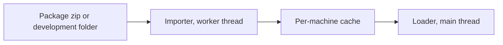
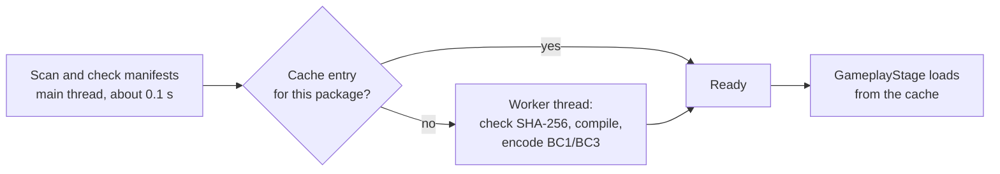

# Package format v1

Status: **frozen** (PACKAGING-PLAN step 3, part 1). This document is the reference for venue, character, and library packages. The JSON Schemas are in [`schemas/`](../schemas). The validator is `pipeline/package/validate.py`. The converter is `pipeline/package/build.py` ([section 19](#19-converter)). The C# importer is `src/Packages/` ([section 20](#20-c-importer)).

The words "must" and "must not" give rules. The validator reports a rule failure as an error. "Should" gives a recommendation. The validator reports it as a warning.

## 1. Overview

A package is one zip file. It holds glTF 2.0 binary files (GLB), JSON files, PNG images, and other data files. Package data is the same on Linux, Windows, and macOS. Only the per-machine cache holds platform-specific data.



| Kind | Extension | `format` | Contents |
|---|---|---|---|
| Venue | `.chstage` | `chstage/1.0` | `stage.glb`, cameras, lighting, scripts, placements, actors |
| Character | `.chchar` | `chchar/1.0` | One skinned GLB on a fixed GH3 rig profile, `character.json` |
| Library | `.chlib` | `chlib/1.0` | The shared GH3 band, crowd, clips, audio, movies, particle textures, and song direction |

The extension selects the kind. The `format` field in `manifest.json` must agree with the extension.

## 2. Container

### 2.1 Zip rules

- The package is a standard zip file. Zip64 is permitted. Readers must support it.
- Each entry uses STORE (method 0) or DEFLATE (method 8). Other methods, encryption, and multi-part archives are not permitted.
- `manifest.json` is at the root of the zip.
- Directory entries are permitted and ignored. Symbolic links are not permitted.
- Each file occurs one time. Two paths must not differ only in letter case (Windows and macOS file systems ignore case).

### 2.2 Paths

All references in a package use package paths:

- Relative to the package root, with `/` as the separator.
- Each segment uses `A`–`Z`, `a`–`z`, `0`–`9`, `_`, `-`, and `.`. A segment must not start with `.` or end with `.`.
- Windows device names (`con`, `nul`, `com1`, and so on) are not permitted as segments.
- Maximum 240 bytes.

These rules make the paths safe on all three platforms. They also prevent paths outside the package (`..`).

### 2.3 Compression for each file type

| File type | Method | Reason |
|---|---|---|
| `.glb` | STORE | Decision of section 4.1 of the plan (see [open question O1](#171-for-the-orchestrator-or-the-owner)) |
| `.png` | STORE | Already compressed |
| `.q48.br` | STORE | Already compressed (Brotli) |
| `.ogg`, `.mp3` | STORE | Already compressed |
| `.json`, `.wav` | DEFLATE | Compresses well |
| Other | DEFLATE | — |

A different method is not an error. The validator gives a warning.

### 2.4 Development folders

For development, a folder can replace the zip. The folder name ends with the package extension, for example `my-stage.chstage/`. The folder contents are the same as the zip contents. In a folder, `manifest.json` can have an empty `files` object. Then the validator does not check hashes (warning). The cache key of a folder comes from its file contents (see [section 14](#14-cache)).

## 3. `manifest.json`

Schema: [`schemas/manifest.schema.json`](../schemas/manifest.schema.json).

| Field | Required | Meaning |
|---|---|---|
| `format` | Yes | `<kind>/<major>.<minor>`, for example `chstage/1.0` |
| `id` | Yes | Stable package ID: lowercase letters, digits, `.`, and `-`; 1–96 characters, for example `author.my-stage`. The ID does not change between versions |
| `version` | Yes | Semantic version 2.0.0 of the package, for example `1.2.0` |
| `name` | Yes | Display name, 1–128 characters |
| `description` | No | Text, maximum 4,000 characters |
| `authors` | Yes | 1–64 objects: `name` (required), `role`, `url` (`https://` or `mailto:`) |
| `license` | Yes | SPDX license expression, for example `CC-BY-4.0`. Use `LicenseRef-<name>` for other licenses |
| `permissions` | Yes | `redistribute`, `modify`, `commercial`: booleans. They give the author's permissions in a form that the game can show |
| `credits` | No | Text lines for other contributors and sources |
| `homepage` | No | `https://` URL |
| `requires` | No | Packages that this package needs: `id` and the lowest compatible `version` (see [section 4](#4-versions-and-compatibility)). Venues and characters should require `gh3-band-v1` |
| `entry` | Yes | Role names to package paths. The keys depend on the kind (see sections 8–10) |
| `files` | Yes | Package path to `sha256` (64 lowercase hex characters) and `size` (bytes) for each file of the package, except `manifest.json` |
| `minModVersion` | No | Lowest mod version (semantic version) that can load the package |
| `preview` | No | Package path of a PNG image, maximum 1024 × 1024. Recommended: 512 × 288 (16:9) |

Rules:

- A zip package lists every file in `files`. A file that is not listed, a listed file that is missing, a wrong size, or a wrong hash is an error.
- Unknown fields are errors.
- JSON files use UTF-8. Numbers are finite (no `NaN` or `Infinity`).

Example (venue):

```json
{
  "format": "chstage/1.0",
  "id": "gh3.dive",
  "version": "1.0.0",
  "name": "Mitch's Moose Lounge",
  "authors": [{"name": "Neversoft", "role": "original venue"}],
  "license": "LicenseRef-GH3-Derived",
  "permissions": {"redistribute": true, "modify": false, "commercial": false},
  "requires": [{"id": "gh3-band-v1", "version": "1.0.0"}],
  "entry": {"model": "stage.glb", "placements": "placements.json", "cameras": "cameras.json",
            "lighting": "lighting.json", "scripts": "scripts.json", "actors": "actors.json"},
  "files": {"stage.glb": {"sha256": "…", "size": 86000000}},
  "preview": "preview.png"
}
```

## 4. Versions and compatibility

| Item | Rule |
|---|---|
| Format major (`chstage/1`) | An incompatible change gives a new major. The mod rejects a major that it does not know |
| Format minor (`chstage/1.0`) | A new minor only adds optional fields, files, or extras. A mod that knows minor *n* reads all packages with minor ≤ *n*. It rejects a higher minor with the message "needs a newer mod" |
| Package `version` | The author increments it for each release. With two packages of one `id`, the mod uses the higher version |
| `requires[].version` | Satisfied by an installed package with the same `id`, the same major version, and a version that is not lower |
| `minModVersion` | The mod rejects the package when the mod version is lower |
| Library ID | `gh3-band-v1` names the library contract (rigs, clip IDs, action tables). An incompatible library change gives a new ID (`gh3-band-v2`), not only a new version |
| Schemas | Each schema file belongs to format major 1. A new minor can add properties to a schema. It does not remove or change them |

Unknown fields are errors at the known minor. This finds spelling errors early. A newer minor that adds fields also increments the minor in `format`, so an older mod gives the clear "newer mod" message.

## 5. Coordinates and units

- Units are metres and seconds. Angles in JSON are degrees.
- GLB files use glTF coordinates (right-handed, Y up, +Z forward).
- JSON sidecars use the Unity runtime coordinates of the mod (left-handed, Y up). The conversion from glTF negates Z of positions and X and Y of quaternions.
- Quaternions are `[x, y, z, w]` with unit length (tolerance 0.001).
- The GLB extras `gh3ObjectPivot` and `gh3ObjectRotation` use the Unity runtime coordinates, as the JSON sidecars do.

## 6. GLB rules

These rules apply to every GLB in a package.

### 6.1 Structure

- glTF 2.0 binary: a JSON chunk and at most one binary chunk. `asset.version` is `"2.0"`.
- One buffer, embedded in the binary chunk. External URIs are not permitted.
- Images are embedded (`bufferView`) with `mimeType` `image/png`.
- Meshes are triangle lists (mode 4). `POSITION` and `NORMAL` are required.
- Sparse accessors are not permitted. Maximum 10,000,000 elements in each accessor.
- The importer reads the node hierarchy, `matrix` or TRS transforms, and all scene root nodes.

### 6.2 Extensions

| Extension | v1 |
|---|---|
| `KHR_materials_unlit` | Read. It gives `unlit` shading when `gh3Shading` is absent |
| `KHR_lights_punctual`, `KHR_materials_emissive_strength`, `KHR_texture_transform`, others | Ignored (warning). Lighting comes from `lighting.json` |
| `EXT_meshopt_compression`, `KHR_draco_mesh_compression`, `KHR_texture_basisu` | Not permitted in v1 |
| Any entry in `extensionsRequired` | Not permitted in v1 |

### 6.3 Vertex attributes

| Attribute | Static scenery | Skinned (actors, characters, library) | Meaning |
|---|---|---|---|
| `POSITION`, `NORMAL` | Required | Required | — |
| `TEXCOORD_0` | Optional | Optional | Base color UV |
| `TEXCOORD_1` | Optional | — | Lightmap UV (`occlusionTexture`, `texCoord` 1) |
| `TEXCOORD_2`, `TEXCOORD_3` | Optional | — | Layer UV, mask UV |
| `COLOR_0` | Optional | Optional | Float or normalized integer, VEC3 or VEC4 |
| `JOINTS_0`, `WEIGHTS_0` | — | Required | Maximum four influences. Weights are not negative and their sum is 1 (tolerance 0.001) |
| `_GH3_UV0` … `_GH3_UV5`, `_GH3_BINORMAL` | Optional | Optional | Original GH3 streams for GH3 material templates |
| `_GH3_POSITION1`, `_GH3_BINORMAL1` | Optional | — | Original GH3 streams |
| `_GH3_TANGENT` | — | Optional | Original GH3 stream |

The importer ignores other attributes (warning). Morph targets are permitted only in character GLBs.

### 6.4 Node extras

Keys that start with `gh3` are reserved. An unknown `gh3` key is an error (this finds spelling errors). The importer ignores other keys, for example other Blender custom properties. Schema: [`schemas/glb-extras.schema.json`](../schemas/glb-extras.schema.json), `$defs/node`.

| Key | Type | Meaning |
|---|---|---|
| `gh3LightGroup` | string | Stage-local light group. Default `Stage`; `Band` lights the performers |
| `gh3VisibilityGroup` | string | Group that the runtime shows and hides; `crowd-lighters` gets crowd lighter commands |
| `gh3InitiallyVisible` | boolean | Start state, default `true`. All meshes of one group have the same start state |
| `gh3FixtureId` | string | Movable light housing for this lighting beam ID. Local +Z is the beam axis |
| `gh3FixtureFixedPosition` | boolean | Keep the housing position while the controller turns it |
| `gh3FixtureObject` | string | Script object name of the housing |
| `gh3FixtureCreated` | boolean | Start state of the housing object |
| `gh3Object` | string | Script object name (or `0x` and 8 hex digits) |
| `gh3ObjectPivot` | [x, y, z] | Object pivot (runtime coordinates) |
| `gh3ObjectRotation` | [x, y, z, w] | Object rotation (runtime coordinates) |
| `gh3ObjectCreated` | boolean | Object start state |
| `gh3ObjectScript` | string | Startup script of the object |

### 6.5 Material extras

Schema: `$defs/material` in the same file.

| Key | Type | Meaning |
|---|---|---|
| `gh3Shading` | `lit`, `ambient`, `unlit` | Stage surface model |
| `gh3Additive` | boolean | Additive transparency |
| `gh3AlphaCutoff` | 0–1 | Alpha test for `BLEND` materials |
| `gh3SortedTransparency` | boolean | Sort the triangles of a skinned transparent material |
| `gh3CrowdAtlas` | boolean | Shared animated crowd atlas (8 columns, 3 rows) |
| `gh3CrowdRole` | `crowd1`–`crowd8` | Crowd card role |
| `gh3Billboard` | boolean | Camera-facing card |
| `gh3ColorScale` | 1–1000 | Multiplier for `baseColorFactor` (glTF limits the factor to 1) |
| `gh3MovieSlot` | −1–31 | Movie texture slot |
| `gh3TextureAnimation` | object | Flipbook: `columns`, `rows`, `fps`, `offset` |
| `gh3UvWibble` | 11 numbers | GH3 UV animation parameters |
| `gh3MaskTexture` | texture reference | Mask texture (UV `TEXCOORD_3`) |
| `gh3LayerTexture` | texture reference | Layer texture (UV `TEXCOORD_2`); needs `gh3LayerColor` |
| `gh3LayerColor` | 4 numbers | Layer color |
| `gh3SourceMaterial` | string | Original material name (identity for scripts) |
| `gh3Shader` | object | Original GH3 material record: `template` (8 hex digits), `vertexConstants` and `pixelConstants` (maximum 64 rows of 4 numbers), `textures` (maximum 16 texture references), `addressing` (one value for each texture), `flags`, `blend` (0–12), `alphaRef` (0–255), `drawOrder` |

Standard glTF material data stays standard: `baseColorTexture` (texture coordinate 0), `baseColorFactor`, `alphaMode` (`OPAQUE`, `MASK`, `BLEND`), `alphaCutoff`, `doubleSided`, and `occlusionTexture` as the lightmap (texture coordinate 1).

A `gh3Shader.template` that the installed mod does not have uses the stage surface model. The package does not contain shaders.

### 6.6 Texture references

A texture reference in extras is a string:

| Value | Meaning |
|---|---|
| `""` | No texture |
| `#<name>` | The image with this `name` in the same GLB. Image names in one GLB are unique |
| `<package path>.png` | A PNG file in the package |

**A texture reference must not be a glTF texture or image index.** Blender renumbers textures on export and drops images that no material slot uses (spike result 9.6). Thus the Blender add-on writes sampler-only textures as package files. The pipeline GLB writer (`GlbWriter`) names every image (the GH3 texture checksum, for example `1a52a814`) and writes `#<name>`.

`#<name>` refers to an image, not to a glTF texture: the image does not need a glTF `textures` entry. Both compilers (`pipeline/stagepack/pack.py` and the C# `StageCompiler`) use the runtime texture name of the first glTF texture of the image when there is one (so the compiled GH3 venues do not change), and else the checksum of `image-<image index>`.

### 6.7 Animation channels and the unit-scale rule

- Channels target skin joints with `translation` or `rotation`, and `LINEAR` or `STEP` interpolation. `CUBICSPLINE` and `weights` channels are not permitted.
- **Unit-scale rule:** a `scale` channel is permitted when every key is within 1e-4 of 1 on each axis. The importer drops it. Other scale keys are errors. (Blender writes a constant scale channel for each joint.)
- Maximum 256 clips for each GLB; clip names are unique. Actor clips are at most 120 s long.

## 7. Textures

- Packages ship PNG files only: 8 bits for each channel (or an 8-bit palette), not interlaced, 1 to 4096 pixels on each side.
- The importer makes the GPU format on the player's machine (BC1 for opaque, BC3 for alpha, with mipmaps). Power-of-two sizes are not required. A size that is not a multiple of 4 uses RGBA32 in the cache.
- The color space is sRGB. Clone Hero uses Gamma color space.
- References are image names or package paths (see [section 6.6](#66-texture-references)).

## 8. Venue (`.chstage`)

### 8.1 Files

| `entry` key | Required | Schema | Contents |
|---|---|---|---|
| `model` | Yes | GLB rules | Static scenery, materials, node extras, fixtures |
| `placements` | Yes | [`placements.schema.json`](../schemas/placements.schema.json) | `band` (1–4 roles), `waypoints`, `effects`, `crowd` |
| `cameras` | Yes | [`cameras.schema.json`](../schemas/cameras.schema.json) | Shots, groups, and GH3 camera note selectors |
| `lighting` | No | [`lighting.schema.json`](../schemas/lighting.schema.json) | Lights, snapshots, moods, color presets. Absent: the basic fill-light preset |
| `scripts` | No | [`scripts.schema.json`](../schemas/scripts.schema.json) | Typed script bank |
| `actors` | No | [`actors.schema.json`](../schemas/actors.schema.json) | Animated scenery. Each actor has its own skinned GLB |

The field meanings are the same as in [CUSTOM-CONTENT.md, section 5](CUSTOM-CONTENT.md#5-stage-pack). The package format moves the identity fields of `stage-pack.json` into `manifest.json`. It splits the other fields into `placements.json` and `actors.json`:

| Current `stage-pack.json` field | Package v1 |
|---|---|
| `version`, `kind`, `id`, `name`, `library` | `manifest.json`: `format`, `id`, `name`, `requires` |
| `model`, `cameras`, `lighting`, `scripts` | `manifest.json` `entry` |
| `band`, `waypoints`, `effects`, `crowd` | `placements.json` (with `version: 1`) |
| `actors` | `actors.json` (`{"version": 1, "actors": {…}}`) |
| `source-report.json` (pipeline report) | Not in the package |

### 8.2 Rules in addition to the schemas

- Every shot in `groups` exists. The `wide` group has a shot without `waypoints`.
- Shot `waypoints` refer to `placements` waypoints or the reserved `<role>_start` names.
- Camera anchors and `lookAt` targets refer to roles in `band`.
- Keyframe `times` start at 0, increase, and have one entry for each point.
- Camera note selectors refer to existing groups.
- Light IDs are unique. Each snapshot lists every light, in the order of `lights`. All snapshots have the same beam IDs. Moods refer to existing snapshots. `intro` and `blackout` are required.
- Each `gh3FixtureId` in the stage GLB is a beam ID in `lighting.json`, one time only.
- The stage GLB has no skins and no animations. Skinned or animated scenery is an actor.
- Actor GLBs have one skin, inverse bind matrices that agree with the joints (1e-4), and the clip names that `clip` and `actions` use.
- Script `textures` and `movies` refer to package files.

## 9. Character (`.chchar`)

### 9.1 Files

| `entry` key | Contents |
|---|---|
| `model` | One skinned GLB |
| `character` | `character.json` ([schema](../schemas/character.schema.json)) |

`character.json`:

| Field | Required | Meaning |
|---|---|---|
| `version` | Yes | `1` |
| `library` | Yes | `gh3-band-v1` |
| `profile` | Yes | `gh3-guitarist-axel-v1`, `gh3-bassist-v1`, `gh3-singer-male-v1`, or `gh3-drummer-v1`. The profile also selects the band role |
| `hairMaterials` | No | GLB material names with sorted hair transparency |
| `attachments` | No | `instrument`: a library model ID. Absent: the profile default. The v1 library has one instrument for each profile. **Mod 0.9.8 does not use this field** (warning): the library models contain their instrument in the same mesh, so the character GLB must contain its instrument (see [section 20.6](#206-characters)) |

### 9.2 GLB rules

- One skin. All mesh nodes use it. Inverse bind matrices are required.
- Joints map to GH3 bones **by name**: `bone-<8 hex digits>` (the GH3 checksum) or the GH3 bone name. Joint order and vertex order are free.
- The skin contains every joint of the profile and no other joints, with the profile parents.
- Nodes above the root joint (for example the Blender `Armature` node) have the identity transform (1e-4).
- Maximum four influences for each vertex. Blend shapes (morph targets) are optional. Mod 0.9.8 accepts them but does not animate them (warning): the GH3 clips move the face with bones.
- Animations in the GLB are ignored (warning). The library supplies the clips.

### 9.3 Tolerances (spike result 9.6)

| Check | Limit | Good Blender export (measured) | Wrong export (measured) |
|---|---|---|---|
| Joint local position against the profile | 0.1 mm | 0.0007 mm | 360–1,860 mm |
| Joint local rotation against the profile | 0.01° | 0.0004° | 90–180° |
| Joint scale | \|scale − 1\| ≤ 1e-4 | 3.5e-6 | — |
| `world(joint) · IBM − world(mesh node)` | 1e-4 | 7e-7 | 2.0–2.2 |

After the check, the importer uses the profile local transforms for clip playback and the GLB inverse bind matrices for skinning.

## 10. Library (`.chlib`)

The library has the ID `gh3-band-v1`. The release ships it. Venues and characters require it.

| `entry` key | Required | Path in the package | Contents |
|---|---|---|---|
| `catalog` | Yes | `catalog.json` | For each role: bones, groups, layers, clips |
| `band` | Yes | `band/band.json` | Members, models, instruments, start clips |
| `performance` | Yes | `direction/performance.json` | Action tables, blend rules, constants, bones |
| `hair` | No | `band/hair.json` | Hair physics |
| `crowd` | No | `crowd/crowd.json` | Crowd models, groups, hands, clips |
| `handFire` | No | `hand-fire/hand-fire.json` | Hand-fire emitters |
| `audio` | No | `audio/audio.json` | Sound definitions, samples, count-offs |
| `scripts` | No | `scripts.json` | Global typed script bank, particle textures, movies |
| `songs` | No | `songs/index.json` | Original song direction |

Other files have fixed paths:

| Path | Format |
|---|---|
| `band/<role>/model.glb` | Skinned GLB of the band member with its instrument. Its joints are the profile rig |
| `crowd/<model>/model.glb`, `crowd/hands/<name>/model.glb` | Skinned GLB |
| `direction/<role>/<clip>.q48.br`, `crowd/clips/<clip>.q48.br` | Clip in q48 + Brotli ([section 11](#11-clip-encoding-q48)) |
| `audio/<sample>.wav`, `.ogg`, or `.mp3` | Sound sample ([section 12](#12-audio-and-movies)) |
| `movies/<name>/movie.json`, `movies/<name>/frames/<NNNNNN>.png` | Movie ([section 12](#12-audio-and-movies)) |
| `particle-textures/<id>.png` | Particle textures |
| `hand-fire/*.png` | Hand-fire textures |
| `effects/particle-materials.json`, `effects/tesla-material.json`, `effects/tesla-noise.png` | Shader-independent effect data |
| `songs/<song>.json` | Original song direction (`stage-events.json` version 1 layout) |

The library does **not** contain shader bundles (`render/*.bundle`) or `render/stage-templates.json`. They depend on the graphics API and the Unity version. The mod installation supplies them for each platform.

The library JSON files keep their current layouts (written by `pipeline.library`). Only file references change: `.bin.gz` clips become `.q48.br`, `.gh3video` movies become `movie.json`, and `.pcm.gz` samples become audio files.

| File | Schema |
|---|---|
| `catalog.json` | [`catalog.schema.json`](../schemas/catalog.schema.json) |
| `band/band.json` | [`band.schema.json`](../schemas/band.schema.json) |
| `direction/performance.json` | [`performance.schema.json`](../schemas/performance.schema.json) |
| `band/hair.json` | [`hair.schema.json`](../schemas/hair.schema.json) |
| `crowd/crowd.json` | [`crowd.schema.json`](../schemas/crowd.schema.json) (layout version 2) |
| `hand-fire/hand-fire.json` | [`hand-fire.schema.json`](../schemas/hand-fire.schema.json) |
| `audio/audio.json` | [`audio.schema.json`](../schemas/audio.schema.json) |
| `scripts.json` | [`scripts.schema.json`](../schemas/scripts.schema.json) |
| `songs/index.json`, `songs/<song>.json` | [`songs.schema.json`](../schemas/songs.schema.json), [`song.schema.json`](../schemas/song.schema.json) |
| `movies/<name>/movie.json` | [`movie.schema.json`](../schemas/movie.schema.json) |
| `effects/particle-materials.json`, `effects/tesla-material.json` | [`particle-materials.schema.json`](../schemas/particle-materials.schema.json), [`tesla-material.schema.json`](../schemas/tesla-material.schema.json) |

Shared definitions are in [`library-common.schema.json`](../schemas/library-common.schema.json). The validator also checks that the files that the JSON files name exist: clips (`direction/<role>/<clip>.q48.br`, `crowd/clips/<clip>.q48.br`), models, audio samples, hand-fire textures, songs, and all movie frames.

Library model GLBs (`band/<role>/model.glb`, `crowd/…/model.glb`):

- The joints are the rig, named `bone-<checksum>`, in rig order. The GLB has the bind pose and the start clips of `band.json` `clips` (or `crowd.json` `clips`) as animations with these names. The crowd hand models use the crowd rig without animations.
- Each material keeps the raw GH3 blend value in `gh3Shader.blend`. The importer takes `blend` from `gh3Shader.blend` when the record is present (section 17.2), and the cutoff from `alphaCutoff` (`MASK`) or `gh3AlphaCutoff` (`BLEND`). `color` is `baseColorFactor` × `gh3ColorScale`.
- The GLB also holds the materials that no mesh uses, so that the importer can write the full material table.

## 11. Clip encoding q48

A clip file `<clip>.q48.br` is one Brotli stream (quality 11, window 24 recommended). The decompressed data has the layout below. All values are little-endian. The layout is the `GH3CLQ01` layout of the clip spike ([docs/spike/clips.md](spike/clips.md)). The reference encoder and decoder are in `pipeline/package/q48.py`.

### 11.1 Layout

| Offset | Type | Field |
|---|---|---|
| 0 | 8 bytes | Magic `GH3CLQ01` |
| 8 | u8 | `bits`: bits for each rotation component; 15 in q48 |
| 9 | u8 | `bones`: bone count of the rig (1–255) |
| 10 | u16 | `frames`: frame count (1–65535) |
| 12 | u16 | `tracks`: track count (1–65535) |
| 14 | f32 | `duration` in seconds |
| 18 | 3 bytes × `tracks` | Track table: `bone` (u8, less than `bones`, unique), `mask` (u8), `flags` (u8) |
| … | blocks | Position blocks of all tracks with mask bit 0, in track order |
| … | blocks | Rotation blocks of all tracks with mask bit 1, in track order |

The data ends after the last block. Extra bytes are an error.

| Bit | `mask` | `flags` |
|---|---|---|
| 0 (1) | Track has positions | Position is constant |
| 1 (2) | Track has rotations | Rotation is constant |

`mask` is 1, 2, or 3. A `flags` bit is set only when the same `mask` bit is set.

### 11.2 Blocks

| Block | Bytes | Contents |
|---|---|---|
| Constant position | 12 | x, y, z as f32 |
| Animated position | 24 + 6 × `frames` | `low` x, y, z (f32), `scale` x, y, z (f32), then three planes (x, y, z) of `frames` u16 values |
| Constant rotation | 16 | x, y, z, w as f32 |
| Animated rotation | 7 × `frames` | One plane of `frames` u8 index values, then three planes of `frames` u16 values |

Each u16 plane is delta-coded: the stored value *s*ᵢ is (*v*ᵢ − *v*ᵢ₋₁) mod 65536, with *v*₋₁ = 0. The decoder restores *v*ᵢ = (*v*ᵢ₋₁ + *s*ᵢ) mod 65536.

### 11.3 Quantization

Positions (each axis *a*, over all frames of the track):

- `low[a]` = minimum, `high[a]` = maximum.
- `scale[a]` = (`high[a]` − `low[a]`) / 65535, or 1 when `high[a]` = `low[a]`.
- Encode: *v* = round((*p* − `low`) / `scale`). Decode: *p* = `low` + *v* × `scale`.
- A track whose positions are all equal is constant.

Rotations (smallest three, *T* = 2^`bits` − 1):

- Normalize the quaternion *q* = (x, y, z, w). The index *k* (0–3, for x, y, z, w) is the component with the largest absolute value. If *q*ₖ < 0, negate *q*.
- The other three components, in ascending component order, are *c*ⱼ. Encode: *v*ⱼ = clamp(round((*c*ⱼ / √½ + 1) / 2 × *T*), 0, *T*).
- Decode: *c*ⱼ = (*v*ⱼ / *T* × 2 − 1) × √½; *q*ₖ = √max(0, 1 − Σ *c*ⱼ²); then normalize.
- A track whose encoded index and values are equal in all frames is constant. It stores the float rotation of frame 0. The decoder normalizes it.
- The encoder can flip the sign between frames. The sampler must use the shortest path (Unity `Quaternion.Slerp` does this).

### 11.4 Time and coordinates

- Frames are dense at 30 frames per second: `frames` = round(`duration` × 30) + 1. Frame *f* is at time *f* × `duration` / (`frames` − 1).
- Values are local bone transforms in Unity runtime coordinates and metres, as in the current `GH3CLP01` clips.
- A channel that is not in `mask` decodes as position 0 and identity rotation. The player uses `mask` to ignore it.

Measured error (spike): 0.0072° maximum rotation error, 0.03 cm maximum fingertip error. The reference decoder in this repository gives 0.0068° maximum against the current clips (219 clips checked).

## 12. Audio and movies

### 12.1 Audio

- Package audio files are WAV (PCM, 16-bit, 1 or 2 channels), Ogg Vorbis, or MP3. The importer decodes them with Clone Hero's BASS library into PCM in the cache.
- `audio/audio.json` keeps its current fields. Each `samples` entry gets `file`, the package path of the sample. Loop points stay in sample frames of the decoded audio.

### 12.2 Movies

- A movie is a folder: `movie.json` and the frames `frames/000000.png`, `frames/000001.png`, and so on (six digits, from 0, without gaps).
- `movie.json`: `{"version": 1, "width": …, "height": …, "frames": …, "rate": [numerator, denominator]}`. Width and height are 1–4096. The frame count is 1–100,000.
- All frames have the size in `movie.json`. This is the content of the current `GH3VID01` file without the container.

## 13. Folders and discovery

- User packages: `Custom/Stages/` and `Custom/Characters/` in each folder of `GlobalVariables.uniqueCustomContentPaths` (this includes portable mode and `custom_content_directories`). Do not use a fixed path.
- Group subfolders are permitted, to a depth of 4.
- Packages that the mod release ships (the GH3 venues and the library): `<game>/Mods/GH3Skin/Packages/`.
- The extension selects the kind, not the folder. A `.chchar` file in `Custom/Stages/` loads as a character, with a warning.
- With two packages of one `id`, the mod uses the higher version. With equal versions, the first in scan order wins: the `Custom` folders in the order of `uniqueCustomContentPaths`, then the mod folder. The mod logs the other package.

## 14. Cache

The importer converts a package one time and writes a per-machine cache.

- Location: `<MelonLoader UserData>/GH3Skin/Cache/<key>/`.
- Key: `<sha256>-i<importerVersion>`. `<sha256>` is the SHA-256 of the package zip file. For a development folder, it is the SHA-256 of the sorted lines `<path> <sha256 of file>\n` of all files.
- A new importer version gives a new key. The old cache folder becomes unused.
- **Cache content is platform-specific.** It can contain the GPU texture formats that this machine supports, compiled meshes (`GH3STG04`, `GH3BND02`), decoded or re-encoded clips, PCM audio, and compiled JSON. No package contains cache files.
- `cache.json` in each cache folder records the key, the platform, the graphics API, and the texture formats. The loader rebuilds the cache when they differ from the running game (for example a copied user folder or `-force-glcore` on Windows).
- The importer writes into a temporary folder and renames it when it is complete. A crash does not leave a partial cache.
- `index.json` in the cache root keeps the SHA-256 of each package with its size and time (zip) or with a signature of its file list (folder). A warm start reads only this index; it does not read the packages again.
- Cache layout (importer version 1): the runtime folders that the mod loaded before packages. A venue cache is a compiled stage folder (`pack.json`, `stage.json`, `meshes.bin` `GH3STG04`, `cameras.json`, `lighting.json`, `scripts.json`, `actors/`, `fixtures/`). A library cache is a library folder (`band/<role>/` and `crowd/…/` with `GH3BND02` meshes, `GH3ANM01` rigs, and `stage.json`; JSON files; `songs/`; `render/` with the effect files). Differences from the older install:

| Item | Cache file | Older install |
|---|---|---|
| Model textures | `textures/<name>.tex`: magic `GH3TEX01`, Unity `TextureFormat` (4 RGBA32, 10 BC1, 12 BC3), width, height, mip count (int32 each), then the full mip chain, largest first, rows bottom first | `textures/<name>.png` |
| Clips | `<clip>.q48.br`, copied from the package; decoded by the clip prefetch | `<clip>.bin.gz` (`GH3CLP01`) |
| Sounds | `audio/<sample>.pcm` (raw 16-bit PCM) | `audio/<sample>.pcm.gz` |
| Song direction | `songs/` in the library cache | `assets/stages/events/` |
| Shader bundles | Not in the cache: `Mods/GH3Skin/render/` | `libraries/gh3-band-v1/render/` |

## 15. Validation

```sh
MISE_QUIET=1 uv run --with numpy --with brotli python -m pipeline.package.validate PACKAGE [--library assets/libraries/gh3-band-v1]
```

- The validator reads a zip or a development folder. It checks the container, the paths, the manifest, the hashes, the schemas, the references, the GLB rules, and the extras. For a character, `--library` adds the profile rig check (section 9.3); the value is a library package (`gh3-band-v1.chlib`, the rig comes from `band/<role>/model.glb`) or the current library folder. For a library, it decodes all clips (needs the `brotli` module) and checks the library schemas and file references (section 10).
- `pipeline/package/schema.py` evaluates the schemas without third-party packages, so the Blender add-on can bundle the validator (`blender/build.py` copies `pipeline/package` and `schemas/`). The tests compare it with the `jsonschema` reference implementation.
- Dry conversion check of the current outputs: `python -m pipeline.package.sources --json report.json` (see [section 16](#16-mapping-of-the-current-pipeline-outputs)).

## 16. Mapping of the current pipeline outputs

`pipeline.package.sources` maps every source pack in `assets/stage-packs/` to the venue layout (section 8.1) without a change to the GLB files. Then it runs the validator. Result on 2026-10-09, before the converter (ten GH3 venues and `example.studio`):

| Item | Result |
|---|---|
| `placements.json`, `cameras.json`, `lighting.json`, `scripts.json`, `actors.json` | All valid against the schemas and the reference rules |
| Node extras, all other material extras, vertex attributes, images | All valid |
| Actor GLBs (29): skin, inverse bind matrices, clips | All valid |
| `example.studio` | Valid, no errors |
| Texture references as glTF indices | Did not map: 2,378 materials in the ten venues: `gh3Shader.textures` (2,272), `gh3MaskTexture` (76), `gh3LayerTexture` (30). **Resolved** in the GLB writer (section 19): 0 errors now |
| `source-report.json` | Not in the package (pipeline report) |

The character rule was checked on the Blender round-trip outputs of the spike (guitarist and singer, 15 variants each). The default bone mode, `.blend` save, frame rate, `nobind`, and `defbones` variants pass. `temperance`, `fortune`, `flatten`, `posed-frame`, and `zup` fail with the expected message. The `keep` variants fail only because of the spike probe extras `gh3Probe` and `gh3Role` (reserved prefix). Evidence: `/tmp/opencode/format-v1/characters.txt`.

The current library does not map file for file. Each part has a conversion step in `pipeline.package.build` (section 19):

| Current file | Package v1 | Status |
|---|---|---|
| `band/<role>/meshes.bin`, `animation.bin`, `stage.json`, `textures/` | `band/<role>/model.glb` | Done (`GlbWriter.actor`; see section 19.4 for the UV result) |
| `crowd/<model>/…`, `crowd/hands/<name>/…` | `model.glb` | Done |
| `direction/**/*.bin.gz`, `crowd/clips/*.bin.gz` (`GH3CLP01`, 1,240 files) | `*.q48.br` | Done. Added error as in section 11.4 |
| `audio/*.pcm.gz` (227) | `audio/*.wav` | Done: the current PCM in a WAV container (open question O4) |
| `movies/*.gh3video` (4) | `movies/<name>/` | Done (lossless) |
| `scripts.json` `movies` values (`.gh3video` paths) | `movie.json` paths | Done: 4 values change |
| `stage.json` material fields `textures` and `template` (85 materials) | Not mapped | The runtime does not read them. The `gh3Shader` record holds the same data |
| `render/particle-materials.json`, `tesla-material.json`, `tesla-noise.png` | `effects/` | Copied |
| `render/*.bundle`, `render/stage-templates.json` | Not in the package | Mod installation |
| `library.json` | `manifest.json` `files` | — |
| `assets/stages/events/` (original song direction, 169 MB) | `songs/` | Copied (not `export-report.json`, a pipeline report) |

## 17. Open questions

### 17.1 For the orchestrator or the owner

| # | Question | Data |
|---|---|---|
| O1 | Permit DEFLATE for `.glb`? The plan says STORE (the converter default, `pipeline/package/decisions.py`). | All source-pack GLBs: 550 MB stored, 299 MB with DEFLATE level 6. The PNG images are 196 MB of this; the mesh data compresses to about one third. The validator only warns, so the change is one line |
| O2 | License text for the GH3-derived packages (`LicenseRef-GH3-Derived`?) and the `permissions` values. The converter uses `LicenseRef-GH3-Derived`, redistribute yes, modify and commercial no. `example.studio` uses `CC0-1.0`. | Decision 1 accepts the IP risk |
| O3 | Library file extension `.chlib`. The plan names `.chstage` and `.chchar` only. The converter uses `.chlib`. | — |
| O4 | Audio in the library: the original MP3 data (smaller, as GH3 shipped it) or WAV of the current PCM (identical samples)? The converter writes WAV of the current PCM. | Current PCM gzip: 104 MB. WAV: 132.4 MB, 107.7 MB with DEFLATE 9 in the zip. MP3 size not measured. MP3 decoders can differ by a few samples at the start, which moves loop points |
| O5 | Movies stay PNG frames (357 MB today) or change to a video codec (smaller, but needs a decoder or Unity `VideoPlayer`)? The converter keeps the PNG frames. | Movies are 357 MB of the 658 MB library zip |
| O6 | Public URL for the schema `$id` values (now `https://schemas.gh3skin.invalid/v1/…`). | — |

### 17.2 For the converter

- Done: GLB image names and `#<name>` references; reproducible zips (section 19).
- Library band and crowd materials use the raw GH3 blend value (0–12) in `blend`. The stage material contract derives `blend` from `alphaMode` and `gh3Additive`. With a `gh3Shader` record, the importer must take the raw value from `gh3Shader.blend` for library models. The round trip (section 19.4) shows that this rule gives the current `stage.json` for all 85 library materials. The venue compiler (`pack.py`) still derives `blend` from `alphaMode` for venue materials; the C# importer must keep both rules.
- Done: `preview.png` for each venue. `scripts/capture-venue-previews.sh` captures GH3's intro of each venue in the game and writes `assets/previews/<id>.png` (512 × 288, 256 colours, 25–90 kB). The converter adds the image when it exists (`decisions.VENUE_PREVIEWS`).

### 17.3 For the C# importer (step 4)

- Done ([section 20](#20-c-importer)): `ZipArchive` reads the packages in the game (DEFLATE entries; the 658 MB library zip). Zip64 was not needed by the current packages and is not tested. The importer has its own GLB reader (`GlbDocument`) with the node hierarchy, extras, and materials. BC1/BC3 encoding runs on worker threads before the stage loads; the stage waits for the import of its package (it does not show RGBA32 first).
- Done: cache clean-up ([section 20.7](#207-cache-clean-up)). Open: development folders are hashed at start, but not watched while the game runs.

## 18. In-game check of Brotli

Question: does `System.IO.Compression.BrotliStream` work inside Clone Hero Linux, on a worker thread?

Method: the probe `src/Spike/BrotliSpike.cs` runs only with `GH3_SKIN_SPIKE=brotli`. It starts one `Task.Run` when the gameplay scene loads. It decodes the 356 guitarist clips of the clip spike in q48 + Brotli 11 and in q48 + gzip 9, and compares the bytes. `GH3_SKIN_SPIKE_CLIPS` points to a folder with the subfolders `brotli11/` and `gzip9/` (copies of `/tmp/opencode/spike-clips/full/variants/q48-*/guitarist`). Game: `~/games/clonehero-gh3-format-v1`, gh3.dive, mycurse-native, started with `scripts/record-preview.sh`.

| Pass | Clips | Byte mismatches | Brotli (all clips) | Brotli, one clip max | gzip 9 (all clips) | gzip 9, one clip max |
|---|---:|---:|---:|---:|---:|---:|
| 0 (cold) | 356 | 0 | 176.4 ms | 11.0 ms | 138.1 ms | 10.3 ms |
| 1 | 356 | 0 | 133.5 ms | 4.0 ms | 107.0 ms | 5.5 ms |
| 2 | 356 | 0 | 138.6 ms | 4.5 ms | 110.1 ms | 3.9 ms |

- Brotli works in the game on .NET 6.0.25 (thread 5, not the main thread). The decompressed bytes are equal to the gzip bytes for all clips.
- Sizes: raw 28.3 MB, Brotli 10.3 MB, gzip 9 12.3 MB.
- The times include the decompression only, not the q48 decode.
- **Decision: q48 + Brotli for v1.**
- Windows and macOS were not tested in the game. The Windows game copy (`~/games/clonehero-win-spike`) has the same MelonLoader .NET 6.0.25 runtime with `System.IO.Compression.Brotli.dll` and `System.IO.Compression.Native.dll` (file check only). macOS was not examined.

Evidence: `/tmp/opencode/format-v1/brotli-Latest.log`. A run without `GH3_SKIN_SPIKE` logs no probe line and draws the stage as before (`/tmp/opencode/format-v1/default-frame.png`, `default-Latest.log`).

## 19. Converter

`python -m pipeline.package.build` (the `packages` step of `scripts/regenerate.sh`) writes all packages to `assets/packages/`: `<id>.chstage` for each source pack, `gh3-band-v1.chlib`, and the same packages as development folders in `assets/packages/unpacked/`. The folder and the zip have the same files, with a full `files` list in `manifest.json`.

### 19.1 Texture references

The GLB writer (`pipeline/stagepack/gltf.py`, `GlbWriter.texture` and `reference`) gives each embedded image a unique `name`: the GH3 texture checksum, with `-1`, `-2` and so on when two different images have the same checksum. Extras use `#<name>`. The venue compiler (`pack.py`) reads `#<name>`, package paths, and (for older packs) glTF indices. It gives a named image the runtime texture name of its texture index, so the compiled packs do not change.

The fix is in the writer, not in a converter post-pass, for these reasons:

- The source packs in `assets/stage-packs/` are the creator-facing format. With the fix they are format v1 GLBs, and `pipeline.package.sources` gives 0 errors. A post-pass would keep two GLB dialects.
- The writer knows the texture checksum of each image. A post-pass sees only indices.
- The converter then copies the GLB bytes without a change, and refuses a GLB that still has index references ("export the source pack again").

Evidence: all ten venues were exported again. All 40 GLBs have the same binary chunk as before; the JSON chunks are equal after the names are mapped back to indices (1,276 images named, all unique). All 1,739 compiled files in `assets/stages` are byte-equal or JSON-equal to the files before the change. Only `pack.json` changes: its `sources` hashes of the GLBs, and the `cameras.json` hash of Credits and Soundcheck (key order, see 19.2).

### 19.2 Reproducible output

- Zip entries: `manifest.json` first, then the sorted paths; time 1980-01-01 00:00; Unix attributes `0644`; STORE or DEFLATE level 9 (`decisions.py`).
- JSON that the converter writes: two-space indent, UTF-8, key order of the source.
- The two old exceptions are fixed at their source: `pack.json` lists its files in sorted order, and the venue exporter sorts the camera arrays of Credits and Soundcheck (the order came from a Python set). An export of the two venues with two different `PYTHONHASHSEED` values gave byte-equal `cameras.json` files.
- Two full converter runs (the second with an empty clip cache and 3 processes) gave byte-equal packages.

### 19.3 Owner choices

`pipeline/package/decisions.py` holds every open choice of section 17.1: the zip method for each suffix (GLB and PNG STORE), the license and permissions, the library extension (`.chlib`), the audio format (`wav`: the current 16-bit PCM, decoded from the GH3 MP3 data by FFmpeg, in a WAV container, without re-encoding), and the movie format (`png-frames`).

### 19.4 Validation and round trip (2026-10-09)

All 12 packages (ten venues, `example.studio`, the library), as zip and as folder: **valid, 0 errors, 0 warnings**.

`python -m pipeline.package.roundtrip` converts each package back to the runtime files that the mod reads today and compares them with the current assets:

| Part | Method | Result |
|---|---|---|
| Venues (10 and `example.studio`) | Package → `stage-pack.json` and files → `compile_stage` → compare with `assets/stages/<id>` | All 1,738 compiled files byte-equal (one `example.studio/pack.json` JSON-equal: its file list was in file-system order) |
| Library JSON (catalog, band, hair, performance, crowd, hand fire, effects) | Bytes | Byte-equal |
| `scripts.json`, `audio/audio.json` | Map `movie.json` back to `.gh3video`, remove `file` | JSON-equal |
| Audio (227 samples) | WAV → PCM → gzip with the pipeline header | 227 byte-equal `.pcm.gz` files |
| Movies (4) | Frames → `GH3VID01` | Byte-equal |
| Particle and hand-fire textures, Tesla noise, songs (159 and `index.json`) | Bytes | Byte-equal |
| Band and crowd models (4 band, 10 crowd, 8 hands) | GLB → `meshes.bin`, `animation.bin`, `stage.json`, `textures/` | `animation.bin` byte-equal (bind pose and start clips), `stage.json` equal, textures byte-equal. `meshes.bin` byte-equal for 20 models. Guitarist and drummer: 159 of the 33,391 band vertices have a V coordinate that differs by at most 3.0e-8, because glTF stores 1 − v in float32 |
| Clips (1,138 band, 102 crowd) | q48 → `GH3CLP01` → compare the channels in the track mask | All within the bound: rotation 0.00715° maximum (bound 0.0075°), position 0.115 mm maximum, at most 0.99 of the half quantization step |

The rotation error uses the chord form 4 asin(|a − b| / 2). An `arccos` of the dot product in float32 gives up to 0.05° for the same data, which is only rounding.

Not carried into the library package, by design: the shader bundles and `render/stage-templates.json` (6 files, mod installation), `library.json` (replaced by `manifest.json` `files`), the 4 movie conversion stamps, 50 model textures that no material refers to (the runtime loads textures by material reference), and the `stage.json` material fields `textures`, `template`, and `geometryCutout` (173 values; the runtime does not read them). An explicit white `color` and an absent `color` draw the same (`StageAssets` keeps white), so the round trip treats them as equal (29 materials have an explicit white `color`; glTF writes no white `baseColorFactor`).

### 19.5 Sizes (MB, 10^6 bytes)

| Package | Folder | Zip |
|---|---:|---:|
| `gh3.artdeco` | 50.8 | 47.7 |
| `gh3.budokan` | 35.0 | 29.8 |
| `gh3.credits` | 6.2 | 6.0 |
| `gh3.dive` | 87.0 | 84.7 |
| `gh3.hell` | 213.6 | 211.6 |
| `gh3.party` | 45.9 | 44.1 |
| `gh3.prison` | 50.9 | 48.7 |
| `gh3.soundcheck` | 18.7 | 18.3 |
| `gh3.video` | 26.1 | 24.3 |
| `gh3.wikker` | 38.1 | 35.9 |
| `example.studio` | 0.05 | 0.05 |
| **Ten venues** (without `example.studio`) | **572.4** | **550.9** |
| **`gh3-band-v1.chlib`** | **856.9** | **658.1** |
| **Total** | **1,429.3** | **1,209.0** |

Library parts:

| Part | Files | Folder | Zip | Current library |
|---|---:|---:|---:|---:|
| Band clips (`direction/`, q48 + Brotli) | 1,138 | 121.1 | 121.1 | 455.7 (with `performance.json`) |
| Crowd clips | 102 | 0.8 | 0.8 | in `crowd/` |
| Band models (`band/`) | 6 | 19.9 | 19.9 | 19.4 |
| Crowd models and `crowd.json` | 19 | 5.0 | 4.9 | 9.1 (with clips) |
| Audio (WAV) | 228 | 132.4 | 107.7 | 108.4 |
| Movies (PNG frames) | 4,603 | 356.9 | 356.9 | 357.0 |
| Particle textures | 542 | 38.1 | 38.1 | 38.1 |
| Songs | 160 | 169.0 | 5.9 | 169.0 (`assets/stages/events`) |
| `scripts.json` | 1 | 12.1 | 1.2 | 12.1 |
| Other JSON, hand fire, effects, manifest | 9 | 1.7 | 0.4 | 1.0 (with `render/` bundles and `library.json`) |

## 20. C# importer

Step 4 of the plan, core part. The mod finds packages, checks them, converts each one to the cache (section 14), and loads the venue and the library from the cache. Code: `src/Packages/` (Unity-free, except `PackageRuntime.cs`).



### 20.1 Discovery and checks

- Folders: `Custom/Stages` and `Custom/Characters` of each `GlobalVariables.uniqueCustomContentPaths` entry (group subfolders to depth 4), then `Mods/GH3Skin/Packages/`. Zip files and development folders.
- Each bad package gives one warning line and is skipped: unknown or newer format (`needs a newer mod`), wrong extension for the format, newer `minModVersion`, a missing or unlisted file, a wrong size (at the scan), a wrong SHA-256 (at the import, `the package is damaged`), a missing required package (`requires gh3-band-v1 1.0.0 … which is not installed`), a failed import of the required library.
- With two packages of one ID, the higher version wins; with equal versions, the first in scan order.
- Characters (`.chchar`) import after the library ([section 20.6](#206-characters)).
- A venue package in a song folder (`venue.chstage`, [PLAYER-GUIDE.md](PLAYER-GUIDE.md#stages-that-a-song-selects)) is found when the song starts, checked as above, and imported first. It does not take part in the ID and version rules: the song uses its own package.
- `GH3_SKIN_PACKAGES=off` turns packages off (the older install only).

### 20.2 Import

- One package at a time, on one background thread (`GH3 package importer`), the library first, then the stage and the characters that a song waits for, then the player's stage (`GH3_SKIN_STAGE` or the picker choice), then the characters, then the others. The thread starts again when a song adds its venue package. Texture encoding uses up to 4 threads (half the cores). A warm start runs no import thread: the scan and the cache check run on the main thread.
- Venues: a C# port of `compile_stage` and `compile_actor` (`StageCompiler`, `StageGeometry`). Library: the C# side of `roundtrip.py` (`LibraryImporter`).
- Textures: PNG decode (all colour types, `tRNS`), box-filter mip chain, then BC1 (opaque) or BC3 (alpha) with a managed encoder written for this project (`BlockCompression`: principal axis, least-squares refinement, exact single colours). A size that is not a multiple of 4, a GPU without DXT1/DXT5 (`SystemInfo.SupportsTextureFormat`), or a first level under 36 dB PSNR (art that GH3 did not store as DXT) gives RGBA32.
- Not ported: the alpha-mask mesh trimming of `pipeline/gh3/mesh_cutout.py`. It applies only to unshaded materials without a GH3 record; no GH3 venue has one. The importer logs a warning for such a material and keeps the full mesh (the shader discards the same pixels).
- Clips: copied as q48 + Brotli. Decision by measurement: the decoded clips (GH3CLP01 float32) would be about 1 GB on disk against 121 MB; the q48 decode of a song set takes 30–85 ms on worker threads in the game (below), less than the gzip decode of the older install (348 ms).

### 20.3 Loader

- `GameplayStage` uses the cache folders when the stage package and its library are ready. While they import, the stage waits (up to 120 s, then the older install is used). Without a package, the older install (`assets/stages`, `assets/libraries`) is used.
- `StageAssets` uploads `.tex` files with `LoadRawTextureData` and `Apply(false, true)` (no decode on the main thread). All uploads are in the stage load frame: 364 textures of gh3.dive take 140–200 ms.
- Clip prefetch: `PerformancePlayer.Prepare` gives the song's clip set to `PerformanceClipCache`, which decodes it with `Parallel.ForEach` on worker threads. The main thread waits for it in the stage load (16–35 ms measured). A clip outside the set loads on the main thread with a warning (`clip … was not prefetched`), and the stage reset logs the count. The crowd prefetches all its performance clips (102).

- The importer copies the manifest `preview` image to `preview.png` in the cache folder of a venue or a character, for the picker.

### 20.4 Comparison with the Python pipeline

`tools/PackageImport` runs the importer outside the game; `python -m pipeline.package.cachecheck` compares its cache with the Python output (`assets/stages/<id>`, `assets/libraries/gh3-band-v1`, `assets/stages/events`), which `roundtrip.py` showed to be the Python conversion of the same packages. Result on 2026-10-09 (all 12 packages):

| Part | Result |
|---|---|
| Venues (10 and `example.studio`) | All equal: `meshes.bin`, `stage.json`, cameras, lighting, scripts, and fixtures byte-equal or JSON-equal. 11 actor meshes have equal values (a few zeros have the other sign, `-0.0`). 28 actor `animation.bin` files are within 3.3e-16 |
| Library JSON, effect files, particle and hand-fire textures, movies (`GH3VID01`), songs | Byte-equal or JSON-equal |
| Sounds | 227 of 227 PCM equal |
| Band and crowd models (22) | `meshes.bin` byte-equal except the guitarist and drummer UV (3.0e-8, as `roundtrip.py`), `animation.bin` and `stage.json` equal |
| Clips | 1,240 `.q48.br` byte-equal to the package. The C# decoder against the `GH3CLP01` clips of the older install (C# test, `GH3_PACKAGE_ASSETS`): 0.0068° and 0.108 mm maximum |
| Textures, RGBA32 cache (`--rgba`) | All 1,520 textures pixel-equal to the Python PNG files |
| Textures, BC1/BC3 cache | 1,120 BC1, 387 BC3, 13 RGBA32 (quality limit). PSNR of the first level: median 61.6–65.4 dB per package, minimum 36.5 dB. On the three worst textures, `etcpak` (the spike's native encoder) gives 28.1, 28.1, and 33.3 dB where this encoder gives 30.5 (now RGBA32), 40.5, and 47.6 dB |

### 20.5 Game measurements (Linux, 2026-10-09)

Game copy `~/games/clonehero-gh3-importer`, gh3.dive, mycurse-native, 1600 × 900. The PC had 13 of 15 GB RAM and 11 GB swap in use by other jobs, so the times vary.

| Measure | Packages (this importer) | `main` 18deb21, older install |
|---|---|---|
| Cold cache, import of all 12 packages | 23.5 s total on the background thread: library 4.1–4.3 s, gh3.dive 2.9–3.0 s, gh3.hell 4.9–5.1 s, others 0.2–2.6 s. The stage waits for the library and its own package only (7 s) | — |
| Scene loaded to stage loaded, warm | 2.09–2.38 s (8 runs, median 2.2 s) | 3.43–3.81 s (9 runs, median 3.5 s) |
| Stage load on the main thread, warm | 1.8–2.2 s; textures 140–200 ms | not logged (the same build with `GH3_SKIN_PACKAGES=off`: 3.1 s) |
| Clip decode | 157 band clips in 30–85 ms on workers; 0 main-thread clip loads during play | gzip on the main thread at load |
| Peak RSS, warm | 1,160–1,210 MB | 1,107–1,171 MB |
| Peak RSS during the cold import of all packages, with the stage loaded | 1,472 MB (the import thread alone: 495 MB peak working set in `tools/PackageImport`) | — |

Visual result: the dive recording from packages and from `main` agree (aligned videos: mean RGB difference 2.3–2.9 in 8 of 10 samples, up to 7.7 when the frame times differ). Screenshot pairs at the same song times differ as much as two `main` runs differ from each other (21–41 dB in both cases, from timing). `tools/audit-materials.py` on the cache gives the same 921 template materials as on `assets/stages`.

### 20.6 Characters

`CharacterImporter` converts a `.chchar` into a band model folder in the cache: `meshes.bin` (`GH3BND02`), `stage.json`, `textures/*.tex`, `character.json` (ID, profile, band role, joint names in skin order), and `bindposes.bin` (magic `GH3BPS01`, joint count, then a row-major 4 × 4 float32 matrix for each joint: the GLB inverse bind matrix in Unity coordinates). It needs the library cache for the profile rig.

| Step | Rule |
| --- | --- |
| Joints | Names `bone-<checksum>` or GH3 bone names. The set equals the profile rig of `catalog.json`, with the same parents |
| Rest pose | Local joint transforms against the profile bind pose of `band/<role>/animation.bin`: 0.1 mm, 0.01° (chord form), scale 1e-4. Nodes above the root joint have no transform |
| Bind | `world(joint) · IBM = world(mesh node)` within 1e-4 for each mesh node |
| Vertices | `POSITION`, `NORMAL`, `JOINTS_0`, `WEIGHTS_0` (float or normalized integer; sum 1 within 0.01, normalized again) required; `TEXCOORD_0`, `COLOR_0`, and the `_GH3_UV0`–`_GH3_UV5`, `_GH3_BINORMAL`, `_GH3_TANGENT` streams optional. A material with a `gh3Shader` record and a mesh without the streams uses the surface model (warning) |
| Materials | The library rules (`LibraryImporter`): `blend` from `gh3Shader.blend` when the record is present. `hairMaterials` add sorted transparency. Material and image names that are not 8 hex digits get checksum names |

A GH3 band member exported with `python -m pipeline.package.character` gives a cache that is byte-equal to the library member (`meshes.bin`, `stage.json`, and all textures; checked for the four members on 2026-10-09).

At load, `StageBand` maps the character joints to the rig of the band role by name. A character can play another role when that rig has all of its joints (the GH3 guitarist and bassist rigs have the same 125 bone names). The role's rig, clips, hair, IK, and hand fire drive the mesh; the GLB inverse bind matrices skin it (`StageAssets.Load(bindposes:)`), so the mesh follows the role's bone positions.

### 20.7 Cache clean-up

When all imports end (or at a warm start, on a worker thread), `PackageManager.CleanCache` deletes the cache folders that no package uses. It keeps the cache folder of each loaded package and the folder of each `index.json` entry whose package file still exists (so the cache of a song's `venue.chstage` stays while the song folder has it). It deletes other folders with the cache name pattern `<64 hex>-i<number>`, which includes all other importer versions, and removes the `index.json` entries of missing package files. It only deletes inside the cache root, never follows links, and leaves other folders.
