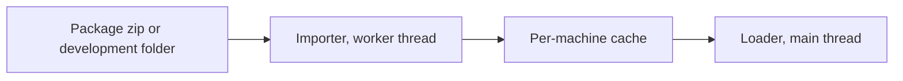

# Package format v1

Status: **frozen** (PACKAGING-PLAN step 3, part 1). This document is the reference for venue, character, and library packages. The JSON Schemas are in [`schemas/`](../schemas). The validator is `pipeline/package/validate.py`. The converter and the C# importer are not written yet (see [section 17](#17-open-questions)).

The words "must" and "must not" give rules. The validator reports a rule failure as an error. "Should" gives a recommendation. The validator reports it as a warning.

## 1. Overview

A package is one zip file. It holds glTF 2.0 binary files (GLB), JSON files, PNG images, and other data files. Package data is the same on Linux, Windows, and macOS. Only the per-machine cache holds platform-specific data.



| Kind | Extension | `format` | Contents |
|---|---|---|---|
| Venue | `.chstage` | `chstage/1.0` | `stage.glb`, cameras, lighting, scripts, placements, actors |
| Character | `.chchar` | `chchar/1.0` | One skinned GLB on a fixed GH3 rig profile, `character.json` |
| Library | `.chlib` | `chlib/1.0` | The shared GH3 band, crowd, clips, audio, movies, particle textures, and song direction |

The extension selects the kind. The `format` field in `manifest.json` must agree with the extension.

## 2. Container

### 2.1 Zip rules

- The package is a standard zip file. Zip64 is permitted. Readers must support it.
- Each entry uses STORE (method 0) or DEFLATE (method 8). Other methods, encryption, and multi-part archives are not permitted.
- `manifest.json` is at the root of the zip.
- Directory entries are permitted and ignored. Symbolic links are not permitted.
- Each file occurs one time. Two paths must not differ only in letter case (Windows and macOS file systems ignore case).

### 2.2 Paths

All references in a package use package paths:

- Relative to the package root, with `/` as the separator.
- Each segment uses `A`–`Z`, `a`–`z`, `0`–`9`, `_`, `-`, and `.`. A segment must not start with `.` or end with `.`.
- Windows device names (`con`, `nul`, `com1`, and so on) are not permitted as segments.
- Maximum 240 bytes.

These rules make the paths safe on all three platforms. They also prevent paths outside the package (`..`).

### 2.3 Compression for each file type

| File type | Method | Reason |
|---|---|---|
| `.glb` | STORE | Decision of section 4.1 of the plan (see [open question O1](#171-for-the-orchestrator-or-the-owner)) |
| `.png` | STORE | Already compressed |
| `.q48.br` | STORE | Already compressed (Brotli) |
| `.ogg`, `.mp3` | STORE | Already compressed |
| `.json`, `.wav` | DEFLATE | Compresses well |
| Other | DEFLATE | — |

A different method is not an error. The validator gives a warning.

### 2.4 Development folders

For development, a folder can replace the zip. The folder name ends with the package extension, for example `my-stage.chstage/`. The folder contents are the same as the zip contents. In a folder, `manifest.json` can have an empty `files` object. Then the validator does not check hashes (warning). The cache key of a folder comes from its file contents (see [section 14](#14-cache)).

## 3. `manifest.json`

Schema: [`schemas/manifest.schema.json`](../schemas/manifest.schema.json).

| Field | Required | Meaning |
|---|---|---|
| `format` | Yes | `<kind>/<major>.<minor>`, for example `chstage/1.0` |
| `id` | Yes | Stable package ID: lowercase letters, digits, `.`, and `-`; 1–96 characters, for example `author.my-stage`. The ID does not change between versions |
| `version` | Yes | Semantic version 2.0.0 of the package, for example `1.2.0` |
| `name` | Yes | Display name, 1–128 characters |
| `description` | No | Text, maximum 4,000 characters |
| `authors` | Yes | 1–64 objects: `name` (required), `role`, `url` (`https://` or `mailto:`) |
| `license` | Yes | SPDX license expression, for example `CC-BY-4.0`. Use `LicenseRef-<name>` for other licenses |
| `permissions` | Yes | `redistribute`, `modify`, `commercial`: booleans. They give the author's permissions in a form that the game can show |
| `credits` | No | Text lines for other contributors and sources |
| `homepage` | No | `https://` URL |
| `requires` | No | Packages that this package needs: `id` and the lowest compatible `version` (see [section 4](#4-versions-and-compatibility)). Venues and characters should require `gh3-band-v1` |
| `entry` | Yes | Role names to package paths. The keys depend on the kind (see sections 8–10) |
| `files` | Yes | Package path to `sha256` (64 lowercase hex characters) and `size` (bytes) for each file of the package, except `manifest.json` |
| `minModVersion` | No | Lowest mod version (semantic version) that can load the package |
| `preview` | No | Package path of a PNG image, maximum 1024 × 1024. Recommended: 512 × 288 (16:9) |

Rules:

- A zip package lists every file in `files`. A file that is not listed, a listed file that is missing, a wrong size, or a wrong hash is an error.
- Unknown fields are errors.
- JSON files use UTF-8. Numbers are finite (no `NaN` or `Infinity`).

Example (venue):

```json
{
  "format": "chstage/1.0",
  "id": "gh3.dive",
  "version": "1.0.0",
  "name": "Mitch's Moose Lounge",
  "authors": [{"name": "Neversoft", "role": "original venue"}],
  "license": "LicenseRef-GH3-Derived",
  "permissions": {"redistribute": true, "modify": false, "commercial": false},
  "requires": [{"id": "gh3-band-v1", "version": "1.0.0"}],
  "entry": {"model": "stage.glb", "placements": "placements.json", "cameras": "cameras.json",
            "lighting": "lighting.json", "scripts": "scripts.json", "actors": "actors.json"},
  "files": {"stage.glb": {"sha256": "…", "size": 86000000}},
  "preview": "preview.png"
}
```

## 4. Versions and compatibility

| Item | Rule |
|---|---|
| Format major (`chstage/1`) | An incompatible change gives a new major. The mod rejects a major that it does not know |
| Format minor (`chstage/1.0`) | A new minor only adds optional fields, files, or extras. A mod that knows minor *n* reads all packages with minor ≤ *n*. It rejects a higher minor with the message "needs a newer mod" |
| Package `version` | The author increments it for each release. With two packages of one `id`, the mod uses the higher version |
| `requires[].version` | Satisfied by an installed package with the same `id`, the same major version, and a version that is not lower |
| `minModVersion` | The mod rejects the package when the mod version is lower |
| Library ID | `gh3-band-v1` names the library contract (rigs, clip IDs, action tables). An incompatible library change gives a new ID (`gh3-band-v2`), not only a new version |
| Schemas | Each schema file belongs to format major 1. A new minor can add properties to a schema. It does not remove or change them |

Unknown fields are errors at the known minor. This finds spelling errors early. A newer minor that adds fields also increments the minor in `format`, so an older mod gives the clear "newer mod" message.

## 5. Coordinates and units

- Units are metres and seconds. Angles in JSON are degrees.
- GLB files use glTF coordinates (right-handed, Y up, +Z forward).
- JSON sidecars use the Unity runtime coordinates of the mod (left-handed, Y up). The conversion from glTF negates Z of positions and X and Y of quaternions.
- Quaternions are `[x, y, z, w]` with unit length (tolerance 0.001).
- The GLB extras `gh3ObjectPivot` and `gh3ObjectRotation` use the Unity runtime coordinates, as the JSON sidecars do.

## 6. GLB rules

These rules apply to every GLB in a package.

### 6.1 Structure

- glTF 2.0 binary: a JSON chunk and at most one binary chunk. `asset.version` is `"2.0"`.
- One buffer, embedded in the binary chunk. External URIs are not permitted.
- Images are embedded (`bufferView`) with `mimeType` `image/png`.
- Meshes are triangle lists (mode 4). `POSITION` and `NORMAL` are required.
- Sparse accessors are not permitted. Maximum 10,000,000 elements in each accessor.
- The importer reads the node hierarchy, `matrix` or TRS transforms, and all scene root nodes.

### 6.2 Extensions

| Extension | v1 |
|---|---|
| `KHR_materials_unlit` | Read. It gives `unlit` shading when `gh3Shading` is absent |
| `KHR_lights_punctual`, `KHR_materials_emissive_strength`, `KHR_texture_transform`, others | Ignored (warning). Lighting comes from `lighting.json` |
| `EXT_meshopt_compression`, `KHR_draco_mesh_compression`, `KHR_texture_basisu` | Not permitted in v1 |
| Any entry in `extensionsRequired` | Not permitted in v1 |

### 6.3 Vertex attributes

| Attribute | Static scenery | Skinned (actors, characters, library) | Meaning |
|---|---|---|---|
| `POSITION`, `NORMAL` | Required | Required | — |
| `TEXCOORD_0` | Optional | Optional | Base color UV |
| `TEXCOORD_1` | Optional | — | Lightmap UV (`occlusionTexture`, `texCoord` 1) |
| `TEXCOORD_2`, `TEXCOORD_3` | Optional | — | Layer UV, mask UV |
| `COLOR_0` | Optional | Optional | Float or normalized integer, VEC3 or VEC4 |
| `JOINTS_0`, `WEIGHTS_0` | — | Required | Maximum four influences. Weights are not negative and their sum is 1 (tolerance 0.001) |
| `_GH3_UV0` … `_GH3_UV5`, `_GH3_BINORMAL` | Optional | Optional | Original GH3 streams for GH3 material templates |
| `_GH3_POSITION1`, `_GH3_BINORMAL1` | Optional | — | Original GH3 streams |
| `_GH3_TANGENT` | — | Optional | Original GH3 stream |

The importer ignores other attributes (warning). Morph targets are permitted only in character GLBs.

### 6.4 Node extras

Keys that start with `gh3` are reserved. An unknown `gh3` key is an error (this finds spelling errors). The importer ignores other keys, for example other Blender custom properties. Schema: [`schemas/glb-extras.schema.json`](../schemas/glb-extras.schema.json), `$defs/node`.

| Key | Type | Meaning |
|---|---|---|
| `gh3LightGroup` | string | Stage-local light group. Default `Stage`; `Band` lights the performers |
| `gh3VisibilityGroup` | string | Group that the runtime shows and hides; `crowd-lighters` gets crowd lighter commands |
| `gh3InitiallyVisible` | boolean | Start state, default `true`. All meshes of one group have the same start state |
| `gh3FixtureId` | string | Movable light housing for this lighting beam ID. Local +Z is the beam axis |
| `gh3FixtureFixedPosition` | boolean | Keep the housing position while the controller turns it |
| `gh3FixtureObject` | string | Script object name of the housing |
| `gh3FixtureCreated` | boolean | Start state of the housing object |
| `gh3Object` | string | Script object name (or `0x` and 8 hex digits) |
| `gh3ObjectPivot` | [x, y, z] | Object pivot (runtime coordinates) |
| `gh3ObjectRotation` | [x, y, z, w] | Object rotation (runtime coordinates) |
| `gh3ObjectCreated` | boolean | Object start state |
| `gh3ObjectScript` | string | Startup script of the object |

### 6.5 Material extras

Schema: `$defs/material` in the same file.

| Key | Type | Meaning |
|---|---|---|
| `gh3Shading` | `lit`, `ambient`, `unlit` | Stage surface model |
| `gh3Additive` | boolean | Additive transparency |
| `gh3AlphaCutoff` | 0–1 | Alpha test for `BLEND` materials |
| `gh3SortedTransparency` | boolean | Sort the triangles of a skinned transparent material |
| `gh3CrowdAtlas` | boolean | Shared animated crowd atlas (8 columns, 3 rows) |
| `gh3CrowdRole` | `crowd1`–`crowd8` | Crowd card role |
| `gh3Billboard` | boolean | Camera-facing card |
| `gh3ColorScale` | 1–1000 | Multiplier for `baseColorFactor` (glTF limits the factor to 1) |
| `gh3MovieSlot` | −1–31 | Movie texture slot |
| `gh3TextureAnimation` | object | Flipbook: `columns`, `rows`, `fps`, `offset` |
| `gh3UvWibble` | 11 numbers | GH3 UV animation parameters |
| `gh3MaskTexture` | texture reference | Mask texture (UV `TEXCOORD_3`) |
| `gh3LayerTexture` | texture reference | Layer texture (UV `TEXCOORD_2`); needs `gh3LayerColor` |
| `gh3LayerColor` | 4 numbers | Layer color |
| `gh3SourceMaterial` | string | Original material name (identity for scripts) |
| `gh3Shader` | object | Original GH3 material record: `template` (8 hex digits), `vertexConstants` and `pixelConstants` (maximum 64 rows of 4 numbers), `textures` (maximum 16 texture references), `addressing` (one value for each texture), `flags`, `blend` (0–12), `alphaRef` (0–255), `drawOrder` |

Standard glTF material data stays standard: `baseColorTexture` (texture coordinate 0), `baseColorFactor`, `alphaMode` (`OPAQUE`, `MASK`, `BLEND`), `alphaCutoff`, `doubleSided`, and `occlusionTexture` as the lightmap (texture coordinate 1).

A `gh3Shader.template` that the installed mod does not have uses the stage surface model. The package does not contain shaders.

### 6.6 Texture references

A texture reference in extras is a string:

| Value | Meaning |
|---|---|
| `""` | No texture |
| `#<name>` | The image with this `name` in the same GLB. Image names in one GLB are unique |
| `<package path>.png` | A PNG file in the package |

**A texture reference must not be a glTF texture or image index.** Blender renumbers textures on export and drops images that no material slot uses (spike result 9.6). Thus the Blender add-on writes sampler-only textures as package files. The converter can use `#<name>` for images that are already in the GLB.

### 6.7 Animation channels and the unit-scale rule

- Channels target skin joints with `translation` or `rotation`, and `LINEAR` or `STEP` interpolation. `CUBICSPLINE` and `weights` channels are not permitted.
- **Unit-scale rule:** a `scale` channel is permitted when every key is within 1e-4 of 1 on each axis. The importer drops it. Other scale keys are errors. (Blender writes a constant scale channel for each joint.)
- Maximum 256 clips for each GLB; clip names are unique. Actor clips are at most 120 s long.

## 7. Textures

- Packages ship PNG files only: 8 bits for each channel (or an 8-bit palette), not interlaced, 1 to 4096 pixels on each side.
- The importer makes the GPU format on the player's machine (BC1 for opaque, BC3 for alpha, with mipmaps). Power-of-two sizes are not required. A size that is not a multiple of 4 uses RGBA32 in the cache.
- The color space is sRGB. Clone Hero uses Gamma color space.
- References are image names or package paths (see [section 6.6](#66-texture-references)).

## 8. Venue (`.chstage`)

### 8.1 Files

| `entry` key | Required | Schema | Contents |
|---|---|---|---|
| `model` | Yes | GLB rules | Static scenery, materials, node extras, fixtures |
| `placements` | Yes | [`placements.schema.json`](../schemas/placements.schema.json) | `band` (1–4 roles), `waypoints`, `effects`, `crowd` |
| `cameras` | Yes | [`cameras.schema.json`](../schemas/cameras.schema.json) | Shots, groups, and GH3 camera note selectors |
| `lighting` | No | [`lighting.schema.json`](../schemas/lighting.schema.json) | Lights, snapshots, moods, color presets. Absent: the basic fill-light preset |
| `scripts` | No | [`scripts.schema.json`](../schemas/scripts.schema.json) | Typed script bank |
| `actors` | No | [`actors.schema.json`](../schemas/actors.schema.json) | Animated scenery. Each actor has its own skinned GLB |

The field meanings are the same as in [CUSTOM-CONTENT.md, section 5](CUSTOM-CONTENT.md#5-stage-pack). The package format moves the identity fields of `stage-pack.json` into `manifest.json`. It splits the other fields into `placements.json` and `actors.json`:

| Current `stage-pack.json` field | Package v1 |
|---|---|
| `version`, `kind`, `id`, `name`, `library` | `manifest.json`: `format`, `id`, `name`, `requires` |
| `model`, `cameras`, `lighting`, `scripts` | `manifest.json` `entry` |
| `band`, `waypoints`, `effects`, `crowd` | `placements.json` (with `version: 1`) |
| `actors` | `actors.json` (`{"version": 1, "actors": {…}}`) |
| `source-report.json` (pipeline report) | Not in the package |

### 8.2 Rules in addition to the schemas

- Every shot in `groups` exists. The `wide` group has a shot without `waypoints`.
- Shot `waypoints` refer to `placements` waypoints or the reserved `<role>_start` names.
- Camera anchors and `lookAt` targets refer to roles in `band`.
- Keyframe `times` start at 0, increase, and have one entry for each point.
- Camera note selectors refer to existing groups.
- Light IDs are unique. Each snapshot lists every light, in the order of `lights`. All snapshots have the same beam IDs. Moods refer to existing snapshots. `intro` and `blackout` are required.
- Each `gh3FixtureId` in the stage GLB is a beam ID in `lighting.json`, one time only.
- The stage GLB has no skins and no animations. Skinned or animated scenery is an actor.
- Actor GLBs have one skin, inverse bind matrices that agree with the joints (1e-4), and the clip names that `clip` and `actions` use.
- Script `textures` and `movies` refer to package files.

## 9. Character (`.chchar`)

### 9.1 Files

| `entry` key | Contents |
|---|---|
| `model` | One skinned GLB |
| `character` | `character.json` ([schema](../schemas/character.schema.json)) |

`character.json`:

| Field | Required | Meaning |
|---|---|---|
| `version` | Yes | `1` |
| `library` | Yes | `gh3-band-v1` |
| `profile` | Yes | `gh3-guitarist-axel-v1`, `gh3-bassist-v1`, `gh3-singer-male-v1`, or `gh3-drummer-v1`. The profile also selects the band role |
| `hairMaterials` | No | GLB material names with sorted hair transparency |
| `attachments` | No | `instrument`: a library model ID. Absent: the profile default. The v1 library has one instrument for each profile |

### 9.2 GLB rules

- One skin. All mesh nodes use it. Inverse bind matrices are required.
- Joints map to GH3 bones **by name**: `bone-<8 hex digits>` (the GH3 checksum) or the GH3 bone name. Joint order and vertex order are free.
- The skin contains every joint of the profile and no other joints, with the profile parents.
- Nodes above the root joint (for example the Blender `Armature` node) have the identity transform (1e-4).
- Maximum four influences for each vertex. Blend shapes (morph targets) are optional.
- Animations in the GLB are ignored (warning). The library supplies the clips.

### 9.3 Tolerances (spike result 9.6)

| Check | Limit | Good Blender export (measured) | Wrong export (measured) |
|---|---|---|---|
| Joint local position against the profile | 0.1 mm | 0.0007 mm | 360–1,860 mm |
| Joint local rotation against the profile | 0.01° | 0.0004° | 90–180° |
| Joint scale | \|scale − 1\| ≤ 1e-4 | 3.5e-6 | — |
| `world(joint) · IBM − world(mesh node)` | 1e-4 | 7e-7 | 2.0–2.2 |

After the check, the importer uses the profile local transforms for clip playback and the GLB inverse bind matrices for skinning.

## 10. Library (`.chlib`)

The library has the ID `gh3-band-v1`. The release ships it. Venues and characters require it.

| `entry` key | Required | Path in the package | Contents |
|---|---|---|---|
| `catalog` | Yes | `catalog.json` | For each role: bones, groups, layers, clips |
| `band` | Yes | `band/band.json` | Members, models, instruments, start clips |
| `performance` | Yes | `direction/performance.json` | Action tables, blend rules, constants, bones |
| `hair` | No | `band/hair.json` | Hair physics |
| `crowd` | No | `crowd/crowd.json` | Crowd models, groups, hands, clips |
| `handFire` | No | `hand-fire/hand-fire.json` | Hand-fire emitters |
| `audio` | No | `audio/audio.json` | Sound definitions, samples, count-offs |
| `scripts` | No | `scripts.json` | Global typed script bank, particle textures, movies |
| `songs` | No | `songs/index.json` | Original song direction |

Other files have fixed paths:

| Path | Format |
|---|---|
| `band/<role>/model.glb` | Skinned GLB of the band member with its instrument. Its joints are the profile rig |
| `crowd/<model>/model.glb`, `crowd/hands/<name>/model.glb` | Skinned GLB |
| `direction/<role>/<clip>.q48.br`, `crowd/clips/<clip>.q48.br` | Clip in q48 + Brotli ([section 11](#11-clip-encoding-q48)) |
| `audio/<sample>.wav`, `.ogg`, or `.mp3` | Sound sample ([section 12](#12-audio-and-movies)) |
| `movies/<name>/movie.json`, `movies/<name>/frames/<NNNNNN>.png` | Movie ([section 12](#12-audio-and-movies)) |
| `particle-textures/<id>.png` | Particle textures |
| `hand-fire/*.png` | Hand-fire textures |
| `effects/particle-materials.json`, `effects/tesla-material.json`, `effects/tesla-noise.png` | Shader-independent effect data |
| `songs/<song>.json` | Original song direction (`stage-events.json` version 1 layout) |

The library does **not** contain shader bundles (`render/*.bundle`) or `render/stage-templates.json`. They depend on the graphics API and the Unity version. The mod installation supplies them for each platform.

The library JSON files keep their current version 1 layouts (written by `pipeline.library`). Only file references change: `.bin.gz` clips become `.q48.br`, `.gh3video` movies become `movie.json`, and `.pcm.gz` samples become audio files. JSON Schemas for the library files are remaining work.

## 11. Clip encoding q48

A clip file `<clip>.q48.br` is one Brotli stream (quality 11, window 24 recommended). The decompressed data has the layout below. All values are little-endian. The layout is the `GH3CLQ01` layout of the clip spike ([docs/spike/clips.md](spike/clips.md)). The reference encoder and decoder are in `pipeline/package/q48.py`.

### 11.1 Layout

| Offset | Type | Field |
|---|---|---|
| 0 | 8 bytes | Magic `GH3CLQ01` |
| 8 | u8 | `bits`: bits for each rotation component; 15 in q48 |
| 9 | u8 | `bones`: bone count of the rig (1–255) |
| 10 | u16 | `frames`: frame count (1–65535) |
| 12 | u16 | `tracks`: track count (1–65535) |
| 14 | f32 | `duration` in seconds |
| 18 | 3 bytes × `tracks` | Track table: `bone` (u8, less than `bones`, unique), `mask` (u8), `flags` (u8) |
| … | blocks | Position blocks of all tracks with mask bit 0, in track order |
| … | blocks | Rotation blocks of all tracks with mask bit 1, in track order |

The data ends after the last block. Extra bytes are an error.

| Bit | `mask` | `flags` |
|---|---|---|
| 0 (1) | Track has positions | Position is constant |
| 1 (2) | Track has rotations | Rotation is constant |

`mask` is 1, 2, or 3. A `flags` bit is set only when the same `mask` bit is set.

### 11.2 Blocks

| Block | Bytes | Contents |
|---|---|---|
| Constant position | 12 | x, y, z as f32 |
| Animated position | 24 + 6 × `frames` | `low` x, y, z (f32), `scale` x, y, z (f32), then three planes (x, y, z) of `frames` u16 values |
| Constant rotation | 16 | x, y, z, w as f32 |
| Animated rotation | 7 × `frames` | One plane of `frames` u8 index values, then three planes of `frames` u16 values |

Each u16 plane is delta-coded: the stored value *s*ᵢ is (*v*ᵢ − *v*ᵢ₋₁) mod 65536, with *v*₋₁ = 0. The decoder restores *v*ᵢ = (*v*ᵢ₋₁ + *s*ᵢ) mod 65536.

### 11.3 Quantization

Positions (each axis *a*, over all frames of the track):

- `low[a]` = minimum, `high[a]` = maximum.
- `scale[a]` = (`high[a]` − `low[a]`) / 65535, or 1 when `high[a]` = `low[a]`.
- Encode: *v* = round((*p* − `low`) / `scale`). Decode: *p* = `low` + *v* × `scale`.
- A track whose positions are all equal is constant.

Rotations (smallest three, *T* = 2^`bits` − 1):

- Normalize the quaternion *q* = (x, y, z, w). The index *k* (0–3, for x, y, z, w) is the component with the largest absolute value. If *q*ₖ < 0, negate *q*.
- The other three components, in ascending component order, are *c*ⱼ. Encode: *v*ⱼ = clamp(round((*c*ⱼ / √½ + 1) / 2 × *T*), 0, *T*).
- Decode: *c*ⱼ = (*v*ⱼ / *T* × 2 − 1) × √½; *q*ₖ = √max(0, 1 − Σ *c*ⱼ²); then normalize.
- A track whose encoded index and values are equal in all frames is constant. It stores the float rotation of frame 0. The decoder normalizes it.
- The encoder can flip the sign between frames. The sampler must use the shortest path (Unity `Quaternion.Slerp` does this).

### 11.4 Time and coordinates

- Frames are dense at 30 frames per second: `frames` = round(`duration` × 30) + 1. Frame *f* is at time *f* × `duration` / (`frames` − 1).
- Values are local bone transforms in Unity runtime coordinates and metres, as in the current `GH3CLP01` clips.
- A channel that is not in `mask` decodes as position 0 and identity rotation. The player uses `mask` to ignore it.

Measured error (spike): 0.0072° maximum rotation error, 0.03 cm maximum fingertip error. The reference decoder in this repository gives 0.0068° maximum against the current clips (219 clips checked).

## 12. Audio and movies

### 12.1 Audio

- Package audio files are WAV (PCM, 16-bit, 1 or 2 channels), Ogg Vorbis, or MP3. The importer decodes them with Clone Hero's BASS library into PCM in the cache.
- `audio/audio.json` keeps its current fields. Each `samples` entry gets `file`, the package path of the sample. Loop points stay in sample frames of the decoded audio.

### 12.2 Movies

- A movie is a folder: `movie.json` and the frames `frames/000000.png`, `frames/000001.png`, and so on (six digits, from 0, without gaps).
- `movie.json`: `{"version": 1, "width": …, "height": …, "frames": …, "rate": [numerator, denominator]}`. Width and height are 1–4096. The frame count is 1–100,000.
- All frames have the size in `movie.json`. This is the content of the current `GH3VID01` file without the container.

## 13. Folders and discovery

- User packages: `Custom/Stages/` and `Custom/Characters/` in each folder of `GlobalVariables.uniqueCustomContentPaths` (this includes portable mode and `custom_content_directories`). Do not use a fixed path.
- Group subfolders are permitted, to a depth of 4.
- Packages that the mod release ships (the GH3 venues and the library): `<game>/Mods/GH3Skin/Packages/`.
- The extension selects the kind, not the folder. A `.chchar` file in `Custom/Stages/` loads as a character, with a warning.
- With two packages of one `id`, the mod uses the higher version. With equal versions, the first in scan order wins: the `Custom` folders in the order of `uniqueCustomContentPaths`, then the mod folder. The mod logs the other package.

## 14. Cache

The importer converts a package one time and writes a per-machine cache.

- Location: `<MelonLoader UserData>/GH3Skin/Cache/<key>/`.
- Key: `<sha256>-i<importerVersion>`. `<sha256>` is the SHA-256 of the package zip file. For a development folder, it is the SHA-256 of the sorted lines `<path> <sha256 of file>\n` of all files.
- A new importer version gives a new key. The old cache folder becomes unused.
- **Cache content is platform-specific.** It can contain the GPU texture formats that this machine supports, compiled meshes (`GH3STG04`, `GH3BND02`), decoded or re-encoded clips, PCM audio, and compiled JSON. No package contains cache files.
- `cache.json` in each cache folder records the key, the platform, the graphics API, and the texture formats. The loader rebuilds the cache when they differ from the running game (for example a copied user folder or `-force-glcore` on Windows).
- The importer writes into a temporary folder and renames it when it is complete. A crash does not leave a partial cache.

## 15. Validation

```sh
MISE_QUIET=1 uv run --with numpy --with brotli python -m pipeline.package.validate PACKAGE [--library assets/libraries/gh3-band-v1]
```

- The validator reads a zip or a development folder. It checks the container, the paths, the manifest, the hashes, the schemas, the references, the GLB rules, and the extras. For a character, `--library` adds the profile rig check (section 9.3). For a library, it decodes all clips (needs the `brotli` module).
- `pipeline/package/schema.py` evaluates the schemas without third-party packages, so the Blender add-on can bundle the validator. The tests compare it with the `jsonschema` reference implementation.
- Dry conversion check of the current outputs: `python -m pipeline.package.sources --json report.json` (see [section 16](#16-mapping-of-the-current-pipeline-outputs)).

## 16. Mapping of the current pipeline outputs

`pipeline.package.sources` maps every source pack in `assets/stage-packs/` to the venue layout (section 8.1) without a change to the GLB files. Then it runs the validator. Result on 2026-10-09 (ten GH3 venues and `example.studio`):

| Item | Result |
|---|---|
| `placements.json`, `cameras.json`, `lighting.json`, `scripts.json`, `actors.json` | All valid against the schemas and the reference rules |
| Node extras, all other material extras, vertex attributes, images | All valid |
| Actor GLBs (29): skin, inverse bind matrices, clips | All valid |
| `example.studio` | Valid, no errors |
| **Texture references as glTF indices** | **Do not map yet.** 2,378 materials in the ten venues: `gh3Shader.textures` (2,272), `gh3MaskTexture` (76), `gh3LayerTexture` (30). The converter must name the GLB images and write `#<name>` |
| `source-report.json` | Not in the package (pipeline report) |

The character rule was checked on the Blender round-trip outputs of the spike (guitarist and singer, 15 variants each). The default bone mode, `.blend` save, frame rate, `nobind`, and `defbones` variants pass. `temperance`, `fortune`, `flatten`, `posed-frame`, and `zup` fail with the expected message. The `keep` variants fail only because of the spike probe extras `gh3Probe` and `gh3Role` (reserved prefix). Evidence: `/tmp/opencode/format-v1/characters.txt`.

The current library does not map file for file. Each part needs a conversion step:

| Current file | Package v1 | Status |
|---|---|---|
| `band/<role>/meshes.bin`, `animation.bin`, `stage.json`, `textures/` | `band/<role>/model.glb` | Converter to write (the spike `character_glb.py` shows the way; bit-identical mesh) |
| `crowd/<model>/…`, `crowd/hands/<name>/…` | `model.glb` | Converter to write |
| `direction/**/*.bin.gz`, `crowd/clips/*.bin.gz` (`GH3CLP01`, 1,240 files) | `*.q48.br` | Reference encoder exists. Added error as in section 11.4 |
| `audio/*.pcm.gz` (227) | `audio/*.wav` or the original MP3 | Converter to write; see open question O4 |
| `movies/*.gh3video` (4) | `movies/<name>/` | Converter to write (lossless) |
| `scripts.json` `movies` values (`.gh3video` paths) | `movie.json` paths | 4 values change |
| `stage.json` material fields `textures` and `template` (85 materials) | Not mapped | The runtime does not read them. The `gh3Shader` record holds the same data |
| `render/particle-materials.json`, `tesla-material.json`, `tesla-noise.png` | `effects/` | Copy |
| `render/*.bundle`, `render/stage-templates.json` | Not in the package | Mod installation |
| `library.json` | `manifest.json` `files` | — |
| `assets/stages/events/` (original song direction, 162 MB) | `songs/` | Copy |

## 17. Open questions

### 17.1 For the orchestrator or the owner

| # | Question | Data |
|---|---|---|
| O1 | Permit DEFLATE for `.glb`? The plan says STORE. | All source-pack GLBs: 550 MB stored, 299 MB with DEFLATE level 6. The PNG images are 196 MB of this; the mesh data compresses to about one third. The validator only warns, so the change is one line |
| O2 | License text for the GH3-derived packages (`LicenseRef-GH3-Derived`?) and the `permissions` values. | Decision 1 accepts the IP risk |
| O3 | Library file extension `.chlib`. The plan names `.chstage` and `.chchar` only. | — |
| O4 | Audio in the library: the original MP3 data (smaller, as GH3 shipped it) or WAV of the current PCM (identical samples)? | Current PCM gzip: 104 MB. MP3 size not measured. MP3 decoders can differ by a few samples at the start, which moves loop points |
| O5 | Movies stay PNG frames (357 MB today) or change to a video codec (smaller, but needs a decoder or Unity `VideoPlayer`)? | Section 9.4 of the plan: movies are now the largest part |
| O6 | Public URL for the schema `$id` values (now `https://schemas.gh3skin.invalid/v1/…`). | — |

### 17.2 For the converter (next part of step 3)

- Name all GLB images (for example the current texture checksum) and rewrite the texture references to `#<name>`.
- Library band and crowd materials use the raw GH3 blend value (0–12) in `blend`. The stage material contract derives `blend` from `alphaMode` and `gh3Additive`. With a `gh3Shader` record, the importer must take the raw value from `gh3Shader.blend` for library models. Check that the skinned path gives the same result.
- Decide the sort order and compression level of the zip entries so that a build is reproducible (fixed times, sorted paths).
- `preview.png` for each venue: make it from a capture.

### 17.3 For the C# importer (step 4)

- Brotli works in the game (see [section 18](#18-in-game-check-of-brotli)). `System.IO.Compression.ZipArchive` is in the same .NET runtime. Test Zip64 and DEFLATE reads in the game.
- The `GlbFile` spike reader needs the node hierarchy, extras, and material parsing (spike result 9.3).
- Texture encoding to BC1/BC3 on worker threads; RGBA32 until the cache is ready.
- Cache clean-up: when to delete unused cache folders.
- Development folders: watch the files and rebuild the cache on change.

## 18. In-game check of Brotli

Question: does `System.IO.Compression.BrotliStream` work inside Clone Hero Linux, on a worker thread?

Method: the probe `src/Spike/BrotliSpike.cs` runs only with `GH3_SKIN_SPIKE=brotli`. It starts one `Task.Run` when the gameplay scene loads. It decodes the 356 guitarist clips of the clip spike in q48 + Brotli 11 and in q48 + gzip 9, and compares the bytes. `GH3_SKIN_SPIKE_CLIPS` points to a folder with the subfolders `brotli11/` and `gzip9/` (copies of `/tmp/opencode/spike-clips/full/variants/q48-*/guitarist`). Game: `~/games/clonehero-gh3-format-v1`, gh3.dive, mycurse-native, started with `scripts/record-preview.sh`.

| Pass | Clips | Byte mismatches | Brotli (all clips) | Brotli, one clip max | gzip 9 (all clips) | gzip 9, one clip max |
|---|---:|---:|---:|---:|---:|---:|
| 0 (cold) | 356 | 0 | 176.4 ms | 11.0 ms | 138.1 ms | 10.3 ms |
| 1 | 356 | 0 | 133.5 ms | 4.0 ms | 107.0 ms | 5.5 ms |
| 2 | 356 | 0 | 138.6 ms | 4.5 ms | 110.1 ms | 3.9 ms |

- Brotli works in the game on .NET 6.0.25 (thread 5, not the main thread). The decompressed bytes are equal to the gzip bytes for all clips.
- Sizes: raw 28.3 MB, Brotli 10.3 MB, gzip 9 12.3 MB.
- The times include the decompression only, not the q48 decode.
- **Decision: q48 + Brotli for v1.**
- Windows and macOS were not tested in the game. The Windows game copy (`~/games/clonehero-win-spike`) has the same MelonLoader .NET 6.0.25 runtime with `System.IO.Compression.Brotli.dll` and `System.IO.Compression.Native.dll` (file check only). macOS was not examined.

Evidence: `/tmp/opencode/format-v1/brotli-Latest.log`. A run without `GH3_SKIN_SPIKE` logs no probe line and draws the stage as before (`/tmp/opencode/format-v1/default-frame.png`, `default-Latest.log`).
