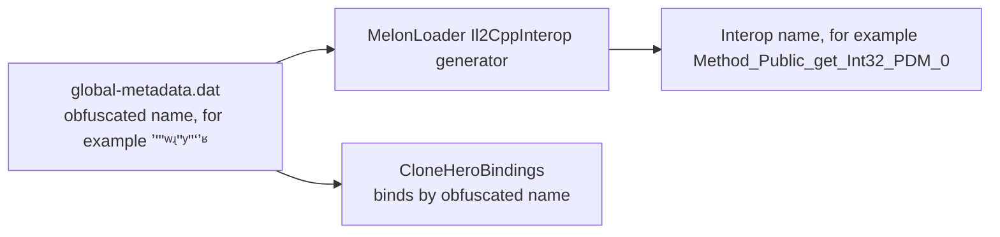

# GH3 parity notes

This is a reference of GH3 facts that the mod uses: addresses, constants, script names, and formulas. Addresses are in the GH3 PC `GH3.exe` (SHA-256 `a565dd36e47e9a5705df12ceef6bd345c9c06e3fd8be8aee362987d9f40d3d2b`) unless the text gives another module. QB scripts come from `DATA/PAK/qb.pak.xen`. Names for checksums come from the `QBDebug` key files (`gh3_keys.txt`, `keys.txt`, `debug.txt`). "Calibrated" marks a value that is a measurement or a fit, not GH3 data.

## Clone Hero bindings

Clone Hero `v1.1.0.6142-final` for Linux and Windows. `engine` is `Il2Cpp.ObjectPublicAbstractDoBoDoInBoObDoInSiBoUnique` in `Il2CppStrikeCore.dll`. `Note` is `Il2Cpp.ObjectPublicObInObDoSiDoUIInBoInUnique`. Native addresses are RVAs in `GameAssembly.so` (Linux) and `GameAssembly.dll` (Windows).

### How the names work

- The interop type names and the obfuscated metadata names and offsets of all fields and methods that the mod uses are the same in the Linux and Windows builds. For `engine`, all 93 fields and all 84 method names and signatures are the same; only the method order is different.
- Il2CppInterop names a method by its signature, its position, and its caller count (`PDM` = no caller found). Position and caller count are different in the two builds. Thus the same interop name can point to a different method. Example: `Method_Public_get_Int32_PDM_0` is the multiplier getter on Linux and a getter of offset `0xd4` on Windows.
- Interop field names (`field_Private_Int32_4`) come from the field order. They point to the same native field on both platforms.
- `CloneHeroBindings` binds the 7 obfuscated methods by their metadata name and parameter count at start. It also checks the metadata name of each obfuscated field that the mod reads. If one check fails, the mod logs `GH3 skin cannot bind to Clone Hero …` and stays off.

### Methods (bound by metadata name)

The evidence is from `tools/InteropMap` (interop name → metadata name and RVA, through the Cpp2IL dummy assemblies) and `tools/native-offsets.py` (object offsets that the native code reads).

| Value | Metadata name, signature | Linux interop name, RVA | Windows interop name, RVA | Native evidence (same on both) |
| --- | --- | --- | --- | --- |
| Multiplier | `ʼʺʹʷʵʺʸʺʻʼʶ`, `int ()` | `Method_Public_get_Int32_PDM_0`, `0x5557270` | `Method_Public_get_Int32_4`, `0x27790` | Reads `0x48` only |
| Star Power charge | `ʶˀʲʵʳˁʾʾˀʼʻ`, `float ()` | `Method_Public_get_Single_0`, `0x5556790` | `Method_Public_get_Single_0`, `0x20F4CB0` | `(float)[0x68] / (float)[0x1b0]` |
| Notes | `ʸʲʾʵʸʹʻʿʽʸʲ`, `List<Note> ()` | `Method_Public_get_List_1_…_0`, `0x55564B0` | same name, `0x20F4F90` | Returns `[0x1e0]` |
| Note lane mask | `ˀʶˀʼʲʾʸʴʴʶʿ`, `ushort ()` | `Method_Public_get_UInt16_0`, `0x556C910` | same name, `0x214BCD0` | ORs `[0x80]` of each chord note (enumerator inlined on Windows) |
| Custom highway | `HighwayScroll.ʳʷʽʴʺʻʷʳʻʼʷ`, `void (Texture2D)` | `Method_Public_Void_Texture2D_0`, `0x2D91000` | same name, `0x380300` | Offsets `0x28 0x6c 0x70 0xe0 0x178 0x180 0x198 0x1a0` |
| Whammy input (verification) | `ʲʽʻʷʻʽʼʷˀʾʾ`, `static void (int, ushort, byte)` | `Method_Public_Static_Void_Int32_UInt16_Byte_0`, `0x2C8EDD0` | same name, `0x22B610` | Offsets `0xb8 0xe0`, 11 calls |
| Track fade | `TrackFadeManager.ʲˁʴʾʸʿʴʿˁʾˀ`, `void ()` | `Method_Public_Void_0`, `0x2BD0040` | same name, `0x1517A0` | Offsets `0x18 0x28 0x30 0x38` (Linux adds the class-init check) |

### Fields (interop name, metadata name checked at start)

| Value | Member | Metadata name | Offset (Linux = Windows) | Evidence |
| --- | --- | --- | --- | --- |
| Total score | `ScoreManager.field_Private_Int32_4` | `ʸʶʻʲʲˀʷʻʳʸʲ` | `0x50` | Live score |
| Streak | `ScoreManager.field_Private_Int32_2` | `ʼʳʽʺʴʺʴʴˁʵʶ` | `0x48` | Live bot run |
| Rock | `engine.field_Protected_Single_0` | `ʺʼʻʳʼʳʲˀʼʸʺ` | `0x70` | Live bot run |
| Star Power active | `engine.field_Public_Boolean_0` | `ˁʸʴʵʳʾʽʿʹʷʿ` | `0x42` | Activation routine |
| Note time, sustain end | `Note.field_Public_Double_0`, `_1` | `ʲʸʺʺʼʷʵʵʶʵˁ`, `ʲʸʷʽʵʷʶʲʿʽˀ` | `0x28`, `0x30` | Live note scan |
| Note flags | `Note.field_Public_EnumNPublicSealedvaNoChDiExChHoStTaSoUnique_0` | `ˀʷˁʵʹʳʿʵʼʹˀ` | `0x7c` | `StarPower`, `StarPowerEnd` |
| Note lane | `Note.field_Public_UInt16_0` | `ʿˀʸʻʺʸʳʺʴʻʿ` | `0x80` | Read by the lane-mask getter |
| Note state | `Note.field_Public_EnumNPublicSealedvaNoHiMiDyIsWa8vWaUnique_0` | `ʺʺʴʶʽʴʳʵˀʽʳ` | `0x84` | `Hit`, `Missed` |
| Scroll speed, tiling | `HighwayScroll.field_Private_Single_1`, `field_Private_Vector4_0` | `ʷʻʺˀʿʵʵʹʽˁʴ`, `ʳˀʳʽʻʳʺˁʲʵʽ` | `0x50`, `0x6c` | Read by the custom-highway method |
| Whammy column, tick | `ObjectPublicAbstractSealedInBoInObDoInSiDoInDoUnique.field_Private_Static_Int32_0`, `field_Private_Static_Double_2` | `ʿʴˀʴʹʷʺʻʸʳʽ`, `ʻʳʷʶˀʻʻʳʶʻʹ` | static | Whammy texture |
| Song clock start | `GameManager.sync` `.field_Private_Double_2`, `_3` | `ʲʻʺʹʺʲʷʾʻʺʹ`, `ˁʵˁʺʳʻʸʶʼʽʺ` | `0x38`, `0x40` | Lead-in starts at −8 s on both |
| Note spawn time | `BaseNoteRenderer.field_Protected_Double_0` | `ʲʾʴʾʹʵʴʺʶʿʸ` | generic type | `noteZPosFarLimit / noteSpeed` |
| Track fade receivers, limits | `TrackFadeManager.field_Private_List_1_InterfacePublicAbstract18Vo2818Unique_0`, `field_Private_List_1_ValueTypePublicSealedSiSiSiSiUnique_0`; limit x `ValueTypePublicSealedSiSiSiSiUnique.field_Public_Single_0` | `ʹʻʵʴʸʲʲʾʿˀʴ`, `ʹʶʿʴʾʿʹʹʹʾʶ`; `ˁʸʷʵʲʺʼʲʷʲʼ` | `0x28`, `0x30`; `0x0` (Linux; Windows binds and shows the same lines) | Limits (7.87, 2, −1, 0.25) = far z, far fade, near z, near fade; `BeatRenderer` copies x and z to its spawn limits (`+0x50`, `+0x58`) every frame |

Named members (`GameManager.songTime`, `BasePlayer.engine`, `SongEntry.ChartPath`, and others) are not obfuscated.

### Windows run against Linux (same `Gh3Skin.dll`)

`GH3_SKIN_TRACE=1` logs the values above twice per song second. `GH3_SKIN_TRACE_CHARGE=0.6` sets the native charge once at song time 20 s, because the command-line bot does not earn Star Power. Chart `mycurse-native`, venue `gh3.dive`, Windows under Wine 11.17 with `-force-glcore` (this run was made before the bundles had Direct3D 11 programs):

| Check | Result |
| --- | --- |
| Song times compared | 138 (−8 s to 60.5 s) |
| Score, streak, rock, hit notes, lane-mask sum, stage note events, hit-flame lanes | Equal at 137 of 138 times. At 14.0 s one note is on the sample boundary (one run is 1 note ahead) |
| Multiplier, charge (0 → 0.6 at 20 s), Star Power active, note count, pause flag, stage audio voices | Equal at all 138 times |
| Lead-in | Both runs go from −1 s (paused) to −8 s |
| Stage audio | Windows loads `Clone Hero_Data/Plugins/x86_64/bass.dll`; voice counts are equal |

- The `ab1e699` DLL on Windows: the stage stops ("type initializer for `StageAudioBackend` threw"; measured). Its multiplier call `Method_Public_get_Int32_PDM_0` reads offset `0xd4` on Windows (static analysis; not seen at run time because the HUD stops with the stage).
- The bot does not activate Star Power, and the Clone Hero pause menu did not open from XTEST key presses or a focus loss in a bot run. Active Star Power and a user pause were not compared at run time.

- Base multiplier (not used): the Linux getter `0x5557020` halves the multiplier while Star Power is active.
- `SPBar.field_Private_Single_0` is a display cache (can be −1). Do not use it for charge.
- Health colors: `HealthContainer` statics are 1/3 and 2/3. Red at or below 1/3, yellow at or below 2/3, green above. The classifier is `Method_Private_EnumNPrivateSealedvaHiMeLo4vUnique_Single_PDM_1`.
- Hit/miss health routine `0x5558de0`: a hit adds `0x74` (`0x7c` while active); a miss subtracts `0x78`. The miss routine `0x5558c80` also resets the streak.
- The bot's charge-award routine `0x5556510` returns early for engine modes 1 and 2. Native activation is `0x55556a0`.
- `HighwayScroll.field_Private_Single_1` is the scroll speed (UV per second = `songTime × speed / 6`, default 7); `field_Private_Vector4_0.y` is the texture tiling; `CloneHeroBindings.SetHighwayTexture` sets a custom highway.
- `GuitarNoteRenderer.HeldSustainNotes`: note flags have `StarPower` (128); `field_Public_UInt16_0` is the lane mask (bit = lane + 1, the whammy channel).
- `_GlobalWhammyTexture`: 1024 columns, one row per channel (green is channel 1).
- `TrackFadeManager` sets `_FadeParams` (z, w = fade rows as viewport heights from the top) on its "Fade Instance" materials. `CloneHeroBindings.RecalculateTrackFade` recalculates them; call it after the intro rise, or the fades stay one viewport too low.
- `GameManager.songTime` (seconds) drives the stage. The cue reader uses `GlobalVariables.instance.currentSongEntry` (`folderPath`, `ChartPath`, `Name_StrippedTags`, `Artist_StrippedTags`).

## Highway geometry

Measured in the original GH3 recording at 1600 × 900 (FastGH3 has a different perspective):

- Rails meet at y 183.6; center x 800. Rail slope 0.5102 px per row.
- Fret centers at y 796.5, 128.3 px apart.
- A beat line τ seconds before the frets is at y = 183.6 + 438 / (τ + 0.72).
- The board starts at y 381 (1280 × 720 layout: `highway_top_width1` 160 at y 305, `highway_playline1` 655 − `highway_height1` 350). It fades in between y 384 and y 406.
- The board texture is 0.987 of the rail width, repeats every 1 / 0.987 s of gem travel, and scrolls 1021–1027 texture rows per second (1024 rows per repeat).

`HighwayView` uses: field of view 15.33°, pitch 4.56°, height 0.921, z −4.894, neck 0.970 × 6.10, scroll speed 6 at note speed 7, lanes 0.1935 apart, `DepthScale` 442.8 (calibrated so that beat lines and gems agree). Gems and beat lines spawn up to the highway top (Clone Hero stops both at z 7.87, y 425).

## Gems

- Regular and HOPO gems: `global_gfx` images from BetterGH3. Cyan active regular and HOPO: indices 39 and 27.
- Phrase gems: 16 frames in a 4 × 4 atlas at 30 fps (`sys_star2d_*` material records: columns, rows, rate at `+0x100`, `+0x110`, `+0x120` of the record). One cycle is 0.533 s. All lanes share one clock.
- Taps: BetterGH3 `_DONOTDELETE.pak.xen` entry 2 (22 images; `tap2d_*`). `TapHopoChord.dll` (SHA-256 `855dce84…0ecc`) selects `sys_tap2d_<lane>`; active is `sys_tap2d_starpower` (`0x31dfdf5c`).
- Cyan phrase sheets: FastGH3 `global.pak.xen`: `star2d_star` `0x2b2f2c12`, `star2d_star_hammer` `0x26331841`, `star2d_star_tap` `0xb278cfe7`.
- Clone Hero sprite names: ordinary tap body `spr_newnotes_strip4_3`; phrase tap body `spr_star_notes_strip2_*`; phrase HOPO cap `spr_star_notes_cap_strip4_2`.

## Sustains and whammy

- GH3 draws the bar with `sys_whammy2d_<lane|starpower|dead>` (template `WhammyBar_UI`: texture × vertex color, alpha blend). Textures (32 × 32): green `0xb47133c1`, red `0x6c97b6c6`, yellow `0xec463e7a`, blue `0x037e6d2c`, orange `0xca034a7a`, Star Power `0xe78e1a35`, dead `0x2a589f46`. Rows 12–23 are the cap, row 28 the body.
- The prepared sprite uses Clone Hero's `spr_sustain_strip6` layout (73 × 70, bar in columns 22–51, sliced border at row 38).
- Held glow (calibrated): `bar + blur(1.8 × bar² + 0.55 × white bar mask)`, Gaussian sigma 1.2 bar widths.
- `control_whammy_pitchshift` (`guitar_input.qb`): `whammy_scale = len + 1`. `SetNewWhammyValue` (`0x41de60`) shifts the wibble array (`whammywibble0`, 136 entries, start 1) by `whammy_wibble_speed` (2) entries per 60 Hz frame. The `WhammyBar` mesh (`0x601d30`, 128 rows) scales the horizontal offset of each row by its entry, so the pattern moves up the highway at 120 entries per second.
- Star whammy (script `0x8fc2ccad`, `MakeStarWhammy`/`MakeNormalWhammy`): per 60 Hz frame, a whammy change above 0.03 sets a 5-frame counter. After 5 frames on, the held phrase sustain turns blue; after 5 frames off, it returns to the lane color.

## Beat lines

Textures `079_1024x16_DXT5`, `090_…`, `100_…` from `global_gfx` (thick: bar, medium: beat, thin: half beat). The sprite bottom is at the native line position. Lines draw above the highway and below strings, notes, and frets, with their own distance fade.

- `guitar_fretbar.qb`: `thin_fretbar_timesigs` gives x/4 signatures `thin_fretbar_8note_params` (1 to 180 BPM) and x/8 signatures `thin_fretbar_16note_params` (1 to 120 BPM). GH3 draws a thin fretbar between two beats when the tempo is in that range. My Curse (172.9 BPM, 6/4) has a line every 0.173 s.
- Clone Hero draws measure and beat lines only, and stops them at z 7.87. The skin adds the thin line halfway to the next Clone Hero line when the beat is 180 BPM or slower (`HighwayView.HasThinFretbar`; the x/8 rule is not used), and moves the `BeatRenderer` limit in `TrackFadeManager` to the highway top.
- Measured on My Curse at song times 20, 25.3, and 30 s: GH3 shows 8 to 9 lines 0.174 s apart, the top line at y 402–407; the skin now shows the same (top line y 390–410). Before the fix: 3 to 4 lines 0.347 s apart, none above y 425, and half of the gems (on half beats) between lines.

## HUD

- `create_2d_hud_elements` (`guitar_hud_2d.qb`): score font `num_a9` at (222, 70), right/bottom, scale 1.1, `font_spacing` 5. Streak digit *i* (1–4): font `num_a7` at (222 − 37*i*, 78), centered, z 25; digit 1 color (15, 15, 70, 200), others (230, 230, 230, 200). `career_hud_2d_elements` places the drum, body, and note icon (z 26, covers the fourth digit) in `HUD2D_note_container` at `counter_pos`.
- Only the highest changed digit rolls; lower digits change at once.
- DoMorph `motion` curves (`0x55b010`): `ease_in` t², `ease_out` 2t − t², `smooth` 3t² − 2t³. For five or more digits the counter opens like `hud_move_note_scorebar` and the new digit pops like `hud_show_note_streak_combo` at double speed; the flash is `hud_glowburst_alert` (`Char_Select_Hilite1`). Calibrated: overshoot 12 units, squash, pop and flash size, six- and seven-digit shrink.
- Amp: the eight multiplier images at (70, 90), 128 × 128, in the 256 × 256 amp texture; normal `1a 2a 3a 4a`, active `2b 4b 6b 8b`; multiplier `zoff` 4, amp `zoff` 5. Uniform scale 268.8 at 1920 × 1080. D3D9 trace: 0.001 rad clockwise at both the container and the sprite, straight-alpha blending, half-pixel offset. Amp origin (263, 569.25) at 1600 × 900.
- Rock needle (calibrated against GH3 frames): pivot (1217, 760.5) at 900p, tip radius about 95 px, endpoints ±43°. Angles: 0% +43°, 1/3 +19.5°, 1/2 0°, 2/3 −18.5°, 100% −43°. The background blends from yellow at the center to red or green at 15° from the center (calibrated: mean blend error 0.0086). The needle moves directly to its angle, with no smoothing.
- Star Power bulbs (HUD script `0x63f57f24.0x3ab79ef5`): bulbs 4–6 slide out from behind the meter at 0.0, 0.2, 0.4 s; each slide is 0.4 s and 170 HUD units at 0°, 21°, 42° from vertical. The meter pose for the first 0.45 s is measured (scale peak 1.4453, low 0.5995; rotation 8.88° clockwise to 12.45° counterclockwise). Retraction: reverse order, 10% farther out for 0.1 s, then 0.4 s back.
- Ready banner: 126 frames at 60 fps cut from the reference recording (calibrated).
- Active Star Power rails: `sys_Big_Bolt01` (8 × 1 frames at 15 fps) from `010_1024x512_DXT1`, glow `053_128x512_DXT5`; two bolt layers and one glow layer per side (script `0x40d71b70.0xb15abbd3`).

## Hit effects

- `hit_note` → `GuitarEvent_HitNote_Spawned` → after one game frame, `hit_note_fx`: `NoteFX` (`0x42add0`), wait 6 frames, `Destroy2DParticleSystem kill_when_empty`, wait 10 frames, `DestroyScreenElement`.
- `NoteFX` sprite: `sys_note_hit01` (`sys_note_hit_blue_01` with Star Power), template `AnimatedTexture_UI`, 4 × 4 cells at 60 fps, additive; textures `Note_Hit01.dds` and `0x9e700d1c` (512 × 1024). Cells 13–15 are empty: 13 frames (217 ms). Particles 20 units above the button: `sys_Particle_Spark01` (`lil_Spark.dds`), color (255,128,0,255) → (255,0,0,0) (Star Power (0,255,255,255) → (0,255,255,0)), scale 1 → 0.5, every 0.02 s, spread 160°, velocity 10, friction (0, 50), life 0.25 s. Chords run `NoteFX` per button. No HOPO-specific effect; no open note.
- Held note: `WhammyFXOn` (`0x42b3e0`, helper `0x42b110`): `sys_whammy_hold01` (`Whammy_hold_01.dds`, 4 × 4 at 30 fps, additive) and `whammy_particle_params` (life 0.5 s).
- Phrase bonus `GuitarEvent_StarSequenceBonus`: `sys_Big_Bolt01` (8 × 1 at 15 fps), scale `star_power_bolt_scale` (1.0, 1.5), rotated by `left_angle`, z 6; particles `sys_Particle_Star01`, `Star02`, `Spark01` (15 units higher); removed after `star_power_bolt_time` (0.3 s).
- `Update2DParticleSystems` (`0x428ba0`, once per game frame): up to 64 particles; direction `emit_dir − spread/2 + rnd(spread)`; position += velocity, velocity += friction × dt; color fade in 12-bit fixed point.
- Button positions: `generate_pos_table` (1280 × 720 units).

## Show flow

- `Common_Intro_Transition` (8000 ms): `cameras_intro`, `play_intro_anims` (`intro_smstg` in party, dive, video, prison, hell; otherwise `intro`; drummer `intro`), `GH_SFX_Intro_WarmUp` at 100 ms.
- `intro_sequence_props`: highway rise at −2000 ms (`move_highway_2d`), button ripple at −800 ms, HUD in from −400 ms for 200 ms, then `move_2d_elements_to_default` and `Song_Intro_Kick_SFX`.
- `win_song`: last note end + 1.1 s (`IsWinPort`) + `Song_Win_Delay` (2 s). Then `You_Rock_End_SFX`, the `Fret_Flames` movie (45 frames, 29.97 fps), "You Rock!" (`text_a10_large`, color 223, center (640, 360), black shadow at 1.3 × 1.2), `jiggle_text_array_elements` 3 s, `explode_text_array_elements` 1 s; `waitAndKillHighway` after 0.5 s; `Common_SongWon_Transition` (8000 ms): `play_outro`, `cameras_win`, `play_win_anims`.
- The mod sets Clone Hero's song clock to −8 s while paused and extends `GameManager.songLength` to the win time + 8 s. Win time = end of the last note + 3.1 s.

## Cameras

- `CameraCuts_StartCallback` (`guitar_cameras.qb`) calls `CameraCut_GetArraySize` (`0x41d770`): filters `includenodes`/`excludenodes`, `Name`, `includetype`, and `excludetype` (the last type, only when the note gives no name and no type). If no entry passes, entry 0 with no random draw. Else `GetRandomValue` (`0x52fba0`) draws `Rnd(count)`; `CameraCut_GetCameraIndex` (`0x41dc10`) maps it.
- `CameraCuts_CalcTime`: a note longer than 200 ms gives the duration; else `RandomRange(3, 8)` integer seconds, extended to the next lightshow note 58. `CameraCuts_HandCam` draws `0..100` for the zoom, only for LongShot and Mid. Note 78 alone does not cut.
- `Rnd` (`0x477120`) is `Gh3Random`. Boot seed `0x6680bf3` (`0x4016f3`); the song start does not seed again. All scripts share it.
- Morph key reader `0x4badf0`: `hfov`/`FOV` (horizontal degrees), `LockTo`, `LockToBone`, `Pos`, `Quat`, `LookAt`, `LookAtBone`, `LookAtPos`, `ScreenOffset`. `0x4bb9d0` aims at the target with the up axis of `Quat` (`0x4ba630`). `0x4b8a60` then pitches by `ScreenOffset.y × FOV/2 ÷ aspect` and yaws by `ScreenOffset.x × FOV/2` (angles). `0x4bd700` interpolates start and end keys (`linear`). `CCam_Orbit` turns the lock frame about Y before the look-at (`0x4ba2d0`). Aspect is 16:9 (`0x47b3a6`).
- Camera note 89 is `CameraCuts_SetArrayPrefix prefix = cameras_drummer changenow` (`CameraCuts_NoteMapping`).

## Band

- Trees (`guitar_anim_tree.qb`): `guitarist_static_tree` = `ConstraintBones(hero_ConstraintBones) → Ik(Hero_Ik_params) → PartialSwitch → ApplyDifference(hero_arm_branch, Body)`. `hero_arm_branch` has `DegenerateBlend` nodes `RightArm` (strum), `LeftArm` (fret position), `LeftHand` (fingers).
- `CDegenerateBlendAnimNode` (vtable `0x8bd638`, update `0x659730`, evaluate `0x659860`, add branch `0x6599b0`): evaluate starts at the oldest branch and lerps each newer branch with `1 − curve(older weight)`, curve `linear`. Older blends advance at the rate of the newest blend. (`0x659d40`/`0x659f50` belong to `CDegeneratePartialAnimNode`, vtable `0x8bd66c`.)
- `applydifference` (`0x4a3550`): `slerp(body, body × diff, weight)`, `position + diff × weight`. `add` (`0x4a3710`), `modulate` (`0x4a4690`), `blendtopartial` (`0x4a3380`). Per-bone weights at `+0x1040` are 1.0 for sampled bones (sampler `0x5fed70`); global weight `+0x1248`.
- Quaternion decode (`0x5fed70`, `0x5fb380`): three signed big-endian shorts / 16384, or bytes through `standardkeyQ.bin`; `w = sqrt(max(0, 1 − |xyz|²))`.
- `CIKAnimNode` (`0x656960`) → `hkaTwoJointsIkSolver` (`0x79b120`): hinge (0, 0, −1), cosine limits ±0.97; the end bone takes the target rotation (`Bone_IK_Hand_Guitar_L/R`; drummer `Bone_IK_Hand_Slave_L/R`). Strength blends over 0.25 s (`hero_toggle_arms`). `CConstraintBonesAnimNode` (`0x658c40`): `Twistchild`, `Twist`, `Split`, `SplitR` (14 entries).
- Hand events start 250 ms (`strum_anim_lead_time`) before the note. Blend times: strum 0.1 s, `no_strum_anim` 0.2 s, fret 0.1 s (`fret_blend_time`), finger press 0.07 s. Strum class: short below 150 ms, medium below 600 ms.
- `FretFingers_iterator_CFunc` (`0x42d0d0`, format `%s_song_%sexpert`): one `pose_fingers` per note from `gem_colors` (at most 4). The release (`chord = none`, sent at `0x42d52a`) adds no branch in GH3 (memory sampling of the `LeftHand` node: 377 branches for 379 notes, blend duration always 0.07). The hand blends from chord to chord.
- Profiles (`guitar_band_profile.qb`, `Musician_Profiles`): Axel `NormalAxel`, `fret_anims_lrg`, `guitarist_finger_anims_Axel`; bassist `Bass_Slap`, `fret_anims_med`, `guitarist_finger_anims_Bassist`.
- `hero_play_tempo_anim_cfunc` (`0x420d50`, limits `0x420af0`) selects slow, med, or fast; clips play at speed 1.
- Drummer (`Drum_iterator`, `0x42d730`): hits start `drum_anim_lead_time` (150 ms) early. Notes 37–45 left arm, 49–57 right arm, 48 kick, 70 count-off taps. Left arm blend `drum_blend_time` 0.1 s; right arm and taps 0.2 s. After a hit: wait `drummer_arm_blend_out_delay` (0.25 s), blend to `stickdown_l/r` over 0.6 s. `drummer_autotwist`: twist moves toward the mean of the twist factors by `drummer_twist_rate` (0.05) per frame; `Test_Drum_BodyTwist_D` is a difference clip.
- Faces: `Band_PlayFacialAnim` (`name`, `anim`) rows in each song's `<song>_performance` array start song-specific facial clips (the library has 570 singer and 78 guitarist clips, 1.9 to 136 s, median 32 s). The 570 singer clips animate the 30 bones 68–97 of `GH3_singer_male` (`Bone_Jaw`, eyes, eyelids, brows, cheeks, lips, `Bone_Tongue`, and one unnamed bone). Jaw opening about the jaw Z axis: p5 −2.4°, p50 7.3°, p95 29.1°, max 51.8°; jaw speed p50 32°/s, p95 229°/s. Blinks (upper lid more than 20° above its median): about 6 per minute, 0.13 s. Outside these clips, only 3 of the 78 singer body clips (idle) move the face, so the face is still. GH3.exe has no lip-sync or blink code by name. The mod's lip sync for custom charts (`StageLipSync`) is not a GH3 feature.
- Bone LOD (`0x4db990`, `Bone_LOD_Distances`): all 11 values are 10000, so no LOD at band distances.
- Hair: Havok 4.6 ragdolls, `guitarist_accessory_bones` (`Bone_ACC_01`–`15`): 54 joints (singer 15, Axel 9, bassist 15, drummer 15). The mod uses a spring solver at 1/120 s, not Havok.
- Hand fire: `GP_4X_FingerFlames01` and `GP_4X_FingerSparks01` (2 × 2 frames at 20 fps; 24 flames and 64 sparks per second per hand at `Bone_Hand_Middle_Mid_L/R`). GH3 starts it with `GuitarEvent_Multiplier4xOn`; the mod uses a 100-note streak.
- Credits: `create_band` with `current_level = z_credits` destroys the bassist, vocalist, and drummer.

## Playable characters

Sources: `Musician_Profiles` (`guitar_band_profile.qb`: name, skeletons, ragdolls, `musician_body`, `musician_instrument`, `finger_anims`, `fret_anims`, `strum_anims`, `anim_set`, `outfits` with `styles`), `musician_body` and `musician_instrument` (`guitar_band_profile_data.qb`: model and instrument PAKs), `Secret_Characters`, `Bonus_Outfits`, `Bonus_Styles` (`store_data.qb`). `pipeline/characters.py` reads them and writes `assets/characters/inventory.json`.

| Character (`name`) | Outfits (styles) | Skeleton | Model PAKs | Default instrument (PAK) | Animation set, strum, fret | GH3 offers it |
| --- | --- | --- | --- | --- | --- | --- |
| Axel Steel (`Axel`) | Jeans (Black 'N Blue, Black 'N Red, Stonewashed, Red Leather); Shorts (Black Vest, Brown Vest, White Vest, Stripes) | `GH3_Guitarist_Axel`, `_Axel_2` | `axel_1`, `Axel_1_color2`–`4`, `axel_2`, `Axel_2_color2`–`4` | `Instrument_Explorer_White` (`Explorer_White`) | `axel_animations`, `NormalAxel`, `fret_anims_lrg` | Start; outfit 2 and styles 2–4 in the store |
| Casey Lynch (`Casey`) | Leather (Basic Black, Silver 'N Black, Crimson, Camo); Mo' Leather (Black 'N Red, Black 'N White, Vast Purple, Fiery) | `GH3_Guitarist_Casey`, `_Casey_2` | `Casey_1` … `Casey_2_color4` | `Instrument_Les_Paul_Black` (`les_paul_black`) | `Casey_animations`, `NormalCasey`, `fret_anims_sml` | Same |
| Izzy Sparks (`Izzy`) | The Rockstar (Leopard, Lizard, Zebra, Menagerie); The Peacock (Fantasy, Florid, Starry Night, Neon Knight) | `GH3_Guitarist_Izzy`, `_Izzy_2` | `Izzy_1` … `Izzy_2_color4` | `Instrument_Les_Paul_Black` | `Izzy_animations`, `NormalIzzy`, `fret_anims_med` | Same |
| Judy Nails (`Judy`) | Rocker Grrl (Shocking Pink, Tornado Blue, Jet Black, Flame Orange); Skool Grrl (Purple Plaid, Dirty Yellow, Stripes, Riot) | `GH3_Guitarist_Judy`, `_Judy_2` | `Judy_1` … `Judy_2_color4` | `Instrument_SG_Worn_Red` (`SG_WornRed`) | `judy_animations`, `NormalJudy`, `fret_anims_sml`; profile `scale` 0.9 | Same |
| Johnny Napalm (`Johnny`) | Liberty Spikes (Bloodshot, Pea Soup, Spew, Skeleton); Mohawk (Spinach, Pumpkin, Two Tone, Eggplant) | `GH3_Guitarist_Johnny`, `_Johnny_2` | `Johnny_1` … `Johnny_2_color4` | `Instrument_SG_Worn_Red` | `Johnny_animations`, `NormalJohnny`, `fret_anims_med`; stance `stance_frontend` | Same |
| Lars Umlaut (`Lars`) | Black Metal (Dyed Black, Bleach Blonde, Phantom, Thunda); Viking (Natural, Barbaric, Icy, Freedom) | `GH3_Guitarist_Lars`, `_Lars_2` | `Lars_1` … `Lars_2_color4` | `Instrument_Explorer_White` | `LARS_animations`, `NormalLars`, `fret_anims_lrg` | Same |
| Midori (`Midori`) | J-Popster (Amethyst, Ruby, Candy, Jade); Puffball (Emerald, Aqua, Maroon, Cream) | `GH3_Guitarist_Midori`, `_Midori_2` | `Midori_1` … `Midori_2_color4` | `Instrument_SG_Worn_Red` | `Midori_animations`, `NormalMidori`, `fret_anims_sml` | Same |
| Xavier Stone (`Xavier`) | Xavier Classic (Orchid, Tangerine, Azure, Emerald); Captain X (John, Paul, George, Larry) | `GH3_Guitarist_Xavier`, `_Xavier_2` | `Xavier_1` … `Xavier_2_color4` | `Instrument_Les_Paul_Black` | `Xavier_animations`, `NormalXavier`, `fret_anims_med` | Same |
| Slash (`Slash`) | — | `GH3_Guitarist_Slash` | `Slash_1` | `Instrument_Guitar_Slash01` (`Slash01`) | `Slash_animations`, `NormalSlash`, `fret_anims_med` | Store (`Secret_Characters`) |
| Tom Morello (`Morello`) | — | `GH3_Guitarist_Morello` | `Morello_1` | `Instrument_Morello` (`Morello`) | `Morello_animations`, `NormalMorello`, `fret_anims_med` | Store (`Secret_Characters`) |
| Lou (`Satan`) | Lou; Thick Izzy | `GH3_Guitarist_Satan` | `Satan`, `Satan_2` | `Instrument_Guitar_Demonik` (`Demonik`) | `Satan_animations`, `NormalSatan`, `fret_anims_lrg` | Store (`Secret_Characters`; Thick Izzy in `Bonus_Outfits`) |
| God of Rock (`RockGod`) | — | `GH3_Guitarist_Axel` | `RockGod_1` | `Instrument_Guitar_GodRock` (`godrock`) | `axel_animations`, `NormalAxel`, `fret_anims_lrg` | Store (`Secret_Characters`) |
| Grim Ripper (`Ripper`) | — | `GH3_Guitarist_Ripper` | `Ripper_1` | `Instrument_Guitar_Ripper` (`ripper`) | `Morello_animations`, `normal`, `fret_anims_med` | Store (`Secret_Characters`) |
| Singer (`Singer_Bret`) | — | `GH3_Singer_BretMichaels` | `Singer_Brett` | `Mic_AT_ATM610` (`Microphone001`) | `singer_male_animations` | Song-selected vocalist (Bret Michaels) |
| Singer (`Singer_Female`) | — | `GH3_Singer_Female` | `Singer_Female` | `Mic_AT_ATM610_Fem` (`Microphone001Female`) | `singer_female_animations` | Song-selected vocalist |

- Not exported: `Bassist`, `Drummer`, `Singer` (the library band members), `Singer_Alt`, `Singer_Bret_Alt`, `Singer_Female_Alt` (the same models with the `Mic_AT_AEW_6100` microphones), and the five `BoneMan_*` profiles (`debug_only`).
- Each character has its own skeleton (125 bones with the same names and order as `GH3_Guitarist_Axel`, other rest positions: the hands up to 0.24 m, the face bones 3–12 cm from Axel's relative to the head; the accessory bones have other parents), its own animation PAK (`<model>_anims`, for example 247 clips for Judy against 194 for Axel; only 4 of 523 action references of `judy_animations` equal `axel_animations`), and its own ragdoll (`ragdoll`, `ragdoll2`: hair and accessory joints `Bone_ACC_01`–`15` on the head, chest, pelvis, arms, or legs).
- Mod (since 0.9.9): each guitarist plays on its own skeleton with its own animation set, ragdoll, IK, and scale (the character library `gh3-characters-v1`, [PACKAGE-FORMAT.md section 10.1](PACKAGE-FORMAT.md#101-character-library-format-11)). The rules below come from the QB scripts:
  - `create_band_member` (`guitar_anim_tree.qb`): `skeleton_name = profile.skeleton`, `ragdoll_name = profile.ragdoll`; for `outfit = 2`, `skeleton2` and `ragdoll2`. `ik_params` of the profile, else `Hero_Ik_params`. Only Lou has `ik_params` (`Satan_Ik_params`: the leg chains are knee, ankle, toe with hinge (0, 0, −1)). The God of Rock profile names Axel's skeleton (`GH3_Guitarist_Axel`) and its own ragdoll (`a494694f`). `create_band_member` gives `skeleton_name` to the `Skeleton` component and to the `ragdoll` component (`SkeletonName`, `RagdollName`); no QB script names `GH3_Guitarist_RockGod`. But his ragdoll and his mesh fit `GH3_Guitarist_RockGod`, not Axel's skeleton: see [God of Rock hair](#god-of-rock-hair).
  - `create_guitarist` (`guitar_character.qb`): the `<name>_Info` struct takes `anim_set`, `finger_anims`, `fret_anims`, and `strum` (`strum_anims`) from the profile, and `scale` (uniform; Judy 0.9). The stance comes from `guitarist_info` (`stance_frontend`), not from the profile `stance` (only Johnny's profile has `stance_frontend`). On the PC port (`IsWinPort`), `ragdoll_setaccessorybones` is not called for the Grim Ripper: his accessory bones have no physics.
  - Bassist: in one-player games `create_bassist` uses the `Bassist` profile (`bassist_animations`, `Bass_Slap` strums). In co-op `create_band` calls `create_guitarist name = bassist`, so the player's character keeps its own `anim_set`, finger, fret, and strum sets, and the player's bass (`instrument_id`). The mod does the same when a guitarist character plays the bassist role (with the library bass `tobB4`).
  - Animation sets: one for each distinct (`anim_set`, `strum_anims`, `finger_anims`, `fret_anims`): 12. The God of Rock has Axel's four values. The Grim Ripper has Morello's `anim_set`, finger, and fret sets, but `strum_anims = normal`. The anim PAKs of all outfits and styles of a character hold the same clips (byte-equal), and so do `RockGod_1_anims` and `axel_1_anims`, and `Ripper_1_anims` and `Morello_1_anims`. The model PAKs (intro and win clips) are equal for all variants of a character.
  - Clip translations: GH3 keys them relative to the skeleton rest pose (`pipeline.gh3.band_formats.sample_animation`), so a clip gives other bone positions on another skeleton. The character library stores each clip on Axel's rig and adds (profile rest − Axel rest) to the position tracks at load. The in-game trace of all 13 families matches the GH3 clip sampled on the GH3 skeleton within 0.001 mm and 0.016° ([STATUS.md](STATUS.md#gh3-characters)).
  - Ragdoll joints of the guitarists: `hkRagdollConstraintData` (cone, twist, plane limits), `hkLimitedHingeConstraintData` (Izzy, Johnny, Lars outfit 2; Slash, Lou, Grim Ripper: arms, coat tails, tails), `hkPrismaticConstraintData` (Axel outfit 2, Casey, Judy outfit 1, Midori outfit 1, Morello: slides of 5–10 cm). Leaf bodies are boxes or capsules. The mod's solver (1/120 s, not Havok) uses the cone limit, the hinge axis and range, and the prismatic axis and range; it collides with the head capsule only. GH3 also collides the accessory bodies with the other ragdoll bodies of their collision group (`ragdoll_collision_group`), which the mod does not do.
- `musician_instrument`: 113 rows, 88 guitars and 20 basses (and the drum kit and four microphones). Store lists: `Free_Guitars` 3, `Bonus_Guitars` 23, `Bonus_Guitar_Finishes` 49, `Secret_Guitars` 13, `Free_Basses` 1, `Bonus_Basses` 5, `Bonus_Bass_Finishes` 6, `Secret_Basses` 8.
- Each model PAK also has the magazine photo of the variant (`.img` `Mag_Photo`, 512 × 512 DDS), the startup script that loads the highway texture, and the intro and win clips.

### God of Rock hair

Measured on the GH3 PC data (2026-10-09). `GH3_Guitarist_RockGod` and `GH3_Guitarist_Axel` have the same 125 bones. The body bones are the same (at most 1 mm); the face bones are up to 3.7 cm apart; seven accessory bones (`Bone_ACC_09`–`15`) have other parents and other places:

| Data | On `GH3_Guitarist_Axel` (the profile) | On `GH3_Guitarist_RockGod` |
| --- | --- | --- |
| Parents of `Bone_ACC_09`, `12`, `13`, `14` | Chest, chest, chest, upper stomach | Head, head, head, `Bone_ACC_04` |
| Ragdoll `a494694f` bodies against the accessory bones | Up to 0.47 m and 150° off | At most 0.005 m and 11° (the same as all other GH3 ragdolls on their skeletons) |
| Mesh `RockGod_1` vertices of `Bone_ACC_14` against the bone | 0.47 m (mean) | 0.10 m (mean) |

The ragdoll and the mesh were made on `GH3_Guitarist_RockGod`. On Axel's skeleton, his hair and beard turn about points on the chest with the wrong axes, and the hair covers the face. Judgment call: the mod gives him a rig with Axel's bones and the accessory bones of `GH3_Guitarist_RockGod` (`pipeline/character_library.py`, `ACCESSORY_SKELETONS`). The body, face, and clips stay as in GH3. With this rig his hair and beard hang down as in the bind pose of his mesh.

Original GH3 check (2026-10-09, quickplay My Curse in the Dive, bot, the God of Rock as player 1, close cameras from the front and the side; the patched files were restored byte-equal):

- His long white hair hangs from the head down the back and over the shoulders. The beard hangs from the chin over the chest. Both move with the head. On fast head moves the hair swings out to the side and for a moment goes over the face, then falls back. We saw no hood-like flip and no hair or beard that stays on the chest when the head turns.
- The mod before the judgment call (1f8ea9c) and after it (main) look the same as this in the same kind of close-ups, and nearly the same as each other: the mod's hair joints hang from the head in both states (the ragdoll constraints give the chain parents), and only the rest lengths of three chains change. So the judgment call stays: it agrees with the GH3 data (ragdoll and mesh fit) and with what GH3 shows.
- Not compared: the exact swing amplitude and speed (GH3 picks its cameras, songs, and clips at random, so no frame pair has the same pose), and the character select screen.

All other guitarist ragdolls fit their own skeletons: at most 0.21 m (Judy Nails outfit 2: the skirt bodies on the pelvis and thighs) and 20° (Judy Nails outfit 1). The converter stops when a body is more than 0.25 m or 45° from its bone (`pipeline/library/hair.py`, `ragdoll_member`).

## Crowd

- `create_crowd_models`, `AddCrowdModelCam` (`0x433c20`, every frame): one 128 × 256 viewport per row (`imposter_rendering`), perspective camera, 20° horizontal FOV, far clip 20, 3.5 units back from the point 1 unit above the ped. It copies the `bg_viewport` orientation and turns about world Y by `25° × forward.x`; rows with `roty` do not turn. Peds are parked at `(-500, -200 - 100n, 0)` with `LightGroup = Crowd`.
- `Billboard_Fast`: the normal holds the card pivot; corners offset along `c120`–`c122` (`g_InvView`). Pixel: `texture × c0 × vertex color`, `c0 = 1`. Card sizes: Dive 1.15 × 2.58, Hell and Budokan 1.0 × 2.58, Prison 1.0 × 1.87, Video 2.08 × 4.26.

## Lighting and node flags

- Default lightshow blend 0.15 s (`lightshow_defaultblendtime`, `scripts\fx\lightshow.qb`). `LightShow_NoteMapping`: 39–53 blends, 56 pyro, 57 next state (keep beams), 58 next state (saved positions), 60 strobe toggle, 61–69 purple, orange, clear override, magenta, white, yellow, blue, red, green; 70–76 strobe, flare, blackout, solo, chorus, verse, intro.
- Housing `Quat` (x, y, z, implied w) maps to (−x, −y, z, w) in stage space. Lens and beam on local +Z.
- Node flags: table `0x1a22a5e6` (after each `LightShow_SetParams`) sets `LS_PERF_*` per performance and `LS_MOOD_*` per mood (not for `poor`). `Progression_SetProgressionNodeFlags` sets `LS_ALWAYS`, `LS_3_5_*`, `LS_ENCORE_*`. `LightShow_InitEventMappings` sets the guitarist spot flag (`0xfb1a2bba`) and, with more than one player, the bassist flag (`0x0fcd6094`). Nodes with `CreatedFromVariable` or `CreatedOnProgress` are created or killed when a flag changes (`0x437c20`, `0x437d50`, `0x49a240`). Blackout and flare set `LS_PERF_*` to 0, so flag-driven neon (for example the Dive dancer `0xed7f462c`) goes away, as in GH3.
- The flag-driven `_gfx_NodeArray` geometry is in the second `.scn` of each zone PAK. Clone nodes name their source sector in field `0xedc063b9`. These meshes are `Flare` cards (template `379bed00`, additive, draw order 1, alpha reference 32, depth write on in the flags; cards up to 6 m from their pivot). Their nodes are created only in the flare mood. The mod draws them without depth write: with it, the card core removed the band's sorted hair (draw order 2) behind it, and GH3 recordings of the flare mood show the hair.
- Model-light commands: `SetModelLightsFadeTime` (wrapper `0x541060`, setter `0x5d12c0`, parameter `0x906b67ba`), update `0x5d1360`, `RemoveCurLightGroup` (`0x540ed0`, `0x5d14c0`), current-group getter (`0x540f40`, `0x5d14d0`, field `0x7e4813a7`), `SetLightGroup` (`0x412df0` → `0x412b80`), `UpdateFxLighting` (`0x541100` → `0x5901c0`). Gameplay content does not call them.
- Light channels (color, intensity, specular, shadow) fade separately. Duration truncates to milliseconds; default easing `smooth`. `PushWorldLights` disables all current groups; `PopWorldLights` enables them (no saved stack). `MoveLight` keeps the position-to-bounds offset.

## Materials and shaders

- Material record (scene `.scn`): template `+160`, vertex constants `+168`, pixel constants `+176`, samplers `+184`, flags `+204`, draw order `+212` (float), blend `+216`, two-sided `+220`, alpha reference `+232`, sampler address bits `+234` (bit 0 clamp U, bit 1 clamp V).
- Material bind (`0x648f20`): flags bit 3 no cull, bit 4 depth always, bit 5 no depth write, bit 6 no alpha test, bit 8 cull direction; blend through the packed table at `0x6491d2`; `ALPHAFUNC GREATER` with `+232`; draw order added to the queue.
- Templates come from `FXFILES/MaterialLibrary.bin.xen` (389 templates). The translation maps only engine registers: transforms `c160`–`c171`, `c124`–`c127`; camera axes and eye `c120`–`c123`; time `c155`; light data `c176`–`c179`, `c188`–`c191`. `c137 = (1,1,1,1)`; `c138 = (0, 40, 30, 0.1)` (normal-map fade distance).
- GH3 PC skins characters on the CPU. Weighted `.skin` rows (56 bytes) hold position, normal, binormal 0, and tangent 0. Skinned templates read already-skinned streams.
- Vertex flags bit 17 + 2n mark UV set n.
- Cube maps export as latitude-longitude images.
- `AnimatedTexture`, `AnimatedTexture_Lit`, and `AnimatedTexture_Billboard`: c0 columns, c1 rows, c2 frames per second, c3 offset. The Dive dancer samples with a clamped sampler (`+234` = 3); the shader clock never goes below zero.

## Particles and Tesla

- Particle LOD is off: the flag at `0xb4e322` is in `.bss` and only `EngineConfig` writes it; no script calls `EngineConfig`.
- Particle technique loading `0x60e700`, sort-ID access `0x60ef90` (144 shader variants).
- `EmitScript` is a PC no-op. Bounce callbacks resume a persistent component with empty setup parameters.
- QuickMaterial defaults to additive. Equal sort keys reverse the submission order. Batches: at most 8,192 quads per mesh, 150 emitters per submission list.
- Nonzero `default_light_group` overrides the particle fallback (exported value `None`, `0x806fff30`).
- Tesla: 30 slots. Allocation stops at the first free slot or the first active slot with the same name. Omitted name is 0, start defaults to UnitX, end to zero. A lifetime of exactly zero stays active. `fadeOut` controls the shader edge; the tapered path derives the amplitude from `lightWidth`.

## Script runtime

- Actor callbacks use `animeventtablename`. Scheduled callbacks use `CancelScheduled`.
- Component scripts keep locals and waits and run on component updates; general `Cancel` does not stop them.
- Random-choice history is per task, with GH3's reusable 100-entry pool. Particle draws use the shared RNG; `TimeSeed` uses a separate CRT RNG.
- Missing Dive and Wikker mood-transition scripts are optional engine calls; the native runner (`0x4960e0`) returns false.
- `HasScript` checks type-7 script definitions only.
- `UpdateMaterialProperty time` holds for whole seconds, then restores.
- Command lookup order: `Builtin(...) ?? _native(...) ?? Gh3PcCommands.Execute(key)`, then optional-missing handling or script execution. `Gh3PcCommands` covers 136 checked constant-result functions of the 1,170-entry PC registry.

## Native song data

A song PAK holds `<song>.mid.qb`, optional scripts, and song assets. The direction sections are `scripts`, `anim`, `triggers`, `cameras`, `lightshow`, `crowd`, `drums`, and `performance`. Each has `<song>_<section>_notes` (start ms, note, length ms, optional velocity) and `<song>_<section>` script calls (`time`, `scr`, `params`).

The original install has 159 song archives, 6,297 song script calls with 33 distinct commands, 3,569 global and venue script definitions, and five named note-map tables.

## Performance

Measured on an RTX 3060 laptop with My Curse (`GH3_SKIN_PROFILE=1`). After the 0.9.1 pass, median frame rates are 183–230 fps for the eight full venues; Soundcheck and Credits stay at the 241 fps cap. The Budokan pyro peak (about 12,000 particles) is the slowest case (minimum 71 fps).
