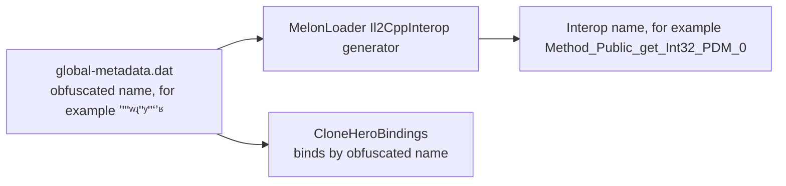

# GH3 parity notes

This is a reference of GH3 facts that the mod uses: addresses, constants, script names, and formulas. Addresses are in the GH3 PC `GH3.exe` (SHA-256 `a565dd36e47e9a5705df12ceef6bd345c9c06e3fd8be8aee362987d9f40d3d2b`) unless the text gives another module. QB scripts come from `DATA/PAK/qb.pak.xen`. Names for checksums come from the `QBDebug` key files (`gh3_keys.txt`, `keys.txt`, `debug.txt`). "Calibrated" marks a value that is a measurement or a fit, not GH3 data.

## Clone Hero bindings

Clone Hero `v1.1.0.6142-final` for Linux and Windows. `engine` is `Il2Cpp.ObjectPublicAbstractDoBoDoInBoObDoInSiBoUnique` in `Il2CppStrikeCore.dll`. `Note` is `Il2Cpp.ObjectPublicObInObDoSiDoUIInBoInUnique`. Native addresses are RVAs in `GameAssembly.so` (Linux) and `GameAssembly.dll` (Windows).

### How the names work

- The interop type names and the obfuscated metadata names and offsets of all fields and methods that the mod uses are the same in the Linux and Windows builds. For `engine`, all 93 fields and all 84 method names and signatures are the same; only the method order is different.
- Il2CppInterop names a method by its signature, its position, and its caller count (`PDM` = no caller found). Position and caller count are different in the two builds. Thus the same interop name can point to a different method. Example: `Method_Public_get_Int32_PDM_0` is the multiplier getter on Linux and a getter of offset `0xd4` on Windows.
- Interop field names (`field_Private_Int32_4`) come from the field order. They point to the same native field on both platforms.
- `CloneHeroBindings` binds the 7 obfuscated methods by their metadata name and parameter count at start. It also checks the metadata name of each obfuscated field that the mod reads. If one check fails, the mod logs `GH3 skin cannot bind to Clone Hero …` and stays off.

### Methods (bound by metadata name)

The evidence is from `tools/InteropMap` (interop name → metadata name and RVA, through the Cpp2IL dummy assemblies) and `tools/native-offsets.py` (object offsets that the native code reads).

| Value | Metadata name, signature | Linux interop name, RVA | Windows interop name, RVA | Native evidence (same on both) |
| --- | --- | --- | --- | --- |
| Multiplier | `ʼʺʹʷʵʺʸʺʻʼʶ`, `int ()` | `Method_Public_get_Int32_PDM_0`, `0x5557270` | `Method_Public_get_Int32_4`, `0x27790` | Reads `0x48` only |
| Star Power charge | `ʶˀʲʵʳˁʾʾˀʼʻ`, `float ()` | `Method_Public_get_Single_0`, `0x5556790` | `Method_Public_get_Single_0`, `0x20F4CB0` | `(float)[0x68] / (float)[0x1b0]` |
| Notes | `ʸʲʾʵʸʹʻʿʽʸʲ`, `List<Note> ()` | `Method_Public_get_List_1_…_0`, `0x55564B0` | same name, `0x20F4F90` | Returns `[0x1e0]` |
| Note lane mask | `ˀʶˀʼʲʾʸʴʴʶʿ`, `ushort ()` | `Method_Public_get_UInt16_0`, `0x556C910` | same name, `0x214BCD0` | ORs `[0x80]` of each chord note (enumerator inlined on Windows) |
| Custom highway | `HighwayScroll.ʳʷʽʴʺʻʷʳʻʼʷ`, `void (Texture2D)` | `Method_Public_Void_Texture2D_0`, `0x2D91000` | same name, `0x380300` | Offsets `0x28 0x6c 0x70 0xe0 0x178 0x180 0x198 0x1a0` |
| Whammy input (verification) | `ʲʽʻʷʻʽʼʷˀʾʾ`, `static void (int, ushort, byte)` | `Method_Public_Static_Void_Int32_UInt16_Byte_0`, `0x2C8EDD0` | same name, `0x22B610` | Offsets `0xb8 0xe0`, 11 calls |
| Track fade | `TrackFadeManager.ʲˁʴʾʸʿʴʿˁʾˀ`, `void ()` | `Method_Public_Void_0`, `0x2BD0040` | same name, `0x1517A0` | Offsets `0x18 0x28 0x30 0x38` (Linux adds the class-init check) |

### Fields (interop name, metadata name checked at start)

| Value | Member | Metadata name | Offset (Linux = Windows) | Evidence |
| --- | --- | --- | --- | --- |
| Total score | `ScoreManager.field_Private_Int32_4` | `ʸʶʻʲʲˀʷʻʳʸʲ` | `0x50` | Live score |
| Streak | `ScoreManager.field_Private_Int32_2` | `ʼʳʽʺʴʺʴʴˁʵʶ` | `0x48` | Live bot run |
| Rock | `engine.field_Protected_Single_0` | `ʺʼʻʳʼʳʲˀʼʸʺ` | `0x70` | Live bot run |
| Star Power active | `engine.field_Public_Boolean_0` | `ˁʸʴʵʳʾʽʿʹʷʿ` | `0x42` | Activation routine |
| Note time, sustain end | `Note.field_Public_Double_0`, `_1` | `ʲʸʺʺʼʷʵʵʶʵˁ`, `ʲʸʷʽʵʷʶʲʿʽˀ` | `0x28`, `0x30` | Live note scan |
| Note flags | `Note.field_Public_EnumNPublicSealedvaNoChDiExChHoStTaSoUnique_0` | `ˀʷˁʵʹʳʿʵʼʹˀ` | `0x7c` | `StarPower`, `StarPowerEnd` |
| Note lane | `Note.field_Public_UInt16_0` | `ʿˀʸʻʺʸʳʺʴʻʿ` | `0x80` | Read by the lane-mask getter |
| Note state | `Note.field_Public_EnumNPublicSealedvaNoHiMiDyIsWa8vWaUnique_0` | `ʺʺʴʶʽʴʳʵˀʽʳ` | `0x84` | `Hit`, `Missed` |
| Scroll speed, tiling | `HighwayScroll.field_Private_Single_1`, `field_Private_Vector4_0` | `ʷʻʺˀʿʵʵʹʽˁʴ`, `ʳˀʳʽʻʳʺˁʲʵʽ` | `0x50`, `0x6c` | Read by the custom-highway method |
| Whammy column, tick | `ObjectPublicAbstractSealedInBoInObDoInSiDoInDoUnique.field_Private_Static_Int32_0`, `field_Private_Static_Double_2` | `ʿʴˀʴʹʷʺʻʸʳʽ`, `ʻʳʷʶˀʻʻʳʶʻʹ` | static | Whammy texture |
| Song clock start | `GameManager.sync` `.field_Private_Double_2`, `_3` | `ʲʻʺʹʺʲʷʾʻʺʹ`, `ˁʵˁʺʳʻʸʶʼʽʺ` | `0x38`, `0x40` | Lead-in starts at −8 s on both |
| Note spawn time | `BaseNoteRenderer.field_Protected_Double_0` | `ʲʾʴʾʹʵʴʺʶʿʸ` | generic type | `noteZPosFarLimit / noteSpeed` |
| Track fade receivers, limits | `TrackFadeManager.field_Private_List_1_InterfacePublicAbstract18Vo2818Unique_0`, `field_Private_List_1_ValueTypePublicSealedSiSiSiSiUnique_0`; limit x `ValueTypePublicSealedSiSiSiSiUnique.field_Public_Single_0` | `ʹʻʵʴʸʲʲʾʿˀʴ`, `ʹʶʿʴʾʿʹʹʹʾʶ`; `ˁʸʷʵʲʺʼʲʷʲʼ` | `0x28`, `0x30`; `0x0` (Linux; Windows binds and shows the same lines) | Limits (7.87, 2, −1, 0.25) = far z, far fade, near z, near fade; `BeatRenderer` copies x and z to its spawn limits (`+0x50`, `+0x58`) every frame |

Named members (`GameManager.songTime`, `BasePlayer.engine`, `SongEntry.ChartPath`, and others) are not obfuscated.

### Windows run against Linux (same `Gh3Skin.dll`)

`GH3_SKIN_TRACE=1` logs the values above twice per song second. `GH3_SKIN_TRACE_CHARGE=0.6` sets the native charge once at song time 20 s, because the command-line bot does not earn Star Power. Chart `mycurse-native`, venue `gh3.dive`, Windows under Wine 11.17 with `-force-glcore` (this run was made before the bundles had Direct3D 11 programs):

| Check | Result |
| --- | --- |
| Song times compared | 138 (−8 s to 60.5 s) |
| Score, streak, rock, hit notes, lane-mask sum, stage note events, hit-flame lanes | Equal at 137 of 138 times. At 14.0 s one note is on the sample boundary (one run is 1 note ahead) |
| Multiplier, charge (0 → 0.6 at 20 s), Star Power active, note count, pause flag, stage audio voices | Equal at all 138 times |
| Lead-in | Both runs go from −1 s (paused) to −8 s |
| Stage audio | Windows loads `Clone Hero_Data/Plugins/x86_64/bass.dll`; voice counts are equal |

- The `ab1e699` DLL on Windows: the stage stops ("type initializer for `StageAudioBackend` threw"; measured). Its multiplier call `Method_Public_get_Int32_PDM_0` reads offset `0xd4` on Windows (static analysis; not seen at run time because the HUD stops with the stage).
- The bot does not activate Star Power, and the Clone Hero pause menu did not open from XTEST key presses or a focus loss in a bot run. Active Star Power and a user pause were not compared at run time.

- Base multiplier (not used): the Linux getter `0x5557020` halves the multiplier while Star Power is active.
- `SPBar.field_Private_Single_0` is a display cache (can be −1). Do not use it for charge.
- Health colors: `HealthContainer` statics are 1/3 and 2/3. Red at or below 1/3, yellow at or below 2/3, green above. The classifier is `Method_Private_EnumNPrivateSealedvaHiMeLo4vUnique_Single_PDM_1`.
- Hit/miss health routine `0x5558de0`: a hit adds `0x74` (`0x7c` while active); a miss subtracts `0x78`. The miss routine `0x5558c80` also resets the streak.
- The bot's charge-award routine `0x5556510` returns early for engine modes 1 and 2. Native activation is `0x55556a0`.
- `HighwayScroll.field_Private_Single_1` is the scroll speed (UV per second = `songTime × speed / 6`, default 7); `field_Private_Vector4_0.y` is the texture tiling; `CloneHeroBindings.SetHighwayTexture` sets a custom highway.
- `GuitarNoteRenderer.HeldSustainNotes`: note flags have `StarPower` (128); `field_Public_UInt16_0` is the lane mask (bit = lane + 1, the whammy channel).
- `_GlobalWhammyTexture`: 1024 columns, one row per channel (green is channel 1).
- `TrackFadeManager` sets `_FadeParams` (z, w = fade rows as viewport heights from the top) on its "Fade Instance" materials. `CloneHeroBindings.RecalculateTrackFade` recalculates them; call it after the intro rise, or the fades stay one viewport too low.
- `GameManager.songTime` (seconds) drives the stage. The cue reader uses `GlobalVariables.instance.currentSongEntry` (`folderPath`, `ChartPath`, `Name_StrippedTags`, `Artist_StrippedTags`).

## Highway geometry

Measured in the original GH3 recording at 1600 × 900 (FastGH3 has a different perspective):

- Rails meet at y 183.6; center x 800. Rail slope 0.5102 px per row.
- Fret centers at y 796.5, 128.3 px apart.
- A beat line τ seconds before the frets is at y = 183.6 + 438 / (τ + 0.72).
- The board starts at y 381 (1280 × 720 layout: `highway_top_width1` 160 at y 305, `highway_playline1` 655 − `highway_height1` 350). It fades in between y 384 and y 406.
- The board texture is 0.987 of the rail width, repeats every 1 / 0.987 s of gem travel, and scrolls 1021–1027 texture rows per second (1024 rows per repeat).

`HighwayView` uses: field of view 15.33°, pitch 4.56°, height 0.921, z −4.894, neck 0.970 × 6.10, scroll speed 6 at note speed 7, lanes 0.1935 apart, `DepthScale` 442.8 (calibrated so that beat lines and gems agree). Gems and beat lines spawn up to the highway top (Clone Hero stops both at z 7.87, y 425).

## Gems

- Regular and HOPO gems: `global_gfx` images from BetterGH3. Cyan active regular and HOPO: indices 39 and 27.
- Phrase gems: 16 frames in a 4 × 4 atlas at 30 fps (`sys_star2d_*` material records: columns, rows, rate at `+0x100`, `+0x110`, `+0x120` of the record). One cycle is 0.533 s. All lanes share one clock.
- Taps: BetterGH3 `_DONOTDELETE.pak.xen` entry 2 (22 images; `tap2d_*`). `TapHopoChord.dll` (SHA-256 `855dce84…0ecc`) selects `sys_tap2d_<lane>`; active is `sys_tap2d_starpower` (`0x31dfdf5c`).
- Cyan phrase sheets: FastGH3 `global.pak.xen`: `star2d_star` `0x2b2f2c12`, `star2d_star_hammer` `0x26331841`, `star2d_star_tap` `0xb278cfe7`.
- Clone Hero sprite names: ordinary tap body `spr_newnotes_strip4_3`; phrase tap body `spr_star_notes_strip2_*`; phrase HOPO cap `spr_star_notes_cap_strip4_2`.

## Sustains and whammy

- GH3 draws the bar with `sys_whammy2d_<lane|starpower|dead>` (template `WhammyBar_UI`: texture × vertex color, alpha blend). Textures (32 × 32): green `0xb47133c1`, red `0x6c97b6c6`, yellow `0xec463e7a`, blue `0x037e6d2c`, orange `0xca034a7a`, Star Power `0xe78e1a35`, dead `0x2a589f46`. Rows 12–23 are the cap, row 28 the body.
- The prepared sprite uses Clone Hero's `spr_sustain_strip6` layout (73 × 70, bar in columns 22–51, sliced border at row 38).
- Held glow (calibrated): `bar + blur(1.8 × bar² + 0.55 × white bar mask)`, Gaussian sigma 1.2 bar widths.
- `control_whammy_pitchshift` (`guitar_input.qb`): `whammy_scale = len + 1`. `SetNewWhammyValue` (`0x41de60`) shifts the wibble array (`whammywibble0`, 136 entries, start 1) by `whammy_wibble_speed` (2) entries per 60 Hz frame. The `WhammyBar` mesh (`0x601d30`, 128 rows) scales the horizontal offset of each row by its entry, so the pattern moves up the highway at 120 entries per second.
- Star whammy (script `0x8fc2ccad`, `MakeStarWhammy`/`MakeNormalWhammy`): per 60 Hz frame, a whammy change above 0.03 sets a 5-frame counter. After 5 frames on, the held phrase sustain turns blue; after 5 frames off, it returns to the lane color.

## Beat lines

Textures `079_1024x16_DXT5`, `090_…`, `100_…` from `global_gfx` (thick: bar, medium: beat, thin: half beat). The sprite bottom is at the native line position. Lines draw above the highway and below strings, notes, and frets, with their own distance fade.

- `guitar_fretbar.qb`: `thin_fretbar_timesigs` gives x/4 signatures `thin_fretbar_8note_params` (1 to 180 BPM) and x/8 signatures `thin_fretbar_16note_params` (1 to 120 BPM). GH3 draws a thin fretbar between two beats when the tempo is in that range. My Curse (172.9 BPM, 6/4) has a line every 0.173 s.
- Clone Hero draws measure and beat lines only, and stops them at z 7.87. The skin adds the thin line halfway to the next Clone Hero line when the beat is 180 BPM or slower (`HighwayView.HasThinFretbar`; the x/8 rule is not used), and moves the `BeatRenderer` limit in `TrackFadeManager` to the highway top.
- Measured on My Curse at song times 20, 25.3, and 30 s: GH3 shows 8 to 9 lines 0.174 s apart, the top line at y 402–407; the skin now shows the same (top line y 390–410). Before the fix: 3 to 4 lines 0.347 s apart, none above y 425, and half of the gems (on half beats) between lines.

## HUD

- `create_2d_hud_elements` (`guitar_hud_2d.qb`): score font `num_a9` at (222, 70), right/bottom, scale 1.1, `font_spacing` 5. Streak digit *i* (1–4): font `num_a7` at (222 − 37*i*, 78), centered, z 25; digit 1 color (15, 15, 70, 200), others (230, 230, 230, 200). `career_hud_2d_elements` places the drum, body, and note icon (z 26, covers the fourth digit) in `HUD2D_note_container` at `counter_pos`.
- Only the highest changed digit rolls; lower digits change at once.
- DoMorph `motion` curves (`0x55b010`): `ease_in` t², `ease_out` 2t − t², `smooth` 3t² − 2t³. For five or more digits the counter opens like `hud_move_note_scorebar` and the new digit pops like `hud_show_note_streak_combo` at double speed; the flash is `hud_glowburst_alert` (`Char_Select_Hilite1`). Calibrated: overshoot 12 units, squash, pop and flash size, six- and seven-digit shrink.
- Amp: the eight multiplier images at (70, 90), 128 × 128, in the 256 × 256 amp texture; normal `1a 2a 3a 4a`, active `2b 4b 6b 8b`; multiplier `zoff` 4, amp `zoff` 5. Uniform scale 268.8 at 1920 × 1080. D3D9 trace: 0.001 rad clockwise at both the container and the sprite, straight-alpha blending, half-pixel offset. Amp origin (263, 569.25) at 1600 × 900.
- Rock needle (calibrated against GH3 frames): pivot (1217, 760.5) at 900p, tip radius about 95 px, endpoints ±43°. Angles: 0% +43°, 1/3 +19.5°, 1/2 0°, 2/3 −18.5°, 100% −43°. The background blends from yellow at the center to red or green at 15° from the center (calibrated: mean blend error 0.0086). The needle moves directly to its angle, with no smoothing.
- Star Power bulbs (HUD script `0x63f57f24.0x3ab79ef5`): bulbs 4–6 slide out from behind the meter at 0.0, 0.2, 0.4 s; each slide is 0.4 s and 170 HUD units at 0°, 21°, 42° from vertical. The meter pose for the first 0.45 s is measured (scale peak 1.4453, low 0.5995; rotation 8.88° clockwise to 12.45° counterclockwise). Retraction: reverse order, 10% farther out for 0.1 s, then 0.4 s back.
- Ready banner: 126 frames at 60 fps cut from the reference recording (calibrated).
- Active Star Power rails: `sys_Big_Bolt01` (8 × 1 frames at 15 fps) from `010_1024x512_DXT1`, glow `053_128x512_DXT5`; two bolt layers and one glow layer per side (script `0x40d71b70.0xb15abbd3`).

### HUD messages

GH3 has two centre messages in a single-player song: "N Note Streak!" (`hud_show_note_streak_combo`) and "Star Power Ready" (`show_star_power_ready`). Star Power activation has no centre text (`hud_activated_star_power` flashes the score panel), and a broken streak has no message. GH3 shows one centre message at a time:

- `GH3.exe` `0x422ebb` (the streak routine at `0x422bc0`) spawns `hud_show_note_streak_combo` at a streak of exactly 50 and at each multiple of 100 (not in `p2_battle`).
- `increase_star_power_guts` (`guitar_starpower.qb`) spawns `show_star_power_ready` when the charge goes from below 50 to 50 or more and Star Power is not in use.
- `show_star_power_ready` waits, one game frame at a time, while the container `HUD_Note_Streak_Combo1` exists (the streak message). Then it sets `star_power_ready_on_p1 = 1`, returns if Star Power is in use, and plays the banner. It sets `star_power_ready_on_p1 = 0` at its end.
- `hud_show_note_streak_combo` (`guitar_hud_2d.qb`) waits, one game frame at a time, while `star_power_ready_on_p1` is 1. Then it returns without a message if `HUD_Note_Streak_Combo1` exists. Else it creates the container and plays the message (2.55 s of `DoMorph` steps), and destroys the container at its end.
- Result: the second message waits for the end of the first one, then plays in full. It does not cut the first one and does not move to another position. A second streak message that comes while a streak message plays is dropped. When the two start in the same frame, the banner plays first (it sets its flag before the streak script runs). Debug script `two_message_test` spawns the two at once to test this rule.

Measured in original GH3 (bot, expert, 60 fps recordings, `~/.cache/hud-messages/gh3-*/gh3.mp4`):

| Song | Chart times | GH3 order | Video times |
| --- | --- | --- | --- |
| Story of My Life | 100 notes at 29.90 s, ready at 31.77 s | Streak, then banner | Streak 32.70–35.12 s; banner from 35.22 s (the trigger was at about 34.57 s) |
| Welcome to the Jungle | Ready at 38.72 s, 100 notes at 39.45 s | Banner, then streak | Banner 41.30–43.42 s (2.12 s); streak from 43.60 s (the trigger was at about 42.03 s) |
| Number of the Beast | 200 notes and ready at 31.77 s | Banner, then streak | Banner from 34.4 s; "200 Note Streak!" after the banner ends (36.6–37.5 s) |

The mod has the same rule in `CenterMessageQueue`: the message that waits starts when the other one ends (the streak message is 2.45 s, the banner 126 frames = 2.1 s). Activation of Star Power hides the banner at once; a streak message that waits then starts.

## Hit effects

- `hit_note` → `GuitarEvent_HitNote_Spawned` → after one game frame, `hit_note_fx`: `NoteFX` (`0x42add0`), wait 6 frames, `Destroy2DParticleSystem kill_when_empty`, wait 10 frames, `DestroyScreenElement`.
- `NoteFX` sprite: `sys_note_hit01` (`sys_note_hit_blue_01` with Star Power), template `AnimatedTexture_UI`, 4 × 4 cells at 60 fps, additive; textures `Note_Hit01.dds` and `0x9e700d1c` (512 × 1024). Cells 13–15 are empty: 13 frames (217 ms). Particles 20 units above the button: `sys_Particle_Spark01` (`lil_Spark.dds`), color (255,128,0,255) → (255,0,0,0) (Star Power (0,255,255,255) → (0,255,255,0)), scale 1 → 0.5, every 0.02 s, spread 160°, velocity 10, friction (0, 50), life 0.25 s. Chords run `NoteFX` per button. No HOPO-specific effect; no open note.
- Held note: `WhammyFXOn` (`0x42b3e0`, helper `0x42b110`): `sys_whammy_hold01` (`Whammy_hold_01.dds`, 4 × 4 at 30 fps, additive) and `whammy_particle_params` (life 0.5 s).
- Phrase bonus `GuitarEvent_StarSequenceBonus`: `sys_Big_Bolt01` (8 × 1 at 15 fps), scale `star_power_bolt_scale` (1.0, 1.5), rotated by `left_angle`, z 6; particles `sys_Particle_Star01`, `Star02`, `Spark01` (15 units higher); removed after `star_power_bolt_time` (0.3 s).
- `Update2DParticleSystems` (`0x428ba0`, once per game frame): up to 64 particles; direction `emit_dir − spread/2 + rnd(spread)`; position += velocity, velocity += friction × dt; color fade in 12-bit fixed point.
- Button positions: `generate_pos_table` (1280 × 720 units).

## Data rules

The rules that select GH3 content by a name or an ID are in the data, from the GH3 files (PACKAGING-PLAN decision 16, [CODE-STYLE.md](CODE-STYLE.md#data-not-code)):

| Rule | GH3 source | Package data |
| --- | --- | --- |
| Small-stage intro and win | `UseSmallVenueAnims` ([Show flow](#show-flow)) | `placements.json` `smallVenue` |
| Zone name of a venue | The zone PAK (`ZONES/z_<name>.pak.xen`) | `scripts.json` `zone` |
| Venue names | `LevelZones` `title` (for example "Desert Rock Festival", "Ye olde Royal Odeon"; the hidden zones `soundcheck` and `credits` have lower-case titles) | `manifest.json` `name` |
| IK chains and their hands | `Hero_Ik_params`, `drummer_IK_params`, `Satan_Ik_params`, `singer_IK_Params` (`guitar_anim_tree.qb`); the hand from the end bone (`Bone_Palm_R`, `_L`) | `catalog.json` and `characters.json` `ik` |
| Twist and split bones | `hero_ConstraintBones` | `constraints` |
| Gear bones | The GH3 rigs: `bone_guitar_body`, `bone_mic`, `Bone_Lip_Upper_Mid`, `Bone_Lip_Lower_Mid`, `Bone_Drum_Stick_L`, `_R`, and the throne bone `fdeaebd9` | Rig `points` ([PACKAGE-FORMAT.md section 10.2](PACKAGE-FORMAT.md#102-rig-data)) |
| No accessory physics on the PC port | `create_guitarist`, `IsWinPort` branch | No `hair` in the profile |
| God of Rock accessory bones | The skeleton named for the profile | The profile rig |

Exceptions that stay in the pipeline code: the slugs of three character IDs (`SLUGS` in `pipeline/characters.py`: `lou`, `god-of-rock`, `grim-ripper`; the IDs are stable names), the labels of the two singer packages ("Female singer", "Bret Michaels": GH3 has no display name for these vocalist profiles), and the `z_artdeco` crowd lighters in `pipeline/venues` (not examined here).

## Show flow

- `Common_Intro_Transition` (8000 ms): `cameras_intro`, `play_intro_anims` (`intro_smstg` when `UseSmallVenueAnims` is true; otherwise `intro`; drummer `intro`), `GH_SFX_Intro_WarmUp` at 100 ms.
- `UseSmallVenueAnims` (`guitar_character.qb`) switches on `GetPakManCurrent map = zones`: `z_party`, `z_dive`, `z_video`, `z_prison`, and `z_hell` give true; `z_artdeco` gives true only when `GetNodeFlag` of a flag (checksum `a176f8a4`) is set, and no `z_artdeco` script names that flag; the other zones give false. The pipeline reads the cases without a condition (`pipeline/gh3/levels.py`) and writes `placements.json` `smallVenue: true` for the five zones. The mod reads the flag, not the stage ID.
- `intro_sequence_props`: highway rise at −2000 ms (`move_highway_2d`), button ripple at −800 ms, HUD in from −400 ms for 200 ms, then `move_2d_elements_to_default` and `Song_Intro_Kick_SFX`.
- `win_song`: last note end + 1.1 s (`IsWinPort`) + `Song_Win_Delay` (2 s). Then `You_Rock_End_SFX`, the `Fret_Flames` movie (45 frames, 29.97 fps), "You Rock!" (`text_a10_large`, color 223, center (640, 360), black shadow at 1.3 × 1.2), `jiggle_text_array_elements` 3 s, `explode_text_array_elements` 1 s; `waitAndKillHighway` after 0.5 s; `Common_SongWon_Transition` (8000 ms): `play_outro`, `cameras_win`, `play_win_anims`.
- The mod sets Clone Hero's song clock to −8 s while paused and extends `GameManager.songLength` to the win time + 8 s. Win time = end of the last note + 3.1 s.

## Cameras

- `CameraCuts_StartCallback` (`guitar_cameras.qb`) calls `CameraCut_GetArraySize` (`0x41d770`): filters `includenodes`/`excludenodes`, `Name`, `includetype`, and `excludetype` (the last type, only when the note gives no name and no type). If no entry passes, entry 0 with no random draw. Else `GetRandomValue` (`0x52fba0`) draws `Rnd(count)`; `CameraCut_GetCameraIndex` (`0x41dc10`) maps it.
- `CameraCuts_CalcTime`: a note longer than 200 ms gives the duration; else `RandomRange(3, 8)` integer seconds, extended to the next lightshow note 58. `CameraCuts_HandCam` draws `0..100` for the zoom, only for LongShot and Mid. Note 78 alone does not cut.
- `Rnd` (`0x477120`) is `Gh3Random`. Boot seed `0x6680bf3` (`0x4016f3`); the song start does not seed again. All scripts share it. The mod does not copy this shared state: GH3's script choices depend on everything that ran before them and cannot be reproduced. The cameras and hit effects start from the boot seed; the venue scripts and sound banks get a new random seed for each song (`ScriptSeed`), so the show changes from play to play. `GH3_SKIN_SEED` fixes the seed; the capture and measurement scripts set it to 1.
- Morph key reader `0x4badf0`: `hfov`/`FOV` (horizontal degrees), `LockTo`, `LockToBone`, `Pos`, `Quat`, `LookAt`, `LookAtBone`, `LookAtPos`, `ScreenOffset`. `0x4bb9d0` aims at the target with the up axis of `Quat` (`0x4ba630`). `0x4b8a60` then pitches by `ScreenOffset.y × FOV/2 ÷ aspect` and yaws by `ScreenOffset.x × FOV/2` (angles). `0x4bd700` interpolates start and end keys (`linear`). `CCam_Orbit` turns the lock frame about Y before the look-at (`0x4ba2d0`). Aspect is 16:9 (`0x47b3a6`).
- Camera note 89 is `CameraCuts_SetArrayPrefix prefix = cameras_drummer changenow` (`CameraCuts_NoteMapping`).

## Band

- Trees (`guitar_anim_tree.qb`): `guitarist_static_tree` = `ConstraintBones(hero_ConstraintBones) → Ik(Hero_Ik_params) → PartialSwitch → ApplyDifference(hero_arm_branch, Body)`. `hero_arm_branch` has `DegenerateBlend` nodes `RightArm` (strum), `LeftArm` (fret position), `LeftHand` (fingers).
- `CDegenerateBlendAnimNode` (vtable `0x8bd638`, update `0x659730`, evaluate `0x659860`, add branch `0x6599b0`): evaluate starts at the oldest branch and lerps each newer branch with `1 − curve(older weight)`, curve `linear`. Older blends advance at the rate of the newest blend. (`0x659d40`/`0x659f50` belong to `CDegeneratePartialAnimNode`, vtable `0x8bd66c`.)
- `applydifference` (`0x4a3550`): `slerp(body, body × diff, weight)`, `position + diff × weight`. `add` (`0x4a3710`), `modulate` (`0x4a4690`), `blendtopartial` (`0x4a3380`). Per-bone weights at `+0x1040` are 1.0 for sampled bones (sampler `0x5fed70`); global weight `+0x1248`.
- Quaternion decode (`0x5fed70`, `0x5fb380`): three signed big-endian shorts / 16384, or bytes through `standardkeyQ.bin`; `w = sqrt(max(0, 1 − |xyz|²))`.
- `CIKAnimNode` (`0x656960`) → `hkaTwoJointsIkSolver` (`0x79b120`): hinge (0, 0, −1), cosine limits ±0.97; the end bone takes the target rotation (`Bone_IK_Hand_Guitar_L/R`; drummer `Bone_IK_Hand_Slave_L/R`). Strength blends over 0.25 s (`hero_toggle_arms`). `CConstraintBonesAnimNode` (`0x658c40`): `Twistchild`, `Twist`, `Split`, `SplitR` (14 entries).
- Hand events start 250 ms (`strum_anim_lead_time`) before the note. Blend times: strum 0.1 s, `no_strum_anim` 0.2 s, fret 0.1 s (`fret_blend_time`), finger press 0.07 s. Strum class: short below 150 ms, medium below 600 ms.
- `FretFingers_iterator_CFunc` (`0x42d0d0`, format `%s_song_%sexpert`): one `pose_fingers` per note from `gem_colors` (at most 4). The release (`chord = none`, sent at `0x42d52a`) adds no branch in GH3 (memory sampling of the `LeftHand` node: 377 branches for 379 notes, blend duration always 0.07). The hand blends from chord to chord.
- Profiles (`guitar_band_profile.qb`, `Musician_Profiles`): Axel `NormalAxel`, `fret_anims_lrg`, `guitarist_finger_anims_Axel`; bassist `Bass_Slap`, `fret_anims_med`, `guitarist_finger_anims_Bassist`.
- `hero_play_tempo_anim_cfunc` (`0x420d50`, limits `0x420af0`) selects slow, med, or fast; clips play at speed 1.
- Drummer (`Drum_iterator`, `0x42d730`): hits start `drum_anim_lead_time` (150 ms) early. Notes 37–45 left arm, 49–57 right arm, 48 kick, 70 count-off taps (`sticktap_l`, `sticktap_r`), or `Test_Drum_HitHat_R` when the song's `countoff` is `HiHat01`, `HiHat02`, or `HiHat03` (GH3.exe 0x42dada–0x42db3e: three string compares of the song's `countoff`). Left arm blend `drum_blend_time` 0.1 s; right arm and taps 0.2 s. After a hit: wait `drummer_arm_blend_out_delay` (0.25 s), blend to `stickdown_l/r` over 0.6 s. `drummer_autotwist`: twist moves toward the mean of the twist factors by `drummer_twist_rate` (0.05) per frame; `Test_Drum_BodyTwist_D` is a difference clip.
- Faces: `Band_PlayFacialAnim` (`name`, `anim`) rows in each song's `<song>_performance` array start song-specific facial clips (the library has 570 singer and 78 guitarist clips, 1.9 to 136 s, median 32 s). The 570 singer clips animate the 30 bones 68–97 of `GH3_singer_male` (`Bone_Jaw`, eyes, eyelids, brows, cheeks, lips, `Bone_Tongue`, and one unnamed bone). Jaw opening about the jaw Z axis: p5 −2.4°, p50 7.3°, p95 29.1°, max 51.8°; jaw speed p50 32°/s, p95 229°/s. Blinks (upper lid more than 20° above its median): about 6 per minute, 0.13 s. Outside these clips, only 3 of the 78 singer body clips (idle) move the face, so the face is still. GH3.exe has no lip-sync or blink code by name. The mod's lip sync for custom charts (`StageLipSync`) is not a GH3 feature. It uses GH3 data where it can: `tools/lipsync-shapes.py` takes each viseme pose (18 mouth bones) as the mean of the 400 GH3 clip frames nearest to the viseme's lip gap, mouth width, and lip protrusion (percentile ranks), and the brow, squint, and eye layers from the same frames. Measured in the clips: lip gap p5/p95 1.0/5.3 cm; eye turn p5/p95 −19.6°/11.8° left-right and ±7° up-down; about 26 eye saccades (faster than 60°/s) per minute, interval p10/p50/p90 0.7/1.83/3.03 s; brow height (5 brow bones, head axis) varies 1.6 cm (p5 to p95) and has no relation to the jaw (correlation 0.02). The head nods of the lip sync are tuned: the GH3 facial clips do not move `Bone_Head`.
- Bone LOD (`0x4db990`, `Bone_LOD_Distances`): all 11 values are 10000, so no LOD at band distances.
- Hair: Havok 4.6 ragdolls, `guitarist_accessory_bones` (`Bone_ACC_01`–`15`): 54 joints (singer 15, Axel 9, bassist 15, drummer 15). The mod uses its own solver at 1/120 s with the GH3 Havok values, not Havok ([hair dynamics](#hair-dynamics)).
- Hand fire: `GP_4X_FingerFlames01` and `GP_4X_FingerSparks01` (2 × 2 frames at 20 fps; 24 flames and 64 sparks per second per hand at `Bone_Hand_Middle_Mid_L/R`). GH3 starts it with `GuitarEvent_Multiplier4xOn`; the mod uses a 100-note streak.
- Credits: `create_band` with `current_level = z_credits` destroys the bassist, vocalist, and drummer.

### Walk clips

- Walks start from `Band_WalkToNode` rows of the song's `<song>_performance` array (`guitar_midi_anim_funcs.qb`). In all GH3 and DLC song PAKs only the guitarist walks (to `guitarist_walk01` and back to `guitarist_start`). The script returns in two-player games and when the venue has no waypoint of that name: of the GH3 venues only `z_dive`, `z_budokan`, and `z_wikker` have walk waypoints, so Slow Ride in `z_party` has no walk.
- `Band_WalkToNode` sends `LaunchEvent type = walk ... data = {anim_set = $normal_walk_data}`, but `walk_to_pos` (`guitar_walking.qb`) sets `anim_set = ($<info_struct>.anim_set)`, the animation set of the performer (`create_guitarist` copies it from the profile). The clips are `anim_set.walking.forward` or `anim_set.walking.backward` (`start_anim`, `cycle_anim`, `stop_left_anim`, `stop_right_anim`; Slow, Med, and Fast name the same clip). `normal_walk_data` (Judy's forward walk clips, only in the `Judy_*_anims` PAKs) does not select a clip. Every guitarist set has its own `walking` struct with clips from its own anim PAK (Axel: `GH3_Guit_Axel_A_Wlk_*` and `GH3_Guit_Axel_A_BWlk_*`), `min_turn` 45, `max_turn` 180, `turn_speed` 45, `face_audience_speed` 90, and the turn clips of `play_turn_anim`. `bassist_animations` has no `walking` struct.
- Direction (`walk_to_pos`): `get_angle_to_target` gives the angle between the performer's `at` axis and the target. Between `min_turn` and 180 − `min_turn` on either side, the performer turns to face the target (`turn_to_face`); else it turns by the small angle that puts the target on its front or back axis. `IsFacing` then selects `forward`, or `backward` when the target is behind. Then: the start clip, `cycle_anim` for the remaining distance (whole or half cycles, from `Anim_GetTotalDisplacement`), `stop_left_anim` or `stop_right_anim` by the foot that is down (`hero_get_foot_down`), and `face_audience` (turn to (0, 0, 50)).
- The walk sequence (`handle_walking`, `guitarist_walking`, `walk_to_waypoint`, `walk_to_pos`, `face_audience`):
  1. In a stance other than `Stance_A`, the performer first plays the stance transition to `Stance_A` (`play_stance_transition_cfunc`) and waits until it ends. The walk then plays with both arms (`disable_arms = 0`). `Guitarist_Walking_EventTable` has no `walk` and no `play_anim` handler: a walk cue or a body animation command during a walk does nothing; a stance change is queued.
  2. A target nearer than `min_walk_dist` (0.75 m, `guitar_animation_data.qb`) gives no walk, only `face_audience`.
  3. The first turn starts (`Obj_RotY` at `turn_speed`). `Obj_RotY` does not wait: the turn and the start clip play at the same time, and `IsFacing` reads the facing before the turn.
  4. Cycle count: (distance − displacement of `start_anim` − displacement of `stop_left_anim`) ÷ displacement of `cycle_anim`, all multiplied by the performer `scale`; the whole part, plus 1 for a fraction above 0.75 or 0.5 for a fraction above 0.25; 3 cycles for a cycle without displacement. `Anim_GetTotalDisplacement` (GH3.exe `0x4e39b0`) is the length of the root bone (bone 0) translation between clip time 0 and the clip end (`0x4e3060`). The cycle plays for cycles × `anim_Getanimlength` seconds, `BlendDuration = 0.0`.
  5. `hero_get_foot_down`: a frame factor of the body timer (the cycle phase) above 0.12 and below 0.62 is the right foot, else the left foot (after whole cycles, or without a cycle: left). The stop clip of that foot plays (`hero_play_anim`, blend 0.2 s). When the audience (0, 0, 50) is within `min_turn` of the front, the performer turns to it at `face_audience_speed` during the stop.
  6. After the stop clip, `face_audience` turns to (0, 0, 50) at `turn_speed`, and `guitarist_idle` plays the idle again (blend 0.2 s). A new `Obj_RotY` replaces the turn in progress.
  7. The clips move the performer (`MotionExtractedSource` in `Hero_turning_tree`): the root bone translation of each clip, blended as the body clips blend, turned with the performer, and scaled by the performer scale. GH3 does not put the performer on the waypoint: it ends where the clips take it.
  8. `play_turn_anim` and `hero_play_turn_anim` (the `turn_left`, `turn_idle`, and `turn_right` clips) have no caller in the GH3 scripts: GH3 does not play the turn clips.
- Measured in GH3 (2026-10-12): Axel Steel in quickplay Slow Ride, venue patched to `z_dive`, bot, the highway hidden with `Cheat_PerformanceMode` (the patched `qb.pab.xen` and zone PAK and the save were restored byte-equal). 18 Havok ragdoll bodies of Axel were sampled at 300 Hz; the bone frames from the bodies agree with his skeleton (in the parent bone frame, the median child bone position is the rest offset within 1 mm, standard deviation at most 2.4 mm). During the walk to `guitarist_walk01` (2.6 s, 2.5 m, the target behind him) he faces the audience. Leg and spine joint angles (11 joints) against clips on his skeleton, at the best clip time: his own `walking.backward` 4.0° (median of 76 samples), his own `walking.forward` 11.8°, Judy's `normal_walk_data` clips 20.7° (rotations as keyed) and 20.2° (rotations corrected for the rest pose). Without blends and layers, his idle clips match at 4–7°.
- Clips on another skeleton: GH3 has no retarget. The anim PAKs of characters with other skeletons hold byte-equal clips (164 clips of `Casey_1_anims` and `Judy_1_anims`, 136 of `Lars_1_anims` and `axel_1_anims`; the rest rotations of the animated bones differ by up to 26.7° and 17.3°), so a clip plays on any skeleton with its rotations as keyed and its translations relative to that skeleton's rest pose.
- Mod: each set has the walk groups `walk/forward/...`, `walk/backward/...`, and `walk/turn_*` of its own `walking` struct, and the set field `walking` (`min_turn`, `max_turn`, `turn_speed`, `face_audience_speed`). `StageWalk` does steps 2–8 of the walk sequence with these data, the GH3 constant `min_walk_dist` (`performance.json` `constants`), and the root bone track of the clips; `PerformancePlayer` does step 1 and puts the start, cycle, and stop clips into its body segments (the walk blends in and out over 0.2 s as a body segment). During the walk clips the root bone of the rig keeps its rest x and z; the performer moves. This is the same for the GH3 characters on their own skeletons and for a character with its own skeleton (the GH3 rig of its role walks, and the retarget follows). The band library bassist has no `walking` struct; for walks of custom stages it gets the `normal_walk_data` clips as its forward walk and the `min_turn` and `max_turn` of `default_turn_data` (not a GH3 behavior: GH3 never walks the bassist); without `turn_speed` and `face_audience_speed` it turns at 45 and 90 degrees per second, the values of every GH3 guitarist set. Until 2026-10-12 every set walked with Judy's clips, and the band library rotated them by (Judy rest)⁻¹ × (own rest), up to 21° on Axel and 7.9° on the bassist; then until the next change the mod played only the cycle clip, at a constant speed, to the waypoint position and rotation.
- Measured against GH3 (2026-10-12, Slow Ride in `z_dive`, bot, `Cheat_PerformanceMode`; Axel Steel: the walk at 69.9 s; Judy Nails: the walks at 69.9, 134.6, and 194.0 s; the GH3 object root from the Havok bodies: the pelvis world pose times the inverse of the pelvis model pose of the best-matching clip frame, which gives Axel's start placement within 1 mm and 0.1°):
  - Clips and timing: the same clips, cycle counts, and stop foot as the mod in all four walks (Axel: backward, 1 cycle, left; Judy: backward 2.5 cycles right, forward 1 cycle left, backward 3 cycles left). The phases start at the same times within 0.06 s (the time alignment of the recording). Judy's third walk starts 1.07 s after the cue in GH3: she was in `Stance_B`, and the stance transition played first (step 1). In the mod she changed to `Stance_A` before the cue, because the mod selects its idle clips at other times.
  - Turns: the first turn of Axel (10.6°) runs at 45° per second during the start clip; the turn to the audience starts with the stop clip (GH3 71.56 s, mod 71.566 s) and runs at 90° per second. The final yaw agrees within 0.5° in the three walks with a GH3 end pose.
  - Root path: during the walk clips the pelvis floor position differs by 1.5–3.9 cm (median for each phase, Judy) and 5.1–7.7 cm (Axel). End of the walk: Axel 7.7 cm, Judy 3.2 cm and 2.2 cm; Judy's second walk is 2.502 m in GH3 and 2.501 m in the mod. The motion has the scale of the performer (Judy 0.9; without it her walks would be 10% longer).
  - Leg and spine joints (11 joints, GH3 bones from the Havok bodies, mod bones from `[trace] walk`, the same song time), median for each phase: Judy start 3.6–6.4°, cycle 3.7–5.9°, stop 3.0–4.5°; Axel start 7.2°, cycle 5.9°, stop 8.0°.
  - Not reproduced: the idle clips before and after a walk (GH3 and the mod select them at random) and the walk camera (`start_walk_camera`, `cameras_walk`), which the mod does not use.

## Characters on their own skeleton

Not a GH3 feature: GH3 has no retarget, and its characters use the GH3 skeletons. The mod retargets the GH3 clips to a creator character that keeps its own skeleton ([PACKAGE-FORMAT.md section 9.6](PACKAGE-FORMAT.md#96-own-skeleton)). The GH3 rig of the profile still plays the GH3 performance (clips, blends, IK, fingers, frets, strums) as before; only the character's bones and the instrument position come from the retarget. GH3 characters in their own roles and the default band do not use it and do not change (`tools/check-character-trace.py`, `[trace] pose` hashes, and screenshots against `main`, [STATUS.md](STATUS.md#any-character-in-any-role)). Blink on every role and the mouth shapes of the singer are additions of the mod, with the blink timing measured from the GH3 facial clips.

## Characters in other roles

Not a GH3 feature: GH3 plays each character only in its own role (and a guitarist as the co-op bassist with `create_guitarist`). The mod lets every character play every role (PACKAGING-PLAN decision 15, [PACKAGE-FORMAT.md section 9.7](PACKAGE-FORMAT.md#97-character-model-and-band-roles)). What stays GH3:

- In its own role (and as the co-op bassist), a GH3 character plays its own GH3 clips on its own GH3 skeleton, as before (equal pose hashes).
- In another role, the GH3 clips of that role's band member play on the member's GH3 rig, with the member's GH3 performance logic (drum notes, strums, facial clips, the GH3 IK). Only the transfer to the character's skeleton is the mod's: the retarget of section 9.6 with the humanoid map of the GH3 bone names. The face bones of a GH3 skeleton take the turns of the GH3 face bones with the same names, as GH3 plays a facial clip on another singer skeleton by bone. The GH3 guitarist and bassist skeletons have all 29 face bones of the singer (`Bone_Jaw`, lips, cheeks, eyes, eyelids, brows, `Bone_Tongue`); the drummer skeleton has none, so a character keeps a still face as the drummer.
- The fit of the gear is the mod's (tuned, not GH3): the drum kit and the throne scale with the character's arms and hips, and the microphone stand with its head height; the sticks stay in the hands, and the singer's hand brings the microphone to the mouth. In GH3 the kit and the stand fit their GH3 members only. Measured from the GH3 data: the throne of `Drum_Set001` is on bone `fdeaebd9` with its top 0.505 m above the floor; the sticks are 0.389 m long along +X of `Bone_Drum_Stick_L` and `_R` (children of the kit root, animated by the drum clips, 5–7 cm from `Bone_IK_Hand_Slave` at the hits); the microphone head is 0.1 m along −Y of `Bone_Mic`.

## Playable characters

Sources: `Musician_Profiles` (`guitar_band_profile.qb`: name, skeletons, ragdolls, `musician_body`, `musician_instrument`, `finger_anims`, `fret_anims`, `strum_anims`, `anim_set`, `outfits` with `styles`), `musician_body` and `musician_instrument` (`guitar_band_profile_data.qb`: model and instrument PAKs), `Secret_Characters`, `Bonus_Outfits`, `Bonus_Styles` (`store_data.qb`). `pipeline/characters.py` reads them and writes `assets/characters/inventory.json`.

| Character (`name`) | Outfits (styles) | Skeleton | Model PAKs | Default instrument (PAK) | Animation set, strum, fret | GH3 offers it |
| --- | --- | --- | --- | --- | --- | --- |
| Axel Steel (`Axel`) | Jeans (Black 'N Blue, Black 'N Red, Stonewashed, Red Leather); Shorts (Black Vest, Brown Vest, White Vest, Stripes) | `GH3_Guitarist_Axel`, `_Axel_2` | `axel_1`, `Axel_1_color2`–`4`, `axel_2`, `Axel_2_color2`–`4` | `Instrument_Explorer_White` (`Explorer_White`) | `axel_animations`, `NormalAxel`, `fret_anims_lrg` | Start; outfit 2 and styles 2–4 in the store |
| Casey Lynch (`Casey`) | Leather (Basic Black, Silver 'N Black, Crimson, Camo); Mo' Leather (Black 'N Red, Black 'N White, Vast Purple, Fiery) | `GH3_Guitarist_Casey`, `_Casey_2` | `Casey_1` … `Casey_2_color4` | `Instrument_Les_Paul_Black` (`les_paul_black`) | `Casey_animations`, `NormalCasey`, `fret_anims_sml` | Same |
| Izzy Sparks (`Izzy`) | The Rockstar (Leopard, Lizard, Zebra, Menagerie); The Peacock (Fantasy, Florid, Starry Night, Neon Knight) | `GH3_Guitarist_Izzy`, `_Izzy_2` | `Izzy_1` … `Izzy_2_color4` | `Instrument_Les_Paul_Black` | `Izzy_animations`, `NormalIzzy`, `fret_anims_med` | Same |
| Judy Nails (`Judy`) | Rocker Grrl (Shocking Pink, Tornado Blue, Jet Black, Flame Orange); Skool Grrl (Purple Plaid, Dirty Yellow, Stripes, Riot) | `GH3_Guitarist_Judy`, `_Judy_2` | `Judy_1` … `Judy_2_color4` | `Instrument_SG_Worn_Red` (`SG_WornRed`) | `judy_animations`, `NormalJudy`, `fret_anims_sml`; profile `scale` 0.9 | Same |
| Johnny Napalm (`Johnny`) | Liberty Spikes (Bloodshot, Pea Soup, Spew, Skeleton); Mohawk (Spinach, Pumpkin, Two Tone, Eggplant) | `GH3_Guitarist_Johnny`, `_Johnny_2` | `Johnny_1` … `Johnny_2_color4` | `Instrument_SG_Worn_Red` | `Johnny_animations`, `NormalJohnny`, `fret_anims_med`; stance `stance_frontend` | Same |
| Lars Umlaut (`Lars`) | Black Metal (Dyed Black, Bleach Blonde, Phantom, Thunda); Viking (Natural, Barbaric, Icy, Freedom) | `GH3_Guitarist_Lars`, `_Lars_2` | `Lars_1` … `Lars_2_color4` | `Instrument_Explorer_White` | `LARS_animations`, `NormalLars`, `fret_anims_lrg` | Same |
| Midori (`Midori`) | J-Popster (Amethyst, Ruby, Candy, Jade); Puffball (Emerald, Aqua, Maroon, Cream) | `GH3_Guitarist_Midori`, `_Midori_2` | `Midori_1` … `Midori_2_color4` | `Instrument_SG_Worn_Red` | `Midori_animations`, `NormalMidori`, `fret_anims_sml` | Same |
| Xavier Stone (`Xavier`) | Xavier Classic (Orchid, Tangerine, Azure, Emerald); Captain X (John, Paul, George, Larry) | `GH3_Guitarist_Xavier`, `_Xavier_2` | `Xavier_1` … `Xavier_2_color4` | `Instrument_Les_Paul_Black` | `Xavier_animations`, `NormalXavier`, `fret_anims_med` | Same |
| Slash (`Slash`) | — | `GH3_Guitarist_Slash` | `Slash_1` | `Instrument_Guitar_Slash01` (`Slash01`) | `Slash_animations`, `NormalSlash`, `fret_anims_med` | Store (`Secret_Characters`) |
| Tom Morello (`Morello`) | — | `GH3_Guitarist_Morello` | `Morello_1` | `Instrument_Morello` (`Morello`) | `Morello_animations`, `NormalMorello`, `fret_anims_med` | Store (`Secret_Characters`) |
| Lou (`Satan`) | Lou; Thick Izzy | `GH3_Guitarist_Satan` | `Satan`, `Satan_2` | `Instrument_Guitar_Demonik` (`Demonik`) | `Satan_animations`, `NormalSatan`, `fret_anims_lrg` | Store (`Secret_Characters`; Thick Izzy in `Bonus_Outfits`) |
| God of Rock (`RockGod`) | — | `GH3_Guitarist_Axel` | `RockGod_1` | `Instrument_Guitar_GodRock` (`godrock`) | `axel_animations`, `NormalAxel`, `fret_anims_lrg` | Store (`Secret_Characters`) |
| Grim Ripper (`Ripper`) | — | `GH3_Guitarist_Ripper` | `Ripper_1` | `Instrument_Guitar_Ripper` (`ripper`) | `Morello_animations`, `normal`, `fret_anims_med` | Store (`Secret_Characters`) |
| Singer (`Singer_Bret`) | — | `GH3_Singer_BretMichaels` | `Singer_Brett` | `Mic_AT_ATM610` (`Microphone001`) | `singer_male_animations`; ragdoll `ragdoll_male_singer` | Song-selected vocalist (Bret Michaels) |
| Singer (`Singer_Female`) | — | `GH3_Singer_Female` | `Singer_Female` | `Mic_AT_ATM610_Fem` (`Microphone001Female`) | `singer_female_animations`; ragdoll `ragdoll_female_singer` | Song-selected vocalist |

- Not exported: `Bassist`, `Drummer`, `Singer` (the library band members), `Singer_Alt`, `Singer_Bret_Alt`, `Singer_Female_Alt` (the same models with the `Mic_AT_AEW_6100` microphones), and the five `BoneMan_*` profiles (`debug_only`).
- Each character has its own skeleton (125 bones with the same names and order as `GH3_Guitarist_Axel`, other rest positions: the hands up to 0.24 m, the face bones 3–12 cm from Axel's relative to the head; the accessory bones have other parents), its own animation PAK (`<model>_anims`, for example 247 clips for Judy against 194 for Axel; only 4 of 523 action references of `judy_animations` equal `axel_animations`), and its own ragdoll (`ragdoll`, `ragdoll2`: hair and accessory joints `Bone_ACC_01`–`15` on the head, chest, pelvis, arms, or legs).
- Mod (since 0.9.9): each guitarist plays on its own skeleton with its own animation set, ragdoll, IK, and scale (the character library `gh3-characters-v1`, [PACKAGE-FORMAT.md section 10.1](PACKAGE-FORMAT.md#101-character-library)). The rules below come from the QB scripts:
  - `create_band_member` (`guitar_anim_tree.qb`): `skeleton_name = profile.skeleton`, `ragdoll_name = profile.ragdoll`; for `outfit = 2`, `skeleton2` and `ragdoll2`. `ik_params` of the profile, else `Hero_Ik_params`. Only Lou has `ik_params` (`Satan_Ik_params`: the leg chains are knee, ankle, toe with hinge (0, 0, −1)). The God of Rock profile names Axel's skeleton (`GH3_Guitarist_Axel`) and its own ragdoll (`a494694f`). `create_band_member` gives `skeleton_name` to the `Skeleton` component and to the `ragdoll` component (`SkeletonName`, `RagdollName`); no QB script names `GH3_Guitarist_RockGod`. But his ragdoll and his mesh fit `GH3_Guitarist_RockGod`, not Axel's skeleton: see [God of Rock hair](#god-of-rock-hair).
  - `create_guitarist` (`guitar_character.qb`): the `<name>_Info` struct takes `anim_set`, `finger_anims`, `fret_anims`, and `strum` (`strum_anims`) from the profile, and `scale` (uniform; Judy 0.9). The stance comes from `guitarist_info` (`stance_frontend`), not from the profile `stance` (only Johnny's profile has `stance_frontend`). On the PC port (`if IsWinPort`, then `if NOT (<character_id> = ripper)`), `ragdoll_setaccessorybones` is not called for the Grim Ripper: his accessory bones have no physics. The pipeline reads the excluded `character_id` from these tokens of the script (`pc_port_without_accessories`), not from a name table.
  - Bassist: in one-player games `create_bassist` uses the `Bassist` profile (`bassist_animations`, `Bass_Slap` strums). In co-op `create_band` calls `create_guitarist name = bassist`, so the player's character keeps its own `anim_set`, finger, fret, and strum sets, and the player's bass (`instrument_id`). The mod does the same when a guitarist character plays the bassist role (with the library bass `tobB4`).
  - Animation sets: one for each distinct (`anim_set`, `strum_anims`, `finger_anims`, `fret_anims`): 12. The God of Rock has Axel's four values. The Grim Ripper has Morello's `anim_set`, finger, and fret sets, but `strum_anims = normal`. The anim PAKs of all outfits and styles of a character hold the same clips (byte-equal), and so do `RockGod_1_anims` and `axel_1_anims`, and `Ripper_1_anims` and `Morello_1_anims`. The model PAKs (intro and win clips) are equal for all variants of a character.
  - Clip translations: GH3 keys them relative to the skeleton rest pose (`pipeline.gh3.band_formats.sample_animation`), so a clip gives other bone positions on another skeleton. The character library stores each clip on Axel's rig and adds (profile rest − Axel rest) to the position tracks at load. The in-game trace of all 13 families matches the GH3 clip sampled on the GH3 skeleton within 0.001 mm and 0.016° ([STATUS.md](STATUS.md#gh3-characters)).
  - Ragdoll joints of the guitarists: `hkRagdollConstraintData` (cone, twist, plane limits), `hkLimitedHingeConstraintData` (Izzy, Johnny, Lars outfit 2; Slash, Lou, Grim Ripper: arms, coat tails, tails), `hkPrismaticConstraintData` (Axel outfit 2, Casey, Judy outfit 1, Midori outfit 1, Morello: slides of 5–10 cm). Leaf bodies are boxes or capsules. The mod's solver (1/120 s, not Havok, [hair dynamics](#hair-dynamics)) uses the cone and plane limits with their Havok frames, the hinge axis and range, and the prismatic axis and range; it collides with the head capsule only. GH3 also collides the accessory bodies with the other ragdoll bodies of their collision group (`ragdoll_collision_group`), which the mod does not do.
- Singers: see [Singers](#singers).
- `musician_instrument`: 113 rows, 88 guitars and 20 basses (and the drum kit and four microphones). Store lists: `Free_Guitars` 3, `Bonus_Guitars` 23, `Bonus_Guitar_Finishes` 49, `Secret_Guitars` 13, `Free_Basses` 1, `Bonus_Basses` 5, `Bonus_Bass_Finishes` 6, `Secret_Basses` 8.
- Each model PAK also has the magazine photo of the variant (`.img` `Mag_Photo`, 512 × 512 DDS), the startup script that loads the highway texture, and the intro and win clips.

### Singers

Sources: `create_band` (`guitar_character.qb`), `create_band_member` and `vocalist_static_tree` (`guitar_anim_tree.qb`), `Band_PlayFacialAnim`, `play_special_facial_anim`, and `facial_anim_loop` (`guitar_midi_anim_funcs.qb`, `guitar_character.qb`), `singer_male_animations` and `singer_female_animations` (`guitar_animation_data_singer_*.qb`), the song PAKs, and the skeletons of `global.pak` (decompiled and measured 2026-10-11).

| Item | GH3 |
| --- | --- |
| Singer of a song | `create_band` reads the `singer` field of the song (`songlist.qb`): `Female` gives the profile `Singer_Female`, `bret` gives `Singer_Bret`, `none` removes the vocalist, other values `Singer`. In `z_wikker`, `z_budokan`, and `z_hell` it uses the `*_Alt` profiles (the same models with the wireless microphones `Mic_AT_AEW_6100` and `Mic_AT_AEW_6100_Fem`). The cheat `Cheat_BretMichaels` gives `Singer_Bret` for every song that is not `Female`. 72 songs are `Male`, 7 `Female` (Barracuda, Closer, Down 'N Dirty, Hit Me With Your Best Shot, In Love, Kool Thing, Radio Song), 2 `bret` (Go That Far, Talk Dirty to Me), and 2 `none` |
| Profile | `create_band_member` gives the profile's `Skeleton` to the skeleton and ragdoll components and its `ragdoll` to the ragdoll. `Singer_Female`: `GH3_Singer_Female`, `ragdoll_female_singer`, `singer_female_animations`. `Singer_Bret`: `GH3_Singer_BretMichaels`, `ragdoll_male_singer`, `singer_male_animations`. No vocalist profile has `scale` or `ik_params` |
| IK | `vocalist_static_tree` has an IK node with `singer_IK_Params` (the two leg chains, hinge (0, 0, 1)) for every vocalist |
| Skeletons | The three singer skeletons have the same 121 bones (in the same order). `GH3_Singer_Female` is smaller: world height of the chest 1.255 m, neck 1.392 m, head 1.466 m (male 1.334, 1.521, 1.639 m; pelvis 0.999 m on both), so the chest to head distance is 0.211 m against 0.305 m; the palms are 5.3 cm closer to the elbows, and the microphone stand bone is 1.379 m high (male 1.486 m). Her accessory bones `Bone_ACC_01`–`15` have other parents (pelvis, chest, forearm, head). `GH3_Singer_BretMichaels` has the body of the male skeleton; only the 30 face bones are 2.7–4.8 cm lower |
| Animation sets | `singer_female_animations` has its own 98 clips (`Singer_Female_anims`, none shared with the male set). `Singer_Brett_anims` is byte-equal to `Singer_Male_anims` (82 clips). All clip translations are relative to the rest pose (no absolute translation) |
| Song facial clips | Each song PAK has its own facial clips (121 bones; 30 rotation and 30 translation tracks on the face bones). `Band_PlayFacialAnim` starts the clip on the vocalist object of the song, whatever its skeleton. GH3 plays a clip by bone index: the rotations as keyed, the translations added to the rest pose of the skeleton. No female or Bret copies of the clips exist |
| Clips for each skeleton | The upper and lower eyelid bones have other rest rotations on the three skeletons (female 12° and 8–10° from the male, Bret 17° and 8–11°). The facial clips of six of the seven `Female` songs reach the female eyelid rest rotation exactly (p10 of the turn from her rest 0.0–1.4°, from the male rest 12–19°): they were made on `GH3_Singer_Female`. Closer, the two `bret` songs, and the `Male` songs reach the male rest rotation: GH3 plays these male clips on Bret's skeleton unchanged |
| Facial idle | `facial_anim_loop` plays `facial_anims/Idle` of the set between song facial clips (female: `GH3_Singer_Female_Face_Idle_1`, `GH3_Singer_Female_Wink`) |

Mod (since 2026-10-11):

- The two singer packages are on the character library profiles `gh3-singer-female-v1` and `gh3-singer-bret-v1`: their own skeleton, animation set (`singer-female`, `singer-male`), ragdoll (all accessory chains), and `singer_IK_Params` ([PACKAGE-FORMAT.md section 10.1](PACKAGE-FORMAT.md#101-character-library)). Before, the export moved their mesh to `GH3_Singer_Male` and they played the male set: the female face rode the male head bone 17 cm higher, so her neck was about 45 % too long.
- The singer clips are stored on `GH3_Singer_Male` (the clip rig `singer`); a profile adds (its rest position − the male rest position) to the position tracks. The song facial clips of the band library singer play on the profile with the same offsets and their rotations unchanged: this is the GH3 result on her skeleton (the in-game trace matches the song `.ska` on `GH3_Singer_Female` within 0.011 mm and 0.011°).
- The mod's lip sync (charts without facial clips) adds its viseme, brow, squint, and blink turns to the bones of her rig, as for the male singer (the deltas are in the frame of each bone).
- The female singer keeps her own microphone, skinned to the stand bones of her skeleton (the stand is at her height). Bret Michaels gets the library microphone, bound with the male rest pose (his stand bones are equal to the male ones).
- Since 2026-10-12 the GH3 direction file of a song (`stage-events.json`, `characters.singer`, written by `pipeline.song_direction` from the `singer` field) selects `gh3.singer-female` or `gh3.singer-bret` when the player keeps the default singer. Checked in Hit Me With Your Best Shot (the female singer in Backyard Bash) and Talk Dirty to Me (Bret Michaels).
- Not done: `none` (Cliffs of Dover, Impulse) does not remove the singer, the mod does not use the `*_Alt` microphones, it does not play `facial_anim_loop` for any singer, and it does not run `singer_IK_Params` (the band library singer does not either).

### Song facial clips on the guitarist

- Scripts: `Band_PlayFacialAnim` has the default `name = Guitarist`. It starts `play_special_facial_anim` on the object, which kills `facial_anim_loop`, plays the clip with `hero_play_facial_anim` (the `Face` DegenerateBlend node, `BlendDuration = 0.0`), waits until it ends, and starts `facial_anim_loop` again (the idle facial clips of the set). `guitarist_static_tree` (guitarist and bassist) has the `Face` node, as `vocalist_static_tree` has.
- Data: 86 of the 674 `Band_PlayFacialAnim` rows in the GH3 and DLC song PAKs name the guitarist (by name or by the default), in 29 songs: Can't Be Saved, Closer, FCP Remix, Helicopter, My Curse (two clips: 71.1 s and 120.3 s), and 24 DLC songs. The other rows name `vocalist`. All song facial clips have the 121 bones of the singer rig and tracks only on the 30 face bones 68–97. On the guitarist and bassist skeletons (125 bones) these 30 face bones have the same index and the same name (119 of the 121 singer indices agree; the two others have no tracks).
- Measured in GH3 (2026-10-12): My Curse in quickplay, venue patched to `z_dive`, Axel Steel, bot, `Cheat_PerformanceMode`, the cameras of the zone patched to look at `bone_head` from 1 m (the patched files and the save were restored byte-equal). The guitarist's mouth opens and closes with the jaw of the clip `a887743e` (the jaw turn from the rest pose in the clip: 37–41° at song 75.8–77.0 s, 15–34° at 80.1–81.4 s, 1–5° between): open at 76.2, 76.6, 76.9, 80.3, 80.6, 81.0, and 81.6 s; closed at 77.8, 78.4, 79.0, 79.6, and 82.4 s. So GH3 plays the 121-bone singer clip on the 125-bone guitarist skeleton, by bone index.
- Rule: rotations as keyed, translations relative to the rest pose of the skeleton that plays the clip (the rule of [Singers](#singers)). The frames do not separate this rule from a rest-pose correction: the corrected rotations differ from the keyed rotations only on a few bones (Axel: up to 10.1° on bones 71 and 72; bassist: 12.0° on bone 86; Judy: 19.5°).
- Mod: the band library writes the guitarist's song facial clips with the rotations as keyed and the translations moved to the guitarist's rest pose, and checks that each animated bone has the same index and name on both rigs. Until 2026-10-12 `write_clip` also rotated each face bone by (singer rest)⁻¹ × (guitarist rest): up to 10.1° on the eyelids of the band guitarist (78 clips). A character library profile gets the same clips with its rest offsets (as before). Not done: the facial idle loop between song facial clips (the singer does not have it either), and the mod blends a song facial clip in over 0.1 s (GH3: 0.0 s).

### Instruments and highways

Sources: `musician_instrument` (`guitar_band_profile_data.qb`), the store lists (`store_data.qb`), the instrument PAKs, the startup script of each PAK, and the scripts `create_guitarist`, `setup_highway`, `create_guitarist_profile`, `setup_character_tags` (decompiled from `qb.pak.xen`, 2026-10-10).

| Data | Value |
| --- | --- |
| Guitars and basses | `musician_instrument` rows with `Type` `guitar` (88) or `bass` (20). Fields: `desc_id` and `desc_name` (`Instrument_<name>`), `logo` (brand), `name`, `name2` (series), `finish`, `blurb` (store text), `mesh`, `pak`. The drum kit and the four microphones have no `Type` |
| Store | `Free_Guitars` (Explorer White, SG Worn Red, Les Paul Black), `Bonus_Guitars` 23, `Bonus_Guitar_Finishes` 49, `Secret_Guitars` 13 (with an unlock icon), `Free_Basses` (`Instrument_LP_VBRST`), `Bonus_Basses` 5, `Bonus_Bass_Finishes` 6, `Secret_Basses` 8. Prices 200–10,000 |
| Instrument PAK | One `.skin` (2–3 mesh parts, 761–7,909 vertices) and one `.tex`. The startup script `<name>_startup` loads only these two files. Every vertex follows `bone_guitar_body`, a bone of every guitarist and bassist skeleton. The PAK has **no** highway texture |
| Default | `default_characterguitartags`: `current_selected_guitar` `Instrument_Les_Paul_Black`, `current_selected_bass` `Instrument_LP_VBRST`. `setup_character_tags` gives each profile its `musician_instrument` (the profile's own guitar, for example `Instrument_Explorer_White` for Axel). An instrument that is not available (`is_musician_instrument_downloaded`) becomes the Les Paul Black or the LP bass |
| Selection | `player_status.instrument_id`. In co-op, `create_guitarist_profile` takes the instrument of the player's status for both players; the character's tags keep `current_selected_guitar` and `current_selected_bass`, and the song's rhythm part selects which one plays (`current_instrument`). In boss battles, the bassist plays the boss's own instrument |
| Highway | `create_guitarist` (`guitar_character.qb`): `AddToMaterialLibrary scene = Guitarist_<name>_Outfit<o>_Style<s>`, then `highway_material = sys_<profile name>_1_highway_sys_<profile name>_1_highway` into `player_status`. `setup_highway` (`guitar_highway.qb`) draws `Highway_2D<player>` with `clonematerial = player_status.highway_material`. The texture is `<name>_1_Highway.tex` of the character's model PAK (512 × 1024): **the highway follows the character, not the instrument.** All outfits and styles of a character load the same `<name>_1_Highway` |
| Highways | 13, one for each guitarist profile: Axel (the bullet belt, the mod's default highway), Casey, Izzy, Judy, Johnny, Lars, Midori, Xavier, Slash, Morello, Lou (`Satan_1_Highway`, also for Thick Izzy), God of Rock, Grim Ripper. The bassist, drummer, and singer PAKs have none |
| Co-op | Each player has a `Highway_2D<player>` with the highway of that player's character (`player1_status`, `player2_status`) |
| Other instrument effects | Two in the scripts: the store preview scales the Obliviaxe (`Instrument_Guitar_Demonik`) to 0.8 and moves it and the Pendulaxe, and `CameraCuts_SetArrayPrefix` selects the shot type `demonik` (the solo arrays of the Dive, Hell, and Budokan have such shots) for player 1 with the Obliviaxe when its caller gives `selectguitartype`. No script gives that parameter. `Cheat_AirGuitar` removes the instrument |

Mod rules (from the table):

- The F6 picker has a guitar line for the guitarist and a bass line for the bassist. **Default** keeps the current rule: a character's own instrument plays in the role of its profile, else the role's library instrument. A chosen instrument replaces the character's own instrument or the library instrument in that role.
- The highway of the Clone Hero player (the guitarist, or the bassist for a bass or rhythm part) is the highway of the character of that role. A GH3 character package has the highway of its GH3 profile. A creator instrument can have its own highway (an addition of the mod: GH3 instruments have none); when the player selects it, it wins over the character's highway. Without a character and without an instrument highway, Axel's highway (the default) stays.
- Not implemented: the `demonik` camera shots (no GH3 script turns them on).

### God of Rock hair

Measured on the GH3 PC data (2026-10-09). `GH3_Guitarist_RockGod` and `GH3_Guitarist_Axel` have the same 125 bones. The body bones are the same (at most 1 mm); the face bones are up to 3.7 cm apart; seven accessory bones (`Bone_ACC_09`–`15`) have other parents and other places:

| Data | On `GH3_Guitarist_Axel` (the profile) | On `GH3_Guitarist_RockGod` |
| --- | --- | --- |
| Parents of `Bone_ACC_09`, `12`, `13`, `14` | Chest, chest, chest, upper stomach | Head, head, head, `Bone_ACC_04` |
| Ragdoll `a494694f` bodies against the accessory bones | Up to 0.47 m and 150° off | At most 0.005 m and 11° (the same as all other GH3 ragdolls on their skeletons) |
| Mesh `RockGod_1` vertices of `Bone_ACC_14` against the bone | 0.47 m (mean) | 0.10 m (mean) |

The ragdoll and the mesh were made on `GH3_Guitarist_RockGod`. On Axel's skeleton, his hair and beard turn about points on the chest with the wrong axes, and the hair covers the face. Judgment call: the mod gives him a rig with Axel's bones and the accessory bones of `GH3_Guitarist_RockGod`. GH3 has a skeleton named for each guitarist profile (`GH3_Guitarist_<name>`, `_2` for outfit 2); the pipeline uses the accessory bones of that skeleton when the profile names another skeleton (`pipeline/character_library.py`; of the GH3 profiles, only the God of Rock). The body, face, and clips stay as in GH3. With this rig his hair and beard hang down as in the bind pose of his mesh.

Original GH3 check (2026-10-09, quickplay My Curse in the Dive, bot, the God of Rock as player 1, close cameras from the front and the side; the patched files were restored byte-equal):

- His long white hair hangs from the head down the back and over the shoulders. The beard hangs from the chin over the chest. Both move with the head. On fast head moves the hair swings out to the side and for a moment goes over the face, then falls back. We saw no hood-like flip and no hair or beard that stays on the chest when the head turns.
- The mod before the judgment call (1f8ea9c) and after it (main) look the same as this in the same kind of close-ups, and nearly the same as each other: the mod's hair joints hang from the head in both states (the ragdoll constraints give the chain parents), and only the rest lengths of three chains change. So the judgment call stays: it agrees with the GH3 data (ragdoll and mesh fit) and with what GH3 shows.
- Not compared here: the character select screen. The swing amplitude and speed are compared in [hair dynamics](#hair-dynamics) (2026-10-10).

All other guitarist ragdolls fit their own skeletons: at most 0.21 m (Judy Nails outfit 2: the skirt bodies on the pelvis and thighs) and 20° (Judy Nails outfit 1). The converter stops when a body is more than 0.25 m or 45° from its bone (`pipeline/library/hair.py`, `ragdoll_member`).

### Hair dynamics

Measured on 2026-10-10: the original GH3 under Wine, quickplay My Curse in the Party (bot), with the God of Rock, Judy Nails, and Izzy Sparks as player 1 and a fixed camera that looks at the head from the front. A sampler read the live Havok bodies (`hkRigidBody`, vtable `0x8cae30`) from the process memory at 300 Hz (the transform of each body; 12,400 physics updates in 86 s). The patched `qb.pab.xen` and zone PAKs and the save folder were restored byte-equal after each run. Tools: `tools/research/hair-motion/`.

What GH3 does (data, disassembly, and memory):

- **Only the accessories are simulated.** In the live ragdoll every body bone (pelvis to head, arms, legs) is `MOTION_KEYFRAMED` (motion type 6): the animation moves it. Only the `Bone_ACC_*` bodies are dynamic (type 3, stabilized sphere inertia). The ragdoll motors are off (`ragdollMotors.isEnabled` 0, no motor objects), so no spring or pose matching pulls the hair to the bind pose: it hangs from its constraints under gravity, and the skeleton takes the body transforms.
- **World** (set up at `0x525c40`): gravity (0, −9.8, 0); solver type 4 (`0x6f2480`: `SOLVER_TYPE_4ITERS_MEDIUM`, 4 iterations, tau 0.6, damping 1.0). **Step** (`0x525840`): each frame steps the world `1 + trunc(60 × dt)` times by `dt / n` (`0x6e5f40`), so a step is at most 1/60 s.
- **Bodies and constraints** (the ragdoll file and the live bodies agree): masses 1–20 kg; angular damping 0.05 /s; linear damping 0; `maxAngularVelocity` 5–200 rad/s (God of Rock `Bone_ACC_02` and `06`: 5 rad/s); constraint friction torque 0.1–0.5 N·m; twist ±5°, cone 5–30°, planes; `angularLimitsTauFactor` 0.8 (hinge limits 1.0).
- **Limit frames.** Havok measures the cone from the twist axis of the child frame to the twist axis of the parent frame, and the planes from the child twist axis to the parent plane axis. In 39 of the 347 GH3 ragdoll joints the cone is not centred on the bind direction (God of Rock `ACC_02`/`06` 15°, `ACC_07`/`08` 25°; Axel up to 29°). The mod before 0.9.10 centred every cone on the bind direction and did not use the planes.
- **Motion.** The joints rest against their limits (median cone angle at the limit ±3°) and go 2–12° past them on fast head moves (soft limits). Head speed in the three runs (head body, p50/p95): God of Rock 59/213 °/s, Judy 90/303 °/s, Izzy 65/180 °/s.

The mod (0.9.10, `StageHair`) does the same with a fixed 120 Hz step: gravity, the Havok angular damping, the constraint friction torque, the angular speed limit of each body, the cone around `coneAxis` and the planes ([PACKAGE-FORMAT.md section 10.1](PACKAGE-FORMAT.md#101-character-library)), no spring. The limits correct 0.48 of a violation per step (tau 0.6 × 0.8), in 4 passes, and in a chain the length and limit corrections act on both joints by their masses and inertias. Before 0.9.10 a spring pulled every joint to its bind pose, inside a cone around the bind direction.

Comparison: the head path of each GH3 recording (from the memory) drives the mod solver of the same character (`tests/HairBench.cs`, `GH3_HAIR_BENCH_HEAD`); the other bones keep the bind pose. Tip: the end of each hair joint in the head frame (all joints that hang from the head). "Bounce": RMS speed of the tips in the head frame by frequency band, as a ratio to GH3. "Ring": the lag after which the autocorrelation of the chain-end tip speed stays below 0.1. "Error": median distance of the tips from the GH3 tips.

| Character | Run | Tip movement p50 / p95 (cm) | Bounce 0.3–1.5 / 1.5–3 / 3–6 / 6–12 Hz (× GH3) | Ring (s) | Error (cm) |
|---|---|---|---|---|---|
| God of Rock | GH3 | 4.1 / 20.7 | 1 / 1 / 1 / 1 | 1.67 | — |
| | Mod before | 3.5 / 16.3 | 0.54 / 1.90 / 2.50 / 2.41 | 1.84 | 6.1 |
| | Mod after | 2.8 / 17.0 | 0.94 / 0.83 / 0.69 / 0.63 | 1.68 | 3.9 |
| Judy Nails | GH3 | 3.4 / 14.2 | 1 / 1 / 1 / 1 | 0.86 | — |
| | Mod before | 3.5 / 10.9 | 0.65 / 0.93 / 0.88 / 0.76 | 1.72 | 4.1 |
| | Mod after | 2.9 / 11.0 | 0.78 / 0.69 / 0.63 / 0.66 | 0.88 | 2.3 |
| Izzy Sparks | GH3 | 2.4 / 6.7 | 1 / 1 / 1 / 1 | 1.66 | — |
| | Mod before | 2.0 / 5.2 | 0.68 / 0.64 / 0.67 / 0.72 | 1.90 | 1.8 |
| | Mod after | 2.0 / 5.5 | 0.82 / 0.62 / 0.69 / 0.73 | 1.90 | 1.2 |

- The God of Rock's hair bounced 1.9–2.5 times as fast as in GH3 between 1.5 and 12 Hz and rang at about 2.5 Hz; now it is 0.6–0.9 times GH3, with the GH3 lag and ring time. The other characters were already near GH3; their tips are now nearer to the GH3 tips (error −33% to −44%). The mod is a little calmer than GH3 above 3 Hz (0.6–0.7 ×).
- The result does not depend on the frame rate: at 30, 60, and 144 rendered frames per second the hair poses at common times are identical.
- In My Curse as in the game (240 s, all 19 profiles with hair and the four band library members), the bounce between 3 and 12 Hz changes by −61% to +33% (God of Rock −56%, the library guitarist Axel −54%, the singer −61%; the largest rises are on hair that moved little: the bassist +33% at 0.09 m/s, Izzy outfit 2 +27% at 0.21 m/s); the fastest joint end is 2.9–8.1 m/s (before 3.0–11.7). Hair through the head (points more than 5 mm in the head capsule) goes down or stays the same for every profile.
- Not reproduced: GH3 collides the accessory bodies with the other bodies of the ragdoll (`ragdoll_collision_group`); the mod collides the GH3 hair with the head capsule only (the God of Rock's beard goes up to 56° past its 5° cone in GH3, on the chest). The mod uses a point mass at the joint end, not the box inertia, and does not use `maxLinearVelocity` (10–200 m/s, not reached).

**Body collision for the GH3 hair (measured 2026-10-10, not used).** The custom chains of character packages (PACKAGE-FORMAT section 9.5) have body colliders. The same collision was tried on the GH3 hair: the capsules of the 19 keyframed GH3 ragdoll bodies (not the head; `tools/research/hair-motion/body_colliders.py`) as colliders of every hair joint except on its constraint parent, with the joint radius from its Havok box. For a fair test, all recorded GH3 body paths drive the bench, not only the head (`body_path.py`, `GH3_HAIR_BENCH_BODIES`); without collision this gives the same result as the head path. Same three GH3 runs as above:

| Character | Collision | Tip error p50 / p95 (cm) | Bounce 3–6 / 6–12 / 12–30 Hz (× GH3) | Cone p95 past the limit, worst joints (°; GH3) |
|---|---|---|---|---|
| God of Rock | Head only (now) | 3.9 / 24.3 | 0.70 / 0.66 / 0.67 | `ACC_09` 2.5 (56.4), `10` 6.2 (20.5), `13` 0.6 (9.0), `12` 0.3 (12.9) |
| | Body capsules | 3.7 / 14.5 | 0.87 / 1.26 / 2.50 | `ACC_09` 61.0 (56.4), `10` 37.4 (20.5), `13` 29.7 (9.0), `12` 28.8 (12.9) |
| Judy Nails | Head only / body | 2.3 / 9.2 and 2.3 / 9.3 | 0.64 / 0.69 / 0.72 and 0.65 / 0.73 / 0.74 | No change (largest 1.1) |
| Izzy Sparks | Head only / body | 1.2 / 4.7 and 1.2 / 4.8 | 0.70 / 0.76 / 0.72 and 0.71 / 0.80 / 0.76 | No change (largest 2.8) |

- With the body capsules, the God of Rock's beard lies on the chest as in GH3 (`ACC_09` 61° past its cone against 56° in GH3), and the far tips get nearer to the GH3 tips (p95 error −40%). But the hair that touches the body shakes: 6–30 Hz bounce 1.3–2.5 × GH3 (without collision 0.7 ×), and four joints go 15–20° further past their cones than in GH3. A softer contact (25% or 50% of the depth for each iteration) did not remove the shake (12–30 Hz 2.2–2.6 ×). Judy and Izzy do not touch their bodies.
- Decision: the GH3 hair keeps the head capsule only (no change for any GH3 character: the bench gives the same bytes as before for all 19 profiles and the four band members). Body collision is for the custom chains, where the creator selects the colliders of each chain. Open: the shake is probably the contact against bodies that GH3 moves in 60 Hz steps; a contact with friction and velocity, as Havok has, could remove it.
- The mod's head moves faster than GH3's in these runs: the God of Rock head (Axel's clips) at song times 10–96 s: p50/p95 70/378 °/s in the mod against 59/213 °/s in the GH3 run. GH3 picks its clips at random, so one GH3 run does not show whether this is the clip choice; it was not changed here.

**Stiffness of the custom chains (2026-10-10).** The custom chains of character packages (PACKAGE-FORMAT section 9.5) can have a stiffness, a drag, a share of gravity, and a bend limit (the spring bones of VRM and MMD; GH3 has none of these). The solver applies them only to the joints of custom chains; the GH3 hair and the character library ragdolls keep their exact GH3 physics. Check: the hair bench output of all 19 profiles and the four band library members at 60 and at 144 fps has the same bytes as before the change (SHA-256 of the 46 files).

## Crowd

- `create_crowd_models`, `AddCrowdModelCam` (`0x433c20`, every frame): one 128 × 256 viewport per row (`imposter_rendering`), perspective camera, 20° horizontal FOV, far clip 20, 3.5 units back from the point 1 unit above the ped. It copies the `bg_viewport` orientation and turns about world Y by `25° × forward.x`; rows with `roty` do not turn. Peds are parked at `(-500, -200 - 100n, 0)` with `LightGroup = Crowd`.
- `Billboard_Fast`: the normal holds the card pivot; corners offset along `c120`–`c122` (`g_InvView`). Pixel: `texture × c0 × vertex color`, `c0 = 1`. Card sizes: Dive 1.15 × 2.58, Hell and Budokan 1.0 × 2.58, Prison 1.0 × 1.87, Video 2.08 × 4.26.

## Lighting and node flags

- Default lightshow blend 0.15 s (`lightshow_defaultblendtime`, `scripts\fx\lightshow.qb`). `LightShow_NoteMapping`: 39–53 blends, 56 pyro, 57 next state (keep beams), 58 next state (saved positions), 60 strobe toggle, 61–69 purple, orange, clear override, magenta, white, yellow, blue, red, green; 70–76 strobe, flare, blackout, solo, chorus, verse, intro.
- Housing `Quat` (x, y, z, implied w) maps to (−x, −y, z, w) in stage space. Lens and beam on local +Z.
- Node flags: table `0x1a22a5e6` (after each `LightShow_SetParams`) sets `LS_PERF_*` per performance and `LS_MOOD_*` per mood (not for `poor`). `Progression_SetProgressionNodeFlags` sets `LS_ALWAYS`, `LS_3_5_*`, `LS_ENCORE_*`. `LightShow_InitEventMappings` sets the guitarist spot flag (`0xfb1a2bba`) and, with more than one player, the bassist flag (`0x0fcd6094`). Nodes with `CreatedFromVariable` or `CreatedOnProgress` are created or killed when a flag changes (`0x437c20`, `0x437d50`, `0x49a240`). Blackout and flare set `LS_PERF_*` to 0, so flag-driven neon (for example the Dive dancer `0xed7f462c`) goes away, as in GH3.
- The flag-driven `_gfx_NodeArray` geometry is in the second `.scn` of each zone PAK. Clone nodes name their source sector in field `0xedc063b9`. These meshes are `Flare` cards (template `379bed00`, additive, draw order 1, alpha reference 32, depth write on in the flags; cards up to 6 m from their pivot). Their nodes are created only in the flare mood. The mod draws them without depth write: with it, the card core removed the band's sorted hair (draw order 2) behind it, and GH3 recordings of the flare mood show the hair.
- Model-light commands: `SetModelLightsFadeTime` (wrapper `0x541060`, setter `0x5d12c0`, parameter `0x906b67ba`), update `0x5d1360`, `RemoveCurLightGroup` (`0x540ed0`, `0x5d14c0`), current-group getter (`0x540f40`, `0x5d14d0`, field `0x7e4813a7`), `SetLightGroup` (`0x412df0` → `0x412b80`), `UpdateFxLighting` (`0x541100` → `0x5901c0`). Gameplay content does not call them.
- Light channels (color, intensity, specular, shadow) fade separately. Duration truncates to milliseconds; default easing `smooth`. `PushWorldLights` disables all current groups; `PopWorldLights` enables them (no saved stack). `MoveLight` keeps the position-to-bounds offset.

## Materials and shaders

- Material record (scene `.scn`): template `+160`, vertex constants `+168`, pixel constants `+176`, samplers `+184`, flags `+204`, draw order `+212` (float), blend `+216`, two-sided `+220`, alpha reference `+232`, sampler address bits `+234` (bit 0 clamp U, bit 1 clamp V).
- Material bind (`0x648f20`): flags bit 3 no cull, bit 4 depth always, bit 5 no depth write, bit 6 no alpha test, bit 8 cull direction; blend through the packed table at `0x6491d2`; `ALPHAFUNC GREATER` with `+232`; draw order added to the queue.
- Templates come from `FXFILES/MaterialLibrary.bin.xen` (389 templates). The translation maps only engine registers: transforms `c160`–`c171`, `c124`–`c127`; camera axes and eye `c120`–`c123`; time `c155`; light data `c176`–`c179`, `c188`–`c191`. `c137 = (1,1,1,1)`; `c138 = (0, 40, 30, 0.1)` (normal-map fade distance).
- GH3 PC skins characters on the CPU. Weighted `.skin` rows (56 bytes) hold position, normal, binormal 0, and tangent 0. Skinned templates read already-skinned streams.
- Vertex flags bit 17 + 2n mark UV set n.
- Cube maps export as latitude-longitude images.
- `AnimatedTexture`, `AnimatedTexture_Lit`, and `AnimatedTexture_Billboard`: c0 columns, c1 rows, c2 frames per second, c3 offset. The Dive dancer samples with a clamped sampler (`+234` = 3); the shader clock never goes below zero.

## Particles and Tesla

- Particle LOD is off: the flag at `0xb4e322` is in `.bss` and only `EngineConfig` writes it; no script calls `EngineConfig`.
- Particle technique loading `0x60e700`, sort-ID access `0x60ef90` (144 shader variants).
- `EmitScript` is a PC no-op. Bounce callbacks resume a persistent component with empty setup parameters.
- QuickMaterial defaults to additive. Equal sort keys reverse the submission order. Batches: at most 8,192 quads per mesh, 150 emitters per submission list.
- Nonzero `default_light_group` overrides the particle fallback (exported value `None`, `0x806fff30`).
- Tesla: 30 slots. Allocation stops at the first free slot or the first active slot with the same name. Omitted name is 0, start defaults to UnitX, end to zero. A lifetime of exactly zero stays active. `fadeOut` controls the shader edge; the tapered path derives the amplitude from `lightWidth`.

## Script runtime

- Actor callbacks use `animeventtablename`. Scheduled callbacks use `CancelScheduled`.
- Component scripts keep locals and waits and run on component updates; general `Cancel` does not stop them.
- Random-choice history is per task, with GH3's reusable 100-entry pool. Particle draws use the shared RNG; `TimeSeed` uses a separate CRT RNG.
- Missing Dive and Wikker mood-transition scripts are optional engine calls; the native runner (`0x4960e0`) returns false.
- `HasScript` checks type-7 script definitions only.
- `UpdateMaterialProperty time` holds for whole seconds, then restores.
- Command lookup order: `Builtin(...) ?? _native(...) ?? Gh3PcCommands.Execute(key)`, then optional-missing handling or script execution. `Gh3PcCommands` covers 136 checked constant-result functions of the 1,170-entry PC registry.

## Native song data

A song PAK holds `<song>.mid.qb`, optional scripts, and song assets. The direction sections are `scripts`, `anim`, `triggers`, `cameras`, `lightshow`, `crowd`, `drums`, and `performance`. Each has `<song>_<section>_notes` (start ms, note, length ms, optional velocity) and `<song>_<section>` script calls (`time`, `scr`, `params`).

The original install has 159 song archives, 6,297 song script calls with 33 distinct commands, 3,569 global and venue script definitions, and five named note-map tables.

Only the pipeline reads the song PAKs (`pipeline.events` with `tools/Gh3SongTool`). `pipeline.song_direction` writes the direction of each song, with its count-off, career venue, and singer, as `stage-events.json` for each song folder of a GH3 chart pack (PACKAGING-PLAN decision 16). The mod does not read song PAKs and does not find a song by its title or artist.

GH3 chart packs (measured 2026-10-12, `pipeline/song_packs/`): the Expert guitar notes of every chart of "Guitar Hero III - Legends of Rock" (75 folders, 73 songs and 2 co-op charts) are on the GH3 notes at offset 0 (all notes and lanes within 4 ms; the co-op charts on `song_guitarcoop_expert`). "Guitar Hero III DLC": 76 of 77 at offset 0, except "All Nightmare Long" at +0.140 s; the co-op chart of "The Devil Went Down to Georgia" matches no GH3 part (96 % of the notes). All `song.ini` files have `delay = 0`. The pack charts give a note without a sustain a length of one tick; GH3 notes have their own lengths (57–86 ms in My Curse), which select the strum clip, so the direction files keep the GH3 strums. The chart's tempo map and the GH3 fretbars of My Curse agree within 1e-12 s, but a tempo from the tempo map differs from the fretbar tempo in the last bits, and that changes the idle clip choices of the band (the guitarist turned away in one My Curse frame). So the direction files keep the fretbars, and the band plays at their tempo.

## Performance

Measured on an RTX 3060 laptop with My Curse (`GH3_SKIN_PROFILE=1`). After the 0.9.1 pass, median frame rates are 183–230 fps for the eight full venues; Soundcheck and Credits stay at the 241 fps cap. The Budokan pyro peak (about 12,000 particles) is the slowest case (minimum 71 fps).
