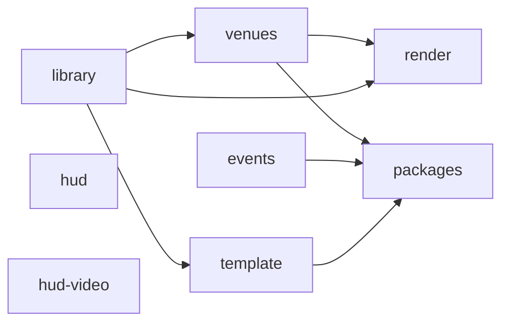

# Asset pipeline and regeneration

The Python package `pipeline/` makes all generated assets from the owner's GH3 PC files. Git keeps only the HUD and gem textures in `assets/`. The shared band library, the stage packs, and the song direction are local outputs. Git ignores them.

## Inputs

| Input | Default location | Used by |
| --- | --- | --- |
| GH3 PC `DATA` folder | `~/games/gh3-test-tools/game/DATA` | All GH3 steps (`GH3_DATA` in `scripts/regenerate.sh`) |
| Isolated Clone Hero copy | `~/games/clonehero-gh3-melon` | Shader bundles: they use the Unity `2022.3.62f2` format of this copy (`GH3_CLONE_HERO_DIR`) |
| Extracted GH3 HUD art | `~/games/gh3-skin-assets` (`global-gfx-png/`, `hud-png/`, `hud-runtime-dds/`) | HUD textures, Star Power highway |
| BetterGH3 package | `~/games/BetterGH3-FULLPACKAGE_v1.0.2.zip` | Tap gems |
| FastGH3 package | `~/games/gh3-test-tools/FastGH3_1.1.zip` | Cyan Star Power phrase gems |
| GH3 reference recording | `gh3-long-star-power-1600x900.mp4` (`GH3_REFERENCE_VIDEO`) | Ready banner, active Star Power highway |
| Rail reference frames | `pipeline/hud/references/gh3-fast-*.png` (in Git) | Highway rail overlays |

You also need `uv`, Python 3.12, the .NET 10 SDK (for `tools/Gh3SongTool`, which the library, venue, and event steps build), and FFmpeg (for the Video Shoot movies and the reference recording).

## Regenerate everything

```bash
MISE_QUIET=1 scripts/regenerate.sh --clean
GH3_REFERENCE_VIDEO=/path/to/gh3-long-star-power-1600x900.mp4 MISE_QUIET=1 scripts/regenerate.sh hud-video
MISE_QUIET=1 bash install.sh
```

`--clean` deletes `assets/libraries/gh3-band-v1`, `assets/stages`, and the generated packs in `assets/stage-packs` before the build. Use it for a clean build. Without it, files from earlier exports can stay in the output folders.

The script runs the steps one after the other. On a machine with little memory (for example 16 GB), do not run other large jobs at the same time. The venue export is the largest step (about 6 minutes, more than 1 GB of memory). When other agents or jobs can run, put the command under a shared lock:

```bash
flock /tmp/opencode/gh3-heavy.lock scripts/regenerate.sh --clean
```

## Steps and order

You can give one or more step names to `scripts/regenerate.sh`. Keep this order:



| Step | Command | Output |
| --- | --- | --- |
| `library` | `python -m pipeline.library --data DATA` | `assets/libraries/gh3-band-v1/`: band, direction clips, hair, hand fire, crowd, stage audio, global scripts, Video Shoot movies, Tesla noise, `catalog.json`, `library.json` |
| `venues` | `python -m pipeline.venues --data DATA` | `assets/stage-packs/gh3.*` (editable source packs) and `assets/stages/gh3.*` (compiled packs), `assets/stages/index.json` |
| `events` | `python3 -m pipeline.events DATA --library --output assets/stages/events` | Original song direction for all songs, `index.json`, `export-report.json` |
| `render` | `python -m pipeline.render.shaders --game GAME` and `python -m pipeline.render.particle_materials` | `render/*.bundle`, `render/stage-templates.json`, `render/particle-materials.json` in the library |
| `hud` | `python -m pipeline.hud.textures`, `pipeline.hud.hit_effects`, `pipeline.hud.fonts` | Gem, sustain, highway, HUD, hit-effect, and font files in `assets/` |
| `hud-video` | `python -m pipeline.hud.star_power --video V`, `pipeline.hud.ready_animation --video V` | `active-highway-*.png`, `ready-*.png`, `ready-animation.json` in `assets/` |
| `template` | `python -m pipeline.stagepack.template`, then `python -m pipeline.stagepack.install assets/stage-packs/example.studio` | The `example.studio` custom stage |
| `packages` | `python -m pipeline.package.build`, then `python -m pipeline.package.validate` | `assets/packages/*.chstage` and `gh3-band-v1.chlib` (package format v1), the same packages as folders in `assets/packages/unpacked/`, `build-report.json` |

Each command uses `uv run --with ...` for its Python packages. See `scripts/regenerate.sh` for the exact package list of each step.

**The `render` step must come after `venues` and `library`.** The stage shader contains only the GH3 material templates that the compiled venues, the band, and the crowd use. If you run it first, the shader has too few templates and the materials use the approximate fallback model.

The `venues` step compiles each pack against the library catalog. Thus run `library` first.

The `packages` step reads the source packs, the library folder, and the song direction. Thus run it last. It does not change the files that the mod reads today. The clip encoder (q48 + Brotli 11) keeps a cache in `assets/packages/.clip-cache/`, so a second run takes less time. Use `--jobs N` to set the number of encoder processes (default 2, about 0.1 GB each).

## Partial updates

| Change | Run |
| --- | --- |
| A file in `src/Stage/Shaders/` or `pipeline/gh3/shader.py` | `render` |
| Band or crowd mesh conversion only | `uv run --with pillow --with numpy --with 'shapely>=2.1' python -m pipeline.library --models-only`, then `render` |
| One venue | `python -m pipeline.venues --venue z_dive`, then `render` |
| One song, for a song folder | `python3 -m pipeline.events DATA/SONGS/mycurse_song.pak.xen --output "<song folder>/stage-events.json"` |
| A custom stage pack | `python -m pipeline.stagepack.install <source pack folder>` |

After a change, run `install.sh`. The installer copies `assets/*.png`, `*.dds`, the font and ready-animation JSON, `assets/counter-tuning.json`, `assets/stages`, and `assets/libraries` into the game.

## Check the result

```bash
python3 tools/audit-materials.py
```

The audit lists how each used material draws. The expected result is `921 template` and no `FALLBACK` lines (band, crowd, and ten venues).

The exporters are deterministic. The package files are reproducible: two runs of the `packages` step give byte-equal `.chstage` and `.chlib` files (sorted zip entries, fixed times and attributes, DEFLATE level 9 of the same zlib).

The round-trip check converts each package back to the files that the mod reads today and compares them with `assets/stages` and `assets/libraries/gh3-band-v1`:

```bash
flock /tmp/opencode/gh3-heavy.lock env MISE_QUIET=1 uv run --with pillow --with numpy --with 'shapely>=2.1' --with brotli \
  python -m pipeline.package.roundtrip --json /tmp/opencode/roundtrip.json
```

Expected result: every compiled venue file is byte-equal; the library JSON, textures, sounds, movies, and rigs are byte-equal or JSON-equal; 159 V coordinates of the guitarist and drummer meshes differ by at most 3e-8 (glTF stores 1 − v); all 1,240 clips are within the q48 error bound.

The `hud` step makes `beatline*.png` files that are different from the files in Git (also with the code before the cleanup). Do not commit the new files without a visual check.

## Package layout

| Module | Contents |
| --- | --- |
| `pipeline/gh3/` | Readers for GH3 PC data: PAK and QB (`formats`), the `DATA` source and camera banks (`direction`), scenes and textures (`scene`), skeletons and clips (`band_formats`), materials and shader translation (`materials`, `shader`), Havok ragdolls (`havok`), hair cards (`hair_mesh`), alpha cut-outs (`mesh_cutout`), typed scripts (`script_bank`, `venue_scripts`) |
| `pipeline/stagepack/` | The public stage-pack format: GLB IO (`gltf`), the compiler (`pack`), skinned actors (`actor`), the `install` and `template` commands |
| `pipeline/package/` | Package format v1 ([PACKAGE-FORMAT.md](PACKAGE-FORMAT.md)): converter (`build`), owner choices of the converter (`decisions`), round-trip check (`roundtrip`), runtime file readers and writers (`runtime`), validator (`validate`), schema evaluator for `schemas/` (`schema`), GLB reader (`glb`), q48 clip codec (`q48`), dry conversion check of the current outputs (`sources`) |
| `pipeline/library/` | The shared band library command and its steps |
| `pipeline/venues/` | The venue exporter, lighting export, and transforms |
| `pipeline/render/` | Shader bundles and particle material fields |
| `pipeline/hud/` | HUD, gem, highway, hit-effect, and font textures |
| `pipeline/events.py` | Song direction export |
| `pipeline/songtool.py` | Builds `tools/Gh3SongTool`, which shares the C# QB and song readers with the mod |
| `pipeline/paths.py` | Default locations |
