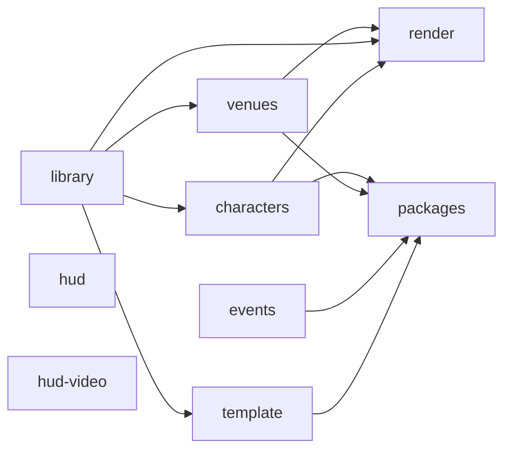

# Asset pipeline and regeneration

The Python package `pipeline/` makes all generated assets from the owner's GH3 PC files. Git keeps only the HUD and gem textures and the venue previews in `assets/` ([assets/README.md](../assets/README.md) lists the folders). The shared band library, the stage packs, and the song direction are local outputs. Git ignores them.

## Inputs

| Input | Default location | Used by |
| --- | --- | --- |
| GH3 PC `DATA` folder | `~/games/gh3-test-tools/game/DATA` | All GH3 steps (`GH3_DATA` in `scripts/regenerate.sh`) |
| Isolated Clone Hero copy | `~/games/clonehero-gh3-melon` | Shader bundles: they use the Unity `2022.3.62f2` format of this copy (`GH3_CLONE_HERO_DIR`) |
| Windows Clone Hero copy (same version, the official `CloneHero-Win-x64.zip` unpacked) | `~/games/clonehero-win/game` | Shader bundles: the Direct3D 11 program format (`Clone Hero_Data/Resources/unity_builtin_extra`, `GH3_CLONE_HERO_WINDOWS_DIR`). On the development machine, use `~/games/clonehero-win-spike/game` |
| Extracted GH3 HUD art | `~/games/gh3-skin-assets` (`global-gfx-png/`, `hud-png/`, `hud-runtime-dds/`) | HUD textures, Star Power highway |
| BetterGH3 package | `~/games/BetterGH3-FULLPACKAGE_v1.0.2.zip` | Tap gems |
| FastGH3 package | `~/games/gh3-test-tools/FastGH3_1.1.zip` | Cyan Star Power phrase gems |
| GH3 reference recording | `gh3-long-star-power-1600x900.mp4` (`GH3_REFERENCE_VIDEO`) | Ready banner, active Star Power highway |
| Rail reference frames | `pipeline/hud/references/gh3-fast-*.png` (in Git) | Highway rail overlays |

You also need `uv`, Python 3.12, the .NET 10 SDK (for `tools/Gh3SongTool`, which the library, venue, and event steps build), FFmpeg (for the Video Shoot movies and the reference recording), and Wine (for the `render` step, see [Shader tools](#shader-tools)).

## Regenerate everything

```bash
MISE_QUIET=1 scripts/regenerate.sh --clean
GH3_REFERENCE_VIDEO=/path/to/gh3-long-star-power-1600x900.mp4 MISE_QUIET=1 scripts/regenerate.sh hud-video
MISE_QUIET=1 bash install.sh
```

`--clean` deletes `assets/libraries/gh3-band-v1`, `assets/characters`, `assets/stages`, and the generated packs in `assets/stage-packs` before the build. Use it for a clean build. Without it, files from earlier exports can stay in the output folders.

The script runs the steps one after the other. On a machine with little memory (for example 16 GB), do not run other large jobs at the same time. The venue export is the largest step (about 6 minutes, more than 1 GB of memory). When other agents or jobs can run, put the command under a shared lock:

```bash
flock /tmp/opencode/gh3-heavy.lock scripts/regenerate.sh --clean
```

## Steps and order

You can give one or more step names to `scripts/regenerate.sh`. Keep this order:



| Step | Command | Output |
| --- | --- | --- |
| `library` | `python -m pipeline.library --data DATA` | `assets/libraries/gh3-band-v1/`: band, direction clips, hair, hand fire, crowd, stage audio, global scripts, Video Shoot movies, Tesla noise, `catalog.json`, `library.json` |
| `characters` | `python -m pipeline.characters --data DATA` | `assets/characters/<id>/` (`meshes.bin`, `stage.json`, `textures/`, `character.json`) for the 72 playable GH3 characters, and `assets/characters/inventory.json` ([GH3 characters](#gh3-characters)) |
| `venues` | `python -m pipeline.venues --data DATA` | `assets/stage-packs/gh3.*` (editable source packs) and `assets/stages/gh3.*` (compiled packs), `assets/stages/index.json` |
| `events` | `python3 -m pipeline.events DATA --library --output assets/stages/events` | Original song direction for all songs, `index.json`, `export-report.json` |
| `render` | `python -m pipeline.render.shaders --game GAME --windows-game WINDOWS_GAME` and `python -m pipeline.render.particle_materials` | `render/*.bundle`, `render/stage-templates.json`, `render/particle-materials.json` in the library |
| `hud` | `python -m pipeline.hud.textures`, `pipeline.hud.hit_effects`, `pipeline.hud.fonts` | `assets/gems/`, `sustains/`, `highway/` (with `beat-lines/`), `hud/` (`clear.png`, `rock-meter/`, `score/`, `counter/`, `messages/`, `you-rock/`), `fonts/`, `hit-effects/` |
| `hud-video` | `python -m pipeline.hud.star_power --video V`, `pipeline.hud.ready_animation --video V` | `assets/highway/star-power/active-highway-*.png`, `assets/hud/ready/` (`ready-*.png`, `ready-animation.json`) |
| `template` | `python -m pipeline.stagepack.template`, then `python -m pipeline.stagepack.install assets/stage-packs/example.studio` | The `example.studio` custom stage |
| `packages` | `python -m pipeline.package.build`, then `python -m pipeline.package.validate` | `assets/packages/*.chstage`, `gh3-band-v1.chlib`, and `gh3.*.chchar` (package format v1), the same packages as folders in `assets/packages/unpacked/`, `build-report.json` |

Each command uses `uv run --with ...` for its Python packages. See `scripts/regenerate.sh` for the exact package list of each step.

**The `render` step must come after `venues`, `library`, and `characters`.** The stage shader contains only the GH3 material templates that the compiled venues, the band, the crowd, and the GH3 characters use (the characters add five templates: `SkinShader_Pass1_Pass2`, `SkinShader_Pass2`, `SkinShaderEnvMap`, `SkinShader_VertexColor_Pass3`, `SkinShaderEnvMap_VertexColor`). If you run it first, the shader has too few templates and the materials use the approximate fallback model.

The `venues` step compiles each pack against the library catalog. Thus run `library` first.

The `packages` step reads the source packs, the library folder, and the song direction. Thus run it last. Its output (`assets/packages/`) is what `install.sh` and the release build install. The clip encoder (q48 + Brotli 11) keeps a cache in `assets/packages/.clip-cache/`, so a second run takes less time. Use `--jobs N` to set the number of encoder processes (default 2, about 0.1 GB each).

## GH3 characters

`python -m pipeline.characters` reads the character tables of the GH3 QB files (`Musician_Profiles`, `musician_body`, `musician_instrument`, and the store lists; [PARITY-NOTES.md](PARITY-NOTES.md#playable-characters)) and exports every playable character in every outfit and style: 64 variants of the eight main characters, Slash, Tom Morello, Lou and Thick Izzy, God of Rock, Grim Ripper, and the two other singers (72 in total). `--only <id>` exports one character. It takes about 80 s and 0.3 GB of memory; the output is about 0.4 GB.

Each character keeps the GH3 data as the library band does (`pipeline/library/band.py`): the meshes of its model PAK and of the default instrument of its GH3 profile (guitarists; the female singer keeps her microphone), the materials with their GH3 templates and constants, the textures, and the combined hair cards. Package format v1 has fixed rig profiles, so the export moves the mesh from the character's GH3 skeleton to the profile rig of its role (`GH3_Guitarist_Axel` or `GH3_Singer_Male`):

- Body and instrument bones: each vertex keeps its place in the frame of its bone, and the bone takes the profile rest pose.
- Face bones (below `bone_head`): the vertices move with the head, so the face keeps its shape. The face bones keep their weights.
- `Bone_ACC_*` joints below the head (hair): each chain goes to the profile hair chain with the nearest root (joint *n* to joint *n*) when that root is within 12 cm, else the chain stays on the head. Other `Bone_ACC_*` joints go to their body parent.

Axel Steel (outfit 1, style 1) on his own rig gives the same body and hair parts as the library guitarist (byte-equal; the instrument differs). The `packages` step writes `assets/packages/<id>.chchar` (one package for each outfit and style, license and permissions from `pipeline/package/decisions.py`), and the validator checks them against the library profile rigs. `install.sh` and `scripts/build-release.sh` ship `assets/packages/gh3.*.chchar` in `Mods/GH3Skin/Packages/`.

Sizes (2026-10-09): 72 packages, 411,351,870 bytes (2.1–8.3 MB, mean 5.7 MB). Release zips (`scripts/build-release.sh`, commit 35d862f) 1,640,161,639 bytes (Linux) and 1,640,164,985 bytes (Windows), against 1,228.78 MB before. Installed `Mods/GH3Skin` 1,640,198,608 bytes (was 1,228,837,531). Cache after the first start 1.92 GB (the characters 0.50 GB). Cold import of all packages 45.1 s (was 22.0 s); the stage still waits only for the library, the venue, and the selected characters.

## Shader tools

The `render` step makes an OpenGL Core program and a Direct3D 11 program for each shader (see [ARCHITECTURE.md](ARCHITECTURE.md#shader-programs-for-each-graphics-api)). `pipeline/render/toolchain.py` gets the Direct3D 11 tools. They need no system package and no root access:

| Tool | Source | Use |
| --- | --- | --- |
| glslang 16.6.0 | Khronos GitHub release `glslang-16.6.0-linux-x86_64-release.tar.gz` | GLSL to SPIR-V |
| SPIRV-Cross 2021-01-15 | Khronos GitHub release `spirv-cross-gcc-trusty-64bit-9acb9ec31f.tar.gz` (the last release with Linux binaries) | SPIR-V to HLSL |
| FXC and `d3dcompiler_47.dll` (Microsoft) | NuGet package `Microsoft.Windows.SDK.CPP` 10.0.26100.7705: `c/bin/10.0.26100.0/x64/fxc.exe` and `c/Redist/D3D/x64/d3dcompiler_47.dll`. Only these two files download (HTTP range requests, about 2 MB) | HLSL to DXBC, under Wine |
| Wine | `wine` on `PATH`, or `GH3_WINE=/path/to/wine` | Runs FXC on Linux |

- The first run downloads the files to `~/.cache/gh3-skin/shader-tools` (`GH3_SHADER_TOOLS` sets another folder). Each file has a fixed SHA-256 value.
- The Windows SDK package requires acceptance of its license (`https://aka.ms/WinSDKLicenseURL`). Read it, then set `GH3_ACCEPT_WINDOWS_SDK_LICENSE=1` for the first run. Without it, the step stops with a message.
- `GH3_GLSLANG` and `GH3_SPIRV_CROSS` select other binaries.
- The tools use their own Wine prefix in the cache folder. The step does not use a GPU. It takes about 45 s for the five bundles; the stage shader is the largest part.
- The output is deterministic: two runs give the same bundle bytes.

```bash
GH3_WINE=~/games/gh3-test-tools/wine-root/usr/bin/wine GH3_ACCEPT_WINDOWS_SDK_LICENSE=1 \
  GH3_CLONE_HERO_WINDOWS_DIR=~/games/clonehero-win-spike/game flock /tmp/opencode/gh3-heavy.lock scripts/regenerate.sh render
```

## Partial updates

| Change | Run |
| --- | --- |
| A file in `src/Stage/Shaders/` or `pipeline/gh3/shader.py` | `render` |
| Band or crowd mesh conversion only | `uv run --with pillow --with numpy --with 'shapely>=2.1' python -m pipeline.library --models-only`, then `render` |
| One venue | `python -m pipeline.venues --venue z_dive`, then `render` |
| One song, for a song folder | `python3 -m pipeline.events DATA/SONGS/mycurse_song.pak.xen --output "<song folder>/stage-events.json"` |
| A custom stage pack | `python -m pipeline.stagepack.install <source pack folder>` |
| Venue preview images (`assets/previews/<id>.png`) | `GH3_CLONE_HERO_DIR=<game copy> scripts/capture-venue-previews.sh [id ...]` (one game run for each venue, under the record lock), then `python -m pipeline.package.build --no-library` |
| Test characters from the library members | `python -m pipeline.package.character --library assets/packages/gh3-band-v1.chlib --output DIR [--role ROLE ...]` writes `gh3.<role>.chchar` (body and hair, no instrument). Do not write them to `assets/packages`: `install.sh` installs `assets/packages/gh3.*.chchar` |
| GH3 characters | `python -m pipeline.characters [--only ID ...]`, then `render` (new templates only), then `python -m pipeline.package.build --no-venues --no-library` |

After a change, run `install.sh`. The installer copies the skin folders (`gems`, `sustains`, `highway`, `hud`, `fonts`, `hit-effects`) to `Mods/GH3Skin/assets/` with the same layout, the packages (`assets/packages/*.chstage`, `gh3-band-v1.chlib`, and the GH3 characters `gh3.*.chchar`, zip form, with their file times) to `Mods/GH3Skin/Packages/`, and the shader bundles (`assets/libraries/gh3-band-v1/render/*.bundle`, `stage-templates.json`) to `Mods/GH3Skin/render/`. It first removes the skin folders and the files of earlier installs (the flat files in `Mods/GH3Skin/assets/`, `Mods/GH3Skin/counter-tuning.json`, and the older install in `Mods/GH3Skin/assets/stages` and `assets/libraries`), so that no old file stays. The mod loads stages only from packages. A changed package gets a new cache entry in `UserData/GH3Skin/Cache/` at the next start.

`assets/stages` (the compiled venues and `stages/events`) and `assets/libraries` (the compiled library and the shader bundles) are intermediate outputs: the `packages` step (`pipeline.package.build`) reads them, and the tests (`GH3_PACK_ASSETS`, `GH3_PACKAGE_ASSETS`) and `tools/audit-materials.py` check them. The installer does not copy them, except the shader bundles.

To make the release zips, see [VERIFICATION.md](VERIFICATION.md#release-build).

## Check the result

```bash
python3 tools/audit-materials.py
```

The audit lists how each used material draws. The expected result is `2031 template` (921 for the band, crowd, and ten venues, and 1,110 for the 72 GH3 characters) and no `FALLBACK` lines.

The exporters are deterministic. The package files are reproducible: two runs of the `packages` step give byte-equal `.chstage` and `.chlib` files (sorted zip entries, fixed times and attributes, DEFLATE level 9 of the same zlib).

The round-trip check converts each package back to the compiled runtime files and compares them with `assets/stages` and `assets/libraries/gh3-band-v1`:

```bash
flock /tmp/opencode/gh3-heavy.lock env MISE_QUIET=1 uv run --with pillow --with numpy --with 'shapely>=2.1' --with brotli \
  python -m pipeline.package.roundtrip --json /tmp/opencode/roundtrip.json
```

Expected result: every compiled venue file is byte-equal; the library JSON, textures, sounds, movies, and rigs are byte-equal or JSON-equal; 159 V coordinates of the guitarist and drummer meshes differ by at most 3e-8 (glTF stores 1 − v); all 1,240 clips are within the q48 error bound.

The four library band members can be written as character packages (`gh3.<role>.chchar`, the round-trip reference of the Blender character tools, [BLENDER-ADDON.md section 2.11](BLENDER-ADDON.md#211-characters)):

```bash
MISE_QUIET=1 uv run --with numpy --with brotli python -m pipeline.package.character --library assets/packages/gh3-band-v1.chlib --output /tmp/opencode/characters
```

The C# importer must give the same cache content as the Python pipeline. Import all packages outside the game, then compare (about 20 s and 0.5 GB for the import; 1.5 GB of disk):

```bash
dotnet run --project tools/PackageImport -c Release -- assets/packages <cache folder>
flock /tmp/opencode/gh3-heavy.lock env MISE_QUIET=1 uv run --with numpy --with pillow --with brotli \
  python -m pipeline.package.cachecheck <cache folder> --json /tmp/opencode/cachecheck.json
```

Expected result: every package `equal` (character caches are skipped; `preview.png` is a copy of the manifest preview); textures BC1/BC3 with a minimum first-level PSNR above 36 dB. With `--rgba` (no BC encoding) all textures are pixel-equal (`maxError` 0). Put the cache folder on a disk, not on `/tmp` (a RAM disk here).

The `hud` step makes `assets/highway/beat-lines/beatline*.png` files that are different from the files in Git (also with the code before the cleanup). Do not commit the new files without a visual check. To keep the files in Git, run `git checkout -- assets/highway/beat-lines`.

## Package layout

| Module | Contents |
| --- | --- |
| `pipeline/gh3/` | Readers for GH3 PC data: PAK and QB (`formats`), the `DATA` source and camera banks (`direction`), scenes and textures (`scene`), skeletons and clips (`band_formats`), materials and shader translation (`materials`, `shader`), Havok ragdolls (`havok`), hair cards (`hair_mesh`), alpha cut-outs (`mesh_cutout`), typed scripts (`script_bank`, `venue_scripts`) |
| `pipeline/stagepack/` | The public stage-pack format: GLB IO (`gltf`), the compiler (`pack`), skinned actors (`actor`), the `install` and `template` commands |
| `pipeline/package/` | Package format v1 ([PACKAGE-FORMAT.md](PACKAGE-FORMAT.md)): converter (`build`), owner choices of the converter (`decisions`), round-trip check (`roundtrip`), runtime file readers and writers (`runtime`), validator (`validate`), schema evaluator for `schemas/` (`schema`), GLB reader (`glb`), q48 clip codec (`q48`), dry conversion check of the current outputs (`sources`), comparison of the C# importer cache with the Python output (`cachecheck`) |
| `pipeline/library/` | The shared band library command and its steps |
| `pipeline/characters.py` | The playable GH3 characters: inventory from the QB tables and export on the library rigs |
| `pipeline/venues/` | The venue exporter, lighting export, and transforms |
| `pipeline/render/` | Shader bundles and particle material fields |
| `pipeline/hud/` | HUD, gem, highway, hit-effect, and font textures |
| `pipeline/events.py` | Song direction export |
| `pipeline/songtool.py` | Builds `tools/Gh3SongTool`, which shares the C# QB and song readers with the mod |
| `pipeline/paths.py` | Default locations |
