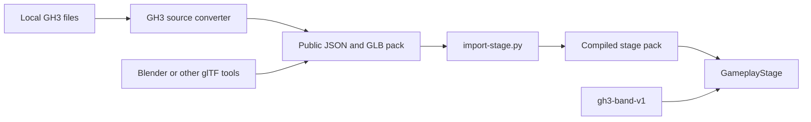

# Stage packs

From build **0.8.111**, all ten GH3 performance venues use the public stage-pack importer and one runtime loader.

## Installed venues

| Pack ID | Venue | Scenery parts | Light housings | Animated scenery models |
| --- | --- | ---: | ---: | ---: |
| `gh3.party` | Backyard Bash | 186 | 0 | 0 |
| `gh3.dive` | Mitch's Moose Lounge | 276 | 20 | 0 |
| `gh3.video` | Video Shoot | 288 | 12 | 0 |
| `gh3.artdeco` | Ye Olde Royal Odeon | 233 | 17 | 3 |
| `gh3.prison` | Shanker's Island | 280 | 19 | 1 |
| `gh3.wikker` | Desert Rock Tour | 314 | 18 | 0 |
| `gh3.budokan` | Kaiju Megadome | 356 | 71 | 0 |
| `gh3.hell` | Lou's Inferno | 286 | 19 | 2 |
| `gh3.soundcheck` | Soundcheck | 194 | 13 | 0 |
| `gh3.credits` | Credits | 82 | 0 | 0 |

`z_debug`, `z_testlevel_peds`, and `z_viewer` are development zones. They have no performance placements or camera banks. The conversion report covers the ten performance venues.

Use the pack ID to select a venue:

```bash
MISE_QUIET=1 GH3_SKIN_STAGE=gh3.hell bash run-gh3-skin.sh
```

The default is `gh3.budokan`. `off` selects the stock background. `assets/stages/index.json` lists installed pack IDs and names.

## Build from your GH3 files

```bash
MISE_QUIET=1 uv run --with pillow --with numpy --with 'shapely>=2.1' \
  python prepare-library.py --data "$HOME/games/gh3-test-tools/game/DATA"
MISE_QUIET=1 uv run --with pillow --with numpy --with 'shapely>=2.1' \
  python export-gh3-stages.py --data "$HOME/games/gh3-test-tools/game/DATA"
MISE_QUIET=1 python3 export-stage-events.py \
  "$HOME/games/gh3-test-tools/game/DATA" --library --output assets/stages/events
MISE_QUIET=1 bash install.sh
```

To reuse the complete band export from 0.8.110, supply `--existing assets/stages/budokan` to `prepare-library.py`. It copies shared assets, removes venue waypoints and camera data, and resets library placements to the origin.

The paths are:

| Path | Contents |
| --- | --- |
| `assets/libraries/gh3-band-v1/` | Shared band, instruments, hair constraints, crowd, animations, and hand fire |
| `assets/stage-packs/<id>/` | Editable manifest, GLB files, camera bank, and lighting bank |
| `assets/stages/<id>/` | Compiled runtime pack |
| `assets/stages/events/` | Original song direction |

The generated files are excluded from Git. `install.sh` copies the compiled packs and shared library to the isolated game.

## Common import path



The GH3 converter writes the same source format that an author supplies. It then calls `import-stage.py`. The runtime reads `pack.json`; it does not read the source PAK files, source reports, or venue names to select special behavior. Performer placements, walking destinations, camera shots, light groups, fixtures, actors, and emitter positions belong to the pack. The shared animation library has no venue waypoints.

## Create and import a stage

The [custom-content specification](CUSTOM-CONTENT.md) defines the fields. To create a working example without GH3 venue data:

```bash
MISE_QUIET=1 uv run --with pillow --with numpy python create-stage-template.py
MISE_QUIET=1 uv run --with pillow --with numpy --with 'shapely>=2.1' \
  python import-stage.py assets/stage-packs/example.studio
MISE_QUIET=1 bash install.sh
MISE_QUIET=1 GH3_SKIN_STAGE=example.studio bash run-gh3-skin.sh --preview
```

The example has four performer placements, cameras, a walking destination, a moving light fixture, effect emitters, and a rotating skinned sign. Its GLB files can be edited in a glTF-compatible tool. The shared band library is required for playback.

The importer accepts embedded glTF 2.0 GLB files with triangle meshes, normals, base-color textures, UVs, vertex colors, and `OPAQUE`, `MASK`, or `BLEND` materials. It applies node transforms, normal transforms, handedness, winding, and UV conversion. Mask textures are converted to trimmed geometry. Bake unsupported extensions and morph targets before import.

Additional public material properties are in glTF `extras`:

| Property | Meaning |
| --- | --- |
| `gh3Additive: true` | Additive transparent material |
| `gh3CrowdAtlas: true` | Sample the shared animated crowd atlas; UVs use eight columns and three rows |
| `gh3SortedTransparency: true` | Sort triangles for a skinned actor's transparent material |

Fixture mesh nodes set `extras.gh3FixtureId` to a lighting beam ID. Local positive Z is the beam axis. The importer bakes mesh scale. `extras.gh3FixtureFixedPosition: true` keeps the authored housing position while the controller changes its rotation. Other housings follow both position and rotation.

### Animated scenery

The optional `actors` object in `stage-pack.json` maps stage-local names to these fields:

| Field | Required | Meaning |
| --- | --- | --- |
| `model` | Yes | Pack-relative GLB with one skin |
| `transform` | Yes | Position and unit quaternion in stage coordinates |
| `clip` | No | Named GLB animation; default is the first clip |
| `playback` | No | `loop`, or `hold` to retain its first pose; default `loop` |
| `lightGroup` | No | Stage-local group; default `Stage` |

An actor can use its own scenery rig. This does not change the fixed performer rigs. All actor mesh nodes use the same skin. The importer checks inverse bind matrices, joint hierarchy, unit joint scale, weights, and animation channels. It accepts translation and rotation tracks with `LINEAR` or `STEP` interpolation, sampled at 60 Hz. Clips are at most 120 seconds; there can be at most 16. A model without animation retains its bind pose.

Loops use the song clock. Pause and seek therefore have the same behavior as stage cameras and lighting. The original dragon, two knights, hammer, and Satan puppet use their idle clips. The prison gas prop retains the first pose of its throw clip until a future venue-event controller can trigger it.

### Continuous orbit cameras

The public `OrbitContinuous` control uses one camera point with an `anchor` and `lookAt`. The point's position is a world-axis offset from the anchor. `angularSpeed` gives degrees per second around the vertical axis. `heightEase` is `[start, end, rate]`; its vertical offset is `end + (start - end) * exp(-rate * songTime)`. Camera cuts do not reset this motion.

Credits uses this control to reproduce its original orbit and rising camera. Soundcheck uses its source normal camera. These two zones have no standard performance camera bank; the converter does not reuse the unrelated default world-space shots.

The public `Keyframes` control preserves timed holds, moves, and lens changes in the source quick zooms and scripted intros. Its `times` array gives seconds from the cut; `interpolation` is `smooth` or `linear`. Original spline intros use the shared multi-point camera interpolation.

### Lighting details

Light intensity can be negative for authored subtractive lighting. Equal near and far distances produce a sharp attenuation boundary. These values occur in the original venues.

Each snapshot lists every light and beam. A setting can include `inherit: true` to retain the preceding state. Its ordinary fields supply the initial state when it is the first snapshot. This supports partial source snapshots through the same public interface. Soundcheck and Credits use their authored static light nodes because they have no snapshot bank.

## Scope

All packs use the existing band animation, hand and drum IK, hair, camera, light motion, transparency, and streak-fire systems. They use the same original-song direction library. The main venues retain their source start positions. The credits source has only a guitarist start; its manifest supplies three extra placements for the required four-role band. Soundcheck retains its source off-stage placements for the supporting performers.

The converter reads literal pyro positions and referenced position arrays from the source venue scripts and writes ordinary emitter transforms. The shared burst styles remain approximations. Runtime execution of GH3 scripts is not implemented. Venue-specific encore sequences, stage divers, security and dancer behavior, score-dependent scenery changes, native shaders, and native shadows remain outside this port. Conversion reports list source model nodes so these are visible gaps rather than hidden runtime paths.

Skin-pack import remains separate work. Stage packs use the shared default skins. Build 0.8.112 adds version 2 song-channel resolution and retains version 1 complete-timeline replacement. See [song cue sources](STAGES.md#where-cues-come-from).

## Checks

- A fresh shared-library build produced the same binary assets as the saved 0.8.110 band export.
- Renaming Budokan to `author.renamed-stage` and importing it again produced 124 identical runtime files. Only the pack manifest identity changed.
- The synthetic `example.studio` pack passes through the same importer and loader.
- Python checks cover GLB coordinate conversion, reflection and winding, pack references, failure handling, actor import, and source script extraction.
- C# checks load every pack, validate camera anchors against the shared rigs, sample cameras and lighting through My Curse, and check backward seeks. They also read each scenery animation through the runtime animation reader.
- All 41 Python checks and the C# logic suite pass. The build has no warnings or errors. SHA-256 checks confirm 2,053 installed pack and library files.
- All ten venues and the Studio pack were checked in 1600×900 GPU previews with automatic cameras. Short samples had 95th-percentile frame times below 14 ms on the local RTX 3060 Laptop GPU. The 50-second My Curse sample had a 16.3 ms 95th percentile.
- A 50-second My Curse run through the shared library kept hand fire off below 100 notes. Its first active sample was combo 100 at 20.919 seconds.
- The final conversion reports have zero unmapped camera controls. Native smoothing, noise, and spline details retain the approximation limits described in [STAGES.md](STAGES.md).

Run the checks after importing all ten venues:

```bash
MISE_QUIET=1 uv run --with pillow --with numpy --with 'shapely>=2.1' \
  python -m unittest discover -s tests -p 'test_*.py'
MISE_QUIET=1 GH3_PACK_ASSETS="$PWD/assets" \
  dotnet run --project tests/SkinLogic.Tests.csproj -c Release --disable-build-servers
```
