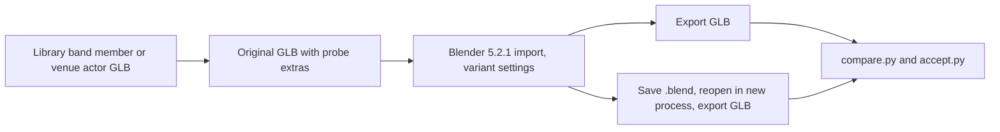

# Spike: GH3 rig through a Blender glTF round trip

PACKAGING-PLAN step 2, item 4. Owner: spike agent `blender`. Date: 2026-10-09.

## Question

Does a GH3 skinned character keep its skeleton, bone local frames, inverse bind matrices (IBMs), weights, and GH3 extras
when a creator imports the GLB into Blender and exports it again? Which import and export settings keep it, and which
settings break it?

## Method



1. `tools/spike-blender/band_glb.py` writes the library guitarist (`axel_1`, 125 joints, 9 hair joints, fingers) and
   singer (`Singer_Male`, 121 joints, 15 hair joints) as skinned GLBs with the existing `GlbWriter.actor`. The rig comes
   from `animation.bin` (bind pose), the mesh from `meshes.bin`, the materials from `stage.json`. Each GLB has 2 s of
   the first library clip (30 fps). The venue actor is `gh3.prison/actor-71546938.glb` (75 joints, 3 clips at 60 fps).
   The script adds `extras.gh3Probe` to every node and `extras.gh3ProbeMesh` to the mesh.
2. `tools/spike-blender/run.sh` runs 15 variants per model in `blender-clean --background --factory-startup`
   (one process for each variant, under the heavy lock). Export is always `export_format="GLB"`.
3. `tools/spike-blender/compare.py` compares each output with its original. It matches joints by name and vertices
   by bind-pose skinned position, UV, and normal (Blender reorders and splits vertices). For the pose test it plays
   the original GH3 clip (joint local TRS by bone name, as the runtime does) on both rigs and skins the mesh. It also
   plays the clip that Blender exported. It samples 30 times along the clip.
4. `tools/spike-blender/accept.py` runs the existing stage-pack actor compiler (`compile_actor`) on every output.

Variant names are `<import>-<export>`. Import: `default`, `temperance` / `fortune` (bone direction modes), `nobind`
(`guess_original_bind_pose=False`), `merge` (`merge_vertices=True`), `fps30` / `fps60` (scene frame rate set
**before** import). Export: `default`, `keep` (`export_extras=True`, `export_attributes=True`), `defbones`
(`export_def_bones=True`), `flatten` (`export_hierarchy_flatten_bones=True`), `zup` (`export_yup=False`),
`posed-frame` (timeline on frame 20 and `export_rest_position_armature=False`). `blend-*` = import with defaults,
save `.blend`, reopen it in a new Blender process, export.

## Results

### Rig, IBMs, mesh, and pose (maximum over guitarist, singer, venue actor)

| Variant (import-export) | Local T (mm) | Local R (°) | IBM max abs | IBM vertex err (mm) | world·IBM − mesh | Bind vertex (mm) | Normal (°) | GH3 clip on rig (cm) | Exported clip (cm) |
| --- | --- | --- | --- | --- | --- | --- | --- | --- | --- |
| `default-default` | 0.00053 | 0.00032 | 8.1e-06 | 0.00069 | 7.3e-07 | 0.00085 | 0.64 | 0.00073 | 1.1 |
| `blend-default` | 0.00053 | 0.00032 | 8.1e-06 | 0.00069 | 7.3e-07 | 0.00085 | 0.64 | 0.00073 | 1.1 |
| `default-keep` | 0.00053 | 0.00032 | 8.1e-06 | 0.00069 | 7.3e-07 | 0.00085 | 0.64 | 0.00073 | 1.1 |
| `blend-keep` | 0.00053 | 0.00032 | 8.1e-06 | 0.00069 | 7.3e-07 | 0.00085 | 0.64 | 0.00073 | 1.1 |
| `fps30-default` | 0.00053 | 0.00032 | 8.1e-06 | 0.00069 | 7.3e-07 | 0.00085 | 0.64 | 0.00073 | 0.00072 |
| `fps30-keep` | 0.00053 | 0.00032 | 8.1e-06 | 0.00069 | 7.3e-07 | 0.00085 | 0.64 | 0.00073 | 0.00072 |
| `fps60-default` | 0.00053 | 0.00032 | 8.1e-06 | 0.00069 | 7.3e-07 | 0.00085 | 0.64 | 0.00073 | 0.00072 |
| `nobind-default` | 0.0007 | 0.00036 | 8.2e-06 | 0.00079 | 7.7e-07 | 0.00092 | 0.64 | 0.00072 | 1.1 |
| `merge-default` | 0.00053 | 0.00032 | 8.1e-06 | 0.00069 | 7.3e-07 | 6.4 | 70 | 0.64 | 1.1 |
| `default-defbones` | 0.00053 | 0.00032 | 8.1e-06 | 0.00069 | 7.3e-07 | 0.00085 | 0.64 | 0.00073 | 1.1 |
| `temperance-default` | 2200 | 180 | 2.6 | 2100 | 6.5e-06 | 0.0024 | 0.64 | 210 | 1.1 |
| `fortune-default` | 2200 | 180 | 2.6 | 2100 | 3.6e-06 | 0.0013 | 0.64 | 210 | 1.1 |
| `default-flatten` | 2200 | 180 | 8.1e-06 | 0.00069 | 1e-06 | 0.00094 | 0.64 | 230 | 1.1 |
| `default-posed-frame` | 710 | 150 | 8.1e-06 | 0.00069 | 2.2 | 1000 | 180 | 100 | 100 |
| `default-zup` | 0.00053 | 0.00032 | 1.4 | 2700 | 6.8e-07 | 1800 | 180 | 190 | 240 |

Column meanings: *Local T / R* = joint local transform difference to the parent joint. *IBM vertex err* = vertex
movement when the round-trip mesh is skinned with the original IBMs instead of its own. *world·IBM − mesh* = the
`compile_actor` consistency check (it rejects above 1e-4). *Bind vertex* = matched vertex distance in the bind pose.
*GH3 clip on rig* = the original clip played by bone name on the round-trip rig. *Exported clip* = the clip that
Blender wrote, played on the round-trip rig. All joints are present in every variant, with the same parents (except
`flatten`). The hair and finger joints are inside these maximums.

### Mesh, weights, and clips (`default-default`)

| Model | Joints | Hair joints | Vertices (orig → round trip) | Unused vertices dropped | Influence count changes | Max weight diff | Clip keys orig → 24 fps → fps set before import |
| --- | --- | --- | --- | --- | --- | --- | --- |
| guitarist | 125 | 9 | 7859 → 7921 | 0 | 0 | 0 | 61 (2.0 s) → 49 (2.0 s) → 61 (2.0 s) |
| singer | 121 | 15 | 8453 → 8479 | 4 | 8 | 4.5e-05 | 61 (2.0 s) → 49 (2.0 s) → 61 (2.0 s) |
| venue-prison | 75 | - | 3486 → 3505 | 0 | 7 | 8.8e-05 | 295 (4.9 s) → 118 (4.875 s) → 295 at 60 fps (4.9 s) |

- Vertex order is never kept, and the count grows by 19–62 (Blender splits vertices). Joint order in `skin.joints` is
  never kept. Blender adds one `Armature` root node above the root joint.
- UV0 and `COLOR_0`: 0 difference on all matched vertices. Weight sums: error ≤ 3e-8. The changed influence counts are
  influences below 1e-4 that Blender drops.
- Material names, `alphaMode`, `alphaCutoff`, `doubleSided`, `baseColorFactor`, and base colour textures: no change.
- Animation names and count: kept (3/3 on the venue actor). Blender adds a constant `scale` channel to every joint
  (|scale − 1| ≤ 3.5e-6 with the default bone mode, ≤ 2.4e-5 with any mode) and writes constant channels as `STEP`.

### GH3 extras and streams

| Item | Default export | `export_extras=True`, `export_attributes=True` | After `.blend` save and reopen |
| --- | --- | --- | --- |
| Node `extras.gh3*` (joints, mesh node) | lost (0/125) | kept (125/125, mesh node yes) | kept |
| Material `extras.gh3*` (shading, shader constants, cutoff) | lost (0/15) | kept, values equal | kept |
| `_GH3_UV0..5`, `_GH3_BINORMAL`, `_GH3_TANGENT` | lost | kept, max diff 5.6e-7 | kept |
| Extras that hold glTF texture indices (`gh3Shader.textures`) | lost | **wrong image in 46/50, 23/26, 29/30** | wrong |
| Images | 28 → 10, 18 → 5, 19 → 7 | same | same |

Blender exports only the images that the material node tree uses for glTF sockets, and it renumbers textures. The
index numbers in the extras stay the same, so they point at other images or past the end.

### Existing actor compiler (`compile_actor`) on Blender output

| Input | Result |
| --- | --- |
| Originals | pass (3/3) |
| Every Blender output | **fail**: "Bake actor animation to joint translation/rotation" (Blender `scale` channels). With `keep`: "Invalid GH3 sampler texture" first. **Fixed later:** `compile_actor` drops unit scale channels; the outputs now pass, except `posed-frame` (IBM check) and the `keep` texture-index extras |
| Same, after `accept.py --tolerant` drops unit `scale` channels and texture-index extras | pass, except `posed-frame` (IBM check, correct) and singer `keep` (the tolerant step removed `gh3Shader`, so the cutout trim ran: an artifact of the probe) |
| `temperance`, `fortune`, `flatten`, `zup` | pass the compiler; they are wrong for GH3 clips or orientation (see table above) |

## Findings

1. **The rig survives with the default bone mode.** With `bone_heuristic=BLENDER` (default), joint local transforms
   change by ≤ 0.0007 mm and ≤ 0.0004°, IBMs by ≤ 8.2e-6 (≤ 0.0008 mm at vertices). A GH3 clip played by bone name on
   the round-trip rig moves vertices by ≤ 0.00073 cm. Saving to `.blend` and reopening gives the same numbers.
2. `guess_original_bind_pose` has no effect on these files, because their node rest pose equals the IBM bind pose.
3. **`TEMPERANCE` and `FORTUNE` break GH3 clips.** They keep joint positions and skin binding (bind vertex ≤ 0.0024 mm),
   but they turn the bone local frames (up to 180°) and write new IBMs. The original GH3 clips then move vertices up to
   2.1 m. Clips that Blender itself bakes still play correctly on that rig (1.1 cm, the 24 fps error).
4. `export_hierarchy_flatten_bones` breaks clips (no parent chain). `export_rest_position_armature=False` on a posed
   timeline and `export_yup=False` break the file. `merge_vertices=True` on import changes normals and UV seams.
   `export_def_bones` changes nothing (the importer marks every joint as deforming).
5. **Default export drops all GH3 data**: `export_extras` and `export_attributes` are off by default.
6. **Frame rate:** the importer converts key times at the scene rate (24 fps after factory startup) and the exporter
   samples whole frames. GH3 clips at 30 fps then lose up to 1.1 cm and can end one frame early (4.9 → 4.875 s).
   With the scene rate set to the clip rate **before** import, the error is ≤ 0.00072 cm. Changing the rate after import
   is wrong (it changes the clip speed; measured 8.6–110 cm in a first run).

## Recommended rule for package format v1

**Characters (`.chchar`, fixed GH3 profile):**

- Map joints, vertices, and clips by **joint name**, never by joint index or vertex order.
- The importer computes the bind pose from the **node local transforms** (as `compile_actor` does now) and checks the
  IBMs against them: `max|world(joint)·IBM − world(mesh)| ≤ 1e-4` (measured ≤ 1e-6 on good files, 1.9–2.2 on a posed
  export).
- The importer checks every joint against the profile: same names, same parents, local translation ≤ **0.1 mm**,
  local rotation ≤ **0.01°**, |scale − 1| ≤ **1e-4**. Measured on good files: 0.0007 mm, 0.0004°, 3.5e-6. Measured on
  wrong bone modes: 1900–2240 mm, 175–180°. The margin is more than 4 orders of magnitude on each side. Reject with a
  message that names the cause ("bone direction must be Blender", "export at rest position", "Y up").
- After the check passes, use the **profile** local transforms for clip playback and the file IBMs for skinning.
- Accept and drop animation `scale` channels when |scale − 1| ≤ 1e-4; reject other scale keys. `compile_actor` must
  get this change, or no Blender file passes.

**Venue actors (own rig, own clips):** trust the node local transforms and keep the IBM consistency check. Any bone
mode is acceptable, because Blender bakes the clips on its own bone frames. Accept unit `scale` channels as above.

**Required Blender settings (the add-on sets them; document them for manual export):**

| Setting | Value | Why |
| --- | --- | --- |
| Import `bone_heuristic` | `BLENDER` (default) | keeps GH3 bone frames |
| Import `merge_vertices` | off (default) | keeps normals and UV seams |
| Scene frame rate before import and at export | clip rate (30 for GH3 band clips, 60 for venue actors) | exact clip keys |
| Export `export_extras` | **on** | node and material `extras.gh3*` |
| Export `export_attributes` | **on** | `_GH3_*` vertex streams |
| Export `export_yup` | on (default) | glTF axis |
| Export `export_rest_position_armature` | on (default) | rest = bind |
| Export `export_hierarchy_flatten_bones` | off (default) | parent chain for clips |

**Extras must not hold glTF texture indices.** Refer to GH3 sampler textures by image name or by a file in the
package (sidecar), or connect them to real glTF material slots. The current `gh3Shader.textures`,
`gh3MaskTexture`, and `gh3LayerTexture` fields do not survive Blender.

## Evidence

All under `/tmp/opencode/spike-blender/`:

- `orig/*.glb` (inputs), `out/*.glb` and `out/*.blend` (round trips), `logs/*.log` (Blender output)
- `results.jsonl` (one row per output, all measurements), `summary.md` (tables above)
- `accept.txt` (compiler on raw output), `accept-tolerant.txt` (compiler after the tolerant step)

Reproduce (from the worktree, under `flock /tmp/opencode/gh3-heavy.lock`):

```sh
PYTHONPATH=$PWD uv run --with pillow --with numpy python tools/spike-blender/band_glb.py assets/libraries/gh3-band-v1 guitarist /tmp/opencode/spike-blender/orig/guitarist.glb
PYTHONPATH=$PWD uv run --with pillow --with numpy python tools/spike-blender/band_glb.py tag assets/stage-packs/gh3.prison/actor-71546938.glb /tmp/opencode/spike-blender/orig/venue-prison.glb
bash tools/spike-blender/run.sh
bash tools/spike-blender/compare_all.sh
PYTHONPATH=$PWD uv run --with pillow --with numpy --with 'shapely>=2.1' python tools/spike-blender/accept.py [--tolerant] /tmp/opencode/spike-blender/out/*.glb
```

## Open risks

- Blender 4.2: tested later (4.2.23 LTS, see [BLENDER-ADDON.md section 2.8](../BLENDER-ADDON.md#28-blender-42-result)).
  With the add-on's import fix, all variants give the same numbers as 5.2.1. Without it, the 4.2 importer fails on
  GLBs with two or more `_GH3_*` attributes (39 of 40 imports).
- Clip export depends on the scene frame rate. A creator who imports with the wrong rate gets slower or shorter clips
  without a warning. The add-on must set the rate.
- The probe GLBs have rest pose = bind pose. A file where they differ (common in other tools) was not tested, so the
  effect of `guess_original_bind_pose` is not measured.

## Not tested

- Blender versions other than 5.2.1 and 4.2.23.
- Edits in Blender (weight paint, mesh edits, new meshes, modifiers, apply transforms, object scale on the armature).
- Morph targets, multiple skins or meshes on one rig, more than 4 influences (`export_all_influences`).
- The bassist and drummer, and venue actors other than `gh3.prison/actor-71546938` (the 125-joint
  `sped_satanpuppet` was not run).
- Clips other than the first one in each file (the pose test uses clip 0 only; names and count of all clips were checked).
- Loading a round-trip file in the game.
