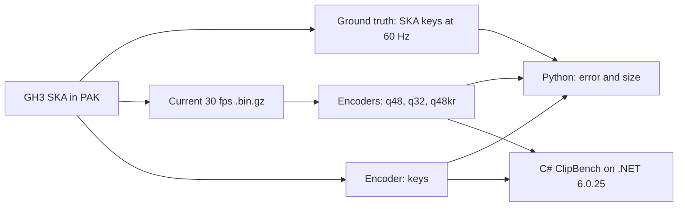

# Spike: band clip size, decode speed, and quantization error

Spike item from `docs/PACKAGING-PLAN.md` section 6, step 2: "Clip size and decode speed with quantized rotations (estimate: 1 GB library to 150–300 MB) and error against GH3 frames."

## Verdict

- Use **Q48** for the package format v1. Q48 is dense 30 fps frames, smallest-three rotations in 48 bits, translations in 16 bits for each clip range, constant-track removal, and Brotli (quality 11) on each clip.
- The clips become **121 MB** (current: 456 MB, 3.8 times smaller).
- The added error is **0.007° maximum** for each bone and **0.03 cm maximum** at the fingertips. Against the GH3 SKA data, the error is the same as the current clips.
- The decode time for each clip in .NET 6 is 1.6 ms (p50) and 13 ms (maximum). The full song clip set decodes in **0.24 s on one worker thread** (current format: 1.3 s on the main thread).
- The plan estimate "1 GB library to 150–300 MB" is **not correct for the full library**. With Q48 clips, the library goes from 1001 MB to approximately **666 MB**. Movies (357 MB) and audio (108 MB) are now the largest parts. The clips alone go below 150 MB.

## Question

1. What is the current clip format, and what are its sizes?
2. How small do quantized encodings make the clips, how fast does .NET decode them, and how much error do they add? Measure the error against the current 30 fps clips and against the original GH3 SKA data, with focus on the fingers and the fret hand.
3. How long does the current load of one clip take?

## Current format

- `pipeline/library/direction.py` `write_clip` resamples each GH3 SKA clip to 30 fps (`frames = round(duration * 30) + 1`). It writes `GH3CLP01`: a header, then (bone, mask) for each track, then `frames × tracks × 7` float32 values (position xyz and quaternion xyzw). Positions and rotations are always written, also when the mask does not use them. The file has gzip level 3.
- `src/Stage/Band/StagePerformance.cs` `PerformanceClip` reads the file with `GZipStream` and `BinaryReader`, and keeps `BandPose[frames × tracks]` in memory. `PerformancePlayer.Prepare()` loads the song clips on the main thread in `GameplayStage` stage setup. `Clip()` loads a clip lazily on a cache miss (cache limit: 512 clips).
- Rigs: guitarist and bassist have 125 bones, the singer has 121, and the drummer has 100. Units are metres.

| Role | Clips | Song facial clips | Seconds | 30 fps frames | Rotation tracks | GH3 rotation keys | 30 fps rotation samples | GH3 SKA bytes | Current `.bin.gz` |
|---|---:|---:|---:|---:|---:|---:|---:|---:|---:|
| guitarist | 356 | 78 | 2383 | 71,862 | 10,290 | 1,874,853 | 2,325,910 | 19.8 MB | 45.1 MB |
| bassist | 95 | 0 | 150 | 4,622 | 1,930 | 122,541 | 185,588 | 1.1 MB | 2.6 MB |
| drummer | 39 | 0 | 89 | 2,701 | 1,254 | 60,609 | 134,783 | 0.6 MB | 1.5 MB |
| singer | 648 | 570 | 20,740 | 622,837 | 21,801 | 16,417,066 | 19,185,294 | 192.4 MB | 406.4 MB |
| **total** | 1138 | 648 | 23,362 | 702,022 | 35,275 | 18,475,069 | 21,831,575 | 214.0 MB | **455.6 MB** |

The song facial clips (one for each song section, up to 136 s and 121 tracks) are 93% of the current size. The GH3 keys are almost dense: 18.5 M source keys against 21.8 M samples at 30 fps. Thus key reduction cannot remove much data.

## Method



- `tools/spike-clips/analyze.py` runs `direction.convert` with a patched `write_clip`. Thus, it gets exactly the SKA bytes, rig, retarget rig, and masks of the pipeline for all 1138 clips. It reads the current `.bin.gz` and makes sure that the header and tracks are equal. Then it encodes, compresses, decodes, and measures each variant.
- **Ground truth (GH3):** the pipeline `sample_animation` (linear interpolation and normalization of the SKA keys, then retarget and z-flip) at each 1/60 s tick. The current clips and the variants are sampled with the runtime rule (`frame = t / duration × (frames − 1)`, lerp and slerp).
- **Error:** the local rotation angle of each bone with a used rotation channel, and the world position error of the head, the palms, and the 5 fingertip bones of each hand (leaf bones under `Bone_Palm_L` and `Bone_Palm_R`). Forward kinematics uses the GH3 rig with bind values for bones that are not animated. The p99 values come from log histograms with 0.5% bin resolution.
- **Variants** (each clip is compressed alone, as a package entry would be):
  - `f32`: the current layout. `f32soa`: float32, only used channels, planar layout.
  - `q48`: smallest-three rotations, a 2-bit index and 3 × 15 bits. Translations are u16 in the range of each track. Constant tracks are stored one time as float. Planes are delta-coded, for each track.
  - `q32`: the same as `q48` with 3 × 10 bits.
  - `keys`: the original GH3 key times (60 Hz ticks) with `q48` values. It is decoded to dense 30 fps. `keys-direct` samples the keys directly at 60 Hz.
  - `q48kr`: `q48` with greedy key reduction (error bound 0.05° and 0.02 cm), decoded to dense 30 fps.
- `tools/ClipBench` (net6.0, ZstdSharp) runs on a copy of the MelonLoader .NET runtime **6.0.25** from the game folder. The game uses this runtime for mods. ClipBench measures file read + decompression + decode to `BandPose[]`, which is the current in-memory layout. Thus, the runtime sampling code does not change. Each value is the median of 3 warm passes (files in the page cache, JIT warm). ClipBench also compares each decoded clip with `PerformanceClip` (validation of the C# decoders).
- **Song set:** all non-facial clips of the 4 roles plus the 7 facial clips of `mycurse` (497 clips). This is an upper bound for `Prepare()`.

## Results

### Size (MB, total for 1138 clips)

| Encoding | raw | gzip 9 | Brotli 11 | zstd 19 |
|---|---:|---:|---:|---:|
| f32 (current, file is gzip 3: 455.6) | 611.6 | 452.7 | 379.4 | 438.6 |
| f32soa | 611.4 | 416.6 | 328.1 | 386.9 |
| **q48** | 267.2 | 144.6 | **121.1** | 136.4 |
| q32 | 267.1 | 107.1 | 91.9 | 99.9 |
| keys | 261.0 | 142.6 | 116.0 | 132.7 |
| q48kr | 214.0 | 124.4 | 101.9 | 115.8 |

q48 with Brotli 11 for each role: guitarist 10.3, bassist 0.52, drummer 0.28, singer 109.9 MB. Full tables for each role are in the evidence `summary.md`.

### Error from quantization only (against the current clips, at their frames)

Maximum / p99 over all roles. "Fret hand" is `_L`, the left hand of the rig.

| Variant | Rotation, all bones (°) | Rotation, fingers L (°) | Fingertips L (cm) | Fingertips R (cm) | Palms (cm) | Head (cm) |
|---|---:|---:|---:|---:|---:|---:|
| **q48** | **0.0072** / 0.0043 | 0.0049 / 0.0045 | **0.026** / 0.014 | 0.030 / 0.014 | 0.024 / 0.011 | 0.012 / 0.007 |
| q32 | 0.245 / 0.14 | 0.158 / 0.14 | 0.74 / 0.45 | 0.90 / 0.45 | 0.73 / 0.40 | 0.35 / 0.24 |
| keys | 0.0072 / 0.0043 | 0.0049 / 0.0045 | 0.026 / 0.014 | 0.030 / 0.014 | 0.024 / 0.011 | 0.012 / 0.007 |
| q48kr | 0.054 / 0.047 | 0.053 / 0.048 | 0.24 / 0.10 | 0.26 / 0.10 | 0.22 / 0.085 | 0.12 / 0.058 |

### Error against the original GH3 SKA keys (60 Hz)

| Variant | Rotation max, all (°) | Rotation p99, all (°) | Rotation max, fingers L / R (°) | Fingertips L / R max (cm) |
|---|---:|---:|---:|---:|
| current f32 | 0.63 | 0.00016 | 0.023 / 0.064 | 0.0019 / 0.0054 |
| **q48** | 0.63 | 0.0043 | 0.025 / 0.066 | 0.026 / 0.030 |
| q32 | 0.65 | 0.14 | 0.158 / 0.199 | 0.74 / 0.90 |
| keys-direct | 0.0072 | 0.0043 | 0.0049 / 0.0065 | 0.026 / 0.030 |

The 0.63° maximum is in the current clips also. It is on the upper eyelids (`Bone_Eyelid_Upper_L/R`, bones 71 and 72): GH3 keys a blink at 60 Hz, and 30 fps sampling cuts its peak. Other than the eyelids, all errors of the current 30 fps resampling are below 0.07°. Thus, 30 fps is sufficient, and q48 adds only its quantization error.

### Decode time (.NET 6.0.25, one thread, ms)

| Encoding | All 1138 clips | Clip p50 | Clip p95 | Clip max | Song set (497 clips) |
|---|---:|---:|---:|---:|---:|
| **current `GH3CLP01` (gzip + `BinaryReader`)** | 11,450 | 7.5 | 30.3 | 64.1 | 1297 |
| q48 gzip 9 | 2286 | 1.42 | 6.1 | 12.8 | 224 |
| **q48 Brotli 11** | 2558 | 1.57 | 6.9 | 13.2 | 238 |
| q48 zstd 19 (ZstdSharp) | 1626 | 1.02 | 4.4 | 9.0 | 161 |
| q32 Brotli 11 | 2065 | 1.28 | 5.4 | 11.4 | 202 |
| keys Brotli 11 | 2915 | 1.72 | 7.8 | 15.0 | 284 |
| q48kr Brotli 11 | 2500 | 1.57 | 6.3 | 12.7 | 270 |

Song-set prefetch with `Task.Run` + `Parallel.ForEach` (median of 3, ms):

| Encoding | 1 worker | 4 workers |
|---|---:|---:|
| current | 1289 | 351 |
| q48 Brotli 11 | 217 | 66 |
| q48 gzip 9 | 195 | 63 |

C# decoders against `PerformanceClip` (all clips): q48 0.0071° / 0.013 cm, q32 0.245°, keys 0.019°, q48kr 0.054° / 0.021 cm. These values agree with the Python values.

### Current load of one clip (question 4)

The current format needs (warm cache, ms): guitarist p50 2.2, p95 10.7, maximum 33.1; singer p50 13.8, p95 34.4, maximum 64.1. One singer facial clip is 1 to 4 frames at 60 fps. Today, `Prepare()` decodes the whole song set on the main thread during stage setup: up to 1.3 s (1.4 s on the first pass with a cold JIT). A load during the song occurs only on a cache miss, for example after an eviction at the 512-clip limit. The upper-bound song set has 497 clips, which is near this limit.

### Compressors in the game

- **gzip / Deflate:** in use today.
- **Brotli:** the MelonLoader runtime (`Dependencies/dotnet/shared/Microsoft.NETCore.App/6.0.25`) has `System.IO.Compression.Brotli.dll`, and `libSystem.IO.Compression.Native.so` exports `BrotliDecoderDecompressStream`. The bench used this runtime. It was not called inside the game process.
- **zstd:** .NET 6 has no zstd. ZstdSharp.Port 0.8.7 (MIT, pure managed, 434 KB) works on .NET 6 without native libraries. It decodes 36% faster than Brotli, but its files are 13% larger. The decode speed does not matter on a worker thread. Thus, zstd does not justify one more dependency.

## Recommendation for package format v1

Use `q48` + Brotli 11 for each clip. It keeps the dense 30 fps layout, thus `PerformanceClip.Apply` and `SampleDelta` do not change. Only the reader changes (a `ClipCodec.DecodeDense` prototype is in `tools/ClipBench/Program.cs`).

| Metric | q48 + Brotli 11 |
|---|---|
| Clip size | 121.1 MB (current 455.6 MB) |
| Rotation error added | maximum 0.0072°, p99 0.0043° |
| Fingertip error added | maximum 0.030 cm, p99 0.014 cm |
| Decode | 1.6 ms p50, 13 ms maximum for each clip; 0.24 s for each song set on one worker thread |

Rejected:

- `q32`: 30 MB smaller, but fingertip errors are up to 0.9 cm (p99 0.45 cm). The owner watches the fingers.
- `q48kr`: 19 MB smaller, but the error is 8 times larger, and key times make the decoder more complex.
- `keys`: the same size as `q48`. It is better only if a later runtime samples at 60 Hz (eyelid error 0.63° to 0.007°). Keep this as an option for a later format version.
- gzip 9: 24 MB larger, with almost the same decode time.

Library estimate: the library is 1000.9 MB today (`direction` 455.7, `movies` 357.0, `audio` 108.4, `particle-textures` 38.1, other 41.7). With q48 clips, the library is approximately 666 MB. To get 150–300 MB, also reduce the movies and the audio. This spike did not examine them.

## Open risks

- Brotli is not called in the game process, and not tested on Windows. The same native library already serves `GZipStream` in the game, thus the risk is low.
- Per-track bit rates (for example 10 bits for face bones and 15 bits for fingers and arms) can make the singer facial clips smaller. This spike did not measure them.
- The timings are from a separate process, not from inside the game, while other spike agents used the machine. Cold disk reads were not measured.
- The ground truth uses the pipeline interpolation (normalized linear interpolation). The interpolation in GH3.exe was not checked.

## Not tested

- No game run, no visual comparison, no recording.
- The exact `Prepare()` clip set for a real chart. The song set above is an upper bound.
- Memory use of the decoded clips. It does not change, because the in-memory layout stays `BandPose[]`.

## Evidence

- `/tmp/opencode/spike-clips/full/summary.md`: all size and error tables for each role.
- `/tmp/opencode/spike-clips/full/bench.md`: all C# timing tables.
- `/tmp/opencode/spike-clips/full/clips.json`: values for each clip (sizes for each encoding and compressor, keys, tracks).
- `/tmp/opencode/spike-clips/full/variants/`: encoded clip files.
- `/tmp/opencode/spike-clips/stats.json`: header statistics of the current clips.

Commands:

```sh
flock /tmp/opencode/gh3-heavy.lock env PYTHONPATH=. MISE_QUIET=1 uv run --with numpy --with brotli --with zstandard \
  python tools/spike-clips/analyze.py ~/games/gh3-test-tools/game/DATA assets/libraries/gh3-band-v1/direction /tmp/opencode/spike-clips/full 4
PYTHONPATH=. uv run --with numpy --with brotli --with zstandard python tools/spike-clips/summarize.py /tmp/opencode/spike-clips/full
dotnet build -c Release tools/ClipBench
DOTNET_ROOT=<copy of MelonLoader/Dependencies/dotnet> <copy>/dotnet tools/ClipBench/bin/Release/net6.0/ClipBench.dll \
  assets/libraries/gh3-band-v1/direction /tmp/opencode/spike-clips/full mycurse 3
```
