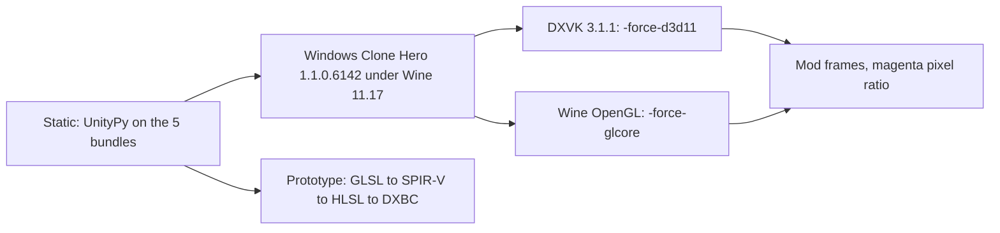

# Spike d3d11: stage shaders on Windows (Direct3D 11)

PACKAGING-PLAN step 2, item 5.

## Question

1. Do the render bundles (`stage.bundle` and the other four) have Direct3D 11 programs?
2. Does the stage render on Windows Clone Hero with Direct3D 11?
3. If not, what is the cheapest way to add Direct3D 11 programs, and what is the effort?
4. Side question: are the obfuscated Clone Hero bindings the same in the Windows build?

## Method

- Static check: `tools/research/spike-d3d11/bundle_platforms.py` reads the shader platforms and GPU program types of each bundle.
- Runtime: the official `CloneHero-Win-x64.zip` (SHA-1 `523dade7…8b66e`, same as clonehero.net), MelonLoader 0.7.3 x64, DXVK 3.1.1. All under `~/games/clonehero-win-spike/` with its own Wine prefix. Wine is `~/games/gh3-test-tools/wine-root` (Wine 11.17). The shared GH3 prefix was not changed. Script: `tools/research/spike-d3d11/run-win.sh`.
- The mod was built against the Windows interop assemblies and installed with `install.sh`. The probe `GH3_SKIN_SPIKE=d3d11` (removed later; no probe code is left after step 6) logs the graphics device and `Shader.isSupported` for `GH3/Stage` (off by default).
- Venue `gh3.dive`, chart `mycurse-native`, 1600 × 900, mod frame capture at 12, 18, and 24 s. All runs under the record lock.

## Results

### Static: shader platforms in the bundles

| Bundle | Shader | Platforms | GPU program types |
| --- | --- | --- | --- |
| `stage.bundle` | `GH3/Stage` | OpenGLCore only | GLCore32 only |
| `particle.bundle` | `GH3/Particle` | OpenGLCore only | GLCore32 only |
| `outline.bundle` | `GH3/Outline` | OpenGLCore only | GLCore32 only |
| `screen-color.bundle` | `GH3/ScreenColor` | OpenGLCore only | GLCore32 only |
| `tesla.bundle` | `GH3/Tesla` | OpenGLCore only | GLCore32 only |

`pipeline/render/shaders.py` takes `Hidden/BlitCopy` from the Linux `unity_builtin_extra`, keeps platform 15 (OpenGLCore) and GPU program type 6 (GLCore32), and replaces the GLSL text and the parameter blob. There is no Unity editor and no HLSL source. The Windows `unity_builtin_extra` has `Hidden/BlitCopy` for D3D11, OpenGLCore, and Vulkan.

### Runtime: Windows Clone Hero

| Run | Graphics device (Player.log and probe) | `GH3/Stage` `isSupported` | Stage loaded | Magenta pixels (frames 12 / 18 / 24 s) |
| --- | --- | --- | --- | --- |
| `-force-d3d11`, DXVK | Direct3D 11.0 [level 11.1] | True | Yes | 91.8 % / 90.4 % / 88.2 % |
| `-force-glcore`, Wine OpenGL | OpenGL 4.5.0 NVIDIA 610.57.04 | True | Yes | 0 % / 0 % / 0 % |
| no argument, `force-glcore=1` in `boot.config`, DXVK | Direct3D 11 (default; the key is ignored) | True | Yes | – / 90.7 % / – |

- On Direct3D 11 the whole venue, band, and crowd are pink (Unity error shader). The flames and parts of the highway are also wrong, because all five bundles are OpenGL only.
- `Shader.isSupported` is **True** on Direct3D 11 (pass count 3, the error shader). The mod guard `if (!shader.isSupported) throw` does not detect the problem.
- With `-force-glcore` the Windows build renders the stage, band, crowd, highway, and HUD correctly (`frames-glcore/frame-01.png`).
- The default Windows graphics API is Direct3D 11. A `boot.config` key does not change it.

### Prototype: Direct3D 11 programs on Linux

| Step | Tool | Result for `GH3/Stage` (32 templates) |
| --- | --- | --- |
| Full GLSL | `pipeline.render.shaders.stage_templates` | 2570 vertex lines, 2491 fragment lines |
| GLSL to SPIR-V | `glslangValidator -G` (system package) | OK after `#version 150` to `330` |
| SPIR-V to HLSL | SPIRV-Cross 2021-01-15 binary | OK, 4314 + 5814 lines |
| HLSL to DXBC | Wine `d3dcompiler_47.dll` (vkd3d-shader) via Windows Python embeddable + ctypes | vs_4_0 99 376 B in 0.3 s; ps_4_0 192 580 B in 1.7 s; SM 5.0 also OK |
| DXBC content | `tools/research/spike-d3d11/dxbc_info.py` | Hash is set; RDEF has `$Globals` (vertex 544 B, 28 variables; pixel 368 B, 23 variables), 10 textures and 10 samplers |

The Windows `Hidden/BlitCopy` D3D11 blob has 4 entries: vertex parameters (`$Globals`, `UnityPerDraw`, `UnityPerFrame` with variable offsets), vertex program (type 15, a 38-byte Unity prefix, DXBC, 26 bytes of bind channels), pixel parameters, and pixel program (type 17). This is the same layout that `shaders.py` already patches for OpenGL.

The prototype did not write a D3D11 bundle, and it did not render a DXBC program in the game.

### Side question: obfuscated bindings in the Windows build

| Check | Result |
| --- | --- |
| `global-metadata.dat` | Different file. 8 960 names only in Linux, 22 162 only in Windows. The raw obfuscated names are random per build. |
| Mod build against Windows interop assemblies | Builds with 0 errors and 0 warnings. All `field_*`, `prop_*`, `Method_*`, and `…Unique` names exist. |
| Data field order of the 13 types that the mod reads | Same for 12 types. Different for the engine type (`ObjectPublicAbstractDoBoDoInBoObDoInSiBoUnique`, one interface field), but the two fields that the mod reads keep the same slot. |
| Method lists of the same 13 types | Different in all 13 (order and count). Indexed names (`prop_Int32_0`, `prop_Single_0`, `Method_Public_Void_0`, `Method_Public_Void_Texture2D_0`, `Method_Public_Static_Void_Int32_UInt16_Byte_0`, `prop_UInt16_1`) can point to a different method. For example, the `prop_Int32_0` getter is `Method_Public_Abstract_Virtual_New_get_Int32_0` on Linux and `Method_Private_Virtual_Final_New_get_Int32_0` on Windows. |
| Runtime (HUD values in the OpenGL run) | Score 4318, ×4, streak 34, rock meter: values look correct. Not verified one by one. |

Other Windows problems found: `StageAudioBackend` looks only in `clonehero_Data/Plugins`; Windows uses `Clone Hero_Data/Plugins/x86_64/bass.dll`, so the stage stops ("type initializer … threw"). The runs above use `GH3_CLONE_HERO_DIR=<…>/Plugins/x86_64` as a workaround. `GameCompatibility` accepts the Windows `Application.version`.

## Decision for package format v1

1. The bundles in the release must contain a Direct3D 11 program for each shader, or the release must say "Windows: Direct3D 11 is not supported". Without D3D11 programs, every Windows user who starts normally sees a pink stage.
2. Recommended path: add a D3D11 variant in `pipeline/render/shaders.py` with the same no-editor method. Use the Windows `Hidden/BlitCopy` D3D11 blob as template, and use the toolchain above (glslang, SPIRV-Cross, `d3dcompiler_47` under Wine) to make DXBC. Put both platforms (15 and 4) in one bundle, so one file works on Linux and Windows.
3. Replace the `isSupported` guard with a check that detects the error shader (for example the pass count, or a check of `SystemInfo.graphicsDeviceType` against the platforms in the bundle), so that an unsupported API shows a clear warning and not a pink stage.
4. Short-term fallback: document the `-force-glcore` launch option for Windows. It works now with no shader change (measured under Wine only).
5. A Windows port of the mod needs a separate binding map: indexed method and property names are not safe across builds. The data fields that the mod reads look stable.

### Effort estimate (not measured)

| Work | Estimate |
| --- | --- |
| Write the D3D11 parameter blob and the program wrapper (38-byte prefix, bind channels) from DXBC reflection | 1–2 days |
| Make the GLSL portable for HLSL output: `hlslcc_mtx4x4` arrays to matrices in Unity constant buffers, stable texture registers, `#version` | 0.5–1 day |
| Particle soft edge: Direct3D uses reversed Z for `_CameraDepthTexture` | 0.5 day |
| Five shaders, DXVK verification, and one check on real Windows hardware | 1–2 days |
| **Total** | **about 3–5 days** |

## Open risks

- Wine `d3dcompiler_47` is vkd3d-shader, not the Microsoft compiler. Code quality and correctness for the 5 000-line uber shader are not verified on GPU. The Microsoft `d3dcompiler_47.dll` can be loaded by the same script if the project accepts it as a build tool.
- The native Windows Direct3D 11 runtime checks the DXBC hash. vkd3d writes a hash, but it was not checked against Windows (DXVK does not check it).
- All runtime results come from Wine + DXVK on NVIDIA Linux. The shader platform choice is the same on real Windows, so the pink result applies. The `-force-glcore` result depends on the Windows OpenGL driver (Intel drivers are a risk).
- Each Clone Hero update can change the Unity version and the shader blob format (`202012090`), on all platforms.

## Not tested

- A bundle with D3D11 programs in the game (no render of compiled DXBC).
- Real Windows hardware. Direct3D 12 and Vulkan on Windows.
- The other four shaders through the prototype toolchain.
- Each HUD binding value on Windows. The full mod behavior on Windows.

## Evidence

All under `/tmp/opencode/spike-d3d11/`:

| File | Content |
| --- | --- |
| `static-bundles.txt` | Bundle platforms |
| `blit-windows.txt`, `blit-4.bin` | Windows `Hidden/BlitCopy` platforms and D3D11 blob |
| `frames-d3d11/` | First D3D11 run (stage stopped by the BASS path problem) |
| `frames-d3d11-b/`, `melon-d3d11-b.log` | D3D11 run: pink stage, probe line |
| `frames-glcore/`, `melon-glcore.log` | OpenGL run: correct stage |
| `melon-bootcfg.log`, `player-bootcfg.log` | `boot.config` test (still Direct3D 11) |
| `Clone Hero_d3d11.log` | DXVK device log |
| `hlsl/` | Full GLSL, SPIR-V, HLSL, DXBC files, `out*.txt` |
| `metadata-compare.txt`, `interop-diff.txt`, `used-types.txt`, `engine-diff.txt`, `prop-getters.txt`, `build-win.log` | Binding comparison |

Scripts: `tools/research/spike-d3d11/`. Windows game, prefix, and downloads: `~/games/clonehero-win-spike/`.
