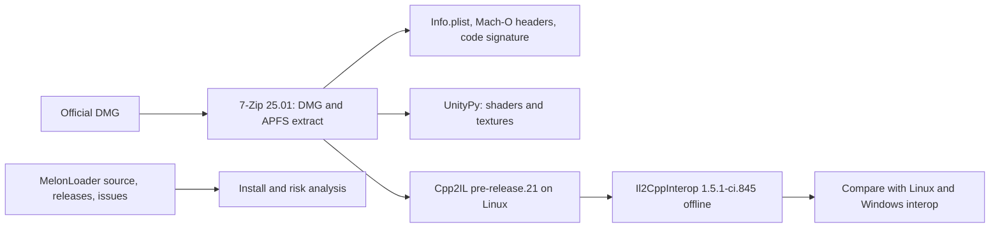

# Spike macos: can the mod run on macOS Clone Hero?

Owner goal: the mod works on all platforms that Clone Hero supports. This spike examines macOS.

There is no Mac on this machine. All results come from static evidence: the official download, binary and metadata inspection, offline tools, official documents, source code, and issue trackers. Each claim has one of these labels:

- **[verified: …]** — measured here, with the evidence.
- **[documentation]** — from an official document or a source repository. Not run here.
- **[not verified]** — an inference or an estimate.

## Questions

1. Is there an official macOS build of Clone Hero 1.1.0.6142? Unity version, scripting backend, architectures, graphics API?
2. Does MelonLoader support IL2CPP games on macOS arm64 and x86_64? What is the install? Is there evidence of Clone Hero mods on macOS?
3. Shaders: what is the Metal program format, and what must `pipeline/render` do to add Metal programs?
4. Textures: does Metal on Apple silicon and Intel Macs support BC1, BC3, and BC7?
5. Obfuscated names: are the macOS names and field positions the same as Linux or Windows?
6. Native libraries: what are the macOS equivalents of BASS and the RtMidi stub?

## Method



- Download: `CloneHero.v1.1.0.6142-final.dmg` from `github.com/clonehero-game/releases` (tag `v1.1.0.6142-final`). The page `clonehero.net/releases/v1.1.0.6142` links to this file. Size 1 015 313 127 bytes. SHA-256 `1b880f98…2a39`. It is the same as the GitHub asset digest.
- The DMG holds one APFS volume. 7-Zip 25.01 (official Linux binary from 7-zip.org) extracts it without root. The app is in `~/games/clonehero-mac-research/dmg/Clone Hero.app`.
- Offline interop generation: `tools/research/spike-macos/InteropGen` calls the same Il2CppInterop generator step as MelonLoader (`Packages/Il2CppInterop.cs`), with the DLLs of the installed MelonLoader 0.7.3. Cpp2IL is the Linux binary that MelonLoader downloaded (`2022.1.0-pre-release.21`).
- The xref scan input is the `GameAssembly` file (Linux: `GameAssembly.so`; macOS: see section 5).
- **Tool check:** for the Linux build, the offline output is identical to the in-game `MelonLoader/Il2CppAssemblies`: 1317 of 1317 `Il2CppCloneHero` types and 608 of 608 `Il2CppStrikeCore` types have identical members [verified: `cmp-linux-validation.txt`]. Thus the tool gives the same names as MelonLoader on Linux.

## Results

### 1. The macOS build

| Item | Value | Label |
| --- | --- | --- |
| Official build | Yes. `.dmg`, notarized app `Clone Hero.app`, bundle ID `com.srylain.CloneHero`, version `v1.1.0.6142-final` | verified: `Info.plist`, `globalgamemanagers` |
| Unity version | **2022.3.62f3** (`96770f904ca7`). Linux is 2022.3.62f2. | verified: `Info.plist`, UnityPy |
| Scripting backend | IL2CPP: `Contents/Frameworks/GameAssembly.dylib` and `Resources/Data/il2cpp_data/Metadata/global-metadata.dat` (metadata version 31.1) | verified: files, Cpp2IL log |
| Architectures | Universal: x86_64 and arm64 for the executable, `UnityPlayer.dylib`, `GameAssembly.dylib`, and all plugins. BASS dylibs also have i386. | verified: Mach-O headers |
| `GameAssembly.dylib` slices | x86_64 at file offset 0x4000 (172 278 672 B); arm64 at 0xa454000 (170 060 496 B) | verified: `tools/research/spike-macos/thin.py` |
| Minimum macOS | 10.13 | verified: `Info.plist` |
| Graphics API | **Metal only.** 73 shaders in the build, all with the Metal platform only: 424 Metal vertex and 408 Metal fragment programs. `UnityPlayer.dylib` has `-force-glcore` strings, but no shader has an OpenGL program, so OpenGL is not a usable fallback. | verified: `shader-platforms-mac.txt` |
| Code signature | Developer ID Application: Coda Digital LLC (YJ4Z9SZ37Q). **Hardened runtime** on the executable, `GameAssembly`, `UnityPlayer`, BASS, and RtMidi. The only entitlement is `com.apple.security.cs.disable-library-validation`. | verified: `codesign.txt` (`tools/research/spike-macos/codesign_info.py`) |
| Notarization | `Contents/CodeResources` starts with the stapled-ticket magic `s8ch` | verified: file bytes; meaning from documentation |

### 2. MelonLoader on macOS

| Fact | Label |
| --- | --- |
| MelonLoader 0.7.3 (latest release, 2026-05-14) has `MelonLoader.macOS.x64.zip`. The bootstrap `MelonLoader.Bootstrap.dylib` is **x86_64 only and unsigned**. There is no arm64 release. | verified: download, `codesign_info.py` |
| arm64 support is on `master` only (CHANGELOG "v0.7.4": "Implemented support for MacOS Arm64", PR #1174, merged 2026-09-29). v0.7.4 is not released (2026-10-09). | documentation: repository, GitHub releases API |
| Injection: `melonloader-launch.sh` sets `DYLD_INSERT_LIBRARIES` to the bootstrap and runs the game binary directly. The `MelonLoader/`, `Mods/` folders and the script must be next to the `.app`. | documentation: script in the 0.7.3 zip |
| On Apple silicon with the x64 loader, the game must run under Rosetta: `/usr/bin/arch -x86_64 /bin/bash melonloader-launch.sh`. Without this, dyld rejects the x64 bootstrap in the arm64 game (PR #1201). | documentation |
| **Blocker for Clone Hero:** with the hardened runtime, dyld ignores `DYLD_*` variables unless the app has `com.apple.security.cs.allow-dyld-environment-variables`. Clone Hero does not have it. The .NET runtime and the hooks also need writable executable memory (`allow-jit` or similar), which Clone Hero does not have. Thus the user must remove the signature or re-sign the app ad hoc without the hardened runtime, and remove the quarantine attribute. MelonLoader and its installer do not do this (no `codesign` in either repository). | entitlements: verified; dyld behavior: documentation (Apple entitlement page); effect on Clone Hero: not verified |
| IL2CPP on macOS is "results may vary" (PR #900). Open issues: #1223 (x64 Dobby hooks do not fire under Rosetta; games crash or hang), #1222 (Player.log mirroring crash on x64 and arm64). Recent fixes (#1201, #1216, #1219, #1221) report games that reach the main menu, not full play sessions. | documentation |
| Clone Hero mods with MelonLoader on macOS: no evidence found. No GitHub issue in LavaGang repositories mentions Clone Hero. Reddit posts about 1.1.0.6142 MelonLoader mods exist, but Reddit blocked the fetch. Discord was not searched. | not verified |
| The mod uses only `MelonMod` callbacks and standard components. It does not use class injection or Harmony. This avoids the macOS class-injection problem in PR #900. MelonLoader itself still injects `SM_Component`. | verified: `grep` of `src/` |

### 3. Shaders

Metal blob of `Hidden/BlitCopy` (macOS `unity_builtin_extra`, 2664 bytes, 4 entries) [verified: `metal-blitcopy.txt`, `tools/research/spike-macos/metal_blob.py`]:

| Entry | Content |
| --- | --- |
| 0 | Vertex parameters (52 B): constant buffer `VGlobals`, size 144, no variables in the blob |
| 1 | Vertex program, type 23 (`MetalVS`): 28-byte Unity header (version 202012090, type, payload length), 60-byte Metal header (magic `0xf00dcafe`, entry point `xlatMtlMain`), **MSL source text** (1439 B), 25-byte trailer (vertex input table, not decoded) |
| 2 | Fragment parameters (52 B): `FGlobals`, size 16 |
| 3 | Fragment program, type 24 (`MetalFS`): same headers, MSL source (852 B), 8-byte trailer |

- The constant-buffer variables and textures are in the pass typetree (`m_CommonParameters`: `VGlobals` with 2 matrices and 1 vector, `_MainTex` texture and sampler slot 0). For OpenGL (Linux), `m_CommonParameters` is empty and all variables are in the blob. [verified: typetree dump]
- OpenGL has one combined program. Metal has two programs (vertex and fragment) with separate parameters.
- The MSL is HLSLcc output: one `constant VGlobals_Type& [[buffer(0)]]` struct, `[[attribute(n)]]` vertex inputs, a `rp_output_remap_mask` function constant in the fragment output. The player compiles the source at run time [not verified].

Prototype on Linux [verified: `msl/`]: SPIRV-Cross (2021-01-15 build from the d3d11 spike) converts the d3d11 spike's `GH3/Stage` SPIR-V to MSL 2.1 with exit code 0:

| Stage | MSL lines | Bytes | Buffers | Textures |
| --- | --- | --- | --- | --- |
| Vertex | 4 269 | 149 644 | 23 (one per loose uniform) | 0 |
| Fragment | 5 778 | 210 499 | 20 (one per loose uniform) | 10 + 10 samplers |

The loose GLSL uniforms become one buffer each. Unity expects one constant buffer struct at `buffer(0)`, as in BlitCopy. The GLSL must put the uniforms in one uniform block first. This is the same change that the D3D11 port needs. There is no MSL compiler on Linux, so the output was not compiled.

### 4. Textures

| Fact | Label |
| --- | --- |
| The official macOS build ships DXT5 731, DXT1 218, RGBA32 133, Alpha8 66, BC7 25, RGB24 4 textures. The same build runs on Intel and Apple silicon Macs. | verified: `texture-formats-mac.txt` |
| Metal Feature Set Tables (2026-05-21): "All Apple7 and Apple8 macOS devices have support" for BC formats (M1, M2), and "As of Apple9 all GPUs have support" (M3, M4, M5). `MTLDevice.supportsBCTextureCompression` is available from macOS 11. | documentation |
| Intel Macs (AMD and Intel GPUs) support BC1–BC7. The current Apple table does not list the Mac2 family. | documentation (older tables); not verified |
| Unity can decompress unsupported formats for built-in assets. `LoadRawTextureData` cannot. The plan in PACKAGING-PLAN 9.1 already checks `SystemInfo.SupportsTextureFormat` before upload. | not verified on Mac |

Result: the BC1/BC3 cache plan is valid for macOS. BC7 is also supported.

### 5. Obfuscated names

`global-metadata.dat` is different again [verified: `metadata-linux-mac.txt`, `metadata-windows-mac.txt`]:

| Pair | Names only in first | Names only in second |
| --- | --- | --- |
| Linux / macOS | 8 462 | 9 263 |
| Windows / macOS | 21 702 | 9 301 |

Interop comparison at the members that the mod uses (13 types, 433 member references) [verified: `cmp-*.txt`, `sig-*.txt`, `modrefs-*.txt`]:

| Check | macOS result |
| --- | --- |
| Data field order of the 13 types | Same as Linux in 11. In `TrackFadeManager` and the engine type, one field name differs only by the obfuscated name of its interface type. The two engine fields that the mod reads keep slots 20 and 8. |
| Mod member names that exist (correct xref scan, x86_64 slice) | 433 of 433 |
| Mod member names that exist (scan of the universal file; MelonLoader passes this file [prediction from source]) | 427 of 433. Missing: `HighwayScroll.Method_Public_Void_Texture2D_0`, `…Static_Void_Int32_UInt16_Byte_0`, `TrackFadeManager.Method_Public_Void_0`, and 3 engine getters. |
| Method order | Shuffled per build. The relative order of real-named methods differs in 5 of 6 checked types between Linux, Windows, and macOS (`method-order-check.txt`). |
| 7 obfuscated methods that the mod calls | 4 have a unique signature in Linux and macOS (safe to map). 3 are ambiguous: `HighwayScroll` `Void(Texture2D)` (Linux 3 candidates, macOS 4), `TrackFadeManager` `Void()` (5 and 1), engine `get_Int32` (8 and 8). |

Two separate problems:

1. **The obfuscation is per build.** Indexed method names do not identify the same method on Linux, Windows, and macOS. Name presence is not proof. A binding map per platform must choose the method by other evidence (code analysis or a run-time check).
2. **The xref scan depends on the file.** Il2CppInterop marks "possibly dead" methods (`_PDM_`) with an x86 decode of `GameAssembly` at Cpp2IL file offsets (`Pass16ScanMethodRefs`). Cpp2IL always reads the x86_64 slice of a universal file and gives offsets in that slice. MelonLoader passes the universal file. The decode thus starts 0x4000 bytes too early. Offline, the universal scan gives 3 717 `_PDM_` names, the correct scan 3 176. Only 1 035 of 1 308 common `Il2CppCloneHero` types have identical members between the two scans. [scan effect verified offline; in-game behavior on a Mac not verified]. The names are stable for one MelonLoader version, because Cpp2IL does not use the host architecture. A MelonLoader fix would change them.

### 6. Native libraries

| Linux | macOS | Mod impact |
| --- | --- | --- |
| `clonehero_Data/Plugins/libbass.so` | `Clone Hero.app/Contents/PlugIns/libbass.dylib` (install name `@rpath/libbass.dylib`, universal) | **Must change.** `StageAudioBackend` looks in `<root>/clonehero_Data/Plugins`, `<root>/clonehero_Data/Plugins/x86_64`, and `<root>`. `<root>` is `GH3_CLONE_HERO_DIR` or the current directory. None match on macOS, so the stage stops. Fix: build candidates from `Application.dataPath` (`…/Contents` on macOS [documentation]) and add `PlugIns`. This also fixes Windows (`Clone Hero_Data/Plugins/x86_64`). |
| `libRtMidi.so` (the stub `tools/rtmidi-stub.c` is for headless Linux test games only) | `Contents/PlugIns/RtMidi.bundle` (CoreMIDI) | None. The mod does not ship or need the stub. |
| `libbass_fx`, `libbassmix`, `libbassopus`, `discord_game_sdk`, `libslimage`, `libblake3_dotnet`, NativeFilePicker, NativeProcessStart, burst, YetAnotherHttpHandler | Same names as `.dylib` or `.bundle` in `Contents/PlugIns`; plus `Rewired_MacOS.bundle` | None. The mod does not call them. |

Other path risk: `Gh3Skin.cs` finds its assets with `AppDomain.CurrentDomain.BaseDirectory/Mods/GH3Skin/assets`. On macOS, MelonLoader puts `Mods/` next to the `.app` (`MelonEnvironment.ModsDirectory`). Use `MelonEnvironment.ModsDirectory` [not verified on Mac]. `GameCompatibility` accepts `v1.1.0.6142-final`, which is the macOS `Application.version` [verified: `globalgamemanagers`].

## Decision

**macOS is not feasible for the v1 release.** Plan it as a later, community-tested target. Reasons:

1. The loader is not ready. Native arm64 needs an unreleased MelonLoader. The x64 release needs Rosetta, and an open bug (#1223) says native hooks fail under Rosetta.
2. Clone Hero's hardened runtime blocks `DYLD_INSERT_LIBRARIES`. Each user must strip or re-sign the app and remove quarantine, after each Clone Hero update. This is a high support cost.
3. The render bundles need Metal programs (new blob writer). Without them, the stage is very likely pink, as on D3D11.
4. The bindings need a third map, and the macOS names depend on a MelonLoader detail (the universal-file scan).

### What macOS needs (after the Windows work)

| Work | Depends on | Estimate (not measured) |
| --- | --- | --- |
| Uniforms in one block in all five GLSL shaders | Same as D3D11 | shared with D3D11 |
| Metal writer in `pipeline/render/shaders.py`: two programs per pass, 28-byte header, 60-byte Metal header, MSL, vertex-input trailer, `m_CommonParameters` or full parameter blobs; template from the macOS `unity_builtin_extra` (2022.3.62f3, not 62f2) | SPIRV-Cross MSL | 2–3 days |
| Metal clip space, reversed Z, and UV origin (same as D3D11) | D3D11 work | 0.5 day |
| Binding map: macOS entries for the 3 ambiguous methods; select the map by platform and check it at start | Windows binding map | 1 day |
| `StageAudioBackend` and assets path from `Application.dataPath` / `MelonEnvironment` | — | 0.5 day |
| Install guide, diagnostic mode, two or three remote test rounds | community tester | 2–4 days elapsed |
| **Total** | | **about 6–9 days of work, plus tester latency** |

Wait for a MelonLoader release with arm64 support and a fix for #1223 before the community test.

### How to test without a Mac

Ask one community tester with an Apple silicon Mac (and, if possible, one Intel Mac). Give a debug build with a diagnostic mode that logs the graphics device, `Shader.isSupported`, a pink-shader check, each binding of the map, and the BASS path. Checklist:

1. macOS version, Mac model and chip, Clone Hero version (`v1.1.0.6142-final`).
2. Copy `Clone Hero.app` from the DMG to a new folder, for example `~/Games/CloneHeroModded/`. Do not use `/Applications`.
3. Unzip the MelonLoader macOS zip (arm64 or x64, version given by us) into the same folder. Run the game once without the mod.
4. In Terminal: `xattr -dr com.apple.quarantine ~/Games/CloneHeroModded` and `codesign --force --deep --sign - ~/Games/CloneHeroModded/"Clone Hero.app"`.
5. Start with `bash melonloader-launch.sh` (arm64 loader) or `/usr/bin/arch -x86_64 /bin/bash melonloader-launch.sh` (x64 loader on Apple silicon). Confirm that `MelonLoader/Latest.log` exists and the interop generation finishes.
6. Install the mod in `Mods/`. Play the test chart with venue `gh3.dive` to the end.
7. Send: `MelonLoader/Latest.log`, `~/Library/Logs/srylain Inc_/Clone Hero/Player.log` (path from Unity documentation; the exact folder name is not verified), screenshots at 12, 18, and 24 s, and a short video.
8. Check: stage not pink; band and crowd move; HUD score, multiplier, streak, rock meter correct; stage audio plays; star power; pause and restart; quit without a crash.

## Open risks

- No result here comes from a Mac. Every runtime claim is from documentation or inference.
- MelonLoader macOS IL2CPP support is new. Aggressive LLVM inlining in `GameAssembly.dylib` broke some games (PR #900).
- Re-signing removes notarization. Some users will not accept it. Apple can make this harder in a future macOS.
- Bundles are built as Linux target (24) with Unity 2022.3.62f2. They load on Windows. On macOS 2022.3.62f3 they are not tested.
- Metal compiles the 5 000-line uber shader at run time. The first-load time is unknown.
- Each Clone Hero update changes the obfuscation on all three platforms.

## Not tested

- Any run on macOS. MSL compilation. A bundle with Metal programs.
- MelonLoader `master` (arm64) builds.
- Intel Mac BC support at run time.
- Clone Hero Discord and Reddit posts about macOS mods.
- The meaning of the Metal header fields (`0x30`, `6`, `0x3c`, `0x25`, `-1`) and of the vertex-input trailer.

## Evidence

Scratch folder `/tmp/opencode/mac-research/`:

| File | Content |
| --- | --- |
| `info-plist.xml`, `codesign.txt` | Bundle metadata, signatures, entitlements |
| `shader-platforms-mac.txt`, `metal-blitcopy.txt`, `blit-14.bin`, `msl/` | Shader platforms, Metal blob dump, BlitCopy MSL, stage MSL from SPIRV-Cross |
| `texture-formats-mac.txt`, `mfst.txt` | Texture formats in the build; Metal Feature Set Tables text |
| `metadata-linux-mac.txt`, `metadata-windows-mac.txt` | Metadata string comparison |
| `cmp-linux-validation.txt` | Offline tool equals in-game Linux interop |
| `cmp-linux-mac*.txt`, `cmp-windows-mac.txt`, `cmp-mac-universal-vs-thin.txt` | Interop comparison |
| `sig-*.txt`, `modrefs-*.txt`, `method-order-check.txt` | Method candidates, all mod references, method order |
| `cpp2il-mac.log`, `interop-*.log` | Generator logs |
| `ml-notes/` | MelonLoader `master` (5aff4d9) CHANGELOG, release notes, launch script, generator and environment sources; Il2CppInterop `Pass16ScanMethodRefs.cs` (f03c8f4) |

Large files: `~/games/clonehero-mac-research/` (`dl/` DMG and MelonLoader zip, `dmg/` extracted app, `thin/` slices, `generated/` Cpp2IL output, interop assemblies, mod build, InteropGen build).

Scripts: `tools/research/spike-macos/`. Commands:

```bash
uv run --with UnityPy --with lz4 python tools/research/spike-macos/shader_platforms.py "<app>/Contents/Resources/Data"
uv run --with UnityPy --with lz4 python tools/research/spike-macos/texture_formats.py "<app>/Contents/Resources/Data"
uv run --with UnityPy --with lz4 python tools/research/spike-macos/metal_blob.py "<app>/Contents/Resources/Data/Resources/unity_builtin_extra" Hidden/BlitCopy
python3 tools/research/spike-macos/codesign_info.py "<app>/Contents/MacOS/Clone Hero"
python3 tools/research/spike-macos/thin.py "<app>/Contents/Frameworks/GameAssembly.dylib" x86_64 GameAssembly.x86_64.dylib
<melon>/Dependencies/Il2CppAssemblyGenerator/Cpp2IL/Cpp2IL --game-path "<app>" --exe-name "Clone Hero" --output-as dummydll --use-processor attributeanalyzer,attributeinjector --output-to cpp2il-mac
dotnet build tools/research/spike-macos/InteropGen -c Release -o interopgen
dotnet interopgen/InteropGen.dll cpp2il-mac <melon>/Dependencies/Il2CppAssemblyGenerator/UnityDependencies interop-mac GameAssembly.x86_64.dylib
uv run --with dnfile python tools/research/spike-macos/interop_compare.py Gh3Skin.dll <linux interop> interop-mac linux mac
uv run --with dnfile python tools/research/spike-macos/signature_candidates.py Gh3Skin.dll <linux interop> interop-mac linux mac
uv run --with dnfile python tools/research/spike-macos/mod_member_refs.py Gh3Skin.dll interop-mac
```

`signature_candidates.py` imports `interop_compare.py`; run it from `tools/research/spike-macos/` or set `PYTHONPATH`.
