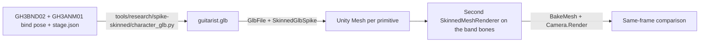

# Spike: skinned GH3 character from a GLB

> Record of the packaging spike (2026-10-09, [PACKAGING-PLAN.md section 9](../PACKAGING-PLAN.md#9-spike-results)). The in-game probes (`src/Spike/`, `GH3_SKIN_SPIKE`) were removed in step 6, so the game commands in this report do not run on `main`. The offline tools are in `tools/research/`. The evidence moved from `/tmp/opencode/` to `~/.cache/gh3-evidence/` on the development machine.

## Question

Can our own code load a skinned GH3 band member from a GLB file in Clone Hero (Il2Cpp, Unity 2022.3.62f2, MelonLoader 0.7.3), and which mesh, skin, and blend-shape APIs work? (PACKAGING-PLAN section 6, step 2, item 3.)

## Answer

Yes. A 142-line GLB reader (`GlbFile`) and a 113-line mesh builder (`SkinnedGlbSpike.Build` and `MirrorZ`) load the gh3.dive guitarist (`axel_1` with `SG_Black`) from a GLB. The band animation drives it through the existing `SkinnedMeshRenderer` path. All vertex channels are bit-identical to GH3BND02. After skinning, the maximum vertex difference is less than 0.74 µm. All skin and blend-shape APIs that we need work.

## Method



1. Export: `PYTHONPATH=. uv run --with pillow --with numpy python tools/research/spike-skinned/character_glb.py --role guitarist --output ~/.cache/gh3-evidence/spike-skinned/guitarist.glb`. The script reads the library guitarist and writes the GLB with the existing `GlbWriter.actor` (skeleton nodes `bone-<checksum>`, inverse bind matrices, `JOINTS_0`/`WEIGHTS_0` with 4 influences, UVs, colors, the `_GH3_*` streams, and materials with embedded PNG textures). It then reads the file back with `GlbReader` and checks it.
2. Probe (off by default; removed in step 6, so the commands below no longer run on `main`): `GH3_SKIN_SPIKE=skinned GH3_SKIN_SPIKE_GLB=<file>`. Code: `src/Spike/GlbFile.cs` (GLB chunks, accessors with stride and normalized integers, embedded images) and `src/Spike/SkinnedGlbSpike.cs`. `StageBand.SetTimeline` attaches the probe to the guitarist. The probe maps joints to band bones by name. It builds one `Mesh` per primitive (z mirror, winding flip, bindposes from the inverse bind matrices, `InternalSetBoneWeights`). It adds a second `SkinnedMeshRenderer` per part on the same band bones and material. `GH3_SKIN_SPIKE_MODE=original` keeps GH3BND02 on screen; the default shows the GLB meshes.
3. At song times 4, 8, 12, and 15 s, the probe bakes both renderers (`BakeMesh`) and compares the vertices. It renders the stage camera twice into a render texture (`forceRenderingOff` selects the source), then repeats both renders.
4. Fixed close camera: `GH3_SKIN_DEBUG_VIEW=-0.58,1.3,-1.6,-0.58,1.0,1.31,45`, stage gh3.dive, chart mycurse-native, 1600×900.

## Measured results

### Data equality (in game)

| Check | Result |
|---|---|
| Joint map, GLB joints to band bones by name | identity, 125 joints |
| GLB joint node TRS against the band bind pose | position 0 m; quaternion component 1.19e-7 |
| Bindposes from GLB inverse bind matrices against the GH3BND02 path (`bone.worldToLocalMatrix * root.localToWorldMatrix`) | max element difference 4.77e-7 |
| Mesh channels against GH3BND02, 15 parts: position, normal, UV0–UV5, tangent (with sign), color32 | max difference 0 (bit-identical) |
| Skinned vertices (`BakeMesh`), 7,859 vertices, 12 samples (3 runs × 4 times) | max 4.85e-7 to 7.36e-7 m; mean about 2e-7 m; normal component max 4.2e-7 |
| Same, but with the GH3BND02 float32 bindposes copied into the GLB mesh (`GH3_SKIN_SPIKE_BINDPOSES=gh3bnd02`) | 0 m |

The 0.5–0.7 µm skin difference comes only from the inverse bind matrices (float64 in Python against float32 in Unity).

### Pixels (same frame, 1600×900, pass 1 of 2)

| Run | Mean abs difference per channel (t = 4, 8, 12, 15 s) | Pixels with difference > 8 |
|---|---|---|
| GLB on screen | 0.484, 0.264, 0.450, 0.230 | 19,970; 12,336; 19,492; 10,461 |
| GH3BND02 on screen | 0.213, 0.313, 0.424, 0.223 | 9,001; 14,815; 18,110; 10,040 |
| GLB with GH3BND02 bindposes | 0.218, 0.281, 0.453, 0.204 | 9,445; 12,953; 19,622; 9,289 |
| **Control:** second renderer with the GH3BND02 mesh itself (`GH3_SKIN_SPIKE_CONTROL=1`) | 0.442, 0.282, 0.535, 0.214 | 19,085; 12,840; 24,186; 9,733 |
| Repeat render of the same source | ≤ 1 level, ≤ 4 pixels | 0 |

The control gives the same difference as the GLB. Thus the remaining pixel difference comes from the second renderer, not from the GLB data. The difference is fine shading detail on the guitarist only (see the diff image). I did not find the cause. Candidates are the draw order of the blended parts and per-renderer state that the probe does not copy.

### Load time (main thread, in game, 5 runs per game start, 4 game starts)

| Step | Cold (run 0) | Warm (runs 1–4) |
|---|---|---|
| Read file (5.16 MB) | 1.5–2.4 ms | 1.7–2.4 ms (one 18 ms outlier) |
| JSON + chunks | 0.9–1.0 ms | 0.36–0.45 ms |
| Accessor decode + weight sort | 10.6–13.9 ms | 6.5–8.3 ms (one 39 ms outlier) |
| Unity mesh build (15 meshes) | 1.3–3.6 ms | 1.2–3.2 ms |
| **Total mesh path** | **22–28 ms** | **10–14 ms** |
| `Texture2D.LoadImage` of the 28 embedded PNGs (10.6 Mpixel) | 155–160 ms | — |

I did not measure the load time of the current GH3BND02 path.

### Size

| Item | Bytes | Deflate (zlib 6) |
|---|---|---|
| guitarist.glb total | 5,163,060 | 4,318,876 |
| – embedded PNG (28 images, re-encoded by Pillow) | 3,939,787 | — |
| – mesh buffer views (vertices, indices, inverse bind matrices) | 1,145,400 | 394,665 |
| – JSON chunk | 77,810 | 18,385 |
| GH3BND02 `meshes.bin` | 1,137,592 | 455,218 |
| Library `textures/` (34 PNG) | 4,349,762 | — |

Both formats use 128 bytes per vertex plus 32-bit indices, so the mesh data has almost the same size.

### API results in this build

| API | Result |
|---|---|
| `Mesh.bindposes` setter and getter | Works |
| `Mesh.boneWeights` (`BoneWeight[]`) | Absent: no proxy and no `BoneWeight` type |
| `Mesh.SetBoneWeights` (all overloads) | Absent from the proxy. `Unity.Collections.NativeArray<T>` exists in `UnityEngine.CoreModule`, but no overload uses it |
| `Mesh.InternalSetBoneWeights` | Works (`HasBoneWeights` true; `GetAllBoneWeightsArraySize` 2,122 for 1,494 vertices) |
| `Mesh.AddBlendShapeFrame` (normals and tangents null) | Works |
| `blendShapeCount`, `GetBlendShapeName`, `GetBlendShapeFrameCount`, `GetBlendShapeFrameWeight` | Work |
| `SkinnedMeshRenderer.SetBlendShapeWeight` / `GetBlendShapeWeight` | Work. Test shape +0.05 m on y: weight 100 gives 0.04992–0.05 m, weight 50 gives 0.02496–0.025 m after skinning |
| `SkinnedMeshRenderer.BakeMesh` | Works, also on a disabled renderer and with blend shapes |
| `Mesh.triangles` getter | Fails: "Method unstripping failed". The setter works |
| `Mesh.GetTrianglesImpl(0, true)` | Works |
| `Object.Instantiate(Mesh)`, `Renderer.forceRenderingOff`, `Camera.Render` to a `RenderTexture` + `ReadPixels` + `EncodeToPNG` | Work |
| Change `sharedMesh`, then `Camera.Render` in the same frame | The changed renderer drew nothing (seen in the first probe version; I did not keep the image). Use one renderer per mesh |
| Native il2cpp method list (`il2cpp_class_get_methods`) | `Mesh` has 78 native methods; of the methods above, only the triangle methods are native. `SkinnedMeshRenderer` lists 0. All the APIs above that work are MelonLoader-unstripped wrappers that call engine internal calls |

Il2Cpp note: a `Dictionary` keyed by `Material` fails because each property read returns a new wrapper object. Compare `.Pointer`.

### Skinning path of the mod

`StageAssets.Load` already uses `SkinnedMeshRenderer` with the band bone `Transform`s, `InternalSetBoneWeights`, and bindposes from the bone transforms at bind time. The GLB path uses the same renderer type. It only takes the bindposes from the inverse bind matrices. No other skinning path is necessary.

## Recommendation for `.chchar` v1

1. **Mesh and skin:** `character.glb` with one skin. Joint nodes have GH3 bone names (`bone-<checksum>` or the GH3 bone name). The skeleton root is the performer root. Use the standard attributes `POSITION`, `NORMAL`, `TEXCOORD_0`, `COLOR_0` (optional), `JOINTS_0` (u8 or u16), `WEIGHTS_0` (float, or normalized u8/u16), and maximum 4 influences. Inverse bind matrices are required. The optional `_GH3_UV0..5`, `_GH3_BINORMAL`, `_GH3_TANGENT` streams apply only to GH3-template materials.
2. **Bindposes:** use the GLB inverse bind matrices. Validate them against the joint node world transforms (tolerance 1e-4, as `compile_actor` does). The rest pose must match the fixed profile bind pose within a tolerance, because the band clips use that rig. Map joints by name, not by order.
3. **Runtime:** parse the mesh and skin from the GLB on import. Write them to the cache in the existing GH3BND02 layout, so `StageAssets.Load` creates the renderers. This gives the same renderer setup as today (see the control result). Decode the textures on a worker thread and cache them (PNG decode is 155–160 ms on the main thread, more than 10 times the mesh path).
4. **Blend shapes:** the APIs work. Allow morph targets as an optional field in schema v1 (for example face shapes). The Python `GlbReader.primitive` rejects `targets` now, so it must change if we allow them.

### Reuse for venues

- `GlbFile` can be used as it is: GLB chunks, buffer views, accessors (stride, normalized u8/u16/i8/i16, float, u32 indices), and embedded images.
- The coordinate rules can be used as they are: z mirror (positions, normals, tangents, matrices `S·M·S`), winding flip, V flip for `TEXCOORD_n` but not for `_GH3_UV*`.
- A venue reader still needs: node hierarchy (`matrix` or TRS) and world transforms, more than one mesh node, `extras` and material extension parsing, `TEXCOORD_1` lightmaps, and the material build from `extras.gh3Shader`.

## Open risks

- All the APIs that we use are MelonLoader-unstripped wrappers. A different MelonLoader or Clone Hero version can break them. Keep a startup self-test (for example `HasBoneWeights` and `blendShapeCount`).
- The pixel difference of a second renderer (control) has an unknown cause. A loader that does not create its renderers through `StageAssets` can look slightly different.
- A Blender-exported GLB can have a different joint order, an extra armature node, scale, or other inverse bind matrices. The "Blender round trip" spike covers this.
- Accessor decode is 6–8 ms (warm) for 7,859 vertices on the main thread. The code uses LINQ in the weight loop and can be faster. The singer has more vertices; I did not measure it.

## Not tested

- A GLB that Blender exported (only the GLB from our own `GlbWriter`).
- Material and texture creation from the GLB. The probe reuses the GH3BND02 materials by material name. It only decodes the embedded PNGs to measure the time.
- Other roles, Windows (D3D11), more than 4 influences, normalized integer weights, hair physics on a skeleton that only the GLB contains (the probe uses the existing band bones).
- The load time of the current GH3BND02 path.

## Evidence (`~/.cache/gh3-evidence/spike-skinned/`)

| File | Content |
|---|---|
| `guitarist.glb`, `export.json` | Exported GLB and its Python checks |
| `run-glb/`, `run-original/`, `run-bindcopy/`, `run-control/` | `Latest.log`, `compare-<t>-{gh3bnd02,glb}-{0,1}.png`, `diff-<t>-pass1-x16.png`, on-screen `frames/` |
| `evidence-pair-t8.png` | GH3BND02, GLB, and diff ×16 at song time 8 s |
| `evidence-onscreen-t9.png` | On-screen frames at 9 s from two game starts (GH3BND02 left, GLB right) |
| `pixel-diff.txt`, `render-summary.txt` | Pixel statistics (`tools/research/spike-skinned/compare_renders.py`) |

Recording command (one run; `GH3_SKIN_SPIKE_MODE=original`, `GH3_SKIN_SPIKE_CONTROL=1`, and `GH3_SKIN_SPIKE_BINDPOSES=gh3bnd02` select the other runs):

```
flock /tmp/opencode/gh3-record.lock env HYPRLAND_INSTANCE_SIGNATURE=... WAYLAND_DISPLAY=wayland-1 \
  GH3_CLONE_HERO_DIR=~/games/clonehero-gh3-spike-skinned GH3_SKIN_STAGE=gh3.dive \
  GH3_SKIN_PREVIEW_SONG=~/.cache/gh3ref/charts/mycurse-native GH3_SKIN_SPIKE=skinned \
  GH3_SKIN_SPIKE_GLB=~/.cache/gh3-evidence/spike-skinned/guitarist.glb GH3_SKIN_SPIKE_OUT=<dir> GH3_SKIN_SPIKE_TIMES=4,8,12,15 \
  GH3_SKIN_DEBUG_VIEW=-0.58,1.3,-1.6,-0.58,1.0,1.31,45 GH3_SKIN_CAPTURE_CLOCK=song GH3_SKIN_CAPTURE_TIMES=9,16 \
  GH3_SKIN_CAPTURE_DIR=<dir>/frames TMPDIR=~/.cache/gh3ref/gpu bash scripts/capture-preview.sh
```
